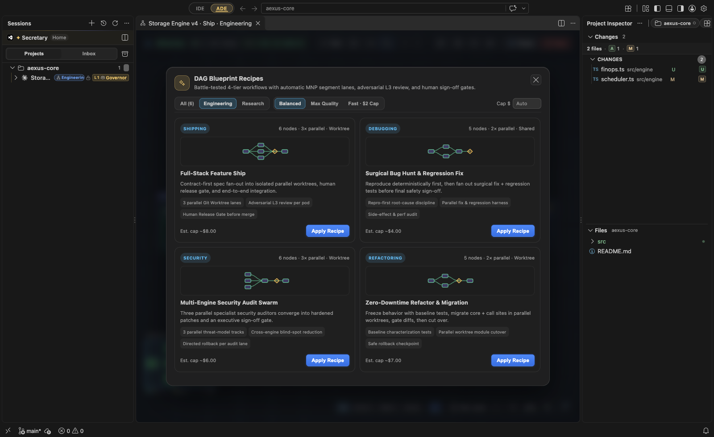
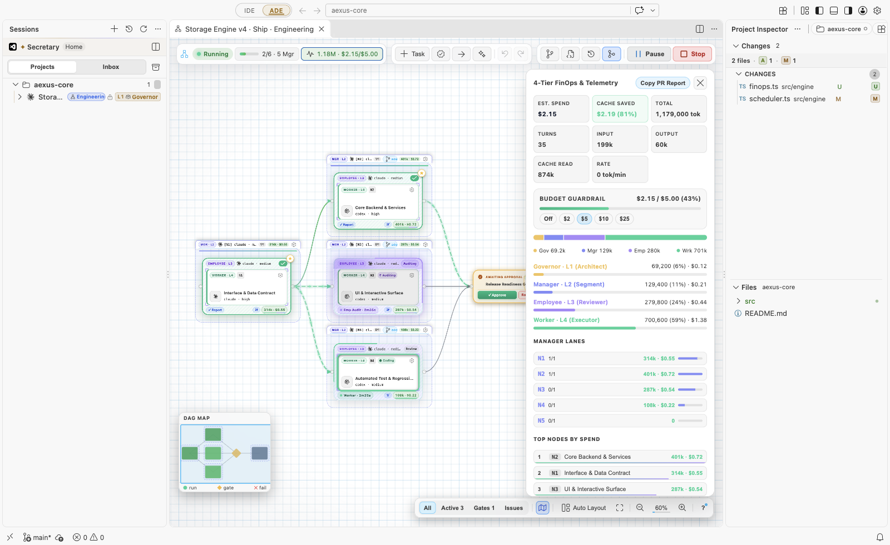
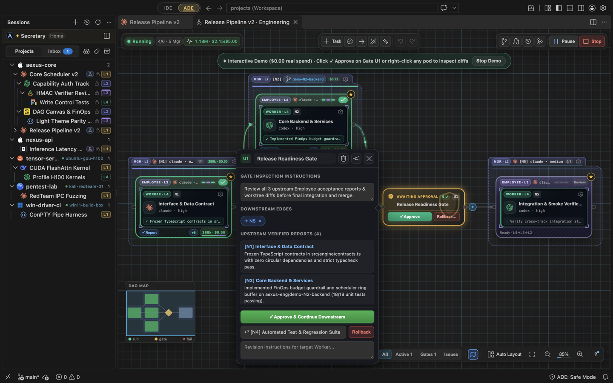
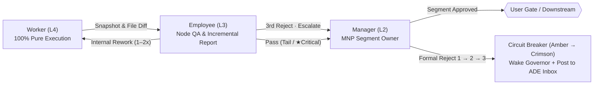

<p align="center">
  
</p>

<h1 align="center">Aexus Code</h1>

<p align="center">
  <strong>The Open-Source Organizational IDE &amp; Visual Multi-Agent Control Plane</strong><br/>
  8 Native BYO-CLI Coding Engines · 4-Tier Adversarial QA · Visual Engineering &amp; Research DAGs · 4-Tier Agent FinOps &amp; Budget Guardrails · Git Worktree Sandbox · Zero-Server SSH Cloud Hosts
</p>

<p align="center">
  <a href="LICENSE.txt"></a>
  
  
  
  
  
</p>

<p align="center">
  <strong>English</strong> · <a href="docs/README.zh-CN.md">简体中文</a> · <a href="examples/blueprints/README.md">Blueprint Recipes</a> · <a href="AEXUS.md">Architecture (AEXUS.md)</a> · <a href="CHANGELOG.md">Changelog</a> · <a href="CONTRIBUTING.md">Contributing</a>
</p>

---

<p align="center">
  
</p>

## Why Aexus Code?

Today's AI dev tools force an ugly trade-off:
- **AI IDEs** (Cursor, Windsurf) bolt a single-thread chat pane onto a closed-source editor — with vendor lock-in, opaque token spend, and zero real multi-agent governance when work fans out across parallel tracks.
- **External worktree launchers** (Vibe Kanban, Conductor, Superset) spawn headless terminal panes outside your editor — leaving you without live AST/LSP navigation, side-by-side Git diffs, debugger integration, or structured adversarial code review.
- **Standalone workflow studios** (LangGraph Studio, Dify, n8n) draw graphs detached from your repository, Git worktrees, and local coding CLIs.

**Aexus Code** creates a new category on top of open-source `Code - OSS`: **one native, MIT-licensed desktop workbench uniting a full-parity IDE (`IDE`) and an Organizational Agent Development Environment (`ADE`)** with:

1. **8 Native BYO-CLI Coding Agent Engines (Zero Lock-In)** — Orchestrate **Claude Code**, **Codex**, **Google Antigravity**, **Kilo Code**, **OpenCode**, **DeepSeek Harness**, **Cline**, and **Pi** side by side using your own CLIs and credentials, with zero mandatory cloud sign-in or bundled proprietary Copilot telemetry.
2. **4-Tier Organizational Hierarchy (`Employee [L3] ≠ Worker [L4]`)** — Strictly separates orchestration and adversarial QA (**`Governor L1 ➔ Manager L2 ➔ Employee L3`**) from **100% pure, unpolluted `Worker L4`** coding contexts so supervisory prompts never degrade implementation quality.
3. **Armored Nested Dual-Shell DAGs + 6 Built-In Blueprint Recipes** — Launch battle-tested parallel Engineering & Research DAGs in one click (`Full-Stack Feature Ship`, `Surgical Bug Hunt`, `Multi-Engine Security Audit Swarm`, `Zero-Downtime Refactor`, `Deep Research Lab`, `Architecture Teardown`), export/share `.aexus-blueprint.md` files, and inspect live execution on an interactive **Execution Gantt** & **DAG MAP**.
4. **4-Tier Agent FinOps, Cache Savings & Hard Budget Circuit Breaker** — Track real-time **`$USD` spend**, **prompt-cache dollar savings (`Cache Saved $`)**, and per-tier / per-lane / per-node cost across all 8 engines; enforce an optional **`max_budget_usd` ceiling** that automatically pauses execution and raises a critical `ADE Inbox` alert before runaway spend happens.
5. **Git Worktree Sandbox & 1-Click Merge Workbench + PR Verification Reports** — Isolate parallel `MGR · L2` lanes on dedicated Git worktree branches, merge or prune branches in one click right inside the studio, and export a **GitHub PR-ready Verification & FinOps Markdown Report** (`Copy PR Report` / `aexus-ade engineering report`) complete with live-status Mermaid DAG, cost table, and verified deliverables.
6. **Zero-Server SSH Cloud Hosts (`aexus-ssh://`) & `aexus-ade` Control Plane** — Manage Linux, macOS, and Windows SSH servers alongside local projects in **one window** with zero remote `vscode-server` daemon, diagnose your entire local multi-agent setup in one command with **`aexus-ade doctor`**, and script 100% of workbench actions over a local `0600` socket / authenticated Windows Named Pipe.

---

## How Aexus Code Compares

| Capability | **Aexus Code** | Cursor / Windsurf | Vibe Kanban / Paradev / Conductor | Cline / Roo Code | LangGraph Studio / Dify |
| :--- | :---: | :---: | :---: | :---: | :---: |
| **100% Open Source (MIT) & Zero Vendor Lock-In** | **Yes** | Closed-source | Partial / Wrapper | Yes (Extension) | Partial |
| **Full Native VS Code IDE Parity (LSP, Git, Debugger, ConPTY/PTY)** | **Yes (Mirror `ADE ⇄ IDE`)** | Yes | No (External wrapper) | Extension inside IDE | No |
| **Mix 8 Native BYO-CLI Coding Engines Side-by-Side** | **Yes (8 Engines)** | Own runtime only | CLI panes only | Single extension loop | LLM API nodes only |
| **Strict 4-Tier Adversarial QA (`Employee L3 ≠ Worker L4`)** | **Yes (Zero Worker pollution)** | Single agent / subagents | Manual user review | Sub-modes (shared loop) | Custom DIY code |
| **Visual Nested Dual-Shell DAG + Auto MNP Lanes + Directed Rollback Gates** | **Yes (Eng + Research)** | No | Kanban list only | No | Generic node graph |
| **Built-In Shareable DAG Blueprint Recipes (`.md` + Mermaid)** | **Yes (6 Recipes + Gallery)** | Rules files only | No | Modes JSON | Proprietary JSON/YAML |
| **4-Tier USD FinOps + Prompt-Cache `$` Savings + Hard Budget Breaker** | **Yes (Auto-pause + Inbox)** | Subscription credits | No | Per-chat cost only | Cloud paid add-on |
| **In-IDE Git Worktree Isolation + 1-Click Merge Workbench** | **Yes (Per-lane Worktrees)** | Basic background agent | Yes (No native IDE) | No | No |
| **Visual Execution Gantt + 1-Click GitHub PR Audit Report** | **Yes (UI + CLI)** | No | No | No | Trace logs only |
| **Zero-Server SSH Cloud Hosts (`aexus-ssh://`) + Live Path Picker** | **Yes (No remote daemon)** | Requires remote server | Local only | Depends on host IDE | No |
| **100% Scriptable Local Control Plane CLI + `doctor` Diagnostics** | **Yes (`aexus-ade`)** | No | Limited REST | No | Server API |
| **Cross-Platform Native Desktop (`macOS · Windows · Linux`)** | **Yes** | Yes | macOS-first / Web | Via host IDE | Web / Docker |

---

## Flagship Studio Highlights

### 1. 4-Tier FinOps, Budget Circuit Breaker & 6 Built-In Blueprint Recipes

Launch multi-agent workflows in seconds from the built-in **DAG Blueprint Recipes** gallery (or share `.aexus-blueprint.md` files from [`examples/blueprints/`](examples/blueprints/README.md)), monitor real-time dollar spend and prompt-cache savings across every tier (`Governor L1`, `Manager L2`, `Employee L3`, `Worker L4`), and lock hard dollar guardrails (`Off / $2 / $5 / $10 / $25` or custom `$`) that pause execution automatically before budgets are exceeded:

<table>
  <tr>
    <td width="50%">
      
      <p align="center"><sub><strong>6 Built-In DAG Blueprint Recipes with Live SVG Previews &amp; Engine Presets</strong></sub></p>
    </td>
    <td width="50%">
      
      <p align="center"><sub><strong>First-Class Dark Modern, Light Modern &amp; High Contrast Theme Parity</strong></sub></p>
    </td>
  </tr>
  <tr>
    <td width="50%">
      
      <p align="center"><sub><strong>Visual Execution Gantt Strip, Role-Filtered Logs &amp; 1-Click PR Audit Report</strong></sub></p>
    </td>
    <td width="50%">
      
      <p align="center"><sub><strong>Per-Lane Git Worktree Sandbox &amp; 1-Click Merge / Prune Workbench</strong></sub></p>
    </td>
  </tr>
</table>

| Built-In Recipe | Mode | Parallel Lanes | Default Isolation | Best For |
| :--- | :---: | :---: | :---: | :--- |
| **[`feature-ship`](examples/blueprints/feature-ship.md)** | Engineering | `3×` parallel | `worktree` | Contract-first full-stack feature delivery with isolated backend/UI/test tracks + Release Gate |
| **`bug-hunt-fix`** | Engineering | `2×` parallel | `shared` | Repro-first root-cause debugging + parallel fix & regression harness |
| **[`security-audit-swarm`](examples/blueprints/security-audit-swarm.md)** | Engineering | `3×` parallel | `worktree` | Cross-engine auth, injection & dependency audit converging into hardened patches |
| **[`safe-migration`](examples/blueprints/safe-migration.md)** | Engineering | `2×` parallel | `worktree` | Characterization-tested zero-downtime architecture refactor & cutover |
| **[`deep-research-lab`](examples/blueprints/deep-research-lab.md)** | Research | `3×` parallel | `shared` | Multi-track literature synthesis, benchmark verification & peer-reviewed findings |
| **`arch-teardown`** | Research | `2×` parallel | `shared` | Competitive & codebase architecture teardown into an actionable RFC |

---

### 2. Four-Tier Agent Organization & Live Diff Inspection (`Employee [L3] ≠ Worker [L4]`)

At the top of the ADE `Sessions` dispatch rail sits **`✦ Secretary`**, a viewport-aware global coordinator that perceives your active project, open editors, and full session hierarchy. Below it, each project organizes parallel multi-engine teams while the center workbench pairs rich agent sessions with live side-by-side Git diffs and the right-hand `Project Inspector` (`Changes` + `Files`):

<p align="center">
  
</p>

> [!IMPORTANT]
> **Architectural Invariant: `Employee (L3)` Is Never a `Worker (L4)`**
> - **`Governor [L1]`, `Manager [L2]`, and `Employee [L3]`** are formal orchestration and quality-assurance ranks. Upon creation, Aexus Code briefly locks input for a one-time role & `aexus-ade` API warmup so subsequent turns carry zero repeated system-prompt overhead. In Engineering workflows, `Employee (L3)` acts exclusively as a per-node code reviewer, test verifier, and incremental report author — **never editing business source files directly**.
> - **`Worker [L4]`** sits at the leaf of the hierarchy and is the **only 100% pure native coding tier**: no orchestration prompts are injected, no subordinate APIs are attached, and no nested sub-sessions can be spawned, preserving maximum reasoning capacity for code generation and debugging.

| Rank | Tier | Primary Responsibility | Control Plane Scope | Context Profile |
| :--- | :---: | :--- | :--- | :--- |
| **`✦ Secretary`** | Global Top | Perceives active viewport, projects & full session tree; assists across ADE | Full ADE control plane (never mutates IDE views) | Viewport + ADE API |
| **`Governor`** | `L1` | System decomposition, cross-segment `Manager` coordination & circuit-breaker triage | Full subordinate tree + `ADE Inbox` escalation | L1 Orchestration Warmup |
| **`Manager`** | `L2` | Owns a Maximal Non-Branching Path segment; handles escalations & critical sign-off | Segment scheduling + formal secondary verdicts | L2 Segment Warmup |
| **`Employee`** | `L3` | Dispatches & audits direct `Worker` output, inspects diffs & writes incremental reports | Direct `Worker` control + node pass/reject | L3 QA & Review Warmup |
| **`Worker`** | `L4` | Focused implementation, refactoring & test execution | **None (Leaf execution node)** | **100% Native Unpolluted** |

---

### 3. Armored Nested Dual-Shell Task Pods, Dual-Layer QA & Directed-Rollback Gates

Right-click any top-level `Governor` and select **`Engineering`** — or invoke **`Open ADE Research...`** — to promote ad-hoc prompting into a **deterministic, topology-locked DAG pipeline** (persisted cleanly under `~/.aexus-code/engineering/<governor-id>/` and `~/.aexus-code/research/<governor-id>/` with zero clutter in your Git repository):

<p align="center">
  
</p>

<table>
  <tr>
    <td width="50%">
      
      <p align="center"><sub><strong>Verified Acceptance Report, Touched Files &amp; Per-Role Telemetry</strong></sub></p>
    </td>
    <td width="50%">
      
      <p align="center"><sub><strong>Mix All 8 Native Engines, Models &amp; Thinking Effort Levels per Role</strong></sub></p>
    </td>
  </tr>
  <tr>
    <td width="50%">
      
      <p align="center"><sub><strong>User Gate Sign-off Card — Upstream Reports &amp; Directed Rollback</strong></sub></p>
    </td>
    <td width="50%">
      
      <p align="center"><sub><strong>ADE Inbox Actionable Gate Queue Synchronized with Live DAG</strong></sub></p>
    </td>
  </tr>
</table>

<p align="center">
  
</p>

- **Algorithmic Maximal Non-Branching Path (`MNP`) Partitioning**: Author nodes visually, load a built-in Recipe, or edit Markdown + Mermaid directly; Aexus Code automatically partitions linear segments between forks, joins, and `user_gate` boundaries into dedicated `MGR · L2` segment lanes (with live Git branch badges in worktree mode) and pre-builds the locked 4-tier sidebar hierarchy.
- **Armored Nested Dual-Shell Task Pods (`268×172`)**: Every task node is one cohesive pod — an outer **`EMPLOYEE · L3`** verification shell physically enclosing on all four sides a recessed inner **`WORKER · L4`** execution core, complete with verdict chips, live phase timers (`Worker · Ns` / `Emp Audit · Ns` / `Mgr Review · Ns`), touched-file badges, and per-pod token + `$USD` footer.
- **Canvas Spotlight Filters, Minimap, Snap Guides & Undo/Redo**: Focus large graphs in one click (`All | Active | Gates | Issues`) without unmounting pods, fly the camera via the floating **`DAG MAP`**, quick-spawn connected nodes via hover `+` (`Alt+Click` for a `User Gate`), and undo/redo every edit with `Cmd/Ctrl+Z`.
- **Dual-Layer Review Loop & 3-Stage Circuit Breaker**:
  - `Employee` internal rejections (attempts 1–2) iterate in-place on the existing `Worker` session; a 3rd rejection escalates to the segment `Manager`, who resets retry counters and grants a guided 4th attempt.
  - Segment-tail nodes and `★Critical` nodes require secondary formal sign-off from the segment `Manager`.
  - Formal `Manager` rejections progress visually from **Light Amber (`failure_1`) ➔ Deep Amber (`failure_2`) ➔ Crimson Circuit-Broken (`failure_3`)**, pausing the branch, waking the `Governor` for root-cause evaluation, and posting an actionable alert to **`ADE Inbox`**.
- **Directed-Rollback `User Gate` Shields with Inline Actions**: Milestone gates glow gold (`Review Gate`) with deduplicated upstream `Employee` reports and inline **`✓ Approve`** / **`Rollback…`** buttons — rolling back specific upstream nodes along directed path intersections **without resetting unrelated parallel branches**.



---

### 4. Zero-Server SSH Cloud Hosts & Live Interactive Path Picker (`aexus-ssh://`)

Connect local `file://` projects and multiple Linux, macOS, and Windows SSH Cloud Hosts (`aexus-ssh://<alias>/<path>`) inside **one unified window** over multiplexed OpenSSH (`ControlMaster`) — with **zero `vscode-server` installation required on remote machines**:

<p align="center">
  
</p>

<p align="center">
  
</p>

- **Automatic VS Code & `~/.ssh/config` Migration**: Recursively parses OpenSSH `Include` directives (honoring first-match-wins semantics) and imports host platforms (`linux` / `macos` / `windows`), `ProxyJump` bastions, and recent remote project directories from VS Code's `settings.json`, `state.vscdb`, `storage.json`, and `Project Manager` — without ever reading or copying private key contents.
- **Unified `+` Two-Step Host ➔ Live Path Auto-Popup Flow**: Pick `Local (This Computer)` or any saved/migrated Cloud Host, then drill into live auto-popped remote subfolders with 0ms `Backspace` parent-directory navigation (including Windows multi-drive `C:/`, `D:/` listing).
- **Native Remote File System, Git Diffs & Hybrid SSH Terminals**: Save remote files directly from Monaco (`Cmd/Ctrl+S`), inspect remote `HEAD` diffs, and open interactive SSH PTY terminals right beside local project shells.

---

### 5. IDE Mirror Symmetry: Full VS Code Parity + Clean Top Agent Bar & Project `Focus`

Flip the top mode switch to **`IDE`** for a fast, distraction-free coding workspace that stays 100% synchronized with ADE:

<p align="center">
  
</p>

- **Hybrid Local + Cloud SSH Explorer & Drag-to-Sort Ordering**: Browse and edit local `file://` folders and `aexus-ssh://` remote folders side by side; drag and drop siblings to customize file, folder, and project root display order without moving files on disk.
- **Project `Focus ➔ Home ⇄ Forward` Navigation**: Right-click any project root and choose **Focus** to isolate that project across Explorer and ADE; use **Home** and **Forward** to jump effortlessly between workspace overview and single-project focus.
- **Single-Icon Extension Bar & Explicit Project Binding**: The top-right bar lists installed user extensions and all 8 Coding Agents cleanly once each, while the right sidebar header displays and switches the exact project bound to the active Coding Agent.

---

## 8 Native Coding Agent Engines

Every engine runs locally via its native CLI/RPC protocol (`requiresCopilotSignIn: false`), unified by `extensions/aexus-agents` for session discovery, attachment, streaming chat, cancellation, permanent history deletion, live token/USD telemetry, and zero-latency role synchronization:

| Engine | Session Type | Default CLI | Native Protocol & Role Sync Mechanism |
| :--- | :--- | :--- | :--- |
| **Claude Code** | `aexus-claude` | `claude` | Bidirectional `stream-json` + dynamic role warmup + live turn token telemetry |
| **Codex** | `aexus-codex` | `codex` | `app-server` JSON-RPC with `thread/inject_items` role context sync |
| **Google Antigravity** | `aexus-antigravity` | `agy` | Local `--hub` ConnectRPC proxy (`StartCascade` / `SendUserCascadeMessage`) |
| **Kilo Code** | `aexus-kilo` | `kilo` | ACP runtime bridge + request-level role synchronization |
| **OpenCode** | `aexus-opencode` | `opencode` | Dual native UI panel + ACP session lifecycle integration |
| **DeepSeek Harness** | `aexus-dsh` | `dsh` | Zero-latency extension-host `dshRolePreload` synchronization |
| **Cline** | `aexus-cline` | `cline` | `--acp` streaming protocol & automated permission bridge |
| **Pi** | `aexus-pi` | `pi` | `--mode rpc` structured event stream & thinking progress |

---

## `aexus-ade` Control Plane CLI & `doctor` Diagnostics

Aexus Code exposes a local `0600` Unix socket (macOS/Linux: `~/.aexus-code/ade-control.sock`) or authenticated Windows Named Pipe (`\\.\pipe\aexus-ade-control-*`) and automatically injects `aexus-ade` into integrated terminals and orchestrated agent environments:

```bash
# 0. Diagnose all 8 coding CLIs, Git worktree readiness, SSH, control plane & repo rule files
aexus-ade doctor --project .

# 1. Inspect workbench state, switch mode & sync VS Code SSH Cloud Hosts
aexus-ade status --json
aexus-ade mode set ade
aexus-ade host import-vscode
aexus-ade project add gpu-h100-cluster:/workspace/tensor-serving

# 2. Spawn a 4-tier hierarchy and apply a built-in DAG Recipe with a $5 hard budget guardrail
GOV_ID=$(aexus-ade session create --project nexus-kv-engine --engine claude --role governor --title "Storage Lead" --no-open --json | jq -r .id)
aexus-ade engineering init --governor "$GOV_ID" --open
aexus-ade engineering template list
aexus-ade engineering template apply --governor "$GOV_ID" --template feature-ship --preset balanced --isolation worktree --max-budget-usd 5
aexus-ade engineering run --governor "$GOV_ID"

# 3. Approve a User Gate, merge isolated worktree branches & export a PR Verification Report
aexus-ade inbox list --unread-only
aexus-ade engineering gate --governor "$GOV_ID" --node U1 --verdict pass
aexus-ade engineering worktrees merge --governor "$GOV_ID"
aexus-ade engineering report --governor "$GOV_ID" --out ./pr-verification-report.md
```

| Command Group | Subcommands |
| :--- | :--- |
| `doctor` | `doctor [--project <path>] [--json]` *(works standalone without a running window)* |
| `status` / `mode` / `view` | `status` · `mode [get \| set <ade\|ide>]` · `view [--archived] [--inspector <changes\|files\|hide>] [--refresh]` |
| `project` | `list` · `add <path\|host:/path>` · `select` · `remove` · `delete` · `focus` · `home` · `forward` · `move` · `changes` · `files` · `open-file` · `open-diff` |
| `host` | `list` · `info` · `add` · `update` · `remove` · `test` · `browse` · `import-vscode` · `open` |
| `engine` | `list` · `sessions <engine> [--project <p>] [--limit <n>]` |
| `session` | `list` · `info` · `subordinates` · `tree` · `create` · `attach` · `connect` · `open` · `select` · `close` · `send [--wait]` · `history` · `mark-read` · `draft` · `reorder` · `rename` · `role` · `move` · `stop` · `archive` · `unarchive` · `detach` · `delete` |
| `secretary` | `status` · `open` · `engine` · `reset` · `send [--wait]` · `history` · `stop` · `draft` · `mark-read` |
| `engineering` | `list` · `init` · `open` · `template <list\|apply>` · `blueprint <get\|apply\|validate>` · `run` · `pause` · `resume` · `stop` · `reset` · `configure [--max-budget-usd <n> \| --clear-budget]` · `worktrees <merge\|cleanup>` · `report [--out <file>]` · `diff` · `reports` · `status` · `review` · `gate` · `watchdog-action` · `remove` |
| `inbox` | `list [--unread-only]` · `post` · `resolve` · `mark-read` |

---

## Building & Running from Source

### Prerequisites

- **Platforms**: **Cross-Platform** — **macOS (`arm64` / `x64`)**, **Windows 10/11 (`x64` / `arm64`)**, and **Linux (`x64` / `arm64`)**
- **Toolchain**:
  - **macOS / Linux**: `./scripts/aexus-env.sh` pins Node.js (`24.22.1`, matching `.nvmrc`) and `pnpm@12.16.0`, plus Xcode Command Line Tools / `build-essential`, Python 3, Rust (`1.88`), and OpenSSH.
  - **Windows**: `.\scripts\aexus-env.ps1` (or `.\scripts\aexus-env.cmd`) pins Node.js (`24.22.1`) and `pnpm@12.16.0`, plus Visual Studio 2022 C++ Build Tools (Desktop development with C++, Spectre-mitigated libraries, Windows 11 SDK), Python 3 (`setuptools`), Rust (`1.88`), Git (`core.longpaths=true`), and Windows OpenSSH.

### Quick Start (macOS / Linux)

```bash
# 1. Install dependencies & verify your local coding CLIs
./scripts/aexus-env.sh pnpm install
./extensions/aexus-agents/bin/aexus-ade doctor

# 2. Fast transpile build & launch from source (macOS & Linux)
./scripts/aexus-env.sh pnpm run build-fast
./scripts/aexus-env.sh ./scripts/code.sh

# 3a. Package standalone macOS arm64 application & install to /Applications/Aexus Code.app
./scripts/aexus-env.sh pnpm run gulp vscode-darwin-arm64
./scripts/aexus-install.sh

# 3b. Package standalone Linux application (outputs ../VSCode-linux-x64 or ../VSCode-linux-arm64)
./scripts/aexus-env.sh pnpm run gulp vscode-linux-x64
```

### Quick Start (Windows PowerShell)

```powershell
# 1. Install dependencies & compile native Win32 C++ modules
.\scripts\aexus-env.ps1 pnpm install
.\extensions\aexus-agents\bin\aexus-ade.ps1 doctor

# 2. Fast transpile build & launch from source
.\scripts\aexus-env.ps1 pnpm run build-fast
.\scripts\aexus-env.ps1 .\scripts\code.bat

# 3. Package standalone Windows x64 application & install to %LOCALAPPDATA%\Programs\Aexus Code
.\scripts\aexus-env.ps1 pnpm run gulp vscode-win32-x64
.\scripts\aexus-install.ps1
```

`.\scripts\aexus-install.ps1` stages and installs the packaged application cleanly to `%LOCALAPPDATA%\Programs\Aexus Code` (including across separate Windows drive volumes) and verifies all bundled CLI launchers: `bin\aexus-ade.cmd`, `bin\aexus-ade.ps1`, `bin\aexus-ade` (Git Bash / WSL), and `bin\aexus-code.cmd`.

**Full VS Code Feature Parity**: Across Windows, macOS, and Linux, Aexus Code retains the complete upstream VS Code feature set — Monaco editor core, IntelliSense/LSP, multi-root Explorer, ripgrep Search, Git Source Control & Diff Editor, Debugger, Tasks, Integrated Terminal (ConPTY on Windows, PTY on macOS/Linux), Extension Host, and Extension API — while cleanly isolating user settings (`~/Library/Application Support/Aexus Code` on macOS, `%APPDATA%\Aexus Code` on Windows, `~/.config/Aexus Code` on Linux) and extensions (`~/.aexus-code/extensions`). Only closed-source Microsoft proprietary plugins that self-restrict to official Microsoft builds are excluded.

---

## Repository Architecture

- [`src/vs/platform/ade/`](src/vs/platform/ade/) — Cross-process contracts & Node services (`adeControlServer`, `adeEngineeringService` with hybrid Markdown/Mermaid parser, `adePricing` 4-tier FinOps engine, `adeBlueprintTemplates` recipe catalog, `adeRunReport` PR audit generator, `adeCloudHostService` multiplexed SSH transport, and non-destructive `vscodeConfigMigration`).
- [`src/vs/workbench/contrib/ade/`](src/vs/workbench/contrib/ade/) — ADE workbench UI & orchestration services (`adeProjectsView` 4-tier session tree & `Inbox`, `adeEngineeringEditorPane` interactive Armored Nested Dual-Shell DAG canvas with FinOps, Recipes Gallery, Execution Gantt, Worktree Merge Workbench, Spotlight HUD & Minimap, `adeCloudHostsEditorPane`, `adeCloudHostFileSystemProvider`, and `adeInspectorViews`).
- [`src/vs/workbench/contrib/terminal/`](src/vs/workbench/contrib/terminal/) — `ProjectTerminalService` routing integrated terminals seamlessly between local project shells and remote SSH PTY sessions.
- [`extensions/aexus-agents/`](extensions/aexus-agents/) — Unified runtime adapters for all 8 native Coding Agent engines, zero-latency role bridges, and the `bin/aexus-ade` CLI (including standalone `doctor`).
- [`examples/blueprints/`](examples/blueprints/) — Ready-to-apply, round-trip validated Engineering & Research `.md` DAG blueprints.

---

## Community, Security & License

- **Contributing & Governance**: See [`CONTRIBUTING.md`](CONTRIBUTING.md) for architecture invariants, local testing commands, and PR guidelines, and [`CHANGELOG.md`](CHANGELOG.md) for release notes.
- **Security Policy & Local-First Privacy**: See [`SECURITY.md`](SECURITY.md). Orchestration runs strictly over a `0600` local Unix socket (macOS/Linux) or authenticated local Windows Named Pipe (`\\.\pipe\aexus-ade-control-*`) with per-launch token authentication. SSH Cloud Host migration reads only public host aliases and directory metadata — private key contents and passphrases are never copied or stored. Built-in upstream Copilot extensions, CLI shims, token/subscription endpoints, and proprietary agent backends are not bundled in this build.
- **Local Ad-Hoc macOS Signing**: Packaged builds are signed with a local ad-hoc signature for development and self-installation. Apple Developer ID signing and notarization are a separate step and are required before distributing the macOS application to third parties.
- **License & Attribution**: Derived from Microsoft [`Code - OSS`](https://github.com/microsoft/vscode) and released under the **[MIT License](LICENSE.txt)** with all upstream copyright notices preserved. See [AEXUS.md](AEXUS.md) for icon attribution and Visual Studio Marketplace compliance notes prior to commercial or public binary redistribution.
