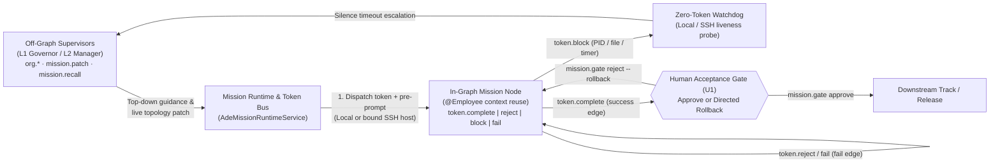
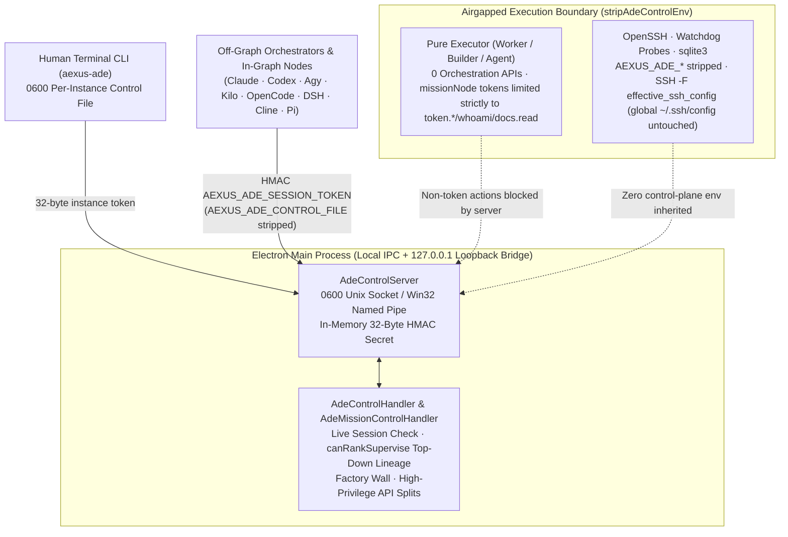
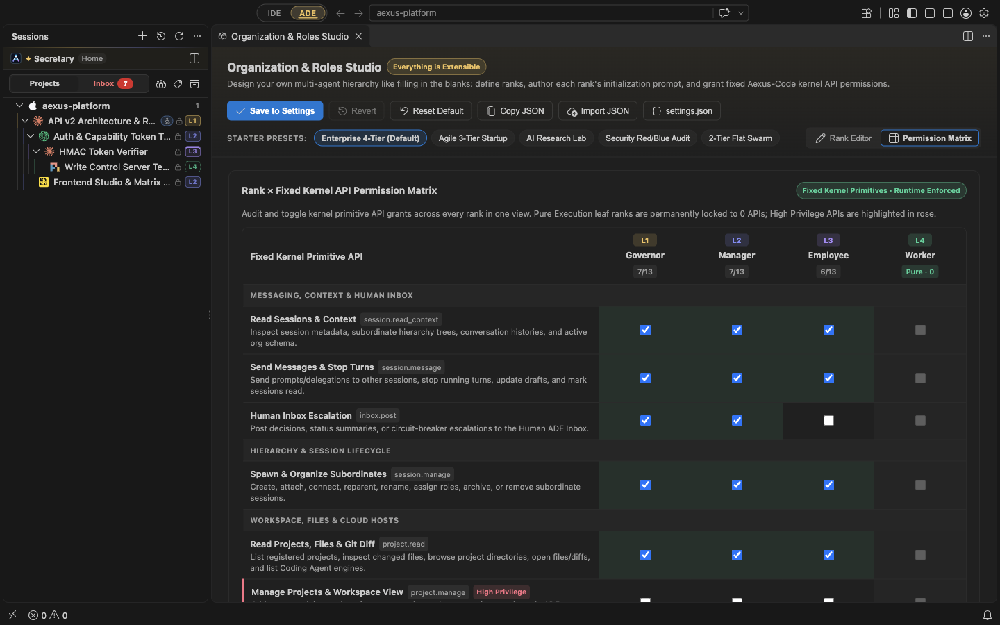

<p align="center">
  
</p>

<h1 align="center">Aexus Code</h1>

<p align="center">
  <strong>Open-Source Organizational IDE &amp; Visual Multi-Agent Control Plane</strong><br/>
  Extensible Multi-Tier Organizations · 8 Native BYO-CLI Coding Engines · Mission Mermaid DAG &amp; Token Bus Runtime · Server-Signed Capability Tokens · Zero-Server SSH Cloud Hosts
</p>

<p align="center">
  <a href="https://github.com/Daijunfan/Aexus-Code/actions/workflows/aexus-ci.yml"></a>
  <a href="https://github.com/Daijunfan/Aexus-Code/releases"></a>
  <a href="LICENSE.txt"></a>
  <a href="https://open-vsx.org/"></a>
  
  
</p>

<p align="center">
  <strong>English</strong> · <a href="docs/README.zh-CN.md">简体中文</a> · <a href="docs/ARCHITECTURE.md">Architecture</a> · <a href="docs/gallery.md">Visual Gallery</a> · <a href="examples/blueprints/README.md">Blueprint Recipes</a> · <a href="SECURITY.md">Security</a> · <a href="CHANGELOG.md">Changelog</a> · <a href="CONTRIBUTING.md">Contributing</a> · <a href="CODE_OF_CONDUCT.md">Code of Conduct</a>
</p>

---

> [!TIP]
> **Quick Start with the Mission Control Plane (`aexus-ade`) & Instant `ADE ⇄ IDE` Flip:**
> - **Diagnose Local Engines in 1 Command**: Run `aexus-ade doctor --project .` (works standalone without a running window) to inspect all 8 coding CLIs, Git, and OpenSSH.
> - **Launch a Visual Mission DAG**: Run `aexus-ade mission init --title "Feature Ship" --open`, apply any recipe via `aexus-ade mission blueprint apply --mission <id> --file ./examples/blueprints/feature-ship.md`, edit per-node pre-prompts directly on the canvas or in the split drawer, and click **Start** (or run `aexus-ade mission start --mission <id>`).
> - **Instant Mode Switch**: Press `Alt+Cmd+A` (`Alt+Ctrl+A`) anytime to flip between **`ADE`** (Agent Development Environment) and **`IDE`** (full-parity `Code - OSS` editor) without restarting terminals or language servers.

<p align="center">
  
  <br/>
  <sub><strong>Visual Multi-Tier Mission DAG Choreography:</strong> Parallel Fan-Out ➔ Token Bus Handoffs ➔ Human Release Gate <code>U1</code> Approval · <a href="docs/assets/demos/02-live-dag-choreography.mp4">▶ Watch Full HD MP4</a> · <a href="docs/gallery.md">Explore Full Visual Gallery →</a></sub>
</p>

---

## Why Aexus Code?

Most AI developer setups force you to choose between a closed-source single-agent editor, detached terminal wrappers outside your IDE, or cloud workflow builders disconnected from Git and local CLIs.

**Aexus Code** (`v1.1.0`) is a 100% open-source (**MIT**), local-first desktop workbench supercharged on `Code - OSS` (`1.146.0`) with [Open VSX](https://open-vsx.org/) VS Code extensions compatibility and zero bundled Copilot telemetry, unifying a full-parity **IDE (`IDE`)** and an extensible **Agent Development Environment (`ADE`)**:

1. **One Panel for Multi-Project, Multi-OS Workspaces (`macOS` · `Ubuntu` · `Kali` · `Windows`)** — Manage local `file://` repositories and zero-server `aexus-ssh://` cloud projects side-by-side in a single sidebar, ignoring path and OS differences, with crisp platform badges, Smart Calm hover-bloom pills, a 1-click full-badge toggle, and a pinned viewport-aware **`✦ Secretary`**.
2. **Simultaneous Local & Multi-Cloud Integrated Terminals** — Control your local macOS/Linux/Windows shell alongside multiple remote Linux, Kali, and Windows SSH cloud host terminals in split panes inside the same window — complete with per-OS terminal tab badges and zero `vscode-server` installation or `~/.ssh/config` mutation.
3. **8 Native BYO-CLI Coding Engines in One ADE Sidebar** — Orchestrate **Claude Code**, **Codex**, **Google Antigravity**, **Kilo Code**, **OpenCode**, **DeepSeek Harness**, **Cline**, and **Pi** locally or over SSH with official brand icons, your own subscriptions, proactive engine availability probing, visible **`ADE: Safe Mode`** / **`ADE: Autonomous`** status controls, and a rank-filtered **`ADE Inbox`**.
4. **Extensible Multi-Tier Organizations ("Everything is Extensible")** — Start from **5 presets** (`Enterprise 4-Tier`, `Agile 3-Tier Startup`, `AI Research Lab`, `Security Red/Blue Audit`, `2-Tier Flat Swarm`) or resize dynamically from `1..N` tiers: author `{{variables}}` prompt templates, configure the **Rank × Fixed Kernel API Permission Matrix**, and enforce server-signed HMAC capability tokens with single-copy tier docs (`docs/ranks/L0..LN.md`).
5. **Visual Mission DAG Runtime, Token Bus & Factory Wall** — Author pure Mermaid flowcharts with **`@Employee:` same-session context reuse**, synchronized **per-node pre-prompts** (canvas button + top-left split drawer backed by one Mission store), **vendor-categorized model & thinking pickers** (switchable at runtime while locking engine switches), **Factory Wall** off-graph/in-graph separation, **zero-token Watchdog liveness probes**, **atomic live `mission.patch`**, and **cron/interval/file source triggers**.
6. **Full-Parity Native VS Code IDE & Open VSX Extension Compatibility** — Press `Alt+Cmd+A` (`Alt+Ctrl+A`) to flip instantly between **`ADE`** and **`IDE`** with 100% native `Code - OSS` editing, Git diffs, debugging, terminals, decoupled right-sidebar **Plugins** + **Agent Engine** switchers, and live **Open VSX** marketplace compatibility.

---

## How the Mission Factory Wall, Token Bus & Capability Airgap Work

### Factory Wall & Token Bus Choreography

Every Mission enforces a clean **Factory Wall** (`offGraphMaxTier`) separating off-graph supervisors (`L1` Governor / `L2` Manager) from in-graph execution nodes (`token.*`):



### Local Control Plane & Pure-Worker Airgap Architecture

All agent orchestration flows through a main-process local IPC server (+ loopback TCP bridge) enforcing server-derived HMAC identity, strictly top-down subtree lineage (`canRankSupervise`), and airgapped subprocess scrubbing:



---

## Flagship Capabilities

### 1. Unified Multi-OS Multi-Project ADE Sidebar & Simultaneous Multi-Host Terminals

Manage local repositories and remote cloud projects across **macOS**, **Ubuntu**, **Kali Linux**, and **Windows** in one unified sidebar — and drive multiple local + cloud terminals side-by-side without juggling windows or installing remote daemons:

<table>
  <tr>
    <td width="50%">
      
      <p align="center"><sub><strong>One Panel, Multi-OS Projects &amp; 8-Engine ADE Command Center:</strong> Apple + Ubuntu + Kali + Windows projects, all 8 colorful engine icons, L1–L4 full badges, live Governor session &amp; Project Inspector.</sub></p>
    </td>
    <td width="50%">
      
      <p align="center"><sub><strong>Live ADE Agent Chat + Side-by-Side Git Diff:</strong> Multi-tier orchestration conversation right beside live code diffs and Smart Calm sidebar.</sub></p>
    </td>
  </tr>
  <tr>
    <td colspan="2">
      <p align="center">
        <br/>
        <sub><strong>Simultaneous Local &amp; Multi-Cloud OS Terminals in One Window:</strong> Split Ubuntu H100 GPU + Kali RedTeam shells running live alongside Apple, Ubuntu, Kali &amp; Windows terminal tabs.</sub>
      </p>
    </td>
  </tr>
</table>

- **Zero Path & OS Friction**: Mix local `file://` projects and zero-server `aexus-ssh://` hosts in the same tree with automatic platform icons (`macOS`, `Ubuntu`, `Kali`, `Windows`), pinned `✦ Secretary`, Smart Calm hover-bloom mode, and a **1-click full-badge toggle**.
- **All 8 Native Coding Engines Side-by-Side**: Visual brand icons differentiate **Claude Code**, **Codex**, **Antigravity**, **Kilo Code**, **OpenCode**, **DeepSeek Harness**, **Cline**, and **Pi** instantly across every tier and every host.

---

### 2. Organization & Roles Studio ("Everything is Extensible")

Define the exact multi-agent organization your team wants instead of being locked into one fixed hierarchy:

<p align="center">
  
  <br/>
  <sub><strong>Organization &amp; Roles Studio ("Everything is Extensible"):</strong> 5 starter presets, dynamic <code>1..N</code> rank tiers, interactive <code>Rank × Fixed Kernel API</code> matrix with <code>High Privilege</code> badges, permanent <code>Pure · 0</code> leaf executor isolation, and Smart Calm sidebar hierarchy.</sub>
</p>

| Starter Preset | Rank Ladder (Top → Leaf Pure Executor) | Structural Slot Mapping (`orch / seg / rev / exec`) |
| :--- | :--- | :--- |
| **`default-4tier`** *(Default)* | `Governor (L1)` → `Manager (L2)` → `Employee (L3)` → `Worker (L4 Pure)` | `governor / manager / employee / worker` |
| **`startup-3tier`** | `Tech Lead (L1)` → `Reviewer (L2)` → `Builder (L3 Pure)` | `tech-lead / tech-lead / reviewer / builder` |
| **`research-lab`** | `Principal Investigator (L1)` → `Research Lead (L2)` → `Peer Critic (L3)` → `Experimenter (L4 Pure)` | `governor / manager / employee / worker` |
| **`security-audit`** | `Audit Director (L1)` → `Lead Auditor (L2)` → `Verifier (L3)` → `Scanner (L4 Pure)` | `governor / manager / employee / worker` |
| **`flat-swarm`** | `Coordinator (L1)` → `Agent (L2 Pure)` | `coordinator / coordinator / coordinator / agent` |

- **Fill-in-the-Blank Custom Ranks & `{{variables}}` Prompt Templates**: Edit rank names, colors, icons, and dynamic prompt templates (`{{rank.name}}`, `{{rank.tier}}`, `{{project.name}}`, `{{supervisor.label}}`, `{{hierarchy.ladder}}`) inside a real dirty-tracked VS Code editor (`Cmd/Ctrl+S` save & revert, live session migration on rank ID rename), or hot-resize and hot-rename tiers via `aexus-ade rank set-count` / `rank rename`.
- **Rank × Fixed Kernel API Permission Matrix**: Toggle coarse-grained kernel APIs per rank (`session.read_context`, `session.message`, `session.manage`, `project.read`, `host.access`, `inbox.post`, `mission.read`, `mission.design`, plus separated high-privilege **`project.manage`**, **`host.manage`**, **`mission.control`**, and **`mission.destroy`**).
- **Lineage-Enforced Server-Signed Capability Tokens**: Every orchestrated agent receives an HMAC-SHA256 `AEXUS_ADE_SESSION_TOKEN` minted in main-process memory. On every call, `AdeControlHandler` validates live session state and enforces strictly top-down `canRankSupervise` + subtree ownership.
- **Zero-Warmup Inline Turn-1 Injection + Single-Copy Tier Docs**: Rank charters inject inline on Turn 1, re-inject automatically on prompt-hash change or context compaction, and link single-copy tier manuals (`docs/ranks/L0..LN.md` & `docs/mission/MISSION_API.md`).
- **Workspace Prompt-Injection Protection**: `aexus.ade.organization` is `application`-scoped and `restricted: true` — `.vscode/settings.json` inside cloned repositories cannot modify agent prompts or API grants.

---

### 3. Visual Mission DAG Canvas, Synchronized Pre-Prompts & 6 Blueprint Recipes

Author pure Mermaid flowcharts visually or via CLI (`aexus-ade mission ...`), assign hosts, engines, categorized models, thinking levels, and per-node pre-prompts, and orchestrate parallel local + SSH cloud tracks:

<table>
  <tr>
    <td width="50%">
      
      <p align="center"><sub><strong>Mission Parallel DAG Canvas:</strong> Armored Task Pods, draw.io orthogonal edge routing, context telemetry bars &amp; Human Gate <code>U1</code>.</sub></p>
    </td>
    <td width="50%">
      
      <p align="center"><sub><strong>Research Workflow DAG:</strong> Multi-track hypothesis probing, quantitative benchmarks &amp; peer methodology gates.</sub></p>
    </td>
  </tr>
</table>

- **Same-Employee Context Reuse (`@Employee:`)**: Reuse one continuous agent session across multiple DAG positions (`N1["@Architect: Spec"]` → … → `N5["@Architect: Verify"]`) with shared orthogonal context-reuse ribbons on hover.
- **Synchronized Per-Node Pre-Prompts**: Click the prompt icon on any node card or open the top-left File split drawer to inspect and edit pre-prompts — both surfaces and `aexus-ade mission prompt get|set` read/write the exact same Mission store.
- **Proactive Engine Availability & Vendor-Grouped Model Picker**: Opening a Mission automatically probes local and bound SSH hosts to disable unavailable agent engines upfront. Clicking a node's big center icon opens a vendor-grouped Model & Thinking selector (with case-insensitive auto-classification and persistent user recategorization), allowing live model changes during a run while locking engine swaps.
- **Zero-Token Watchdog, Live Topology Patching & Source Triggers**: Set per-Mission silence timeouts (`mission timeout`), inspect liveness without spending LLM tokens, recall/retry branches (`mission recall`, `mission retry`), atomically patch running DAGs (`mission patch`), and attach cron/interval/file triggers (`mission trigger set`).

<p align="center">
  <picture>
    <source media="(prefers-color-scheme: dark)" srcset="docs/assets/08-finops-budget-guardrails.png" />
    <source media="(prefers-color-scheme: light)" srcset="docs/assets/12-light-theme-finops.png" />
    
  </picture>
  <br/>
  <sub><strong>Adaptive Dark / Light Theme Parity:</strong> Clean contrast across Dark Modern, Light Modern, and High Contrast workbench themes.</sub>
</p>

| Curated Blueprint Recipe | Topology | Employee Context Reuse | Ideal Use Case |
| :--- | :--- | :--- | :--- |
| **[`feature-ship`](examples/blueprints/feature-ship.md)** | `N1 → (N2 ∥ N3 ∥ N4) → U1 → N5` | `@Architect`, `@Backend`, `@Frontend`, `@QA` | Contract-first full-stack delivery with backend/UI/test tracks + Release Gate |
| **[`bug-hunt-fix`](examples/blueprints/bug-hunt-fix.md)** | `N1 → (N2 ∥ N3) → N4 → U1` | `@Debugger`, `@QA`, `@Auditor` | Repro-first root-cause debugging + surgical fix & regression suite |
| **[`security-audit-swarm`](examples/blueprints/security-audit-swarm.md)** | `(N1 ∥ N2 ∥ N3) → N4 → U1 → N5` | `@AuthAudit`, `@IpcAudit`, `@SupplyAudit`, `@Hardening` | Multi-engine auth, IPC & supply-chain audit converging into hardened patches |
| **[`safe-migration`](examples/blueprints/safe-migration.md)** | `N1 → (N2 ∥ N3) → U1 → N4` | `@Architect`, `@CoreDev`, `@CallerDev` | Characterization-tested refactor with rollback gate & legacy cleanup |
| **[`deep-research-lab`](examples/blueprints/deep-research-lab.md)** | `R1 → (R2 ∥ R3 ∥ R4) → U1 → R5` | `@PI`, `@TrackA`, `@TrackB`, `@Bench` | Multi-track hypothesis probing, quantitative benchmarks & peer-reviewed synthesis |
| **[`arch-teardown`](examples/blueprints/arch-teardown.md)** | `R1 → (R2 ∥ R3) → R4 → U1` | `@Systems`, `@UX`, `@Architect` | Parallel systems + UX teardown converging into an Engineering RFC |

---

### 4. Smart Calm Sidebar & Rank-Filtered Inbox

<table>
  <tr>
    <td width="50%">
      
      <p align="center"><sub><strong>Rank-Filtered <code>ADE Inbox</code> &amp; Fill-in-the-Blank Rank Prompt Editor</strong></sub></p>
    </td>
    <td width="50%">
      
      <p align="center"><sub><strong>Multi-Track Diff &amp; Review Surface</strong></sub></p>
    </td>
  </tr>
</table>

- **Smart Calm Sidebar**: Session rows default to compact hover-bloom rank/engine indicators with non-clipping badges, paired with a **1-click full-badge toggle** when you want every rank and status pill visible simultaneously, plus the pinned viewport-aware **`✦ Secretary`** (`/mission`, `/status`, `/sessions`, `/projects`).
- **Rank-Filtered `ADE Inbox`**: Unified escalation and gate queue with schema-driven **per-rank filter pills** (`All | Governor | Manager | Employee` or `All | Tech Lead | Reviewer` — automatically hiding `0`-API pure executor ranks when empty), synced directly with Mission gates.

---

### 5. Supercharged VS Code IDE (`ADE ⇄ IDE`), Full Extensions Compatibility & Zero-Server SSH Cloud Hosts

Aexus Code keeps 100% of native `Code - OSS` IDE ergonomics intact — Explorer, split editors, side-by-side diffs, multi-OS terminals, decoupled **Plugins** & **Agent Engine** header buttons, and live **[Open VSX](https://open-vsx.org/)** compatibility — while adding a Zero-Server SSH Cloud Host Studio:

<table>
  <tr>
    <td width="50%">
      
      <p align="center"><sub><strong>Instant <code>ADE ⇄ IDE</code> Mirror Symmetry (<code>Alt+Cmd+A</code>):</strong> Full native VS Code Explorer, split diff &amp; live multi-OS terminals.</sub></p>
    </td>
    <td width="50%">
      
      <p align="center"><sub><strong>Full VS Code Extensions Ecosystem (Open VSX):</strong> Install <code>Python Debugger</code>, <code>Claude Code</code>, <code>Python</code>, <code>Java</code>, <code>Ruby LSP</code> &amp; thousands more.</sub></p>
    </td>
  </tr>
</table>

<p align="center">
  
  <br/>
  <sub><strong>Zero-Server SSH Cloud Host Studio:</strong> Manage Kali Linux (with ProxyJump), macOS, Ubuntu GPU &amp; Windows SSH hosts in one console without installing <code>vscode-server</code> or mutating <code>~/.ssh/config</code>.</sub>
</p>

- **Zero Remote Daemon**: Edit remote files, view Git `HEAD` diffs, discover & attach remote Claude Code / Codex / OpenCode sessions, bind Mission DAG nodes to cloud hosts (`mission host bind`), and open remote SSH PTY terminals right beside local folders with **no `vscode-server` installed on remote hosts**.
- **Non-Destructive `~/.ssh/config` Guarantee**: `syncUserSshDir` defaults to **`false`** — Aexus Code passes `-F <userDataDir>/ssh/effective_ssh_config` exclusively to its own SSH sessions/terminals and **never prepends `Include` or modifies your global `~/.ssh/config`**.
- **OpenSSH Transport**: Uses **OpenSSH `ControlMaster` multiplexing on macOS/Linux** and **direct OpenSSH on Windows**. Background filesystem, Git, and probe operations run with **`BatchMode=yes`**, requiring key-based / `ssh-agent` authentication (private keys are never read or copied).
- **Non-Destructive VS Code Migration**: Imports `~/.ssh/config` (including recursive `Include` directives) and VS Code remote host/directory history via `aexus-ade host import-vscode` (read-only import).
- **More Screenshots & Motion Clips**: See [`docs/gallery.md`](docs/gallery.md) for the complete visual tour and 5 HD MP4 clips.

---

## 8 Native Coding Agent Engines

All 8 engines run locally (or over SSH) via your own installed CLIs and credentials (`requiresCopilotSignIn: false`), sharing centralized child-environment isolation (`runtime.ts`), public upstream default model catalogs (plus dynamic discovery from your local CLI configs), and zero-warmup Turn-1 role synchronization (`extension.ts`):

| Engine | Session Type | Default CLI | Native Transport & Safe Default Mode |
| :--- | :--- | :--- | :--- |
| **Claude Code** | `aexus-claude` | `claude` | Bidirectional `stream-json` · default `acceptEdits` · live token telemetry & compaction reset |
| **Codex** | `aexus-codex` | `codex` | `app-server` JSON-RPC (`thread/inject_items`) · default `workspace-write` + `on-request` |
| **Google Antigravity** | `aexus-antigravity` | `agy` | Local `--hub` ConnectRPC bridge · default `ask` |
| **Kilo Code** | `aexus-kilo` | `kilo` | ACP runtime bridge · default `ask` |
| **OpenCode** | `aexus-opencode` | `opencode` | Native panel + ACP lifecycle · default `ask` |
| **DeepSeek Harness** | `aexus-dsh` | `dsh` | Native runtime adapter + opt-out role bridge · default `ask` |
| **Cline** | `aexus-cline` | `cline` | `--acp` streaming protocol · default `ask` |
| **Pi** | `aexus-pi` | `pi` | `--mode rpc` structured event stream & thinking progress · default safe mode |

> [!NOTE]
> - **Safe Mode vs Autonomous Execution**: A live Status Bar pill (**`ADE: Safe Mode`** vs **`ADE: Autonomous`**) and Command Palette command (**`Aexus ADE: Toggle Safe / Autonomous Permission Mode`**) make permission posture visible at all times.
> - **Third-Party Extension Role Bridge Opt-Out**: Transparently documented in [`SECURITY.md`](SECURITY.md) and disabled anytime via `aexus.ade.nativeExtensionRoleBridge.enabled: false` or `AEXUS_ADE_DISABLE_NATIVE_ROLE_BRIDGE=1`.

---

## `aexus-ade` Local Control Plane CLI

Aexus Code listens on a per-instance `0600` local Unix socket (`~/.aexus-code/ade-control.<pid>.sock` on macOS/Linux) or a local Windows Named Pipe (`\\.\pipe\aexus-ade-control-*`) plus a `127.0.0.1` loopback TCP bridge, authenticated by a **per-instance 32-byte token** (human CLI) or **server-signed per-session HMAC capability token** (`AEXUS_ADE_SESSION_TOKEN` for orchestrated agents):

```bash
# 0. Diagnose all 8 CLIs, Git & OpenSSH (v1.1.0, schemaVersion: 1 JSON, exits 1/2 on fail/strict)
aexus-ade --version
aexus-ade doctor --project . --json
eval "$(aexus-ade completion zsh)"   # also supports bash | fish | powershell

# 1. Inspect or customize organization presets, dynamic ranks & API docs
aexus-ade role list --json
aexus-ade role apply-preset startup-3tier
aexus-ade rank names --json
aexus-ade docs read mission

# 2. Initialize a Mission, apply a curated Mermaid blueprint, set pre-prompts & start
GOV_ID=$(aexus-ade session create --project . --engine claude --role governor --title "Release Lead" --no-open --json | jq -r .id)
MISSION_ID=$(aexus-ade mission init --governor "$GOV_ID" --title "Feature Ship" --open --json | jq -r .id)
aexus-ade mission blueprint validate --file ./examples/blueprints/feature-ship.md
aexus-ade mission blueprint apply --mission "$MISSION_ID" --file ./examples/blueprints/feature-ship.md
aexus-ade mission prompt set --mission "$MISSION_ID" --node N1 --text "Define shared TypeScript contracts and ownership boundaries."
aexus-ade mission start --mission "$MISSION_ID" --timeout 15

# 3. Monitor runtime status, inspect inbox escalations & approve a human gate
aexus-ade mission status --mission "$MISSION_ID" --json
aexus-ade inbox list --unread-only
aexus-ade mission gate approve --mission "$MISSION_ID" --node U1 --note "All tracks verified"
```

| Command Group | Subcommands |
| :--- | :--- |
| `doctor` / `completion` | `doctor [--project <path>] [--strict] [--json]` *(emits `schemaVersion: 1` & `aexusVersion`)* · `completion <bash\|zsh\|fish\|powershell>` · `--version` *(standalone without a running window)* |
| `whoami` / `docs` / `api` | `whoami [--json]` · `docs read <L0..LN\|common\|mission>` · `api update [--since <v>] [--scope <s\|all>]` |
| `role` *(alias `roles`)* | `list [--json]` / `schema` · `apis` / `primitives` · `presets [--json]` · `preset <id>` / `apply-preset <id>` · `set-tier <sessionId> <rankId>` · `reset` · `studio [rankId]` |
| `rank` *(alias `ranks`)* | `list` · `names` · `get <tier\|alias>` · `docs [tier]` · `rename <tier\|alias> <newName>` · `set-count <n>` · `mission-name <name>` |
| `status` / `mode` / `view` | `status [--json]` · `mode [get \| set <ade\|ide>]` · `view [--archived] [--inspector <changes\|files\|hide>] [--refresh]` |
| `project` | `list` · `add <path\|host:/path>` · `select` · `remove` · `delete` · `focus` · `home` · `forward` · `move` · `changes` · `files` · `open-file` · `open-diff` |
| `host` *(alias `cloud-host`)* | `list` · `info` · `add` · `update` · `remove` · `test` · `browse` · `import-vscode` · `open` |
| `engine` | `list` · `sessions <engine> [--project <p>] [--limit <n>]` |
| `session` | `list` · `info` · `subordinates` · `tree` · `create` · `attach` · `connect` · `open` · `select` · `close` · `send [--wait]` · `history` · `mark-read` · `draft` · `reorder` · `rename` · `role` · `configure` · `move` · `stop` · `archive` · `unarchive` · `detach` · `delete` |
| `secretary` | `status` · `open` · `engine` · `reset` · `send [--wait]` · `history` · `stop` · `draft` · `mark-read` |
| `mission` | `list` · `init` · `open` · `docs` · `rename` · `blueprint <get\|apply\|validate>` · `prompt <list\|get\|set\|clear>` · `start` / `run` · `pause` · `resume` · `stop` · `status` · `timeout` · `boundary <get\|set>` · `recall` · `retry` · `patch` · `gate <approve\|reject>` · `trigger <list\|set\|remove>` · `host bind` · `remove` |
| `token` | `current` · `trace <ptr>` · `complete <id>` · `reject <id>` · `block <id>` · `fail <id>` |
| `org` | `subordinates` · `send <target> <msg>` · `context <target>` · `escalate` |
| `inbox` | `list [--unread-only]` · `post` · `resolve` · `mark-read` |

---

## How Aexus Code Fits in the Ecosystem

Different tools optimize for different workflows. Here is an honest architectural comparison of design trade-offs rather than a blanket "better/worse" claim:

| Architectural Dimension | **Aexus Code** | Proprietary AI IDEs *(e.g. Cursor, Windsurf)* | External Launchers *(e.g. Vibe Kanban, Conductor)* | In-IDE Agent Extensions *(e.g. Cline, Roo Code)* | Workflow Graph Studios *(e.g. LangGraph Studio, Dify)* |
| :--- | :---: | :---: | :---: | :---: | :---: |
| **License & Extension Registry** | MIT · [Open VSX](https://open-vsx.org/) | Closed-source | Mixed OSS / commercial | Open-source extension | Mixed OSS / hosted |
| **Native Desktop IDE Core** | Full `Code - OSS` (`ADE ⇄ IDE`) | Full proprietary VS Code fork | External launcher around editors/terminals | Runs inside host IDE | Standalone web / server UI |
| **Multi-Engine BYO-CLI Orchestration** | 8 native local/SSH CLIs side by side | Primarily own managed runtime | Launches external CLI panes | Single extension runtime (multi-LLM APIs) | API / SDK graph nodes |
| **Extensible Org Roles & Kernel API Matrix** | Custom `1..N` ranks + Factory Wall + lineage HMAC tokens | Fixed agent / subagent modes | Manual task assignment | Custom mode prompts | Code-defined graph roles |
| **Visual Mission DAG + Token Bus + Context Reuse** | Built-in Mermaid DAG, `@Employee:` context reuse, synchronized pre-prompts, Watchdog | Background agents (no visual DAG) | Kanban boards (no native diff/LSP) | Sequential / mode loops | Generic graphs (detached from local CLIs) |
| **Zero-Server SSH Multi-Root (`aexus-ssh://`)** | OpenSSH (no remote daemon, `~/.ssh/config` untouched) | Remote server extension | Local-first | Depends on host IDE | Server-hosted |

---

## Quick Start: Download Binary or Build from Source

### Option A — Prebuilt Binary Release (`v1.1.0`, ~60 Seconds)

Download prebuilt archives and `SHA256SUMS.txt` directly from **[GitHub Releases](https://github.com/Daijunfan/Aexus-Code/releases)** (built by [`.github/workflows/release.yml`](.github/workflows/release.yml)):

- **macOS (`arm64` Apple Silicon / `x64` Intel)**: `Aexus-Code-v1.1.0-darwin-*.dmg` or `.zip`
  - *Signing note*: Builds without an Apple Developer ID certificate use an ad-hoc signature. On first launch run `xattr -dr com.apple.quarantine "/Applications/Aexus Code.app"` or open via Finder → Right-Click → Open.
- **Linux (`x64`)**: `Aexus-Code-v1.1.0-linux-x64.tar.gz` *(extracts cleanly to `Aexus-Code-linux-x64/`)*
- **Windows (`x64`)**: `Aexus-Code-v1.1.0-win32-x64.zip`

Launch the app, press `Alt+Cmd+A` (`Alt+Ctrl+A`) to explore `ADE ⇄ IDE`, open a project, and initialize your first visual Mission DAG.

> **Extension Marketplace Note**: Aexus Code ships pre-configured with the open-source **[Open VSX Registry](https://open-vsx.org/)** (`open-vsx.org/vscode/gallery`) — matching VSCodium's open-source compliance model — and supports local `.vsix` installs. Closed-source Microsoft extensions restricted to official Microsoft VS Code builds are excluded.

### Option B — Build from Source (~15 min first build)

Compiling a full `Code - OSS` desktop workbench takes ~15 minutes and ~8–12 GB disk on a fresh checkout. *(Just contributing to an engine adapter or `aexus-ade` CLI? Use our **[30-Second Engine Adapter Fast-Path](CONTRIBUTING.md#30-second-engine-adapter-contributor-fast-path)** — no full IDE build needed!)*

#### Prerequisites
- **Node.js `24.22.1`** (matching [`.nvmrc`](.nvmrc)) and **`pnpm@12.16.0`** (e.g. via `nvm`/`fnm`/`mise` + `corepack enable && corepack prepare pnpm@12.16.0 --activate`).
  - `./scripts/aexus-env.sh` (macOS/Linux) and `.\scripts\aexus-env.ps1` (Windows) automatically prepend an optional repo-local `.build/toolchain` if present, validate your active Node version against `.nvmrc`, and set proxy/environment hygiene — they do **not** download Node automatically.
- **Native build tools**: Xcode Command Line Tools (`macOS`), `build-essential` + X11/libsecret dev headers (`Linux`), or Visual Studio 2022 C++ Build Tools + Windows 11 SDK (`Windows`), plus Python 3, Git, and OpenSSH.

#### Source Build (macOS / Linux)

```bash
# 1. Install dependencies & fast-transpile core + extensions/aexus-agents
./scripts/aexus-env.sh pnpm install
./scripts/aexus-env.sh pnpm run build-fast

# 2. Verify local coding CLIs, Git & OpenSSH
#    (Tip: before build-fast, run: node --experimental-strip-types extensions/aexus-agents/src/adeCli.ts doctor)
./extensions/aexus-agents/bin/aexus-ade doctor

# 3. Launch from source
./scripts/aexus-env.sh ./scripts/code.sh

# 4a. Package & install on macOS (auto-detects arm64 or x64; override with AEXUS_ARCH=x64)
ARCH=$(uname -m | sed 's/x86_64/x64/')
./scripts/aexus-env.sh pnpm run gulp "vscode-darwin-${ARCH}"
./scripts/aexus-install.sh   # optional local signing/keychain helper; falls back cleanly to ad-hoc signing

# 4b. Package standalone Linux build (gulp outputs ../VSCode-linux-x64; release.yml renames to Aexus-Code-linux-x64)
./scripts/aexus-env.sh pnpm run gulp vscode-linux-x64
```

#### Source Build (Windows PowerShell)

```powershell
# 1. Install dependencies & fast-transpile
.\scripts\aexus-env.ps1 pnpm install
.\scripts\aexus-env.ps1 pnpm run build-fast

# 2. Verify local coding CLIs, Git & OpenSSH
.\extensions\aexus-agents\bin\aexus-ade.ps1 doctor

# 3. Launch from source
.\scripts\aexus-env.ps1 .\scripts\code.bat

# 4. Package & install to %LOCALAPPDATA%\Programs\Aexus Code
.\scripts\aexus-env.ps1 pnpm run gulp vscode-win32-x64
.\scripts\aexus-install.ps1
```

---

## Honest Limitations & Non-Goals

We prefer telling engineers the exact rough edges upfront:

- **Building from source is heavy**: Because Aexus Code is a full `Code - OSS` Electron fork, a source checkout + `node_modules` + build output takes ~8–12 GB and ~15 minutes on first build. Use prebuilt GitHub Releases when you just want to try the app, or the 30-second adapter fast-path in [`CONTRIBUTING.md`](CONTRIBUTING.md) when hacking on CLI engines.
- **macOS release signing**: Until an Apple Developer ID signing/notarization secret is wired into CI, macOS release artifacts are ad-hoc signed and require clearing Gatekeeper quarantine on first launch.
- **SSH Transport Requirements**: `aexus-ssh://` runs `BatchMode=yes` over OpenSSH (requiring key/`ssh-agent` auth), and Windows lacks Unix-socket `ControlMaster` multiplexing so remote FS latency is higher on Windows clients than on macOS/Linux.
- **Non-Goals**: Aexus Code does not run a hosted SaaS cloud IDE, does not proxy or resell LLM API tokens, and does not bundle Microsoft's proprietary Copilot or Visual Studio Marketplace.

---

## Community, Security & License

- **Architecture & Contributing**: Read [`docs/ARCHITECTURE.md`](docs/ARCHITECTURE.md), [`CONTRIBUTING.md`](CONTRIBUTING.md), and [`CHANGELOG.md`](CHANGELOG.md).
- **Security Policy & Threat Model**: Read [`SECURITY.md`](SECURITY.md) for full details on Safe vs Autonomous mode, Factory Wall & lineage-scoped HMAC capability tokens, scrubbed subprocess execution, non-destructive SSH config (`syncUserSshDir: false`), and opting out of third-party extension role bridging.
- **License & Attribution**: Derived from Microsoft [`Code - OSS`](https://github.com/microsoft/vscode) under the **[MIT License](LICENSE.txt)** with all upstream copyright notices preserved, using the open-source [Open VSX Registry](https://open-vsx.org/). Microsoft and Visual Studio Code are trademarks of Microsoft Corporation.
