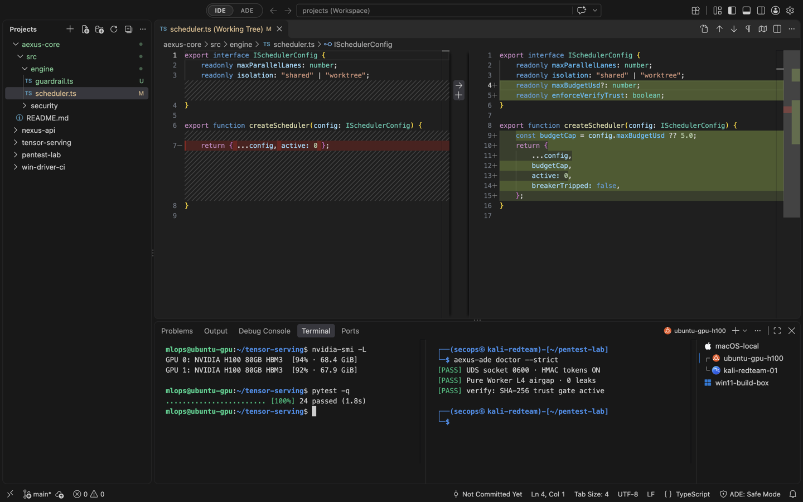

<p align="center">
  
</p>

<h1 align="center">Aexus Code</h1>

<p align="center">
  <strong>Open-Source Organizational IDE &amp; Visual Multi-Agent Control Plane</strong><br/>
  Extensible Multi-Tier Organizations · 8 Native BYO-CLI Coding Engines · Deterministic Engineering &amp; Research DAGs · Server-Signed Capability Tokens · Git Worktree Sandbox · Zero-Server SSH Cloud Hosts
</p>

<p align="center">
  <a href="https://github.com/Daijunfan/Aexus-Code/actions/workflows/aexus-ci.yml"></a>
  <a href="https://github.com/Daijunfan/Aexus-Code/releases"></a>
  <a href="LICENSE.txt"></a>
  <a href="https://open-vsx.org/"></a>
  
  
</p>

<p align="center">
  <strong>English</strong> · <a href="docs/README.zh-CN.md">简体中文</a> · <a href="docs/ARCHITECTURE.md">Architecture</a> · <a href="docs/gallery.md">Visual Gallery</a> · <a href="examples/blueprints/README.md">Blueprint Recipes</a> · <a href="SECURITY.md">Security</a> · <a href="CHANGELOG.md">Changelog</a> · <a href="CONTRIBUTING.md">Contributing</a> · <a href="CODE_OF_CONDUCT.md">Code of Conduct</a>
</p>

---

> [!TIP]
> **Try It in 10 Seconds Without Spending a Cent (`$0.00` Simulated Demo) — or Scaffold a DAG in `<50ms`:**
> - **Simulated 0-Token Interactive Demo (`$0.00` spend, zero file edits)**: Press `Cmd/Ctrl+Shift+P` → **`Aexus ADE: Try Interactive Engineering DAG Demo (0 Tokens)`** (or run `aexus-ade engineering demo`) to preview the multi-tier choreography, approve Gate `U1`, and export a **Vector SVG** + **GitHub PR Verification Report**.
> - **Prompt-to-DAG (`Cmd/Ctrl+K`)**: Press `Cmd/Ctrl+K` on any canvas for **deterministic keyword-to-DAG scaffolding in `<50ms`** (matching your goal to parallel lanes and gates, ready to edit visually or refine with your Governor LLM).
> - **Instant Mode Switch**: Press `Alt+Cmd+A` (`Alt+Ctrl+A`) anytime to flip between **`ADE`** (Agent Development Environment) and **`IDE`** (full-parity `Code - OSS` editor) without restarting terminals or language servers.

<p align="center">
  
  <br/>
  <sub><strong>Simulated 0-Token Interactive Demo (<code>$0.00</code> spend, deterministic choreography preview):</strong> 3× Parallel Worktree Fan-Out ➔ Rework ➔ Release Gate <code>U1</code> Approval ➔ 4-Tier FinOps · <a href="docs/assets/demos/02-live-dag-choreography.mp4">▶ Watch Full HD MP4</a> · <a href="docs/gallery.md">Explore Full Visual Gallery →</a></sub>
</p>

---

## Why Aexus Code?

Most AI developer setups force you to choose between a closed-source single-agent editor, detached terminal wrappers outside your IDE, or cloud workflow builders disconnected from Git and local CLIs.

**Aexus Code** is a 100% open-source (**MIT**), local-first desktop workbench built on `Code - OSS` (`1.146.0`) with [Open VSX](https://open-vsx.org/) extensions and zero bundled Copilot telemetry, combining a full-parity **IDE (`IDE`)** and an extensible **Agent Development Environment (`ADE`)**:

1. **Organization & Roles Studio ("Everything is Extensible")** — Start from **5 presets** (`Enterprise 4-Tier`, `Agile 3-Tier Startup`, `AI Research Lab`, `Security Red/Blue Audit`, `2-Tier Flat Swarm`) or author custom ranks with `{{variables}}` prompt templates, an interactive **Rank × Fixed Kernel API Permission Matrix**, and server-signed HMAC capability tokens (`AEXUS_ADE_SESSION_TOKEN`) across all 8 engines.
2. **8 Native BYO-CLI Coding Engines (Safe by Default)** — Orchestrate **Claude Code**, **Codex**, **Google Antigravity**, **Kilo Code**, **OpenCode**, **DeepSeek Harness**, **Cline**, and **Pi** locally with your own CLIs and subscriptions. Interactive sessions start in each engine's safe approval mode; autonomous mode is an explicit opt-in (`aexus.ade.autonomousMode`).
3. **Deterministic Engineering & Research DAGs** — Run parallel worktrees or file-scoped lanes with **SHA-256 hash-pinned `verify:` pre-review checks**, **`files:` scope serialization**, **`max_concurrency` + critical-path scheduling**, **branch-isolated RED circuit breakers**, **Git-native cumulative diffs**, and a **2-stage zero-token-first Watchdog**.
4. **4-Tier FinOps, Configurable Pricing & Budget Guardrails** — Track real-time estimated `$USD` spend (preferring engine-reported costs when present), prompt-cache savings, custom rate cards (`aexus.ade.pricing`), and **Subscription (`$0` marginal)** mode — backed by **pre-dispatch budget admission + post-turn ceiling pauses that stop active agents cleanly**.
5. **Smart Calm Sidebar, Rank-Filtered Inbox & Zero-Server SSH Cloud Hosts** — Keep large multi-agent trees legible with compact hover-bloom badges, triage alerts with dynamic per-rank Inbox filter pills, and mix local `file://` folders with `aexus-ssh://` Linux/macOS/Windows servers in one window with zero remote `vscode-server` daemon.

---

## Flagship Capabilities

### 1. Organization & Roles Studio ("Everything is Extensible")

Define the exact multi-agent organization your team wants instead of being locked into one fixed hierarchy. Engineering and Research DAGs resolve four **structural work-tree slots** (`orchestrator`, `segment_owner`, `reviewer`, `executor`) from your active schema — so DAG pipelines run cleanly under 2-tier, 3-tier, 4-tier, or custom ranks:

| Starter Preset | Rank Ladder (Top → Leaf Pure Executor) | Work-Tree Slot Mapping (`orch / seg / rev / exec`) |
| :--- | :--- | :--- |
| **`default-4tier`** *(Default)* | `Governor (L1)` → `Manager (L2)` → `Employee (L3)` → `Worker (L4 Pure)` | `governor / manager / employee / worker` |
| **`startup-3tier`** | `Tech Lead (L1)` → `Reviewer (L2)` → `Builder (L3 Pure)` | `tech-lead / tech-lead / reviewer / builder` |
| **`research-lab`** | `Principal Investigator (L1)` → `Research Lead (L2)` → `Peer Critic (L3)` → `Experimenter (L4 Pure)` | `governor / manager / employee / worker` |
| **`security-audit`** | `Audit Director (L1)` → `Lead Auditor (L2)` → `Verifier (L3)` → `Scanner (L4 Pure)` | `governor / manager / employee / worker` |
| **`flat-swarm`** | `Coordinator (L1)` → `Agent (L2 Pure)` | `coordinator / coordinator / coordinator / agent` |

- **Fill-in-the-Blank Custom Ranks & `{{variables}}` Prompt Templates**: Edit rank names, colors, icons, hierarchy slots, and dynamic prompt templates (`{{rank.name}}`, `{{rank.tier}}`, `{{project.name}}`, `{{supervisor.label}}`, `{{hierarchy.ladder}}`, etc.) inside a real dirty-tracked VS Code editor (`Cmd/Ctrl+S` save & revert, live session migration on rank ID rename).
- **Rank × Fixed Kernel API Permission Matrix**: Toggle coarse-grained kernel APIs per rank (`session.read_context`, `session.message`, `session.manage`, `project.read`, `project.manage`, `host.access`, `inbox.post`, `engineering.read`, `engineering.design`, `engineering.review`, `engineering.control`, plus separated high-privilege `engineering.integrate` and `engineering.destroy`).
- **Server-Signed Capability Enforcement & Pure Worker Isolation**: Every orchestrated agent receives an HMAC-SHA256 `AEXUS_ADE_SESSION_TOKEN` minted in main-process memory; the control server derives rank exclusively from the signed token (agents cannot spoof `secretary` or clear env vars). Pure execution ranks (`Worker`, `Builder`, `Agent`) have control files and `aexus-ade` stripped from `PATH` and carry an explicit server-signed deny token.
- **Zero-Warmup Inline Turn-1 Injection + Prompt-Hash Cache Invalidation + Auto-Compaction Recovery**: Rank charters inject inline on Turn 1 (never locking the composer for a separate warmup turn), commit only after a successful send, automatically re-inject when Studio edits change the prompt's SHA-256 hash, and recover cleanly after engine context compaction (`compact_boundary` / `context_compacted`).
- **Workspace Prompt-Injection Protection**: `aexus.ade.organization` is `application`-scoped and `restricted: true` — `.vscode/settings.json` inside cloned repositories cannot modify agent prompts or API grants.

---

### 2. Deterministic DAG Guardrails, Nested Dual-Shell Pods & 6 Blueprint Recipes

Right-click any top-level orchestrator (`Governor` / `Tech Lead` / `Coordinator`) and choose **`Engineering`** or **`Research`** to launch a visual, Mermaid+Markdown synchronized DAG:

<p align="center">
  
  <br/>
  <sub><em>Simulated 0-Token Demo preview:</em> Armored Nested Dual-Shell Task Pods (outer <code>EMPLOYEE · L3</code> review shell wrapping recessed inner <code>WORKER · L4</code> execution core) inside auto-partitioned <code>MGR · L2</code> lanes.</sub>
</p>

- **SHA-256 Hash-Pinned `verify:` Pre-Review Checks**: Run deterministic build/lint/test commands (via `/bin/sh -c` in a detached process group killed cleanly on timeout) after the Worker finishes and **before** waking the reviewer. Every `verify:` command is pinned by SHA-256 hash per project and requires explicit user confirmation before execution.
- **`files:` Scope Serialization & `max_concurrency` Critical-Path Scheduling**: Declare per-node file ownership globs (`files: src/server/**`) so overlapping nodes serialize automatically in `shared` workspace mode, while `max_concurrency` caps parallel active pods prioritized by critical-path depth.
- **Branch-Isolated RED Circuit Breaker & 2-Stage Zero-Token-First Watchdog**: Repeated formal rejections escalate visually (`failure_1` amber → `failure_2` deep amber → `failure_3` crimson), pausing **only the affected branch**, waking the orchestrator, and alerting `ADE Inbox` while healthy sibling branches keep progressing. Stalled pods trigger a 2-stage watchdog that inspects local liveness and Git activity at **zero token cost** before escalating.
- **Cumulative Node & Segment Diffs (Git-Native)**: Inside Git repositories, Worker changes are tracked via `git status --porcelain=v2 -z` and `git diff` (respecting `.gitignore` with no hardcoded file-count truncation), surfacing cumulative diffs per node and segment alongside directed-rollback `User Gate` shields.
- **4-Tier FinOps & Budget Guardrails**: Pre-dispatch budget admission + post-turn ceiling pause (routing through `pauseTree` to stop active agents and reset running nodes cleanly to `idle`), configurable `aexus.ade.pricing` rate overrides, and a **Subscription (`$0` marginal)** mode.

| Built-In Recipe (All 6 Included) | Mode | Parallel Lanes | Isolation | Guardrails Included | Ideal Use Case |
| :--- | :---: | :---: | :---: | :---: | :--- |
| **[`feature-ship`](examples/blueprints/feature-ship.md)** | Engineering | `3×` parallel | `worktree` | `max_concurrency`, `files:`, `verify:` | Contract-first full-stack delivery with backend/UI/test tracks + Release Gate |
| **[`bug-hunt-fix`](examples/blueprints/bug-hunt-fix.md)** | Engineering | `2×` parallel | `shared` | `max_concurrency`, `files:`, `verify:` | Repro-first root-cause debugging + scoped fix & regression suite |
| **[`security-audit-swarm`](examples/blueprints/security-audit-swarm.md)** | Engineering | `3×` parallel | `worktree` | `max_concurrency`, `files:`, `verify:` | Multi-engine auth, IPC & supply-chain audit converging into hardened patches |
| **[`safe-migration`](examples/blueprints/safe-migration.md)** | Engineering | `2×` parallel | `worktree` | `max_concurrency`, `files:`, `verify:` | Characterization-tested refactor with rollback gate & legacy cleanup |
| **[`deep-research-lab`](examples/blueprints/deep-research-lab.md)** | Research | `3×` parallel | `shared` | `max_concurrency`, `files:`, `verify:` | Multi-track hypothesis probing, quantitative benchmarks & peer-reviewed synthesis |
| **[`arch-teardown`](examples/blueprints/arch-teardown.md)** | Research | `2×` parallel | `shared` | `max_concurrency`, `files:`, `verify:` | Parallel systems + UX teardown converging into an engineering RFC |

---

### 3. Safe Git Worktree Sandbox, Smart Calm Sidebar & Rank-Filtered Inbox

<p align="center">
  
  <br/>
  <sub>Per-segment Git worktrees on <code>aexus-eng/*</code> branches with in-studio merge/cleanup controls, dirty-tree preflight, and preserved user Git identity.</sub>
</p>

- **Safe Git Worktree Lifecycle**: Blueprint and runtime state live outside your repository under `~/.aexus-code/engineering/` and `~/.aexus-code/research/`. When `worktree` isolation is enabled, parallel lanes execute on dedicated **`aexus-eng/*` Git branches** with dirty-tree preflight before merging, non-destructive branch creation (no forced `-B` reset or `-D` drop by default), your own `git config user.name` / `user.email` preserved (plus a `Co-authored-by` trailer), and explicit pause + Inbox alert if worktree creation fails.
- **Smart Calm Sidebar**: Session rows default to compact hover-bloom rank/engine indicators to cut visual clutter, paired with a **1-click full-badge toggle** when you want every rank and status pill visible simultaneously, plus the pinned viewport-aware **`✦ Secretary`** at the top.
- **Rank-Filtered `ADE Inbox`**: Unified escalation and gate queue with dynamic, schema-driven **per-rank filter pills** (automatically matching your active organization preset — e.g. `All | Governor | Manager | Employee` or `All | Tech Lead | Reviewer`), synced directly with canvas gates.

---

### 4. Zero-Server SSH Cloud Hosts (`aexus-ssh://`) & `ADE ⇄ IDE` Mirror Symmetry

<table>
  <tr>
    <td width="50%">
      
      <p align="center"><sub><strong>Zero-Server SSH Cloud Host Studio (Linux, macOS &amp; Windows)</strong></sub></p>
    </td>
    <td width="50%">
      
      <p align="center"><sub><strong>Instant <code>ADE ⇄ IDE</code> Mirror Symmetry &amp; Hybrid Terminals</strong></sub></p>
    </td>
  </tr>
</table>

- **Zero Remote Daemon**: Edit remote files, view Git `HEAD` diffs, and open remote SSH PTY terminals right beside local folders with **no `vscode-server` installed on remote hosts**.
- **Honest SSH Transport Behavior**: Uses **OpenSSH `ControlMaster` multiplexing on macOS/Linux** and **direct OpenSSH on Windows** (where Unix-socket ControlMaster is unavailable). Background filesystem and Git operations run with **`BatchMode=yes`**, requiring key-based / `ssh-agent` authentication (private keys are never read or copied by Aexus Code).
- **Non-Destructive VS Code Migration**: Imports `~/.ssh/config` (including recursive `Include` directives) and VS Code remote host/directory history via `aexus-ade host import-vscode`.
- **More Screenshots & Motion Clips**: See [`docs/gallery.md`](docs/gallery.md) for the complete visual tour (Prompt-to-DAG, Execution Gantt, Light Modern Theme, Node Inspector, Blueprint Drawer, and 5 HD MP4 clips).

---

## 8 Native Coding Agent Engines

All 8 engines run locally via your own installed CLIs and credentials (`requiresCopilotSignIn: false`), sharing centralized child-environment isolation (`runtime.ts`) and zero-warmup Turn-1 role synchronization (`extension.ts`):

| Engine | Session Type | Default CLI | Native Transport & Safe Default Mode |
| :--- | :--- | :--- | :--- |
| **Claude Code** | `aexus-claude` | `claude` | Bidirectional `stream-json` · default `acceptEdits` · live token telemetry & compaction reset |
| **Codex** | `aexus-codex` | `codex` | `app-server` JSON-RPC (`thread/inject_items`) · default `workspace-write` + `on-request` |
| **Google Antigravity** | `aexus-antigravity` | `agy` | Local `--hub` ConnectRPC bridge · default `ask` |
| **Kilo Code** | `aexus-kilo` | `kilo` | ACP runtime bridge · default `ask` |
| **OpenCode** | `aexus-opencode` | `opencode` | Native panel + ACP lifecycle · default `ask` |
| **DeepSeek Harness** | `aexus-dsh` | `dsh` | Native runtime adapter + opt-out role bridge · default `ask` |
| **Cline** | `aexus-cline` | `cline` | `--acp` streaming protocol · default `ask` |
| **Pi** | `aexus-pi` | `pi` | `--mode rpc` structured event stream & thinking progress · default safe mode |

> [!NOTE]
> Third-party extension role bridging (`nativeRoleBridge`) is transparently documented in [`SECURITY.md`](SECURITY.md) and can be disabled anytime via `aexus.ade.nativeExtensionRoleBridge.enabled: false` or `AEXUS_ADE_DISABLE_NATIVE_ROLE_BRIDGE=1`.

---

## `aexus-ade` Local Control Plane CLI

Aexus Code listens on a per-instance `0600` local Unix socket (`~/.aexus-code/ade-control.<pid>.sock` on macOS/Linux) or a local Windows Named Pipe (`\\.\pipe\aexus-ade-control-*`) authenticated by a **per-instance 32-byte token** (human CLI) or **server-signed per-session HMAC capability token** (`AEXUS_ADE_SESSION_TOKEN` for orchestrated agents):

```bash
# 0. Diagnose all 8 CLIs, git worktrees & OpenSSH (exits 1 on failures, 2 on --strict warnings)
aexus-ade --version
aexus-ade doctor --project .
eval "$(aexus-ade completion zsh)"   # also supports bash | fish

# 1. Inspect or switch organization presets & open Organization & Roles Studio
aexus-ade role list
aexus-ade role presets
aexus-ade role preset startup-3tier
aexus-ade role studio

# 2. Try the 0-token interactive demo or run a real DAG with worktree isolation + $5 budget cap
aexus-ade engineering demo
GOV_ID=$(aexus-ade session create --project my-app --engine claude --role governor --title "Release Lead" --no-open --json | jq -r .id)
aexus-ade engineering init --governor "$GOV_ID" --open
aexus-ade engineering template apply --governor "$GOV_ID" --template feature-ship --preset balanced --isolation worktree --max-budget-usd 5
aexus-ade engineering run --governor "$GOV_ID"

# 3. Approve a gate, merge isolated worktree branches & export a PR Verification Report
aexus-ade inbox list --unread-only
aexus-ade engineering gate --governor "$GOV_ID" --node U1 --verdict pass
aexus-ade engineering worktrees merge --governor "$GOV_ID"
aexus-ade engineering report --governor "$GOV_ID" --out ./pr-verification-report.md
```

| Command Group | Subcommands |
| :--- | :--- |
| `doctor` / `completion` | `doctor [--project <path>] [--strict] [--json]` · `completion <bash\|zsh\|fish>` · `--version` *(standalone without a running window)* |
| `role` *(alias `roles`, `org`)* | `list` / `schema` · `apis` / `primitives` · `presets` · `preset <id>` · `reset` · `studio [rankId]` |
| `status` / `mode` / `view` | `status` · `mode [get \| set <ade\|ide>]` · `view [--archived] [--inspector <changes\|files\|hide>] [--refresh]` |
| `project` | `list` · `add <path\|host:/path>` · `select` · `remove` · `delete` · `focus` · `home` · `forward` · `move` · `changes` · `files` · `open-file` · `open-diff` |
| `host` *(alias `cloud-host`)* | `list` · `info` · `add` · `update` · `remove` · `test` · `browse` · `import-vscode` · `open` |
| `engine` | `list` · `sessions <engine> [--project <p>] [--limit <n>]` |
| `session` | `list` · `info` · `subordinates` · `tree` · `create` · `attach` · `connect` · `open` · `select` · `close` · `send [--wait]` · `history` · `mark-read` · `draft` · `reorder` · `rename` · `role` · `move` · `stop` · `archive` · `unarchive` · `detach` · `delete` |
| `secretary` | `status` · `open` · `engine` · `reset` · `send [--wait]` · `history` · `stop` · `draft` · `mark-read` |
| `engineering` | `list` · `init` · `open` · `demo` · `generate --prompt "<goal>"` · `template <list\|apply>` · `blueprint <get\|apply\|validate>` · `run` · `pause` · `resume` · `stop` · `reset` · `configure` · `worktrees <merge\|cleanup>` · `report [--out <file>]` · `diff` · `reports` · `status` · `review` · `gate` · `watchdog-action` · `remove` |
| `inbox` | `list [--unread-only]` · `post` · `resolve` · `mark-read` |

---

## How Aexus Code Fits in the Ecosystem

Different tools optimize for different workflows. Here is an honest architectural comparison of design trade-offs rather than a blanket "better/worse" claim:

| Architectural Dimension | **Aexus Code** | Proprietary AI IDEs *(e.g. Cursor, Windsurf)* | Worktree / Kanban Launchers *(e.g. Vibe Kanban, Conductor)* | In-IDE Agent Extensions *(e.g. Cline, Roo Code)* | Workflow Graph Studios *(e.g. LangGraph Studio, Dify)* |
| :--- | :---: | :---: | :---: | :---: | :---: |
| **License & Extension Registry** | MIT · [Open VSX](https://open-vsx.org/) | Closed-source | Mixed OSS / commercial | Open-source extension | Mixed OSS / hosted |
| **Native Desktop IDE Core** | Full `Code - OSS` (`ADE ⇄ IDE`) | Full proprietary VS Code fork | External launcher around editors/terminals | Runs inside host IDE | Standalone web / server UI |
| **Multi-Engine BYO-CLI Orchestration** | 8 native local CLIs side by side | Primarily own managed runtime | Launches external CLI panes | Single extension runtime (multi-LLM APIs) | API / SDK graph nodes |
| **Extensible Org Roles & Kernel API Matrix** | Custom ranks + server-signed capability tokens | Fixed agent / subagent modes | Manual task assignment | Custom mode prompts | Code-defined graph roles |
| **Visual DAG + Hash-Pinned `verify:` + Worktrees** | Built-in dual-shell DAG, `files:`, `verify:`, worktrees | Background agents (no visual DAG) | Kanban + worktrees (no native diff/LSP) | Sequential / mode loops | Generic graphs (detached from Git worktrees) |
| **Zero-Server SSH Multi-Root (`aexus-ssh://`)** | OpenSSH (no remote daemon) | Remote server extension | Local-first | Depends on host IDE | Server-hosted |

---

## Download or Build from Source

### Option 1: Download Prebuilt Releases *(Fastest)*

Grab prebuilt archives and `SHA256SUMS.txt` from **[GitHub Releases](https://github.com/Daijunfan/Aexus-Code/releases)** (built automatically by [`.github/workflows/release.yml`](.github/workflows/release.yml) on tagged releases):
- **macOS (`arm64` Apple Silicon / `x64` Intel)**: `.dmg` and `.zip` *(Note: builds without an Apple Developer ID certificate use an ad-hoc signature; on first launch run `xattr -dr com.apple.quarantine "/Applications/Aexus Code.app"` or open via Finder → Right-Click → Open.)*
- **Linux (`x64`)**: `.tar.gz`
- **Windows (`x64`)**: `.zip`

> **Extension Marketplace Note**: Aexus Code ships pre-configured with the open-source **[Open VSX Registry](https://open-vsx.org/)** (`open-vsx.org/vscode/gallery`) — matching VSCodium's open-source compliance model — and supports local `.vsix` installs. Closed-source Microsoft extensions that restrict execution to official Microsoft VS Code builds are excluded.

### Option 2: Build from Source

#### Prerequisites
- **Node.js `24.22.1`** (matching [`.nvmrc`](.nvmrc)) and **`pnpm@12.16.0`** (e.g. via `nvm`/`fnm`/`mise` + `corepack enable && corepack prepare pnpm@12.16.0 --activate`).
  - `./scripts/aexus-env.sh` (macOS/Linux) and `.\scripts\aexus-env.ps1` (Windows) automatically prepend an optional repo-local `.build/toolchain` if present, validate your active Node version against `.nvmrc`, and set proxy/environment hygiene — they do **not** download Node for you automatically.
- **Native build tools**: Xcode Command Line Tools (`macOS`) or `build-essential` + X11/secret dev headers (`Linux`) or Visual Studio 2022 C++ Build Tools + Windows 11 SDK (`Windows`), plus Python 3, Git, and OpenSSH.

#### Quick Start (macOS / Linux)

```bash
# 1. Install dependencies & fast-transpile core + extensions/aexus-agents
./scripts/aexus-env.sh pnpm install
./scripts/aexus-env.sh pnpm run build-fast

# 2. Verify local coding CLIs, Git worktree support & OpenSSH
#    (Tip: before build-fast, run: node --experimental-strip-types extensions/aexus-agents/src/adeCli.ts doctor)
./extensions/aexus-agents/bin/aexus-ade doctor

# 3. Launch from source
./scripts/aexus-env.sh ./scripts/code.sh

# 4a. Package & install on macOS (auto-detects arm64 or x64; override with AEXUS_ARCH=x64)
ARCH=$(uname -m | sed 's/x86_64/x64/')
./scripts/aexus-env.sh pnpm run gulp "vscode-darwin-${ARCH}"
./scripts/aexus-install.sh   # optional local signing/keychain helper; falls back cleanly to ad-hoc signing

# 4b. Package standalone Linux build (outputs ../VSCode-linux-x64)
./scripts/aexus-env.sh pnpm run gulp vscode-linux-x64
```

#### Quick Start (Windows PowerShell)

```powershell
# 1. Install dependencies & fast-transpile
.\scripts\aexus-env.ps1 pnpm install
.\scripts\aexus-env.ps1 pnpm run build-fast

# 2. Verify local coding CLIs, Git & OpenSSH
.\extensions\aexus-agents\bin\aexus-ade.ps1 doctor

# 3. Launch from source
.\scripts\aexus-env.ps1 .\scripts\code.bat

# 4. Package & install to %LOCALAPPDATA%\Programs\Aexus Code
.\scripts\aexus-env.ps1 pnpm run gulp vscode-win32-x64
.\scripts\aexus-install.ps1
```

---

## Honest Limitations & Non-Goals

We prefer telling engineers the exact rough edges upfront:

- **Building from source is heavy**: Because Aexus Code is a full `Code - OSS` Electron fork, a source checkout + `node_modules` + build output takes ~8–12 GB and several minutes on first install. Use prebuilt GitHub Releases when you just want to try the app.
- **macOS release signing**: Until an Apple Developer ID signing/notarization secret is wired into CI, macOS release artifacts are ad-hoc signed and require clearing Gatekeeper quarantine on first launch.
- **Prompt-to-DAG is deterministic scaffolding, not magic**: `Cmd/Ctrl+K` maps your prompt keywords into structured blueprint templates in `<50ms` so you get an editable graph immediately with zero token cost; deep task decomposition should still be refined visually or handed to your `Governor` LLM.
- **SSH transport requires key-based auth & differs on Windows**: `aexus-ssh://` runs `BatchMode=yes` over OpenSSH (no interactive password/2FA prompts on background file operations), and Windows lacks Unix-socket `ControlMaster` multiplexing so remote FS latency is higher on Windows clients than on macOS/Linux.
- **FinOps USD numbers are estimates when engines omit cost**: When a CLI does not emit `total_cost_usd`, Aexus Code estimates USD from token counts and `aexus.ade.pricing` (labeled as estimated; switch to `aexus.ade.pricing.subscriptionMode` for flat-rate plans). Budget guardrails gate new turns before dispatch and stop active agents once a completed turn crosses the ceiling, so an already-in-flight turn can overshoot slightly before pausing.
- **Non-Goals**: Aexus Code does not run a hosted SaaS cloud IDE, does not proxy or resell LLM API tokens, and does not bundle Microsoft's proprietary Copilot or Visual Studio Marketplace.

---

## Community, Security & License

- **Architecture & Contributing**: Read [`docs/ARCHITECTURE.md`](docs/ARCHITECTURE.md), [`CONTRIBUTING.md`](CONTRIBUTING.md), and [`CHANGELOG.md`](CHANGELOG.md).
- **Security Policy & Threat Model**: Read [`SECURITY.md`](SECURITY.md) for full details on safe defaults, capability tokens, workspace prompt-injection defenses, SHA-256 `verify:` pinning, SSH boundaries, and opting out of third-party extension role bridging.
- **License & Attribution**: Derived from Microsoft [`Code - OSS`](https://github.com/microsoft/vscode) under the **[MIT License](LICENSE.txt)** with all upstream copyright notices preserved. Aexus Code uses an original geometric mark (`docs/assets/aexus-logo.svg`) and the open-source [Open VSX Registry](https://open-vsx.org/).
