<p align="center">
  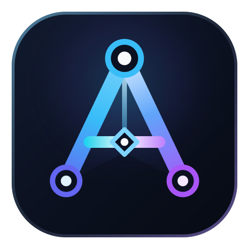
</p>

<h1 align="center">Aexus Code</h1>

<p align="center">
  <strong>Open-Source Organizational IDE &amp; Visual Multi-Agent Control Plane</strong><br/>
  Extensible Multi-Tier Organizations · 8 Native BYO-CLI Coding Engines · Deterministic Engineering &amp; Research DAGs · Server-Signed Capability Tokens · Git Worktree Sandbox · Zero-Server SSH Cloud Hosts
</p>

<p align="center">
  <a href="https://github.com/Daijunfan/Aexus-Code/actions/workflows/aexus-ci.yml"></a>
  <a href="https://github.com/Daijunfan/Aexus-Code/releases"></a>
  <a href="LICENSE.txt"></a>
  <a href="https://open-vsx.org/"></a>
  
  
</p>

<p align="center">
  <strong>English</strong> · <a href="docs/README.zh-CN.md">简体中文</a> · <a href="docs/ARCHITECTURE.md">Architecture</a> · <a href="docs/gallery.md">Visual Gallery</a> · <a href="examples/blueprints/README.md">Blueprint Recipes</a> · <a href="SECURITY.md">Security</a> · <a href="CHANGELOG.md">Changelog</a> · <a href="CONTRIBUTING.md">Contributing</a> · <a href="CODE_OF_CONDUCT.md">Code of Conduct</a>
</p>

---

> [!TIP]
> **Try It in 10 Seconds Without Spending a Cent (`$0.00` Simulated Demo) — or Scaffold a DAG in `<50ms`:**
> - **Simulated 0-Token Interactive Demo (`$0.00` spend, zero file edits)**: Click **`▶ Simulated Demo (0 tok)`** in the DAG Studio toolbar, press `Cmd/Ctrl+Shift+P` → **`Aexus ADE: Try Interactive Engineering DAG Demo (0 Tokens)`**, or run `aexus-ade engineering demo` to preview the multi-tier choreography, approve Gate `U1`, and export a **Vector SVG** + **GitHub PR Verification Report**.
> - **Prompt-to-DAG (`Cmd/Ctrl+Shift+K` or `/`)**: Press **`Cmd/Ctrl+Shift+K`** (or **`/`** when the DAG canvas is focused — leaving VS Code's native `Cmd/Ctrl+K` chord shortcuts 100% intact) for **deterministic keyword-to-DAG scaffolding in `<50ms`**, ready to edit visually or refine with your Orchestrator LLM.
> - **Instant Mode Switch**: Press `Alt+Cmd+A` (`Alt+Ctrl+A`) anytime to flip between **`ADE`** (Agent Development Environment) and **`IDE`** (full-parity `Code - OSS` editor) without restarting terminals or language servers.

<p align="center">
  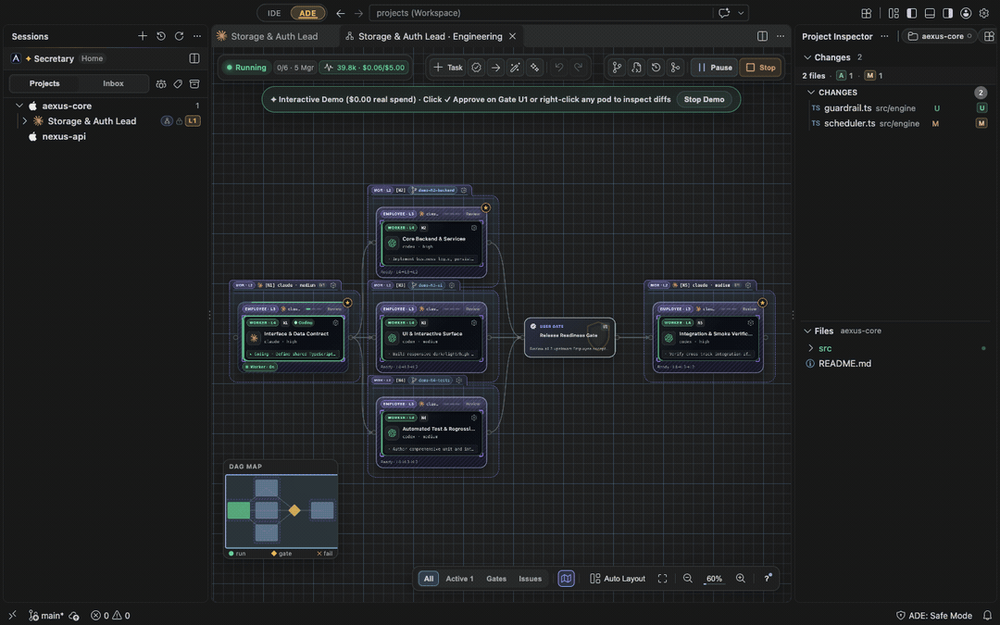
  <br/>
  <sub><strong>Simulated 0-Token Interactive Demo (<code>$0.00</code> spend, deterministic choreography preview):</strong> 3× Parallel Worktree Fan-Out ➔ Rework ➔ Release Gate <code>U1</code> Approval ➔ FinOps Telemetry · <a href="docs/assets/demos/02-live-dag-choreography.mp4">▶ Watch Full HD MP4</a> · <a href="docs/gallery.md">Explore Full Visual Gallery →</a></sub>
</p>

---

## Why Aexus Code?

Most AI developer setups force you to choose between a closed-source single-agent editor, detached terminal wrappers outside your IDE, or cloud workflow builders disconnected from Git and local CLIs.

**Aexus Code** (`v1.1.0`) is a 100% open-source (**MIT**), local-first desktop workbench supercharged on `Code - OSS` (`1.146.0`) with [Open VSX](https://open-vsx.org/) VS Code extensions compatibility and zero bundled Copilot telemetry, unifying a full-parity **IDE (`IDE`)** and an extensible **Agent Development Environment (`ADE`)**:

1. **One Panel for Multi-Project, Multi-OS Workspaces (`macOS` · `Ubuntu` · `Kali` · `Windows`)** — Manage local `file://` repositories and zero-server `aexus-ssh://` cloud projects side-by-side in a single sidebar, ignoring path and OS differences, with crisp platform badges, Smart Calm hover-bloom pills, a 1-click full-badge toggle, and a pinned viewport-aware **`✦ Secretary`**.
2. **Simultaneous Local & Multi-Cloud Integrated Terminals** — Control your local macOS/Linux/Windows shell alongside multiple remote Linux, Kali, and Windows SSH cloud host terminals in split panes inside the same window — complete with per-OS terminal tab badges and zero `vscode-server` installation or `~/.ssh/config` mutation.
3. **8 Native BYO-CLI Coding Engines in One ADE Sidebar** — Orchestrate **Claude Code**, **Codex**, **Google Antigravity**, **Kilo Code**, **OpenCode**, **DeepSeek Harness**, **Cline**, and **Pi** locally with official brand icons, your own subscriptions, visible **`ADE: Safe Mode`** / **`ADE: Autonomous`** status controls, and a rank-filtered **`ADE Inbox`** (`Trust Gate`, `Budget Cap`, `Circuit Breaker`).
4. **Extensible Multi-Tier Organizations ("Everything is Extensible")** — Start from **5 presets** (`Enterprise 4-Tier`, `Agile 3-Tier Startup`, `AI Research Lab`, `Security Red/Blue Audit`, `2-Tier Flat Swarm`) or design custom ranks like filling in the blanks: author `{{variables}}` prompt templates, bind the **4 DAG slots**, toggle the **Rank × Fixed Kernel API Permission Matrix**, and enforce server-signed HMAC capability tokens.
5. **Visual Engineering & Research Parallel DAGs + FinOps Guardrails** — Execute parallel Git worktrees or file-scoped lanes with Nested Dual-Shell Pods, **upfront SHA-256 hash-pinned `verify:` gates**, **`files:` scope serialization**, **`max_concurrency` scheduling**, **branch-isolated RED circuit breakers**, **2-stage zero-token-first Watchdog**, and **dynamic-tier FinOps budget caps**.
6. **Full-Parity Native VS Code IDE & Open VSX Extension Compatibility** — Press `Alt+Cmd+A` (`Alt+Ctrl+A`) to flip instantly between **`ADE`** and **`IDE`** with 100% native `Code - OSS` editing, Git diffs, debugging, terminals, and live **Open VSX** marketplace compatibility for mainstream VS Code extensions (`Python`, `Python Debugger`, `Java`, `Ruby LSP`, `Claude Code`, and more).

---

## How the Adversarial Execution Loop & Trust Airgap Work

### 4-Slot Adversarial Execution & Trust Gate Loop

Every Engineering or Research DAG resolves four structural slots from your active organization preset — separating **pure code execution** (`0` control APIs) from **deterministic `verify:` verification** and **adversarial review**:

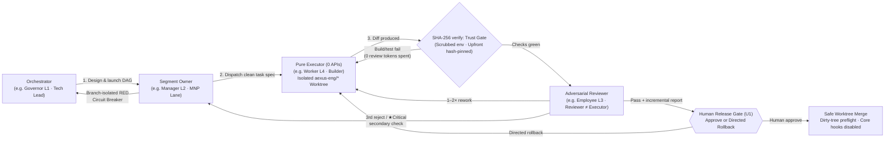

### Local Control Plane & Pure-Worker Airgap Architecture

Aexus Code never exposes a TCP port. All agent orchestration flows through a main-process local IPC server enforcing server-derived HMAC identity, subtree lineage (`canRankSupervise`), and airgapped subprocess scrubbing:

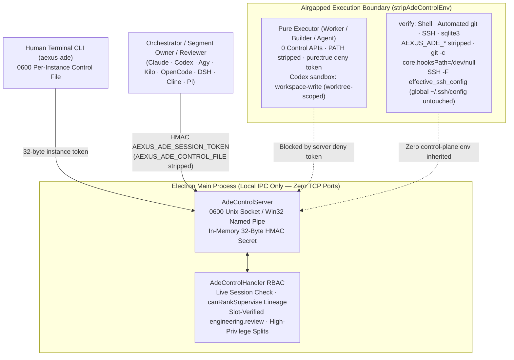

---

## Flagship Capabilities

### 1. Unified Multi-OS Multi-Project ADE Sidebar & Simultaneous Multi-Host Terminals

Manage local repositories and remote cloud projects across **macOS**, **Ubuntu**, **Kali Linux**, and **Windows** in one unified sidebar — and drive multiple local + cloud terminals side-by-side without juggling windows or installing remote daemons:

<table>
  <tr>
    <td width="50%">
      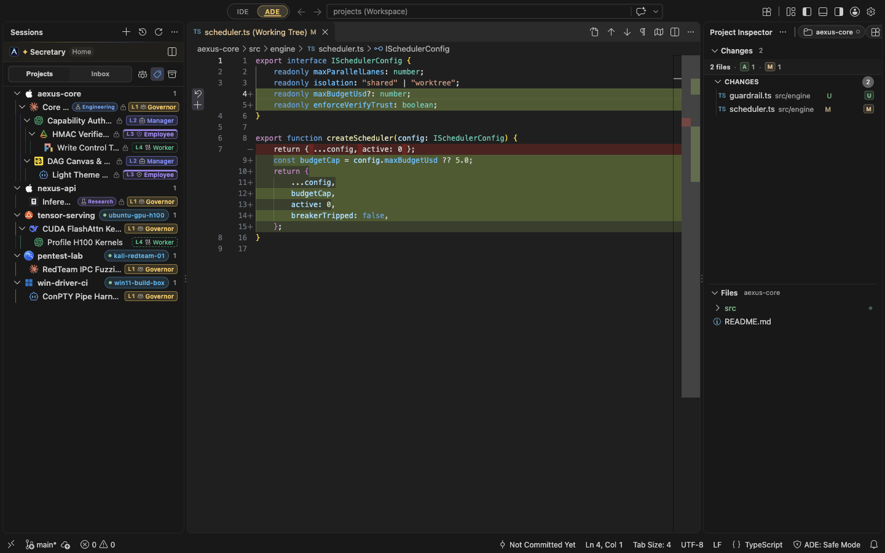
      <p align="center"><sub><strong>One Panel, Multi-OS Projects &amp; 8-Engine ADE Hierarchy:</strong> Local Apple + cloud Ubuntu, Kali &amp; Windows projects, colorful engine icons, L1–L4 full badges, pinned <code>✦ Secretary</code> &amp; live diff.</sub></p>
    </td>
    <td width="50%">
      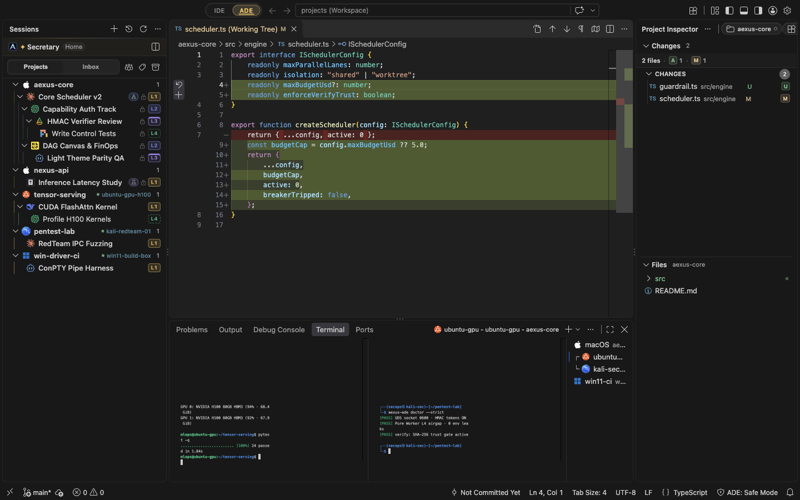
      <p align="center"><sub><strong>Simultaneous Local &amp; Multi-Cloud OS Terminals:</strong> Split Ubuntu H100 GPU + Kali RedTeam shells running live alongside Apple, Ubuntu, Kali &amp; Windows terminal tabs.</sub></p>
    </td>
  </tr>
</table>

- **Zero Path & OS Friction**: Mix local `file://` projects and zero-server `aexus-ssh://` hosts in the same tree with automatic platform icons (`macOS`, `Ubuntu`, `Kali`, `Windows`), pinned `✦ Secretary`, Smart Calm hover-bloom mode, and a **1-click full-badge toggle**.
- **All 8 Native Coding Engines Side-by-Side**: Visual brand icons differentiate **Claude Code**, **Codex**, **Antigravity**, **Kilo Code**, **OpenCode**, **DeepSeek Harness**, **Cline**, and **Pi** instantly across every tier (`L1`–`L4`) and every host.

---

### 2. Organization & Roles Studio ("Everything is Extensible")

Define the exact multi-agent organization your team wants instead of being locked into one fixed hierarchy. Engineering and Research DAGs resolve four **structural work-tree slots** (`orchestrator`, `segment_owner`, `reviewer`, `executor`) directly from your active schema — and now you can view, bind, and validate all 4 slots live in Role Studio:

<p align="center">
  
  <br/>
  <sub><strong>Organization &amp; Roles Studio ("Everything is Extensible"):</strong> 5 starter presets, live <strong>4-Slot DAG Binding bar</strong>, interactive <code>Rank × Fixed Kernel API</code> matrix with <code>High Privilege</code> badges, permanent <code>Pure · 0</code> leaf executor isolation, and Smart Calm sidebar hierarchy.</sub>
</p>

| Starter Preset | Rank Ladder (Top → Leaf Pure Executor) | Work-Tree Slot Mapping (`orch / seg / rev / exec`) |
| :--- | :--- | :--- |
| **`default-4tier`** *(Default)* | `Governor (L1)` → `Manager (L2)` → `Employee (L3)` → `Worker (L4 Pure)` | `governor / manager / employee / worker` |
| **`startup-3tier`** | `Tech Lead (L1)` → `Reviewer (L2)` → `Builder (L3 Pure)` | `tech-lead / tech-lead / reviewer / builder` |
| **`research-lab`** | `Principal Investigator (L1)` → `Research Lead (L2)` → `Peer Critic (L3)` → `Experimenter (L4 Pure)` | `governor / manager / employee / worker` |
| **`security-audit`** | `Audit Director (L1)` → `Lead Auditor (L2)` → `Verifier (L3)` → `Scanner (L4 Pure)` | `governor / manager / employee / worker` |
| **`flat-swarm`** | `Coordinator (L1)` → `Agent (L2 Pure)` | `coordinator / coordinator / coordinator / agent` *(auto-skips redundant duplicate self-review)* |

- **4-Slot DAG Binding Bar & Dynamic Preset Prompts**: Bind any rank to `Orchestrator`, `Segment Owner`, `Adversarial Reviewer`, or `Pure Executor` right inside Role Studio (with live warnings if `reviewer === executor` or if `executor` is not pure). DAG prompts and FinOps telemetry automatically adopt your active preset's real rank names (never leaking hardcoded `Employee L3` into `Research Lab` or `Startup 3-Tier`).
- **Fill-in-the-Blank Custom Ranks & `{{variables}}` Prompt Templates**: Edit rank names, colors, icons, and dynamic prompt templates (`{{rank.name}}`, `{{rank.tier}}`, `{{project.name}}`, `{{supervisor.label}}`, `{{hierarchy.ladder}}`, etc.) inside a real dirty-tracked VS Code editor (`Cmd/Ctrl+S` save & revert, live session migration on rank ID rename).
- **Rank × Fixed Kernel API Permission Matrix**: Toggle coarse-grained kernel APIs per rank (`session.read_context`, `session.message`, `session.manage`, `project.read`, `project.manage`, read-only `host.access`, `inbox.post`, `engineering.read`, `engineering.design`, `engineering.review`, `engineering.control`, plus separated high-privilege **`host.manage`**, **`engineering.integrate`**, and **`engineering.destroy`**).
- **Lineage-Enforced Server-Signed Capability Tokens**: Every orchestrated agent receives an HMAC-SHA256 `AEXUS_ADE_SESSION_TOKEN` minted in main-process memory. On every call, `AdeControlHandler` validates live session state, enforces `canRankSupervise` + subtree ownership, and verifies `engineering.review` slot identity.
- **Zero-Warmup Inline Turn-1 Injection + Prompt-Hash Invalidation + Auto-Compaction Recovery**: Rank charters inject inline on Turn 1, commit only after a successful send, automatically re-inject when Studio edits change the prompt's SHA-256 hash, and recover cleanly after engine context compaction.
- **Workspace Prompt-Injection Protection**: `aexus.ade.organization` is `application`-scoped and `restricted: true` — `.vscode/settings.json` inside cloned repositories cannot modify agent prompts or API grants.

---

### 3. Deterministic Engineering & Research Parallel DAGs, Nested Dual-Shell Pods & 6 Blueprint Recipes

Right-click any top-level orchestrator (`Governor` / `Tech Lead` / `Coordinator`) on a local Git workspace and choose **`Engineering`** or **`Research`** to launch a visual, Mermaid+Markdown synchronized parallel DAG:

<table>
  <tr>
    <td width="50%">
      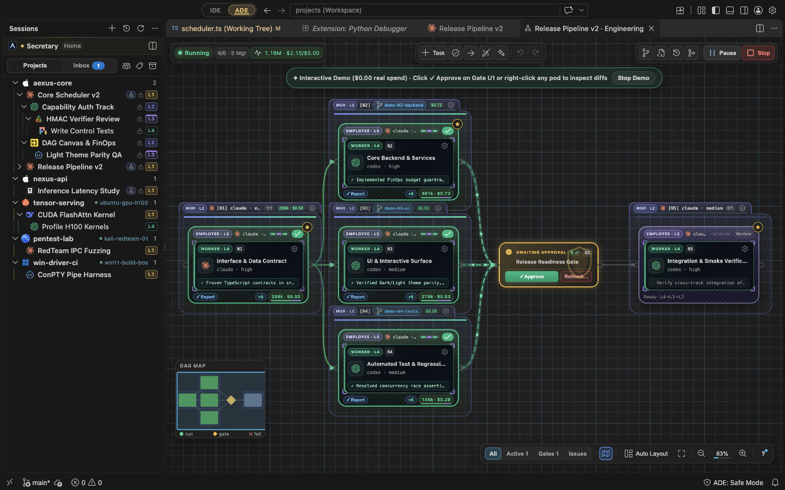
      <p align="center"><sub><strong>Engineering Mode DAG (Simulated 0-Token Demo):</strong> Nested Dual-Shell Pods (<code>L3</code> review shell wrapping <code>L4</code> pure core), <code>3×</code> worktree lanes &amp; Gate <code>U1</code>.</sub></p>
    </td>
    <td width="50%">
      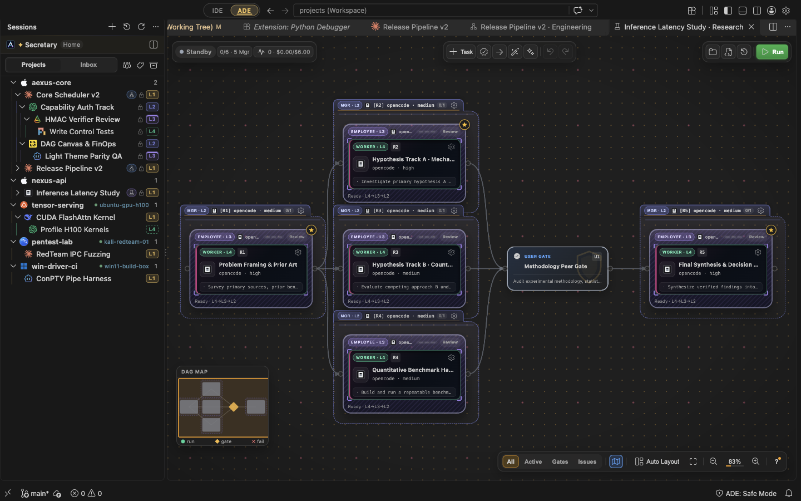
      <p align="center"><sub><strong>Research Mode Parallel DAG:</strong> Distinct warm amber/magenta canvas for multi-track hypothesis probing, benchmark harnesses &amp; peer methodology gates.</sub></p>
    </td>
  </tr>
</table>

- **Upfront SHA-256 Hash-Pinned `verify:` Checks & Revocation**: Untrusted or agent-modified `verify:` commands are gated **upfront at the start of `runTree` before any Worker runs** — never wasting tokens before human approval. Approved commands execute in a scrubbed environment (`AEXUS_ADE_*` stripped; POSIX detached process group or Windows `cmd.exe /d /s /c`) and can be inspected or revoked anytime via **`Aexus ADE: Manage Trusted Verify Commands...`** or `aexus-ade engineering verify-trust list|revoke`.
- **`files:` Scope Serialization & `max_concurrency` Critical-Path Scheduling**: Declare per-node file ownership globs (`files: src/services/**`) so overlapping nodes serialize automatically in `shared` workspace mode, while `max_concurrency` caps parallel active pods prioritized by critical-path depth.
- **Branch-Isolated RED Circuit Breaker & 2-Stage Zero-Token-First Watchdog**: Repeated formal rejections escalate visually (`failure_1` amber → `failure_2` deep amber → `failure_3` crimson), pausing **only the affected branch**, waking the orchestrator, and alerting `ADE Inbox` while healthy sibling branches keep progressing. Stalled pods trigger a 2-stage watchdog that inspects local liveness and Git activity at **zero token cost** before escalating.
- **Git-Native Cumulative Diffs & Safe Hooks**: Inside Git repositories, Worker changes are tracked via `git status --porcelain=v2 -z` and `git diff` (respecting `.gitignore` with no hardcoded file-count truncation), while automated worktree Git operations pass `-c core.hooksPath=/dev/null` and scrubbed env vars.
- **Dynamic-Tier FinOps, Adaptive Dark/Light Theme & Enforced Recipe Budgets**: Applying any built-in recipe automatically populates its `max_budget_usd` ceiling (plus optional `org_preset` frontmatter for shareable blueprints), backed by pre-dispatch admission, clean `pauseTree` ceiling pauses, custom `aexus.ade.pricing` rate overrides, and **Subscription (`$0` marginal)** mode.

<p align="center">
  <picture>
    <source media="(prefers-color-scheme: dark)" srcset="docs/assets/08-finops-budget-guardrails.png" />
    <source media="(prefers-color-scheme: light)" srcset="docs/assets/12-light-theme-finops.png" />
    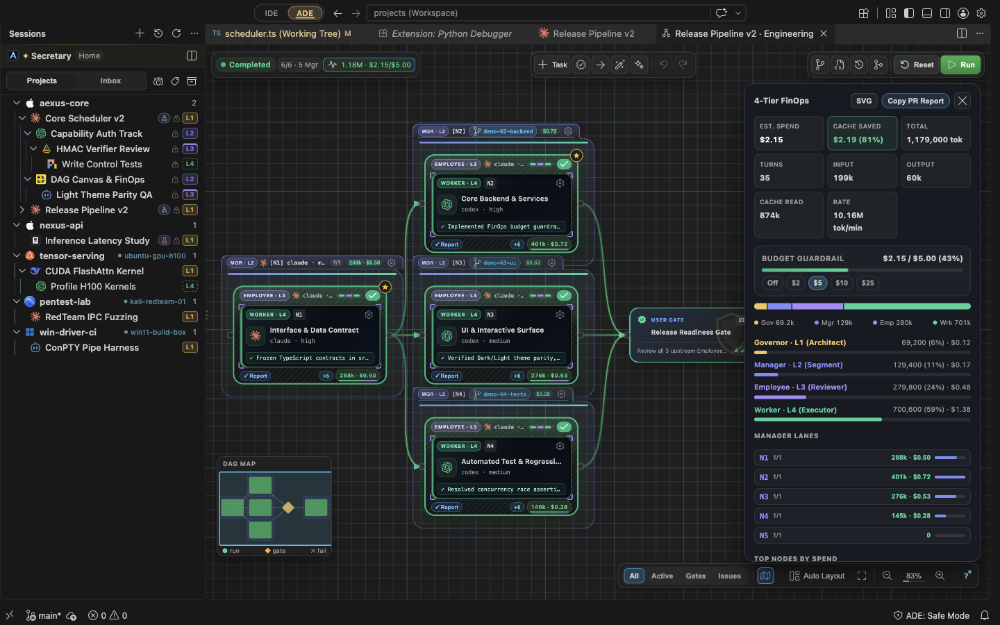
  </picture>
  <br/>
  <sub><strong>FinOps Telemetry &amp; Budget Guardrails (adapts automatically to GitHub Dark / Light theme):</strong> Per-tier spend breakdown matching your active organization schema, prompt-cache savings, and pre-dispatch budget guardrails.</sub>
</p>

| Built-In Recipe (100% Synced with `ADE_BLUEPRINT_TEMPLATES`) | Mode | Parallel Lanes | Isolation | Budget Cap | Guardrails Included | Ideal Use Case |
| :--- | :---: | :---: | :---: | :---: | :---: | :--- |
| **[`feature-ship`](examples/blueprints/feature-ship.md)** | Engineering | `3×` parallel | `worktree` | `$8.00` | `max_budget_usd`, `max_concurrency`, `files:`, `verify:` | Contract-first full-stack delivery with backend/UI/test tracks + Release Gate |
| **[`bug-hunt-fix`](examples/blueprints/bug-hunt-fix.md)** | Engineering | `2×` parallel | `shared` | `$4.00` | `max_budget_usd`, `max_concurrency`, `files:`, `verify:` | Repro-first root-cause debugging + scoped fix & regression suite |
| **[`security-audit-swarm`](examples/blueprints/security-audit-swarm.md)** | Engineering | `3×` parallel | `worktree` | `$6.00` | `max_budget_usd`, `max_concurrency`, `files:`, `verify:` | Multi-engine auth, IPC & supply-chain audit converging into hardened patches |
| **[`safe-migration`](examples/blueprints/safe-migration.md)** | Engineering | `2×` parallel | `worktree` | `$7.00` | `max_budget_usd`, `max_concurrency`, `files:`, `verify:` | Characterization-tested refactor with rollback gate & legacy cleanup |
| **[`deep-research-lab`](examples/blueprints/deep-research-lab.md)** | Research | `3×` parallel | `shared` | `$6.00` | `max_budget_usd`, `max_concurrency`, `files:`, `verify:` | Multi-track hypothesis probing, quantitative benchmarks & peer-reviewed synthesis |
| **[`arch-teardown`](examples/blueprints/arch-teardown.md)** | Research | `2×` parallel | `shared` | `$5.00` | `max_budget_usd`, `max_concurrency`, `files:`, `verify:` | Parallel systems + UX teardown converging into an engineering RFC |

---

### 4. Safe Git Worktree Sandbox, Smart Calm Sidebar & Rank-Filtered Inbox

<table>
  <tr>
    <td width="50%">
      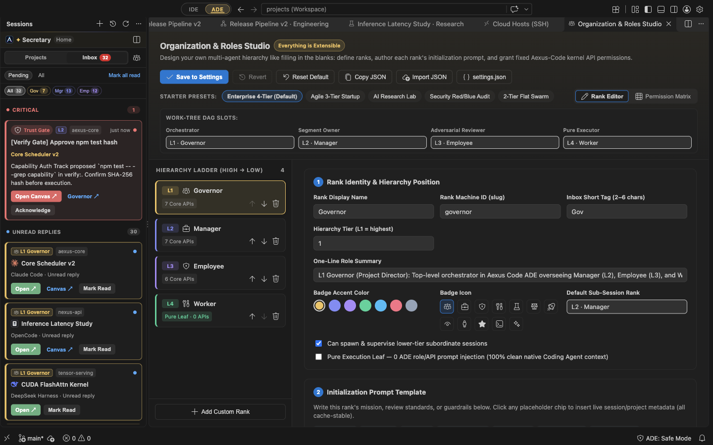
      <p align="center"><sub><strong>Rank-Filtered <code>ADE Inbox</code> (<code>Trust Gate</code> · <code>Budget Cap</code> · <code>Circuit Breaker</code>) &amp; Rank Prompt Editor</strong></sub></p>
    </td>
    <td width="50%">
      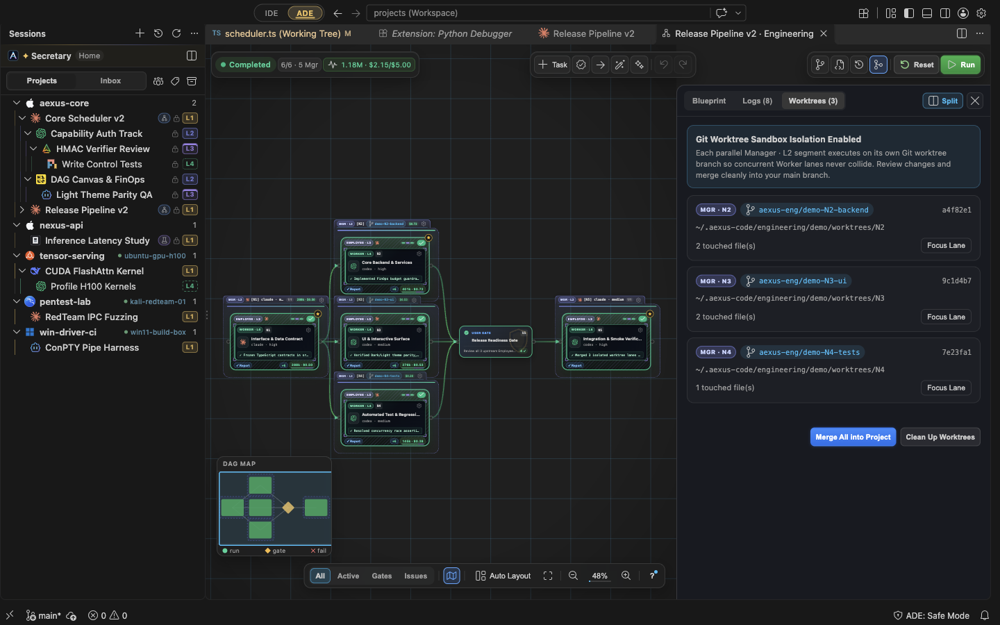
      <p align="center"><sub><strong>Per-Lane <code>aexus-eng/*</code> Git Worktree Sandbox &amp; Merge Workbench</strong></sub></p>
    </td>
  </tr>
</table>

- **Safe Git Worktree Lifecycle**: Blueprint and runtime state live outside your repository under `~/.aexus-code/engineering/` and `~/.aexus-code/research/`. When `worktree` isolation is enabled, parallel lanes execute on dedicated **`aexus-eng/*` Git branches** with dirty-tree preflight before merging, non-destructive branch creation (no forced `-B` reset or `-D` drop by default), your own `git config user.name` / `user.email` preserved (plus a `Co-authored-by` trailer), `-c core.hooksPath=/dev/null` hook protection, and explicit pause + Inbox alert if worktree creation fails.
- **Smart Calm Sidebar**: Session rows default to compact hover-bloom rank/engine indicators with non-clipping badges, paired with a **1-click full-badge toggle** when you want every rank and status pill visible simultaneously, plus the pinned viewport-aware **`✦ Secretary`** at the top.
- **Accurate, Rank-Filtered `ADE Inbox`**: Unified escalation and gate queue with accurate alert kind badges (**`Trust Gate`**, **`Budget Cap`**, **`Circuit Breaker`**, **`Worktree Alert`**, **`User Gate`**) and dynamic schema-driven **per-rank filter pills** (`All | Governor | Manager | Employee` or `All | Tech Lead | Reviewer` — automatically hiding `0`-API pure executor ranks when empty), synced directly with canvas gates.

---

### 5. Supercharged VS Code IDE (`ADE ⇄ IDE`), Full Extensions Compatibility & Zero-Server SSH Cloud Hosts

Aexus Code keeps 100% of native `Code - OSS` IDE ergonomics intact — Explorer, split editors, side-by-side diffs, multi-OS terminals, and live **[Open VSX](https://open-vsx.org/)** compatibility for mainstream VS Code marketplace extensions — while adding a Zero-Server SSH Cloud Host Studio:

<table>
  <tr>
    <td width="50%">
      
      <p align="center"><sub><strong>Instant <code>ADE ⇄ IDE</code> Mirror Symmetry (<code>Alt+Cmd+A</code>):</strong> Full native VS Code Explorer, split diff &amp; live multi-OS terminals.</sub></p>
    </td>
    <td width="50%">
      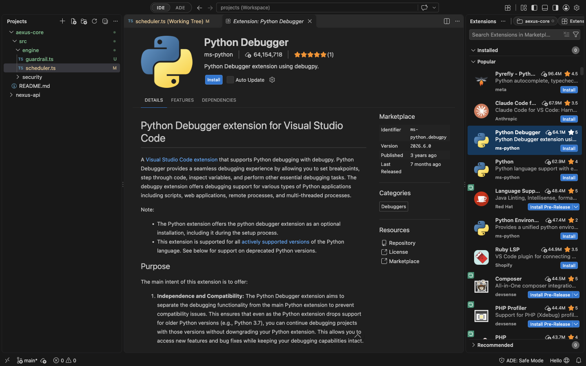
      <p align="center"><sub><strong>Full VS Code Extensions Ecosystem (Open VSX):</strong> Install <code>Python Debugger</code>, <code>Claude Code</code>, <code>Python</code>, <code>Java</code>, <code>Ruby LSP</code> &amp; thousands more.</sub></p>
    </td>
  </tr>
</table>

<p align="center">
  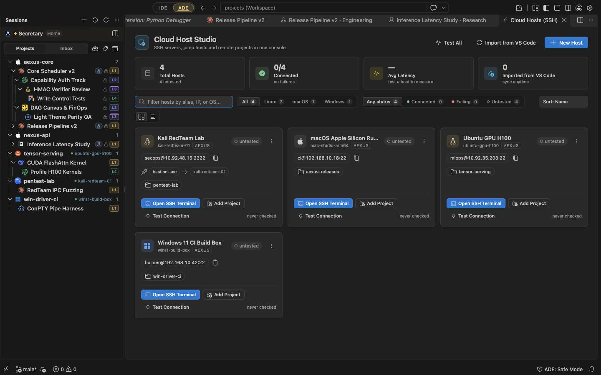
  <br/>
  <sub><strong>Zero-Server SSH Cloud Host Studio:</strong> Manage Kali Linux (with ProxyJump), macOS, Ubuntu GPU &amp; Windows SSH hosts in one console without installing <code>vscode-server</code> or mutating <code>~/.ssh/config</code>.</sub>
</p>

- **Zero Remote Daemon**: Edit remote files, view Git `HEAD` diffs, run interactive ADE agent sessions, and open remote SSH PTY terminals right beside local folders with **no `vscode-server` installed on remote hosts**.
- **Non-Destructive `~/.ssh/config` Guarantee**: `syncUserSshDir` defaults to **`false`** — Aexus Code passes `-F <userDataDir>/ssh/effective_ssh_config` exclusively to its own SSH sessions/terminals and **never prepends `Include` or modifies your global `~/.ssh/config`**.
- **Honest SSH Scope & Transport Behavior**:
  - **Interactive ADE & IDE over `aexus-ssh://`**: Interactive agent sessions, remote file editing, Git diffs, and remote SSH terminals all work directly over `aexus-ssh://`.
  - **DAG Git Worktrees Require a Local Workspace**: Engineering and Research DAG Git worktrees currently require a local Git repository (attempting `engineering init` on an `aexus-ssh://` project displays a clear scope notice instead of failing cryptically).
  - **OpenSSH Transport**: Uses **OpenSSH `ControlMaster` multiplexing on macOS/Linux** and **direct OpenSSH on Windows** (where Unix-socket ControlMaster is unavailable). Background filesystem and Git operations run with **`BatchMode=yes`**, requiring key-based / `ssh-agent` authentication (private keys are never read or copied).
- **Non-Destructive VS Code Migration**: Imports `~/.ssh/config` (including recursive `Include` directives) and VS Code remote host/directory history via `aexus-ade host import-vscode` (read-only import).
- **More Screenshots & Motion Clips**: See [`docs/gallery.md`](docs/gallery.md) for the complete visual tour (Prompt-to-DAG, Execution Gantt, Light Modern Theme, Node Inspector, Blueprint Drawer, and 5 HD MP4 clips).

---

## 8 Native Coding Agent Engines

All 8 engines run locally via your own installed CLIs and credentials (`requiresCopilotSignIn: false`), sharing centralized child-environment isolation (`runtime.ts`), public upstream default model catalogs (plus dynamic discovery from your local CLI configs), and zero-warmup Turn-1 role synchronization (`extension.ts`):

| Engine | Session Type | Default CLI | Native Transport & Safe Default Mode |
| :--- | :--- | :--- | :--- |
| **Claude Code** | `aexus-claude` | `claude` | Bidirectional `stream-json` · default `acceptEdits` · live token telemetry & compaction reset |
| **Codex** | `aexus-codex` | `codex` | `app-server` JSON-RPC (`thread/inject_items`) · default `workspace-write` + `on-request` *(stays `workspace-write` on DAG worktree lanes unless `autonomousMode: true`)* |
| **Google Antigravity** | `aexus-antigravity` | `agy` | Local `--hub` ConnectRPC bridge · default `ask` |
| **Kilo Code** | `aexus-kilo` | `kilo` | ACP runtime bridge · default `ask` |
| **OpenCode** | `aexus-opencode` | `opencode` | Native panel + ACP lifecycle · default `ask` |
| **DeepSeek Harness** | `aexus-dsh` | `dsh` | Native runtime adapter + opt-out role bridge · default `ask` |
| **Cline** | `aexus-cline` | `cline` | `--acp` streaming protocol · default `ask` |
| **Pi** | `aexus-pi` | `pi` | `--mode rpc` structured event stream & thinking progress · default safe mode |

> [!NOTE]
> - **Safe Mode vs Autonomous DAG Execution**: A live Status Bar pill (**`ADE: Safe Mode`** vs **`ADE: Autonomous`**) and Command Palette command (**`Aexus ADE: Toggle Safe / Autonomous Permission Mode`**) make permission posture visible at all times. When `aexus.ade.autonomousMode` is `false`, launching an automated DAG prompts once per project to confirm unattended execution, and Codex Workers remain confined to `sandbox: 'workspace-write'` inside their isolated worktree.
> - **Third-Party Extension Role Bridge Opt-Out**: Transparently documented in [`SECURITY.md`](SECURITY.md) and disabled anytime via `aexus.ade.nativeExtensionRoleBridge.enabled: false` or `AEXUS_ADE_DISABLE_NATIVE_ROLE_BRIDGE=1`.

---

## `aexus-ade` Local Control Plane CLI

Aexus Code listens on a per-instance `0600` local Unix socket (`~/.aexus-code/ade-control.<pid>.sock` on macOS/Linux) or a local Windows Named Pipe (`\\.\pipe\aexus-ade-control-*`) authenticated by a **per-instance 32-byte token** (human CLI) or **server-signed per-session HMAC capability token** (`AEXUS_ADE_SESSION_TOKEN` for orchestrated agents):

```bash
# 0. Diagnose all 8 CLIs, git worktrees & OpenSSH (v1.1.0, schemaVersion: 1 JSON, exits 1/2 on fail/strict)
aexus-ade --version
aexus-ade doctor --project . --json
eval "$(aexus-ade completion zsh)"   # also supports bash | fish (covers role, engineering generate & verify-trust)

# 1. Inspect or switch organization presets & open Organization & Roles Studio
aexus-ade role list --json
aexus-ade role presets --json
aexus-ade role preset startup-3tier
aexus-ade role studio

# 2. Try the 0-token interactive demo or run a real DAG with worktree isolation + $5 budget cap
aexus-ade engineering demo
GOV_ID=$(aexus-ade session create --project my-app --engine claude --role governor --title "Release Lead" --no-open --json | jq -r .id)
aexus-ade engineering init --governor "$GOV_ID" --open
aexus-ade engineering template apply --governor "$GOV_ID" --template feature-ship --preset balanced --isolation worktree --max-budget-usd 5
aexus-ade engineering verify-trust list
aexus-ade engineering run --governor "$GOV_ID"

# 3. Approve a gate, merge isolated worktree branches & export a PR Verification Report
aexus-ade inbox list --unread-only
aexus-ade engineering gate --governor "$GOV_ID" --node U1 --verdict pass
aexus-ade engineering worktrees merge --governor "$GOV_ID"
aexus-ade engineering report --governor "$GOV_ID" --out ./pr-verification-report.md
```

| Command Group | Subcommands |
| :--- | :--- |
| `doctor` / `completion` | `doctor [--project <path>] [--strict] [--json]` *(emits `schemaVersion: 1` & `aexusVersion`)* · `completion <bash\|zsh\|fish>` · `--version` *(standalone without a running window)* |
| `role` *(alias `roles`, `org`)* | `list [--json]` / `schema` · `apis` / `primitives` · `presets [--json]` · `preset <id>` · `reset` · `studio [rankId]` |
| `status` / `mode` / `view` | `status [--json]` · `mode [get \| set <ade\|ide>]` · `view [--archived] [--inspector <changes\|files\|hide>] [--refresh]` |
| `project` | `list` · `add <path\|host:/path>` · `select` · `remove` · `delete` · `focus` · `home` · `forward` · `move` · `changes` · `files` · `open-file` · `open-diff` |
| `host` *(alias `cloud-host`)* | `list` · `info` · `add` · `update` · `remove` · `test` · `browse` · `import-vscode` · `open` |
| `engine` | `list` · `sessions <engine> [--project <p>] [--limit <n>]` |
| `session` | `list` · `info` · `subordinates` · `tree` · `create` · `attach` · `connect` · `open` · `select` · `close` · `send [--wait]` · `history` · `mark-read` · `draft` · `reorder` · `rename` · `role` · `move` · `stop` · `archive` · `unarchive` · `detach` · `delete` |
| `secretary` | `status` · `open` · `engine` · `reset` · `send [--wait]` · `history` · `stop` · `draft` · `mark-read` |
| `engineering` | `list` · `init` · `open` · `demo` · `generate --prompt "<goal>"` · `template <list\|apply>` · `blueprint <get\|apply\|validate>` · `verify-trust <list\|revoke>` · `run` · `pause` · `resume` · `stop` · `reset` · `configure` · `worktrees <merge\|cleanup>` · `report [--out <file>]` · `diff` · `reports` · `status` · `review` · `gate` · `watchdog-action` · `remove` |
| `inbox` | `list [--unread-only]` · `post` · `resolve` · `mark-read` |

---

## How Aexus Code Fits in the Ecosystem

Different tools optimize for different workflows. Here is an honest architectural comparison of design trade-offs rather than a blanket "better/worse" claim:

| Architectural Dimension | **Aexus Code** | Proprietary AI IDEs *(e.g. Cursor, Windsurf)* | Worktree / Kanban Launchers *(e.g. Vibe Kanban, Conductor)* | In-IDE Agent Extensions *(e.g. Cline, Roo Code)* | Workflow Graph Studios *(e.g. LangGraph Studio, Dify)* |
| :--- | :---: | :---: | :---: | :---: | :---: |
| **License & Extension Registry** | MIT · [Open VSX](https://open-vsx.org/) | Closed-source | Mixed OSS / commercial | Open-source extension | Mixed OSS / hosted |
| **Native Desktop IDE Core** | Full `Code - OSS` (`ADE ⇄ IDE`) | Full proprietary VS Code fork | External launcher around editors/terminals | Runs inside host IDE | Standalone web / server UI |
| **Multi-Engine BYO-CLI Orchestration** | 8 native local CLIs side by side | Primarily own managed runtime | Launches external CLI panes | Single extension runtime (multi-LLM APIs) | API / SDK graph nodes |
| **Extensible Org Roles & Kernel API Matrix** | Custom ranks + 4-slot bindings + lineage HMAC tokens | Fixed agent / subagent modes | Manual task assignment | Custom mode prompts | Code-defined graph roles |
| **Visual DAG + Hash-Pinned `verify:` + Worktrees** | Built-in dual-shell DAG, `files:`, `verify:`, worktrees | Background agents (no visual DAG) | Kanban + worktrees (no native diff/LSP) | Sequential / mode loops | Generic graphs (detached from Git worktrees) |
| **Zero-Server SSH Multi-Root (`aexus-ssh://`)** | OpenSSH (no remote daemon, `~/.ssh/config` untouched) | Remote server extension | Local-first | Depends on host IDE | Server-hosted |

---

## Quick Start: Download Binary or Build from Source

### Option A — Prebuilt Binary Release (`v1.1.0`, ~60 Seconds)

Download prebuilt archives and `SHA256SUMS.txt` directly from **[GitHub Releases](https://github.com/Daijunfan/Aexus-Code/releases)** (built by [`.github/workflows/release.yml`](.github/workflows/release.yml)):

- **macOS (`arm64` Apple Silicon / `x64` Intel)**: `Aexus-Code-v1.1.0-darwin-*.dmg` or `.zip`
  - *Signing note*: Builds without an Apple Developer ID certificate use an ad-hoc signature. On first launch run `xattr -dr com.apple.quarantine "/Applications/Aexus Code.app"` or open via Finder → Right-Click → Open.
- **Linux (`x64`)**: `Aexus-Code-v1.1.0-linux-x64.tar.gz` *(extracts cleanly to `Aexus-Code-linux-x64/`)*
- **Windows (`x64`)**: `Aexus-Code-v1.1.0-win32-x64.zip`

Launch the app, press `Cmd/Ctrl+Shift+P` → **`Aexus ADE: Try Interactive Engineering DAG Demo (0 Tokens)`**, and explore the full DAG + FinOps experience in under a minute.

> **Extension Marketplace Note**: Aexus Code ships pre-configured with the open-source **[Open VSX Registry](https://open-vsx.org/)** (`open-vsx.org/vscode/gallery`) — matching VSCodium's open-source compliance model — and supports local `.vsix` installs. Closed-source Microsoft extensions restricted to official Microsoft VS Code builds are excluded.

### Option B — Build from Source (~15 min first build)

Compiling a full `Code - OSS` desktop workbench takes ~15 minutes and ~8–12 GB disk on a fresh checkout. *(Just contributing to an engine adapter or `aexus-ade` CLI? Use our **[30-Second Engine Adapter Fast-Path](CONTRIBUTING.md#30-second-engine-adapter-contributor-fast-path)** — no full IDE build needed!)*

#### Prerequisites
- **Node.js `24.22.1`** (matching [`.nvmrc`](.nvmrc)) and **`pnpm@12.16.0`** (e.g. via `nvm`/`fnm`/`mise` + `corepack enable && corepack prepare pnpm@12.16.0 --activate`).
  - `./scripts/aexus-env.sh` (macOS/Linux) and `.\scripts\aexus-env.ps1` (Windows) automatically prepend an optional repo-local `.build/toolchain` if present, validate your active Node version against `.nvmrc`, and set proxy/environment hygiene — they do **not** download Node automatically.
- **Native build tools**: Xcode Command Line Tools (`macOS`), `build-essential` + X11/libsecret dev headers (`Linux`), or Visual Studio 2022 C++ Build Tools + Windows 11 SDK (`Windows`), plus Python 3, Git, and OpenSSH.

#### Source Build (macOS / Linux)

```bash
# 1. Install dependencies & fast-transpile core + extensions/aexus-agents
./scripts/aexus-env.sh pnpm install
./scripts/aexus-env.sh pnpm run build-fast

# 2. Verify local coding CLIs, Git worktree support & OpenSSH
#    (Tip: before build-fast, run: node --experimental-strip-types extensions/aexus-agents/src/adeCli.ts doctor)
./extensions/aexus-agents/bin/aexus-ade doctor

# 3. Launch from source
./scripts/aexus-env.sh ./scripts/code.sh

# 4a. Package & install on macOS (auto-detects arm64 or x64; override with AEXUS_ARCH=x64)
ARCH=$(uname -m | sed 's/x86_64/x64/')
./scripts/aexus-env.sh pnpm run gulp "vscode-darwin-${ARCH}"
./scripts/aexus-install.sh   # optional local signing/keychain helper; falls back cleanly to ad-hoc signing

# 4b. Package standalone Linux build (gulp outputs ../VSCode-linux-x64; release.yml renames to Aexus-Code-linux-x64)
./scripts/aexus-env.sh pnpm run gulp vscode-linux-x64
```

#### Source Build (Windows PowerShell)

```powershell
# 1. Install dependencies & fast-transpile
.\scripts\aexus-env.ps1 pnpm install
.\scripts\aexus-env.ps1 pnpm run build-fast

# 2. Verify local coding CLIs, Git & OpenSSH
.\extensions\aexus-agents\bin\aexus-ade.ps1 doctor

# 3. Launch from source
.\scripts\aexus-env.ps1 .\scripts\code.bat

# 4. Package & install to %LOCALAPPDATA%\Programs\Aexus Code
.\scripts\aexus-env.ps1 pnpm run gulp vscode-win32-x64
.\scripts\aexus-install.ps1
```

---

## Honest Limitations & Non-Goals

We prefer telling engineers the exact rough edges upfront:

- **Building from source is heavy**: Because Aexus Code is a full `Code - OSS` Electron fork, a source checkout + `node_modules` + build output takes ~8–12 GB and ~15 minutes on first build. Use prebuilt GitHub Releases when you just want to try the app, or the 30-second adapter fast-path in [`CONTRIBUTING.md`](CONTRIBUTING.md) when hacking on CLI engines.
- **macOS release signing**: Until an Apple Developer ID signing/notarization secret is wired into CI, macOS release artifacts are ad-hoc signed and require clearing Gatekeeper quarantine on first launch.
- **SSH Cloud Hosts & DAG Worktrees**: Interactive ADE sessions, remote file editing, Git diffs, and remote SSH terminals work over `aexus-ssh://`, but **Engineering and Research DAG Git worktrees currently require a local Git workspace**. Additionally, `aexus-ssh://` runs `BatchMode=yes` over OpenSSH (requiring key/`ssh-agent` auth), and Windows lacks Unix-socket `ControlMaster` multiplexing so remote FS latency is higher on Windows clients than on macOS/Linux.
- **Prompt-to-DAG is deterministic scaffolding, not magic**: `Cmd/Ctrl+Shift+K` (or `/` on canvas) maps your prompt keywords into structured blueprint templates in `<50ms` at zero token cost; deep task decomposition should still be refined visually or handed to your `Orchestrator` LLM.
- **FinOps USD numbers are estimates when engines omit cost**: When a CLI does not emit `total_cost_usd`, Aexus Code estimates USD from token counts and `aexus.ade.pricing` (labeled as estimated; switch to `aexus.ade.pricing.subscriptionMode` for flat-rate plans). Budget guardrails gate new turns before dispatch and stop active agents once a completed turn crosses the ceiling, so an already-in-flight turn can overshoot slightly before pausing.
- **Non-Goals**: Aexus Code does not run a hosted SaaS cloud IDE, does not proxy or resell LLM API tokens, and does not bundle Microsoft's proprietary Copilot or Visual Studio Marketplace.

---

## Community, Security & License

- **Architecture & Contributing**: Read [`docs/ARCHITECTURE.md`](docs/ARCHITECTURE.md) *(canonical architecture guide replacing legacy `AEXUS.md`)*, [`CONTRIBUTING.md`](CONTRIBUTING.md), and [`CHANGELOG.md`](CHANGELOG.md).
- **Security Policy & Threat Model**: Read [`SECURITY.md`](SECURITY.md) for full details on Safe vs Autonomous mode, lineage-scoped HMAC capability tokens, scrubbed `verify:`/`git` subprocess execution, upfront SHA-256 `verify:` pinning & revocation, non-destructive SSH config (`syncUserSshDir: false`), and opting out of third-party extension role bridging.
- **License & Attribution**: Derived from Microsoft [`Code - OSS`](https://github.com/microsoft/vscode) under the **[MIT License](LICENSE.txt)** with all upstream copyright notices preserved. Aexus Code uses an original geometric mark (`docs/assets/aexus-logo.svg`) and the open-source [Open VSX Registry](https://open-vsx.org/). Microsoft and Visual Studio Code are trademarks of Microsoft Corporation.
