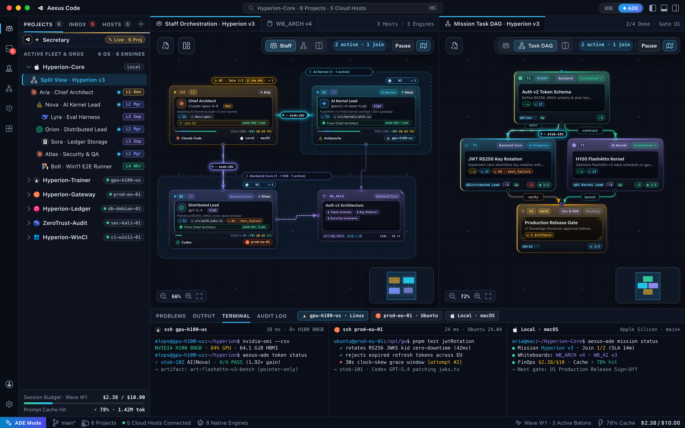
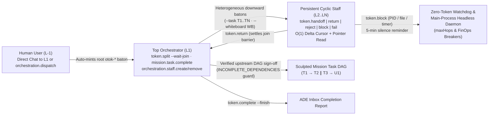
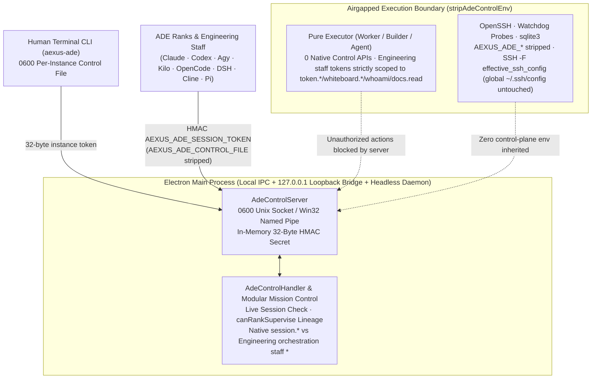
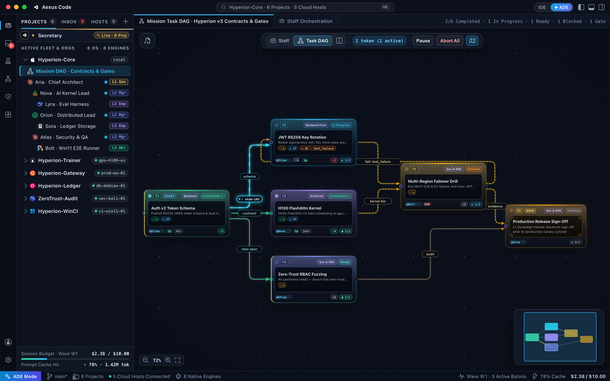
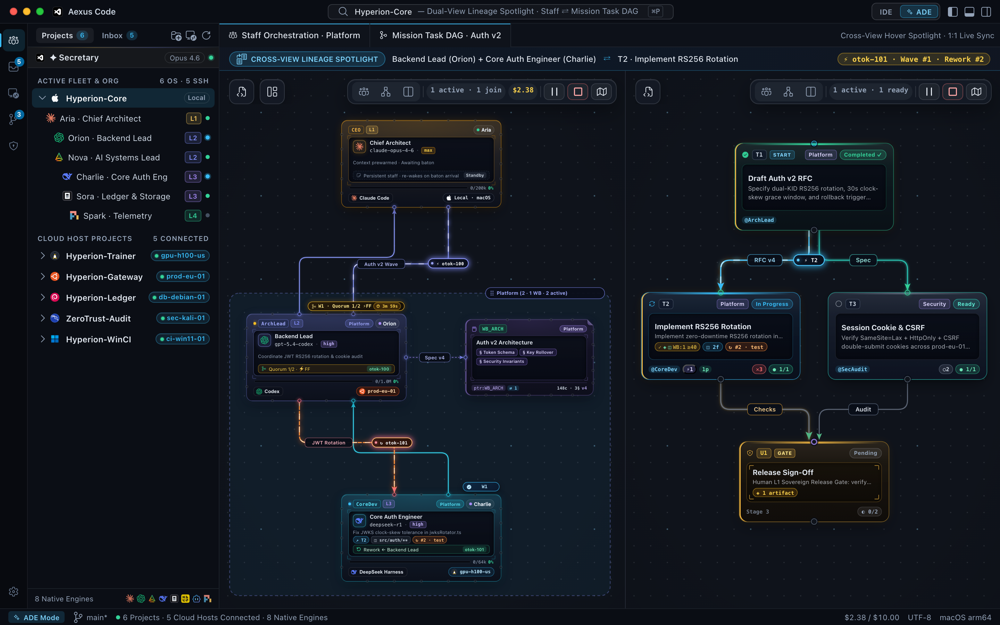
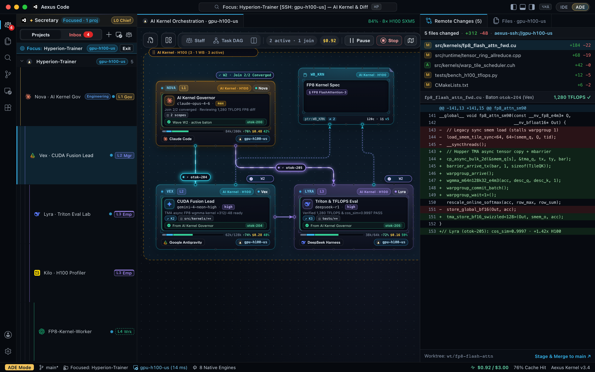
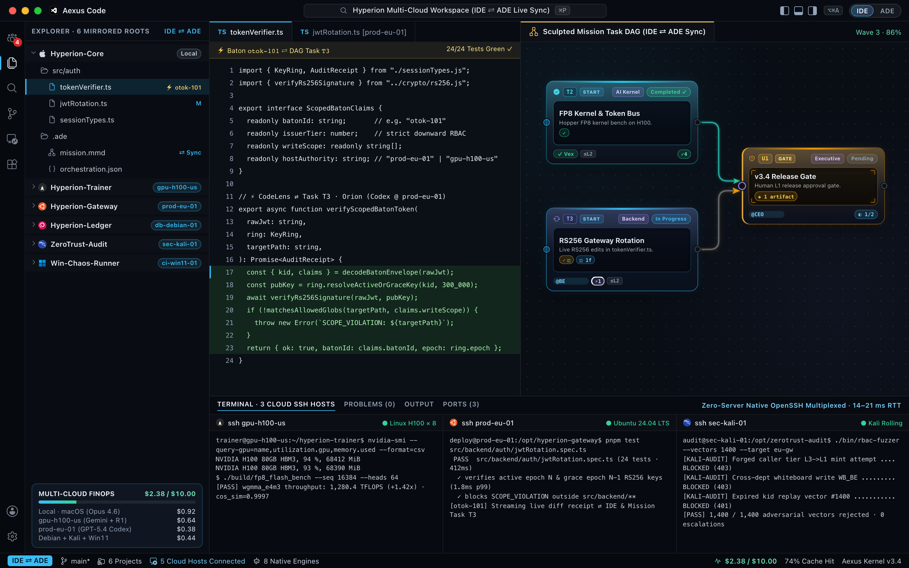

<p align="center">
  
</p>

<h1 align="center">Aexus Code</h1>

<p align="center">
  <strong>Open-Source Organizational IDE &amp; Visual Multi-Agent Control Plane</strong><br/>
  Dual-View Cyclic Orchestration &amp; Sculpted Mission Task DAG · 8 Native BYO-CLI Engines with FinOps Guardrails · Zero-Server SSH Cloud Hosts · Main-Process Headless Daemon &amp; Pointer-Native Baton Bus
</p>

<p align="center">
  <a href="https://github.com/Daijunfan/Aexus-Code/actions/workflows/aexus-ci.yml"></a>
  <a href="https://github.com/Daijunfan/Aexus-Code/releases"></a>
  <a href="LICENSE.txt"></a>
  <a href="https://open-vsx.org/"></a>
  
  
</p>

<p align="center">
  <strong>English</strong> · <a href="docs/README.zh-CN.md">简体中文</a> · <a href="docs/ARCHITECTURE.md">Architecture</a> · <a href="docs/gallery.md">Visual Gallery</a> · <a href="examples/blueprints/README.md">Blueprint Recipes</a> · <a href="SECURITY.md">Security</a> · <a href="CHANGELOG.md">Changelog</a> · <a href="CONTRIBUTING.md">Contributing</a> · <a href="CODE_OF_CONDUCT.md">Code of Conduct</a>
</p>

---

> [!TIP]
> **Get Started Visually in Minutes:**
> 1. **Dual-View Engineering Canvas (Orchestration + Sculpted Task DAG)**: Author your persistent all-staff cyclic **Orchestration** team (department wings, `<-->` review loops, folded shared whiteboards, radial/LR/TD/grid layouts) alongside a strictly acyclic sculpted **Mission Task DAG**, complete with **50-step Undo/Redo (`Cmd/Ctrl+Z`)**, marquee multi-select, magnetic snap guides, and `Cmd/Ctrl+F` search.
> 2. **Run Across 8 Native BYO-CLI Engines & Zero-Server SSH Cloud Hosts**: Assign staff nodes to **Claude Code**, **Codex**, **Google Antigravity**, **Kilo Code**, **OpenCode**, **DeepSeek Harness**, **Cline**, or **Pi** locally or over SSH. Chat directly with your `L1` lead (auto-minting a root `otok-*` baton) or run `aexus-ade orchestration dispatch` to drive parallel `token split --wait-join`, Check Hook auto-verification, cyclic review bounces, and verified Task DAG sign-off.
> 3. **Inspect Live Batons, Whiteboards & FinOps — Flip `ADE ⇄ IDE` Instantly**: Click any card, chip, or live baton comet to inspect pointer-only baton traces, Department Whiteboards, Completion Contracts, and `maxHops` / FinOps budget circuit-breakers, or press `Alt+Cmd+A` (`Alt+Ctrl+A`) to switch instantly between **`ADE`** and **`IDE`**.

<p align="center">
  
  <br/>
  <sub><strong>Flagship ADE Command Center:</strong> 6-OS Multi-Project Sidebar ➔ Dual-View Widescreen Staff Orchestration &amp; Sculpted Mission Task DAG ➔ Simultaneous Multi-Cloud SSH Terminals · <a href="docs/gallery.md">Explore Full 24-Shot 2x Retina Visual Gallery →</a></sub>
</p>

---

## Why Aexus Code?

Most AI developer setups force you to choose between a closed-source single-agent editor, detached terminal wrappers outside your IDE, or cloud workflow builders disconnected from Git and local CLIs.

**Aexus Code** (`v1.1.0`) is a 100% open-source (**MIT**), local-first desktop workbench supercharged on `Code - OSS` (`1.146.0`) with [Open VSX](https://open-vsx.org/) VS Code extensions compatibility and zero bundled Copilot telemetry, unifying a full-parity **IDE (`IDE`)** and an extensible **Agent Development Environment (`ADE`)**:

1. **Dual-View Cyclic Orchestration + Sculpted Mission Task DAG** — Place every rank (`L1..LN`) on one widescreen cyclic **Orchestration** canvas (`344×188` staff pods, 1-to-1 unique employees, `<-->` bidirectional loops, `276×164` folded Department Shared Whiteboards, radial/LR/TD/grid layouts) linked live to a strictly acyclic sculpted **Mission Task DAG** (`280×154` contract-guarded task pods, Sovereign Human Gates, upstream dependency gating, 50-step Undo/Redo, marquee multi-select, and interactive detail popovers).
2. **Unified Pointer-Native `otok-*` Baton Bus & Main-Process 0-Window Headless Daemon** — Heterogeneous `token mint|split --wait-join` with per-branch `scopePaths` conflict detection & `all|any|quorum` + `--deadline` convergence, deterministic task `completionContract` guardrails, TOC/section-sliced whiteboards, provenance `token return`, cyclic `token handoff|reject`, `token fail|retry`, Temporal-grade mutation `idempotencyKey` deduplication, durable `mission checkpoint` snapshots, `mission diagnostics`, `maxHops` cycle circuit-breakers, 429/502 transient retry, and main-process headless continuity that survives window reloads.
3. **8 Native BYO-CLI Coding Engines + Unified Multi-Engine FinOps Budget Breaker** — Orchestrate **Claude Code**, **Codex**, **Google Antigravity**, **Kilo Code**, **OpenCode**, **DeepSeek Harness**, **Cline**, and **Pi** locally or over SSH with official brand icons, unified per-model input/output/cache pricing (with `~$` estimated tags, custom overrides & local `$0` detection), and hard FinOps budget circuit-breakers across all 8 engines.
4. **One Panel for Multi-Project, Multi-OS Workspaces (`macOS` · `Ubuntu` · `Kali` · `Windows`) & Multi-Cloud Terminals** — Manage local `file://` repositories and zero-server `aexus-ssh://` cloud projects side-by-side with simultaneous split local + remote SSH terminals and zero `vscode-server` installation or `~/.ssh/config` mutation.
5. **Extensible Multi-Tier Organizations ("Everything is Extensible") & Native + Engineering APIs** — Start from **5 presets** (`Enterprise 4-Tier`, `Agile 3-Tier Startup`, `AI Research Lab`, `Security Red/Blue Audit`, `2-Tier Flat Swarm`) or resize `1..N` tiers, with native core employee APIs (`session.*`) for regular ADE hierarchies and Engineering-exclusive canvas staffing APIs (`orchestration staff create|config|remove`) with server-signed HMAC tokens & zero-token Watchdog probes.
6. **Full-Parity Native VS Code IDE & Open VSX Extension Compatibility** — Press `Alt+Cmd+A` (`Alt+Ctrl+A`) to flip instantly between **`ADE`** and **`IDE`** with 100% native `Code - OSS` editing, Git diffs, debugging, terminals, and live **Open VSX** marketplace compatibility.

---

## How Dual-View Orchestration, Pointer-Native Batons & Capability Airgap Work

### Dual-View Orchestration & Unified `otok-*` Baton Bus

Every Engineering workspace pairs an **all-staff cyclic Orchestration canvas** (zero off-graph wall, persistent unique employees, Department Whiteboards) with a strictly acyclic **Mission Task DAG** (live status/assignee sync + superior sign-off gated by upstream dependencies):



### Local Control Plane & Pure-Worker Airgap Architecture

All agent orchestration flows through a main-process local IPC server (+ loopback TCP bridge & 0-window headless daemon) enforcing server-derived HMAC identity, strictly top-down subtree/department lineage (`canRankSupervise`), and airgapped subprocess scrubbing:



---

## Flagship Capabilities

### 1. Unified Multi-OS Multi-Project ADE Sidebar & Simultaneous Multi-Host Terminals

Manage local repositories and remote cloud projects across **macOS**, **Ubuntu**, **Kali Linux**, and **Windows** in one unified sidebar — and drive multiple local + cloud terminals side-by-side without juggling windows or installing remote daemons:

<p align="center">
  
  <br/>
  <sub><strong>One Panel, Multi-OS Cloud Fleet &amp; 4-Host Simultaneous SSH Terminals:</strong> Manage macOS, Linux H100 GPU, Ubuntu, Debian, Kali &amp; Windows projects alongside a live 2×2 multi-cloud terminal matrix.</sub>
</p>

- **Zero Path & OS Friction**: Mix local `file://` projects and zero-server `aexus-ssh://` hosts in the same tree with automatic platform icons (`macOS`, `Ubuntu`, `Kali`, `Windows`), pinned `✦ Secretary`, Smart Calm hover-bloom mode, and a **1-click full-badge toggle**.
- **All 8 Native Coding Engines Side-by-Side**: Visual brand icons differentiate **Claude Code**, **Codex**, **Antigravity**, **Kilo Code**, **OpenCode**, **DeepSeek Harness**, **Cline**, and **Pi** instantly across every tier and every host.

---

### 2. Organization & Roles Studio ("Everything is Extensible")

Define the exact multi-agent organization your team wants instead of being locked into one fixed hierarchy:

<p align="center">
  
  <br/>
  <sub><strong>Cross-Cloud Multi-Tier Agent Orchestration:</strong> L1 Sovereign Architect coordinating 3 cloud department wings, folded shared whiteboards, 6 OS hosts, 6 agent engines, live baton comets &amp; join barriers.</sub>
</p>

| Starter Preset | Rank Ladder (Top → Leaf Pure Executor) | Structural Slot Mapping (`orch / seg / rev / exec`) |
| :--- | :--- | :--- |
| **`default-4tier`** *(Default)* | `Governor (L1)` → `Manager (L2)` → `Employee (L3)` → `Worker (L4 Pure)` | `governor / manager / employee / worker` |
| **`startup-3tier`** | `Tech Lead (L1)` → `Reviewer (L2)` → `Builder (L3 Pure)` | `tech-lead / tech-lead / reviewer / builder` |
| **`research-lab`** | `Principal Investigator (L1)` → `Research Lead (L2)` → `Peer Critic (L3)` → `Experimenter (L4 Pure)` | `governor / manager / employee / worker` |
| **`security-audit`** | `Audit Director (L1)` → `Lead Auditor (L2)` → `Verifier (L3)` → `Scanner (L4 Pure)` | `governor / manager / employee / worker` |
| **`flat-swarm`** | `Coordinator (L1)` → `Agent (L2 Pure)` | `coordinator / coordinator / coordinator / agent` |

- **Fill-in-the-Blank Custom Ranks & `{{variables}}` Prompt Templates**: Edit rank names, colors, icons, and dynamic prompt templates (`{{rank.name}}`, `{{rank.tier}}`, `{{project.name}}`, `{{supervisor.label}}`, `{{hierarchy.ladder}}`) inside a real dirty-tracked VS Code editor (`Cmd/Ctrl+S` save & revert, live session migration on rank ID rename), or hot-resize and hot-rename tiers via `aexus-ade rank set-count` / `rank rename`.
- **Rank × Fixed Kernel API Permission Matrix**: Toggle coarse-grained kernel APIs per rank (`session.read_context`, `session.message`, `session.manage`, `project.read`, `host.access`, `inbox.post`, `mission.read`, `mission.design`, plus separated high-privilege **`project.manage`**, **`host.manage`**, **`mission.control`**, and **`mission.destroy`**).
- **Lineage-Enforced Server-Signed Capability Tokens**: Every orchestrated agent receives an HMAC-SHA256 `AEXUS_ADE_SESSION_TOKEN` minted in main-process memory. On every call, `AdeControlHandler` validates live session state and enforces strictly top-down `canRankSupervise` + subtree ownership.
- **Zero-Warmup KV-Cache-Stable Turn-1 Injection + Single-Copy Tier Docs**: Rank charters place the 100% static core charter prefix first (isolating dynamic bindings under `### Live Role Bindings` so auto-titles and subordinate spawns never bust prompt-hash caches), re-inject only on true charter changes or context compaction, and link single-copy tier manuals (`docs/ranks/L0..LN.md` & `docs/mission/MISSION_API.md`).
- **Workspace Prompt-Injection Protection**: `aexus.ade.organization` is `application`-scoped and `restricted: true` — `.vscode/settings.json` inside cloned repositories cannot modify agent prompts or API grants.

---

### 3. Dual-View Engineering Canvas (Sculpted Mission Task DAG + Cyclic Orchestration) & 6 Blueprint Recipes

Pair a strictly acyclic sculpted **Mission Task DAG** with a persistent cyclic **Orchestration** team visually or via CLI (`aexus-ade orchestration ...` / `aexus-ade mission task ...`), configure per-staff hosts, engines, models, thinking levels, and Department Shared Whiteboards, and orchestrate parallel local + SSH cloud collaboration:

<table>
  <tr>
    <td width="50%">
      
      <p align="center"><sub><strong>Sculpted Mission Task DAG:</strong> <code>280×154</code> task pods with Completion Contract guardrails, deterministic Check Receipts, Ready Frontier &amp; Sovereign Gate.</sub></p>
    </td>
    <td width="50%">
      
      <p align="center"><sub><strong>Dual-View Live Linkage:</strong> Widescreen Orchestration staff batons synchronized 1:1 with Mission Task DAG deliverables &amp; hover spotlight.</sub></p>
    </td>
  </tr>
</table>

- **All-Staff Cyclic Collaboration & Zero Pre-Prompts**: Every participating rank (`L1..LN`) lives on the Orchestration canvas with 1-to-1 employee uniqueness, `<-->` review cycles, and pointer-native `otok-*` batons (`--summary`, `--detail`, `--artifact`, `--decision`, `--whiteboard`). Employees stay alive across waves and re-enter cycles with O(1) delta pointers instead of repeating history.
- **Live Task DAG Binding & Hard Upstream Completion Gate**: Binding tokens via `--task <taskId>` updates circular Task DAG orbs in real time (status, assignee, elapsed time, artifact pointers) while reserving `completed` for authorized superior sign-off (`mission task complete`) only after all upstream prerequisites complete.
- **Proactive Engine Availability & Vendor-Grouped Model Picker**: Opening an Engineering workspace automatically probes local and bound SSH hosts to disable unavailable agent engines upfront. Clicking any staff node's center icon opens a vendor-grouped Model & Thinking selector, allowing live model switches during a run while locking engine swaps.
- **Zero-Token Watchdog, Main-Process Headless Continuity & Guardrails**: Automatic 5-minute baton silence reminders, zero-token PID/file `token block` wakeups, `maxHops` cycle circuit-breakers, FinOps hard budget breakers (`orchestration limits`), deterministic `%% check` hooks, 429/502 transient retries, and 0-window main-process daemon persistence.

<p align="center">
  
  <br/>
  <sub><strong>Pointer-Native Baton Inspector, Join Barriers &amp; Shared Whiteboards:</strong> Inspect Write Scope globs, DP scope conflict alerts, quorum SLA timers, rework ledgers, and on-demand context pointers.</sub>
</p>

| Curated Dual-View Blueprint | Mission Task DAG | Orchestration Staff Roles | Ideal Use Case |
| :--- | :--- | :--- | :--- |
| **[`feature-ship`](examples/blueprints/feature-ship.md)** | `T1 → (T2 ∥ T3 ∥ T4) → U1 → T5` | `Architect (L1)`, `Backend (L2)`, `Frontend (L2)`, `QA (L3)` | Contract-first full-stack delivery with backend/UI/test tracks + Release Gate |
| **[`bug-hunt-fix`](examples/blueprints/bug-hunt-fix.md)** | `T1 → (T2 ∥ T3) → T4 → U1` | `LeadDebugger (L1)`, `FixDev (L2)`, `QA (L3)`, `Auditor (L2)` | Repro-first root-cause debugging + surgical fix & regression suite |
| **[`security-audit-swarm`](examples/blueprints/security-audit-swarm.md)** | `(T1 ∥ T2 ∥ T3) → T4 → U1 → T5` | `AuditLead (L1)`, `AuthAudit/IpcAudit/SupplyAudit (L2)`, `Hardening (L3)` | Multi-engine auth, IPC & supply-chain audit converging into hardened patches |
| **[`safe-migration`](examples/blueprints/safe-migration.md)** | `T1 → (T2 ∥ T3) → U1 → T4` | `Architect (L1)`, `CoreDev (L2)`, `CallerDev (L2)`, `Verifier (L3)` | Characterization-tested refactor with rollback gate & legacy cleanup |
| **[`deep-research-lab`](examples/blueprints/deep-research-lab.md)** | `R1 → (R2 ∥ R3 ∥ R4) → U1 → R5` | `PI (L1)`, `TrackA (L2)`, `TrackB (L2)`, `Bench (L3)` | Multi-track hypothesis probing, quantitative benchmarks & peer-reviewed synthesis |
| **[`arch-teardown`](examples/blueprints/arch-teardown.md)** | `R1 → (R2 ∥ R3) → R4 → U1` | `Architect (L1)`, `Systems (L2)`, `UX (L2)`, `Reviewer (L3)` | Parallel systems + UX teardown converging into an Engineering RFC |

---

### 4. Smart Calm Sidebar & Rank-Filtered Inbox

<p align="center">
  
  <br/>
  <sub><strong>Project Focus Mode, Cross-Engine Collaboration &amp; Live Git Changes Inspector:</strong> Scope the multi-project sidebar to a single cloud workspace while collaborating across Claude, Antigravity &amp; DeepSeek with live diff inspection.</sub>
</p>

- **Smart Calm Sidebar**: Session rows default to compact hover-bloom rank/engine indicators with non-clipping badges, paired with a **1-click full-badge toggle** when you want every rank and status pill visible simultaneously, plus the pinned viewport-aware **`✦ Secretary`** (`/mission`, `/status`, `/sessions`, `/projects`).
- **Rank-Filtered `ADE Inbox`**: Unified escalation and gate queue with schema-driven **per-rank filter pills** (`All | Governor | Manager | Employee` or `All | Tech Lead | Reviewer` — automatically hiding `0`-API pure executor ranks when empty), synced directly with Mission gates.

---

### 5. Supercharged VS Code IDE (`ADE ⇄ IDE`), Full Extensions Compatibility & Zero-Server SSH Cloud Hosts

Aexus Code keeps 100% of native `Code - OSS` IDE ergonomics intact — Explorer, split editors, side-by-side diffs, multi-OS terminals, decoupled **Plugins** & **Agent Engine** header buttons, and live **[Open VSX](https://open-vsx.org/)** compatibility — while adding a Zero-Server SSH Cloud Host Studio:

<p align="center">
  
  <br/>
  <sub><strong>Instant <code>ADE ⇄ IDE</code> Mirror Symmetry (<code>Alt+Cmd+A</code>):</strong> Manage the same local + cloud SSH multi-project workspace in native IDE mode with syntax-highlighted editing, live sculpted Task DAG sync &amp; split cloud terminals.</sub>
</p>

- **Zero Remote Daemon**: Edit remote files, view Git `HEAD` diffs, discover & attach remote Claude Code / Codex / OpenCode sessions, bind Mission DAG nodes to cloud hosts (`mission host bind`), and open remote SSH PTY terminals right beside local folders with **no `vscode-server` installed on remote hosts**.
- **Non-Destructive `~/.ssh/config` Guarantee**: `syncUserSshDir` defaults to **`false`** — Aexus Code passes `-F <userDataDir>/ssh/effective_ssh_config` exclusively to its own SSH sessions/terminals and **never prepends `Include` or modifies your global `~/.ssh/config`**.
- **OpenSSH Transport**: Uses **OpenSSH `ControlMaster` multiplexing on macOS/Linux** and **direct OpenSSH on Windows**. Background filesystem, Git, and probe operations run with **`BatchMode=yes`**, requiring key-based / `ssh-agent` authentication (private keys are never read or copied).
- **Non-Destructive VS Code Migration**: Imports `~/.ssh/config` (including recursive `Include` directives) and VS Code remote host/directory history via `aexus-ade host import-vscode` (read-only import).
- **Full Visual Gallery**: See [`docs/gallery.md`](docs/gallery.md) for the complete 24-shot 2x Retina showcase gallery.

---

## 8 Native Coding Agent Engines

All 8 engines run locally (or over SSH) via your own installed CLIs and credentials (`requiresCopilotSignIn: false`), sharing centralized child-environment isolation (`runtime.ts`), public upstream default model catalogs (plus dynamic discovery from your local CLI configs), and zero-warmup Turn-1 role synchronization (`extension.ts`):

| Engine | Session Type | Default CLI | Native Transport & Safe Default Mode |
| :--- | :--- | :--- | :--- |
| **Claude Code** | `aexus-claude` | `claude` | Bidirectional `stream-json` · default `acceptEdits` · live token telemetry & compaction reset |
| **Codex** | `aexus-codex` | `codex` | `app-server` JSON-RPC (`thread/inject_items`) · default `workspace-write` + `on-request` |
| **Google Antigravity** | `aexus-antigravity` | `agy` | Local `--hub` ConnectRPC bridge · default `ask` |
| **Kilo Code** | `aexus-kilo` | `kilo` | ACP runtime bridge · default `ask` |
| **OpenCode** | `aexus-opencode` | `opencode` | Native panel + ACP lifecycle · default `ask` |
| **DeepSeek Harness** | `aexus-dsh` | `dsh` | Native runtime adapter + opt-out role bridge · default `ask` |
| **Cline** | `aexus-cline` | `cline` | `--acp` streaming protocol · default `ask` |
| **Pi** | `aexus-pi` | `pi` | `--mode rpc` structured event stream & thinking progress · default safe mode |

> [!NOTE]
> - **Safe Mode vs Autonomous Execution**: A live Status Bar pill (**`ADE: Safe Mode`** vs **`ADE: Autonomous`**) and Command Palette command (**`Aexus ADE: Toggle Safe / Autonomous Permission Mode`**) make permission posture visible at all times.
> - **Third-Party Extension Role Bridge Opt-Out**: Transparently documented in [`SECURITY.md`](SECURITY.md) and disabled anytime via `aexus.ade.nativeExtensionRoleBridge.enabled: false` or `AEXUS_ADE_DISABLE_NATIVE_ROLE_BRIDGE=1`.

---

## `aexus-ade` Local Control Plane CLI

Aexus Code listens on a per-instance `0600` local Unix socket (`~/.aexus-code/ade-control.<pid>.sock` on macOS/Linux) or a local Windows Named Pipe (`\\.\pipe\aexus-ade-control-*`) plus a `127.0.0.1` loopback TCP bridge, authenticated by a **per-instance 32-byte token** (human CLI) or **server-signed per-session HMAC capability token** (`AEXUS_ADE_SESSION_TOKEN` for orchestrated agents):

```bash
# 0. Diagnose all 8 CLIs, Git & OpenSSH (v1.1.0, schemaVersion: 1 JSON, exits 1/2 on fail/strict)
aexus-ade --version
aexus-ade doctor --project . --json
eval "$(aexus-ade completion zsh)"   # also supports bash | fish | powershell

# 1. Inspect or customize organization presets, dynamic ranks & single-copy API docs
aexus-ade role list --json
aexus-ade role apply-preset startup-3tier
aexus-ade rank names --json
aexus-ade docs read engineering       # Dual-View working paradigm & token rules
aexus-ade docs read engineering-api   # Engineering CLI cookbook

# 2. Native ADE employee session creation (built-in core ADE — NOT Engineering-only!)
aexus-ade session create --project . --engine claude --role governor --title "Release Lead" --no-open --json

# 3. Initialize a Dual-View Engineering workspace, apply Task DAG + Orchestration Team + Task Specs, and set guardrails
MISSION_ID=$(aexus-ade mission init --title "Feature Ship" --open --json | jq -r .id)
aexus-ade mission blueprint validate --file ./examples/blueprints/feature-ship.md --json
aexus-ade mission blueprint apply --mission "$MISSION_ID" --file ./examples/blueprints/feature-ship.md
aexus-ade orchestration limits --mission "$MISSION_ID" --max-hops 48 --budget 15 --json

# 4. Add a new employee NODE inside the Engineering Orchestration canvas (Engineering-exclusive API!)
aexus-ade orchestration staff create --mission "$MISSION_ID" --name "Perf Engineer" --rank L3 --department Backend --engine codex --json

# 5. Dispatch a requirement wave (or chat directly with your L1 lead), inspect compact status & approve Human Gate U1
aexus-ade orchestration dispatch --mission "$MISSION_ID" --prompt "Ship Feature X per T1..T5" --task T1 --json
aexus-ade orchestration status --mission "$MISSION_ID" --json
aexus-ade inbox list --unread-only
aexus-ade mission task complete --mission "$MISSION_ID" --node U1 --note "Release gate approved by User"
```

| Command Group | Subcommands |
| :--- | :--- |
| `doctor` / `completion` | `doctor [--project <path>] [--strict] [--json]` *(emits `schemaVersion: 1` & `aexusVersion`)* · `completion <bash\|zsh\|fish\|powershell>` · `--version` *(standalone without a running window)* |
| `whoami` / `docs` / `api` | `whoami [--json]` · `docs read <common\|L0..LN\|engineering\|engineering-api\|mission\|manifest>` · `api update [--since <v>] [--scope <s\|all>]` |
| `role` *(alias `roles`)* | `list [--json]` / `schema` · `apis` / `primitives` · `presets [--json]` · `preset <id>` / `apply-preset <id>` · `set-tier <sessionId> <rankId>` · `reset` · `studio [rankId]` |
| `rank` *(alias `ranks`)* | `list` · `names` · `get <tier\|alias>` · `docs [tier]` · `rename <tier\|alias> <newName>` · `set-count <n>` · `mission-name <name>` |
| `status` / `mode` / `view` | `status [--json]` · `mode [get \| set <ade\|ide>]` · `view [--archived] [--inspector <changes\|files\|hide>] [--refresh]` |
| `project` | `list` · `add <path\|host:/path>` · `select` · `remove` · `delete` · `focus` · `home` · `forward` · `move` · `changes` · `files` · `open-file` · `open-diff` |
| `host` *(alias `cloud-host`)* | `list` · `info` · `add` · `update` · `remove` · `test` · `browse` · `import-vscode` · `open` |
| `engine` | `list` · `sessions <engine> [--project <p>] [--limit <n>]` |
| `session` *(Native Core ADE)* | `list` · `info` · `subordinates` · `tree` · `create` · `attach` · `connect` · `open` · `select` · `close` · `send [--wait]` · `history` · `mark-read` · `draft` · `reorder` · `rename` · `role` · `configure` · `move` · `stop` · `archive` · `unarchive` · `detach` · `delete [--force]` |
| `secretary` | `status` · `open` · `engine` · `reset` · `send [--wait]` · `history` · `stop` · `draft` · `mark-read` |
| `orchestration` *(Engineering Canvas)* | `get` · `status [--full]` · `validate` · `load` · `apply` · `export` · `import` · `layout set` · `group <list\|create\|rename\|assign\|remove>` · **`staff <create\|rename\|config\|remove>`** *(Engineering canvas employee nodes)* · `edge <connect\|label\|remove>` · `dispatch [--ref]` · `pause` · `resume` · `abort` · `limits [--max-hops] [--budget] [--silence]` |
| `mission` *(Task DAG & Lifecycle)* | `list [--project <p>]` · `init` · `open [--view <orchestration\|mission\|both>]` · `docs` · `rename <id> <title>` · `blueprint <get\|apply\|validate>` · `task <list\|get\|set\|create\|update\|remove\|edge\|complete\|status>` · `check <list\|get\|set\|remove\|run>` · `diagnostics` · `checkpoint <list\|create\|diff\|restore>` · `export [--format json\|markdown]` · `import` · `host bind` · `trigger <list\|set\|remove>` · `remove` |
| `token` *(Unified `otok-*` Bus)* | `current [--full]` · `read <ptrs> [--toc\|--section <h>\|--tail <n>]` · `history <id> [--delta\|--all]` · `mint` · `split [--wait-join] [--scope-paths] [--join-mode all\|any\|quorum] [--branches-json -]` · `return <id> [--complete-task]` · `handoff <id>` · `reject <id> [--category]` · `fail <id> [--category]` · `retry <id>` · `block <id>` · `complete <id> [--finish] [--complete-task]` |
| `whiteboard` | `list` · `create` · `read <wbId> [--toc\|--section <h>\|--max-chars <n>\|--tail <n>]` · `write <wbId> [--section <h>] [--expected-version <n>]` · `rename` · `remove` |
| `org` | `subordinates` · `send <target> <msg>` · `context <target> [--limit <n>] [--full]` · `escalate` |
| `inbox` | `list [--unread-only]` · `post` · `resolve` · `mark-read` |

---

## How Aexus Code Fits in the Ecosystem

Different tools optimize for different workflows. Here is an honest architectural comparison of design trade-offs rather than a blanket "better/worse" claim:

| Architectural Dimension | **Aexus Code** | Proprietary AI IDEs *(e.g. Cursor, Windsurf)* | External Launchers *(e.g. Vibe Kanban, Conductor)* | In-IDE Agent Extensions *(e.g. Cline, Roo Code)* | Workflow Graph Studios *(e.g. LangGraph Studio, Dify)* |
| :--- | :---: | :---: | :---: | :---: | :---: |
| **License & Extension Registry** | MIT · [Open VSX](https://open-vsx.org/) | Closed-source | Mixed OSS / commercial | Open-source extension | Mixed OSS / hosted |
| **Native Desktop IDE Core** | Full `Code - OSS` (`ADE ⇄ IDE`) | Full proprietary VS Code fork | External launcher around editors/terminals | Runs inside host IDE | Standalone web / server UI |
| **Multi-Engine BYO-CLI Orchestration** | 8 native local/SSH CLIs side by side | Primarily own managed runtime | Launches external CLI panes | Single extension runtime (multi-LLM APIs) | API / SDK graph nodes |
| **Extensible Org Roles & Kernel API Matrix** | Custom `1..N` ranks + Native `session.*` vs Engineering `orchestration staff *` + lineage HMAC tokens | Fixed agent / subagent modes | Manual task assignment | Custom mode prompts | Code-defined graph roles |
| **Dual-View Orchestration + Circular Task DAG** | Cyclic all-staff canvas, circular Task DAG, pointer-native `otok-*` Split/Join/Reject, Whiteboards & Headless Daemon | Background agents (no visual DAG) | Kanban boards (no native diff/LSP) | Sequential / mode loops | Generic graphs (detached from local CLIs) |
| **Zero-Server SSH Multi-Root (`aexus-ssh://`)** | OpenSSH (no remote daemon, `~/.ssh/config` untouched) | Remote server extension | Local-first | Depends on host IDE | Server-hosted |

---

## Quick Start: Download Binary or Build from Source

### Option A — Prebuilt Binary Release (`v1.1.0`, ~60 Seconds)

Download prebuilt archives and `SHA256SUMS.txt` directly from **[GitHub Releases](https://github.com/Daijunfan/Aexus-Code/releases)** (built by [`.github/workflows/release.yml`](.github/workflows/release.yml)):

- **macOS (`arm64` Apple Silicon / `x64` Intel)**: `Aexus-Code-v1.1.0-darwin-*.dmg` or `.zip`
  - *Signing note*: Builds without an Apple Developer ID certificate use an ad-hoc signature. On first launch run `xattr -dr com.apple.quarantine "/Applications/Aexus Code.app"` or open via Finder → Right-Click → Open.
- **Linux (`x64`)**: `Aexus-Code-v1.1.0-linux-x64.tar.gz` *(extracts cleanly to `Aexus-Code-linux-x64/`)*
- **Windows (`x64`)**: `Aexus-Code-v1.1.0-win32-x64.zip`

Launch the app, press `Alt+Cmd+A` (`Alt+Ctrl+A`) to explore `ADE ⇄ IDE`, open a project, and initialize your first visual Mission DAG.

> **Extension Marketplace Note**: Aexus Code ships pre-configured with the open-source **[Open VSX Registry](https://open-vsx.org/)** (`open-vsx.org/vscode/gallery`) — matching VSCodium's open-source compliance model — and supports local `.vsix` installs. Closed-source Microsoft extensions restricted to official Microsoft VS Code builds are excluded.

### Option B — Build from Source (~15 min first build)

Compiling a full `Code - OSS` desktop workbench takes ~15 minutes and ~8–12 GB disk on a fresh checkout. *(Just contributing to an engine adapter or `aexus-ade` CLI? Use our **[30-Second Engine Adapter Fast-Path](CONTRIBUTING.md#30-second-engine-adapter-contributor-fast-path)** — no full IDE build needed!)*

#### Prerequisites
- **Node.js `24.22.1`** (matching [`.nvmrc`](.nvmrc)) and **`pnpm@12.16.0`** (e.g. via `nvm`/`fnm`/`mise` + `corepack enable && corepack prepare pnpm@12.16.0 --activate`).
  - `./scripts/aexus-env.sh` (macOS/Linux) and `.\scripts\aexus-env.ps1` (Windows) automatically prepend an optional repo-local `.build/toolchain` if present, validate your active Node version against `.nvmrc`, and set proxy/environment hygiene — they do **not** download Node automatically.
- **Native build tools**: Xcode Command Line Tools (`macOS`), `build-essential` + X11/libsecret dev headers (`Linux`), or Visual Studio 2022 C++ Build Tools + Windows 11 SDK (`Windows`), plus Python 3, Git, and OpenSSH.

#### Source Build (macOS / Linux)

```bash
# 1. Install dependencies & fast-transpile core + extensions/aexus-agents
./scripts/aexus-env.sh pnpm install
./scripts/aexus-env.sh pnpm run build-fast

# 2. Verify local coding CLIs, Git & OpenSSH
#    (Tip: before build-fast, run: node --experimental-strip-types extensions/aexus-agents/src/adeCli.ts doctor)
./extensions/aexus-agents/bin/aexus-ade doctor

# 3. Launch from source
./scripts/aexus-env.sh ./scripts/code.sh

# 4a. Package & install on macOS (auto-detects arm64 or x64; override with AEXUS_ARCH=x64)
ARCH=$(uname -m | sed 's/x86_64/x64/')
./scripts/aexus-env.sh pnpm run gulp "vscode-darwin-${ARCH}"
./scripts/aexus-install.sh   # optional local signing/keychain helper; falls back cleanly to ad-hoc signing

# 4b. Package standalone Linux build (gulp outputs ../VSCode-linux-x64; release.yml renames to Aexus-Code-linux-x64)
./scripts/aexus-env.sh pnpm run gulp vscode-linux-x64
```

#### Source Build (Windows PowerShell)

```powershell
# 1. Install dependencies & fast-transpile
.\scripts\aexus-env.ps1 pnpm install
.\scripts\aexus-env.ps1 pnpm run build-fast

# 2. Verify local coding CLIs, Git & OpenSSH
.\extensions\aexus-agents\bin\aexus-ade.ps1 doctor

# 3. Launch from source
.\scripts\aexus-env.ps1 .\scripts\code.bat

# 4. Package & install to %LOCALAPPDATA%\Programs\Aexus Code
.\scripts\aexus-env.ps1 pnpm run gulp vscode-win32-x64
.\scripts\aexus-install.ps1
```

---

## Honest Limitations & Non-Goals

We prefer telling engineers the exact rough edges upfront:

- **Building from source is heavy**: Because Aexus Code is a full `Code - OSS` Electron fork, a source checkout + `node_modules` + build output takes ~8–12 GB and ~15 minutes on first build. Use prebuilt GitHub Releases when you just want to try the app, or the 30-second adapter fast-path in [`CONTRIBUTING.md`](CONTRIBUTING.md) when hacking on CLI engines.
- **macOS release signing**: Until an Apple Developer ID signing/notarization secret is wired into CI, macOS release artifacts are ad-hoc signed and require clearing Gatekeeper quarantine on first launch.
- **SSH Transport Requirements**: `aexus-ssh://` runs `BatchMode=yes` over OpenSSH (requiring key/`ssh-agent` auth), and Windows lacks Unix-socket `ControlMaster` multiplexing so remote FS latency is higher on Windows clients than on macOS/Linux.
- **Non-Goals**: Aexus Code does not run a hosted SaaS cloud IDE, does not proxy or resell LLM API tokens, and does not bundle Microsoft's proprietary Copilot or Visual Studio Marketplace.

---

## Community, Security & License

- **Architecture & Contributing**: Read [`docs/ARCHITECTURE.md`](docs/ARCHITECTURE.md), [`CONTRIBUTING.md`](CONTRIBUTING.md), and [`CHANGELOG.md`](CHANGELOG.md).
- **Security Policy & Threat Model**: Read [`SECURITY.md`](SECURITY.md) for full details on Safe vs Autonomous mode, Dual-View boundaries & lineage-scoped HMAC capability tokens, scrubbed subprocess execution, non-destructive SSH config (`syncUserSshDir: false`), and opting out of third-party extension role bridging.
- **License & Attribution**: Derived from Microsoft [`Code - OSS`](https://github.com/microsoft/vscode) under the **[MIT License](LICENSE.txt)** with all upstream copyright notices preserved, using the open-source [Open VSX Registry](https://open-vsx.org/). Microsoft and Visual Studio Code are trademarks of Microsoft Corporation.
