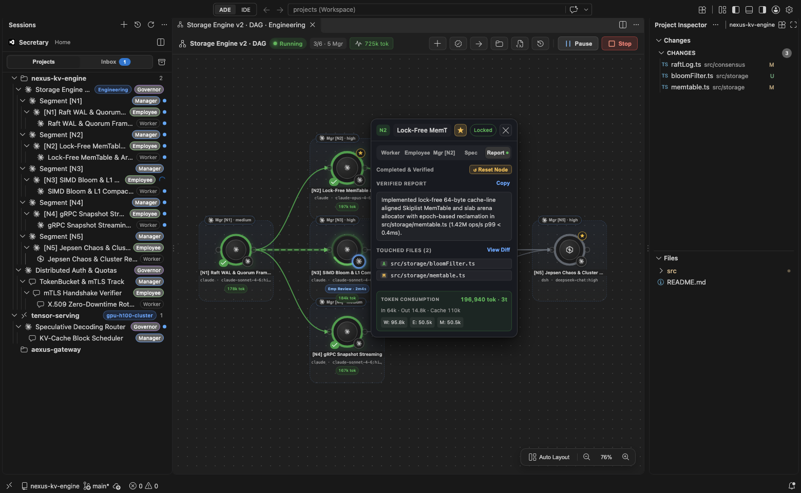
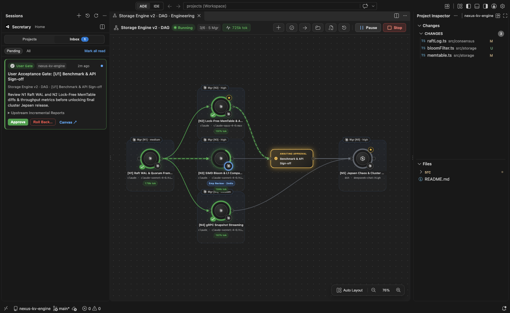
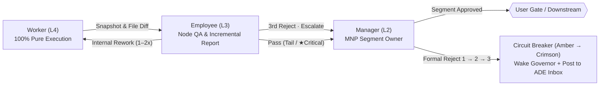

<p align="center">
  
</p>

<h1 align="center">Aexus Code</h1>

<p align="center">
  <strong>An Organizational Agent Development Environment (ADE) &amp; Mirror-Symmetric IDE in One Native Workbench</strong><br/>
  8 Native Coding Agent Engines · 4-Tier Hierarchical Orchestration · Visual Engineering DAG · Zero-Server SSH Cloud Hosts
</p>

<p align="center">
  <a href="LICENSE.txt"></a>
  
  
  
  
</p>

<p align="center">
  <strong>English</strong> · <a href="docs/README.zh-CN.md">简体中文</a> · <a href="AEXUS.md">Architecture Notes (AEXUS.md)</a>
</p>

---

<p align="center">
  
</p>

## Overview

Most AI-enabled editors bolt a single-thread chat sidebar onto a text editor. As soon as engineering work scales across parallel subsystems, prompts bloat, supervisory rules pollute coding context, acceptance criteria go unverified, and switching to remote GPU/Linux servers requires deploying heavyweight proprietary server daemons.

**Aexus Code** reimagines the workbench from the ground up on top of open-source `Code - OSS`, uniting an **Organizational Agent Development Environment (`ADE`)** and a **Mirror-Symmetric `IDE`** inside the **same native window**:

1. **ADE ⇄ IDE Mirror Symmetry** — Switch instantaneously between multi-agent orchestration (`ADE`) and distraction-free code editing (`IDE`). Both modes share the exact same local and remote project catalog, custom file ordering, open editors, and `Focus ➔ Home ⇄ Forward` navigation state with zero workspace duplication.
2. **4-Tier Organizational Hierarchy + Pinned `✦ Secretary`** — Structure agents into **`Governor (L1) ➔ Manager (L2) ➔ Employee (L3) ➔ Worker (L4)`**, strictly separating orchestration & code-review roles from 100% pure, unpolluted `Worker` coding contexts.
3. **Visual Engineering Workflow DAG** — Turn any `Governor` into a topology-locked visual pipeline with automatic **Maximal Non-Branching Path (`MNP`)** `Manager` partitioning, dual-core concentric task nodes, a 3-stage amber-to-crimson circuit breaker, targeted-rollback **`User Gate`** shields, and live streaming per-role Token telemetry.
4. **8 First-Class Native Coding Agent Engines (BYO CLI, Zero Lock-In)** — Natively orchestrate **Claude Code**, **Codex**, **Google Antigravity**, **Kilo Code**, **OpenCode**, **DeepSeek Harness**, **Cline**, and **Pi** side by side with zero mandatory cloud sign-in or Copilot telemetry.
5. **Zero-Server SSH Cloud Hosts (`aexus-ssh://`)** — Automatically migrate hosts & recent remote folders from VS Code and `~/.ssh/config`, manage multi-OS hosts in **Cloud Host Studio**, add remote workspaces via a unified `+` two-step **Select Host ➔ Live Path Auto-Popup Picker** (with 0ms Backspace parent-folder navigation & Windows multi-drive support), and run SSH PTY terminals right beside local shells.
6. **100% Scriptable `aexus-ade` Local Control Plane** — Every UI capability is exposed over a token-authenticated `0600` local Unix socket (`~/.aexus-code/ade-control.sock`).

---

## Visual Tour & Core Capabilities

### 1. Four-Tier Agent Organization & Live Diff Inspection (`Employee [L3] ≠ Worker [L4]`)

At the top of the ADE `Sessions` dispatch rail sits **`✦ Secretary`**, a viewport-aware global coordinator that perceives your active project, open editors, and full session hierarchy. Below it, each project organizes parallel multi-engine teams while the center workbench pairs rich agent sessions with live side-by-side Git diffs and the right-hand `Project Inspector` (`Changes` + `Files`):

<p align="center">
  
</p>

> [!IMPORTANT]
> **Architectural Invariant: `Employee (L3)` Is Never a `Worker (L4)`**
> - **`Governor [L1]`, `Manager [L2]`, and `Employee [L3]`** are formal orchestration and quality-assurance ranks. Upon creation, Aexus Code briefly locks input for a one-time role & `aexus-ade` API warmup so subsequent turns carry zero repeated system-prompt overhead. In Engineering workflows, `Employee (L3)` acts exclusively as a per-node code reviewer, test verifier, and incremental report author — **never editing business source files directly**.
> - **`Worker [L4]`** sits at the leaf of the hierarchy and is the **only 100% pure native coding tier**: no orchestration prompts are injected, no subordinate APIs are attached, and no nested sub-sessions can be spawned, preserving maximum reasoning capacity for code generation and debugging.

| Rank | Tier | Primary Responsibility | Control Plane Scope | Context Profile |
| :--- | :---: | :--- | :--- | :--- |
| **`✦ Secretary`** | Global Top | Perceives active viewport, projects & full session tree; assists across ADE | Full ADE control plane (never mutates IDE views) | Viewport + ADE API |
| **`Governor`** | `L1` | System decomposition, cross-segment `Manager` coordination & circuit-breaker triage | Full subordinate tree + `ADE Inbox` escalation | L1 Orchestration Warmup |
| **`Manager`** | `L2` | Owns a Maximal Non-Branching Path segment; handles escalations & critical sign-off | Segment scheduling + formal secondary verdicts | L2 Segment Warmup |
| **`Employee`** | `L3` | Dispatches & audits direct `Worker` output, inspects diffs & writes incremental reports | Direct `Worker` control + node pass/reject | L3 QA & Review Warmup |
| **`Worker`** | `L4` | Focused implementation, refactoring & test execution | **None (Leaf execution node)** | **100% Native Unpolluted** |

---

### 2. ADE Engineering: Dynamic Collaborative DAG, Dual-Layer QA & Live Token Telemetry

Right-click any top-level `Governor` and select **`Engineering`** to promote ad-hoc prompting into a **deterministic, topology-locked DAG pipeline** (persisted cleanly under `~/.aexus-code/engineering/<governor-id>/` with zero clutter in your Git repository):

<table>
  <tr>
    <td width="50%">
      
      <p align="center"><sub><strong>Verified Acceptance Report, Touched Files &amp; Per-Role Token Telemetry</strong></sub></p>
    </td>
    <td width="50%">
      
      <p align="center"><sub><strong>Mix All 8 Native Engines, Models &amp; Thinking Effort Levels per Role</strong></sub></p>
    </td>
  </tr>
  <tr>
    <td width="50%">
      
      <p align="center"><sub><strong>User Gate Sign-off Card — Upstream Reports &amp; Directed Rollback</strong></sub></p>
    </td>
    <td width="50%">
      
      <p align="center"><sub><strong>ADE Inbox Actionable Gate Queue Synchronized with Live DAG</strong></sub></p>
    </td>
  </tr>
</table>

<p align="center">
  
</p>

- **Algorithmic Maximal Non-Branching Path (`MNP`) Partitioning**: Author nodes visually or in Markdown + Mermaid; Aexus Code automatically partitions linear segments between forks, joins, and `user_gate` boundaries into dedicated `Manager` segments and pre-builds the locked 4-tier sidebar hierarchy.
- **Dual-Core Concentric Nodes & Flowing Edges**: The inner core represents the `Worker (L4)`; the outer satellite ring represents the `Employee (L3)`. Active sub-roles pulse with emerald breathing highlights, live phase timers (`Worker · Ns` / `Emp Review · Ns`), and animated dashed edges.
- **Dual-Layer Review Loop & 3-Stage Circuit Breaker**:
  - `Employee` internal rejections (attempts 1–2) iterate in-place on the existing `Worker` session; a 3rd rejection escalates to the segment `Manager`, who resets retry counters and grants a guided 4th attempt.
  - Segment-tail nodes and `★Critical` nodes require secondary formal sign-off from the segment `Manager`.
  - Formal `Manager` rejections progress visually from **Light Amber (`failure_1`) ➔ Deep Amber (`failure_2`) ➔ Crimson Circuit-Broken (`failure_3`)**, pausing the branch, waking the `Governor` for root-cause evaluation, and posting an actionable alert to **`ADE Inbox`**.
- **Directed-Rollback `User Gate` Shields**: Milestone gates glow amber (`Review Gate`) with deduplicated upstream `Employee` reports; approve in one click to unlock downstream tracks, or roll back specific upstream nodes along directed path intersections **without resetting unrelated parallel branches**.
- **Right-Click Role Cards & Streaming Token Counter**: Hovering never obscures the canvas — **right-click** any node or segment header to open a 5-tab inspector (`Worker | Employee | Mgr | Spec | Report`) to mix engines/models/thinking levels across roles, expand per-turn Git diffs, or inspect live streaming token usage across `Governor / Manager / Employee / Worker`.



---

### 3. Zero-Server SSH Cloud Hosts & Live Interactive Path Picker (`aexus-ssh://`)

Connect local `file://` projects and multiple Linux, macOS, and Windows SSH Cloud Hosts (`aexus-ssh://<alias>/<path>`) inside **one unified window** over multiplexed OpenSSH (`ControlMaster`) — with **zero `vscode-server` installation required on remote machines**:

<p align="center">
  
</p>

<p align="center">
  
</p>

- **Automatic VS Code & `~/.ssh/config` Migration**: Recursively parses OpenSSH `Include` directives (honoring first-match-wins semantics) and imports host platforms (`linux` / `macos` / `windows`), `ProxyJump` bastions, and recent remote project directories from VS Code's `settings.json`, `state.vscdb`, `storage.json`, and `Project Manager` — without ever reading or copying private key contents.
- **Unified `+` Two-Step Host ➔ Live Path Auto-Popup Flow**:
  - **Step 1 (`Select Host`)**: Pick `Local (This Computer)` or any saved/migrated Cloud Host directly in a single flat list.
  - **Step 2 (`Select Folder on <Host>`)**: Opens with the remote path pre-filled in the input bar and **current subfolders automatically popped up below**. Type ahead for instant fuzzy highlighting, press `Enter` to drill into a subfolder, or **press `Backspace` across `/` to pop up parent-directory folders in 0ms from cache** (backing out to `/` on Windows hosts even lists all remote drives `C:/`, `D:/`, etc.).
- **Native Remote File System, Git Diffs & Hybrid SSH Terminals**: Save remote files directly from Monaco (`Cmd+S`), inspect remote `HEAD` diffs, and press `` Ctrl+Shift+` `` on any Cloud Host project to launch an interactive SSH PTY terminal right alongside local project shells.

---

### 4. IDE Mirror Symmetry: Hybrid Multi-Root Explorer, Clean Top Agent Bar & Project `Focus`

Flip the top mode switch to **`IDE`** for a fast, streamlined coding workspace that stays 100% synchronized with ADE:

<p align="center">
  
</p>

- **Hybrid Local + Cloud SSH Explorer & Drag-to-Sort Ordering**: Browse and edit local `file://` folders and `aexus-ssh://` remote folders side by side; drag and drop siblings to customize file, folder, and project root display order without moving files on disk.
- **Project `Focus ➔ Home ⇄ Forward` Navigation**: Right-click any project root and choose **Focus** to isolate that project across Explorer and ADE; use the top-left **Home** and **Forward** controls to jump effortlessly between workspace overview and deep single-project focus.
- **Single-Icon Extension Bar & Explicit Project Binding**: The top-right bar lists installed user extensions and all 8 Coding Agents cleanly once each, while the right sidebar header displays and switches the exact project bound to the active Coding Agent.

---

## 8 Native Coding Agent Engines

Every engine runs locally via its native CLI/RPC protocol (`requiresCopilotSignIn: false`), unified by `extensions/aexus-agents` for session discovery, attachment, streaming chat, cancellation, permanent history deletion, and zero-latency role synchronization:

| Engine | Session Type | Default CLI | Native Protocol & Role Sync Mechanism |
| :--- | :--- | :--- | :--- |
| **Claude Code** | `aexus-claude` | `claude` | Bidirectional `stream-json` + dynamic role warmup + live turn token telemetry |
| **Codex** | `aexus-codex` | `codex` | `app-server` JSON-RPC with `thread/inject_items` role context sync |
| **Google Antigravity** | `aexus-antigravity` | `agy` | Local `--hub` ConnectRPC proxy (`StartCascade` / `SendUserCascadeMessage`) |
| **Kilo Code** | `aexus-kilo` | `kilo` | ACP runtime bridge + request-level role synchronization |
| **OpenCode** | `aexus-opencode` | `opencode` | Dual native UI panel + ACP session lifecycle integration |
| **DeepSeek Harness** | `aexus-dsh` | `dsh` | Zero-latency extension-host `dshRolePreload` synchronization |
| **Cline** | `aexus-cline` | `cline` | `--acp` streaming protocol & automated permission bridge |
| **Pi** | `aexus-pi` | `pi` | `--mode rpc` structured event stream & thinking progress |

---

## `aexus-ade` Control Plane CLI

Aexus Code exposes a local `0600` Unix socket (`~/.aexus-code/ade-control.sock`) and automatically injects `aexus-ade` into integrated terminals and orchestrated agent environments:

```bash
# 1. Inspect workbench state, switch mode & sync VS Code SSH Cloud Hosts
aexus-ade status --json
aexus-ade mode set ade
aexus-ade host import-vscode
aexus-ade project add gpu-h100-cluster:/workspace/tensor-serving

# 2. Spawn a 4-tier hierarchy and run synchronous orchestrated turns
GOV_ID=$(aexus-ade session create --project nexus-kv-engine --engine claude --role governor --title "Storage Lead" --no-open --json | jq -r .id)
MGR_ID=$(aexus-ade session create --project nexus-kv-engine --parent "$GOV_ID" --engine codex --title "WAL Track" --no-open --json | jq -r .id)
aexus-ade session send "$GOV_ID" "Design parallel Raft WAL and Lock-Free MemTable milestones" --wait

# 3. Initialize, apply & execute a visual Engineering DAG blueprint
aexus-ade engineering init --governor "$GOV_ID" --open
aexus-ade engineering blueprint apply --governor "$GOV_ID" --file ./blueprint.md
aexus-ade engineering run --governor "$GOV_ID"
aexus-ade engineering status --governor "$GOV_ID" --json

# 4. Inspect ADE Inbox alerts and approve a User Acceptance Gate
aexus-ade inbox list --unread-only
aexus-ade engineering gate --governor "$GOV_ID" --node U1 --verdict pass
```

| Command Group | Subcommands |
| :--- | :--- |
| `status` / `mode` / `view` | `status` · `mode [get \| set <ade\|ide>]` · `view [--archived] [--inspector <changes\|files\|hide>] [--refresh]` |
| `project` | `list` · `add <path\|host:/path>` · `select` · `remove` · `delete` · `focus` · `home` · `forward` · `move` · `changes` · `files` · `open-file` · `open-diff` |
| `host` | `list` · `info` · `add` · `update` · `remove` · `test` · `browse` · `import-vscode` · `open` |
| `engine` | `list` · `sessions <engine> [--project <p>] [--limit <n>]` |
| `session` | `list` · `info` · `subordinates` · `tree` · `create` · `attach` · `open` · `send [--wait]` · `history` · `stop` · `rename` · `role` · `move` · `reorder` · `archive` · `unarchive` · `delete` |
| `secretary` | `status` · `open` · `engine` · `reset` · `send [--wait]` · `history` · `stop` · `draft` · `mark-read` |
| `engineering` | `list` · `init` · `open` · `blueprint <get\|apply\|validate>` · `run` · `pause` · `resume` · `stop` · `reset` · `configure` · `diff` · `reports` · `status` · `review` · `gate` · `watchdog-action` · `remove` |
| `inbox` | `list [--unread-only]` · `post` · `resolve` · `mark-read` |

---

## Building & Running from Source

### Prerequisites

- **Platform**: macOS (Apple Silicon `arm64` validated end-to-end for standalone packaging, code signing, and runtime verification)
- **Toolchain**: `./scripts/aexus-env.sh` automatically pins the compatible Node.js (`22.x`) and `pnpm` toolchain; requires Xcode Command Line Tools, Python 3, and system OpenSSH

### Quick Start

```bash
# 1. Install dependencies
./scripts/aexus-env.sh pnpm install

# 2. Fast transpile build & launch from source
./scripts/aexus-env.sh pnpm run build-fast
./scripts/aexus-env.sh ./scripts/code.sh

# 3. Package standalone macOS arm64 application & install to /Applications/Aexus Code.app
./scripts/aexus-env.sh pnpm run gulp vscode-darwin-arm64
./scripts/aexus-install.sh
```

User settings live in `~/Library/Application Support/Aexus Code` and extensions live in `~/.aexus-code/extensions`, cleanly isolated from any existing VS Code installation.

---

## Repository Architecture

- [`src/vs/platform/ade/`](src/vs/platform/ade/) — Cross-process contracts & Node services (`adeControlServer`, `adeEngineeringService` & hybrid Markdown/Mermaid blueprint parser, `adeCloudHostService` multiplexed SSH transport, and non-destructive `vscodeConfigMigration`).
- [`src/vs/workbench/contrib/ade/`](src/vs/workbench/contrib/ade/) — ADE workbench UI & orchestration services (`adeProjectsView` 4-tier session tree & `Inbox`, `adeEngineeringEditorPane` interactive DAG canvas, `adeCloudHostsEditorPane` Cloud Host Studio, `adeCloudHostFileSystemProvider` `aexus-ssh://` provider & live path picker, and `adeInspectorViews`).
- [`src/vs/workbench/contrib/terminal/`](src/vs/workbench/contrib/terminal/) — `ProjectTerminalService` routing integrated terminals seamlessly between local project shells and remote SSH PTY sessions.
- [`extensions/aexus-agents/`](extensions/aexus-agents/) — Unified runtime adapters for all 8 native Coding Agent engines, zero-latency role bridges, and the `bin/aexus-ade` CLI.

---

## Security, Privacy & License

- **Local-First & Zero Credential Exposure**: Orchestration runs strictly over a `0600` local Unix socket with per-launch token authentication. SSH Cloud Host migration reads only public host aliases and directory metadata — private key contents and passphrases are never copied or stored. Built-in upstream Copilot extensions, token endpoints, and proprietary agent backends have been completely removed.
- **License & Attribution**: Derived from Microsoft [`Code - OSS`](https://github.com/microsoft/vscode) and released under the **[MIT License](LICENSE.txt)** with all upstream copyright notices preserved. See [AEXUS.md](AEXUS.md) for icon attribution and Visual Studio Marketplace compliance notes prior to commercial or public binary redistribution.
