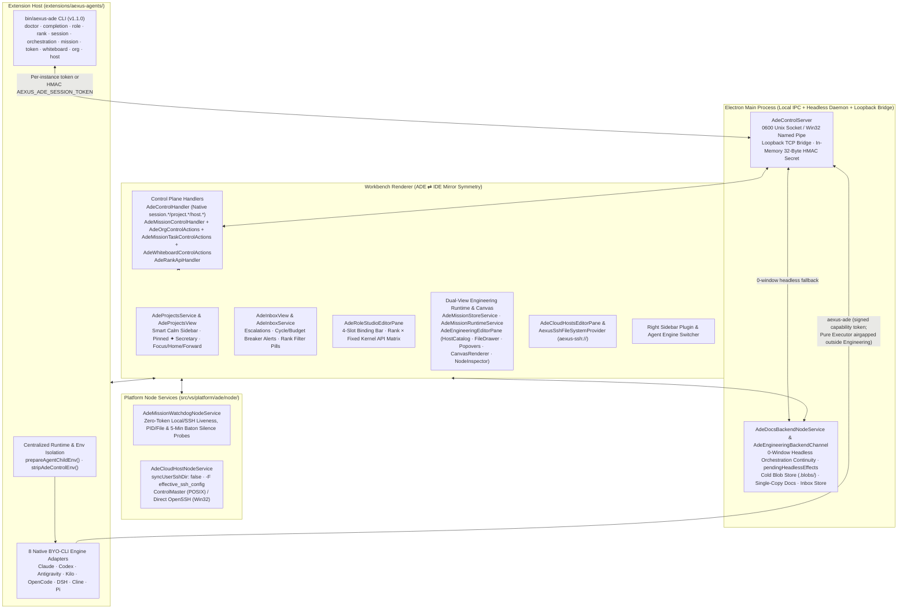
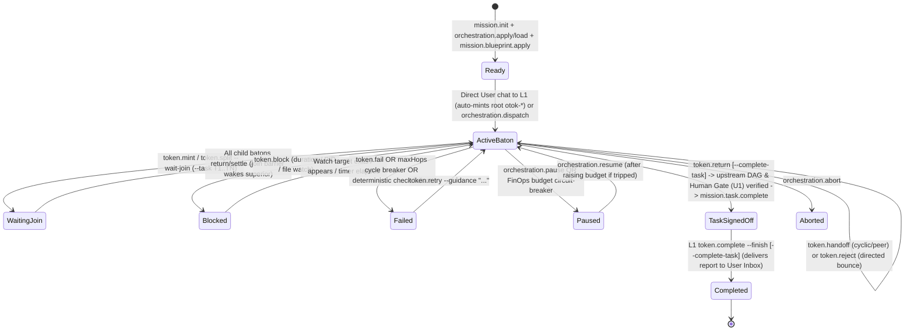

# Aexus Code Architecture

Aexus Code (`v1.1.0`) is an open-source, MIT-licensed desktop workbench built on `Code - OSS` (`1.146.0`) that unites a full-parity **IDE (`IDE`)** and a multi-agent **Agent Development Environment (`ADE`)** inside one cross-platform Electron application (`macOS`, `Windows`, `Linux`), using the open-source [Open VSX Registry](https://open-vsx.org/).

> [!NOTE]
> `docs/ARCHITECTURE.md` is the canonical architecture reference for Aexus Code (consolidating and superseding retired legacy notes, with Open VSX compliance and original Aexus branding).

---

## 1. High-Level System & Control-Plane Topology

---

## 2. Dual-View Orchestration & Unified `otok-*` Baton State Machine

---

## 3. Module Map

| Layer | Path | Key Responsibilities |
| :--- | :--- | :--- |
| **Platform Core & Dual-View Orchestration Engine** | [`src/vs/platform/ade/common/`](../src/vs/platform/ade/common/) | `adeControl.ts` (`stripAdeControlEnv()` airgap scrubber & IPC constants) + `adeControlPolicy.ts` (shared renderer/headless RBAC & compact projections); `adeRoleSchema.ts` (extensible `1..N` rank schema, 5 presets, 4 structural slots, fixed kernel primitive APIs, `canRankSupervise`, KV-cache-stable `compileAdeRoleStaticCharter` + `### Live Role Bindings` `compileAdeRolePrompt`); `adeMessageEnvelope.ts` (anti-spoofing `sanitizeAdeSystemEnvelopeHeaders()` + multiline-safe `sanitizeAdeEnvelopeMetadataField()` across `[Aexus System · Baton Token \| Direct Message from Role \| Message from User (L-1)]` envelopes); `adeMissionDag.ts` (`parseDualViewBlueprintMarkdown()`, Mermaid Task DAG parser, `%% task` authority, `completionContract` guardrails, Human Gate `kind === 'gate'` rules, `%% check` hooks); `adeOrchestrationGraph.ts` & `adeOrchestrationConfig.ts` (cyclic all-staff graph parser/serializer, Code-as-Orchestration `.json`/`.mjs` compiler); **modular Orchestration engine** (`adeOrchestrationTypes.ts`, `adeOrchestrationTasks.ts`, `adeOrchestrationWhiteboards.ts` with TOC/section slicing, `adeOrchestrationArchive.ts`, `adeOrchestrationStaffPlans.ts`, `adeOrchestrationPipeline.ts`, `adeOrchestrationLifecycle.ts`, `adeOrchestrationRecovery.ts`, `adeOrchestrationEngine.ts` with `scopePaths` conflict detection, `all|any|quorum` + `--deadline` join barriers, `mission.diagnostics` & checkpoints); `adeEngineeringIpc.ts`; `adeRankResize.ts`, deduplicated `adeDocsCatalog.ts`, Rev 11 `adeApiRegistry.ts`; `adeCloudHosts.ts` & `adeModelPricing.ts`. |
| **Platform Node Services & Headless Daemon** | [`src/vs/platform/ade/node/`](../src/vs/platform/ade/node/) | `adeControlServer.ts` (local IPC server + loopback TCP bridge, `0600` metadata, in-memory HMAC capability tokens); `adeDocsBackendService.ts` & `adeDocsSync.ts` (0-window main-process headless Orchestration continuity, durable mutation `idempotencyKey` ledger, `pendingHeadlessEffects` queue, `.blobs/` cold storage, `.checkpoints/` snapshots & `.archive.jsonl` compaction, single-copy `docs/ranks/L0..LN.md`, `docs/engineering/ENGINEERING_*.md`, `docs/mission/MISSION_API.md` & Inbox store); `adeMissionWatchdogService.ts` (zero-token local/SSH liveness, PID/file, join-deadline & configurable silence probes); `adeCloudHostService.ts` (`syncUserSshDir: false` default, `-F effective_ssh_config`, scrubbed OpenSSH transport); `vscodeConfigMigration.ts`. |
| **Workbench ADE UI & Modular Control Handlers** | [`src/vs/workbench/contrib/ade/browser/`](../src/vs/workbench/contrib/ade/browser/) | `adeControlHandler.ts` (native `session.*`, `project.*`, `host.*`, `inbox.*` & `mission.init/list/blueprint` RBAC); **modular Mission/Orchestration control plane** (`adeMissionControlHelpers.ts`, `adeOrgControlActions.ts`, `adeMissionTaskControlActions.ts`, `adeWhiteboardControlActions.ts`, `adeMissionControlHandler.ts` facade) + `adeRankApiHandler.ts`; `adeMissionStore.ts` & `adeMissionRuntime.ts` (persistent Dual-View store, 429/502 exponential backoff retry, deterministic check execution, zero-leak staff removal & watchdog wiring); modular Dual-View Canvas (`adeEngineeringEditorPane.ts`, `adeMissionHostCatalog.ts`, `adeMissionFileDrawer.ts`, `adeMissionPopovers.ts`, `adeMissionCanvasRenderer.ts`, `adeMissionNodeInspector.ts`); `adeProjectsView.ts`, `adeInboxView.ts`, `adeRoleStudioEditorPane.ts`, `adeCloudHostsEditorPane.ts`, `adeCloudHostFileSystemProvider.ts`. |
| **Hybrid Terminal Routing** | [`src/vs/workbench/contrib/terminal/`](../src/vs/workbench/contrib/terminal/) | `ProjectTerminalService` routes integrated terminals automatically between local shells (`file://`) and interactive remote SSH PTYs (`aexus-ssh://`, using `-F effective_ssh_config`). |
| **8-Engine Runtime & CLI** | [`extensions/aexus-agents/`](../extensions/aexus-agents/) | Unified adapters (`claude.ts`, `codex.ts`, `acp.ts`, `kilo.ts`, `pi.ts`), public upstream default model catalogs (`capabilities.ts`), identity-keyed client pools `(cwd, sessionId, rank, pure)`, centralized `runtime.ts` child-env builder, zero-warmup Turn-1 prompt injection with prompt-hash invalidation & auto-compaction reset (`extension.ts`), opt-out third-party role bridge (`nativeRoleBridge.ts`), Secretary commands, and the `aexus-ade` CLI (`adeCli.ts`, `adeCliMissionRuntime.mjs`, `adeCliRankMission.mjs`, `v1.1.0`, `schemaVersion: 1`, bash/zsh/fish/powershell completions). |

---

## 4. Core Architectural Principles

### 4.1 Native Employee APIs vs. Engineering Canvas Staff APIs
Aexus Code maintains a strict, intentional separation between **native core ADE sessions** and **Engineering Orchestration canvas nodes**:
- **Native Core ADE Employee APIs (`session.*`, `project.*`, `host.*`, `inbox.*`)**: Creating and managing regular hierarchical employee sessions (`aexus-ade session create|attach|send|move|role|rename|configure|archive|delete`) is a **native built-in ADE capability** (NOT an Engineering-only feature) available in any ADE project workspace.
- **Engineering-Exclusive Canvas Staff APIs (`orchestration staff *`)**: Adding, configuring, renaming, or removing an employee **node inside an Engineering Orchestration canvas** MUST call `aexus-ade orchestration staff create|config|rename|remove --mission <id> ...` (or `orchestration apply|load`). Calling native `session create` creates a regular ADE session outside the canvas and is explicitly blocked on locked Engineering parents; conversely, `orchestration staff remove` cleanly aborts active turns, stops/deletes the sidebar session, reclaims in-flight `otok-*` tokens, re-parents surviving child tokens, settles waiting join barriers, and purges stale Task DAG assignees with zero leaks.

### 4.2 Dual-View Engineering Architecture & Unified `otok-*` Baton Bus
- **View 1 — Cyclic All-Staff Orchestration Canvas**: Places all participating tiers (`L1..LN`) on the same canvas (no off-graph wall) with strict 1-to-1 employee uniqueness, arbitrary cycles & `<-->` bidirectional review loops, radial/LR/TD/grid layouts, and **Department Shared Whiteboards** (`whiteboard create|list|read [--toc|--section <h>|--tail <n>]|write [--section <h>] [--expected-version <n>]|rename|remove` and `token read <ptrs> [--toc|--section <h>]`).
- **View 2 — Strictly Acyclic Circular Mission Task DAG**: Represents concrete engineering deliverables (`T1 --> T2 --> T3`) rendered as luminous circular task orbs. Binding tokens via `--task <taskId>` automatically updates live task status (`in_progress` / `blocked`), current assignee, active tokens, elapsed time, and artifact pointers — while **never auto-marking `completed`**. Authorized superiors explicitly sign off via `aexus-ade mission task complete`, enforced by BOTH per-node completion authority (`owner` / `completers` / `min_tier` / direct or transitive supervisor) AND a hard upstream dependency gate (`INCOMPLETE_DEPENDENCIES`).
- **Unified Pointer-Native `otok-*` Bus**: Direct User chat to the `L1` lead automatically mints a root `otok-*` baton (zero duplicate self-dispatch). Superiors fan out heterogeneous sub-tasks strictly downward (`token mint` / `token split --wait-join`), subordinates return results along provenance (`token return`), peers relay or bounce feedback (`token handoff` / `token reject`), failures escalate or retry (`token fail` / `token retry`), and cyclic re-entry carries only O(1) delta pointers (`hop-N`, `art-N`, `dec-N`, `wb:<id>`).

### 4.3 Main-Process 0-Window Headless Continuity & Fault-Tolerance Guardrails
- **Headless Main-Process Daemon (`AdeDocsBackendNodeService` + `AdeEngineeringBackendChannel`)**: When all Electron renderer windows close or reload, the main-process daemon continues serving headless `orchestration.status|pause|resume|abort|limits` and `token.read|history` requests, buffers side-effects in durable `pendingHeadlessEffects`, externalizes large/cold blobs to `.blobs/<ptr>.json`, and replays pending effects cleanly when a workbench window re-attaches.
- **Built-in Guardrails**:
  - **Cycle Circuit-Breaker (`maxHops`)**: Freezes runaway cyclic relay chains at `maxHops` (default `64`, configurable via `orchestration limits --max-hops <N>`), settles join barriers, and posts a critical Inbox alert.
  - **FinOps Budget Hard Circuit-Breaker**: Tracks multi-engine USD spend across all 8 engines and hard-pauses Orchestration when `totalCostUsd >= budgetLimitUsd` (`orchestration limits --budget <usd>`), latching until Human raises or clears the cap.
  - **Zero-Token Deterministic Check Gates (`%% check` / `%% staff-check`)**: Runs local or remote SSH build/lint/test/file assertions automatically before baton delivery/completion.
  - **429/502 Transient Engine Retry**: Automatically retries rate-limit / upstream gateway dispatches with bounded exponential backoff before failing a baton.

### 4.4 Extensible Organization Schema, Lineage RBAC & Single-Copy Docs
- **5 Built-In Presets + Dynamic Rank Resize (`1..N` Tiers)**: `default-4tier`, `startup-3tier`, `research-lab`, `security-audit`, `flat-swarm`, stored in `aexus.ade.organization` (`scope: application`, `restricted: true` so untrusted repos cannot tamper with prompts or API grants).
- **Server-Signed Capability Tokens & Top-Down Lineage**: `AdeControlServer` verifies HMAC-SHA256 `AEXUS_ADE_SESSION_TOKEN` tokens in constant time; `AdeControlHandler` & `AdeOrgControlActions` verify live sessions, intersect live ranks, and enforce strictly top-down `canRankSupervise` + department/subtree jurisdiction across custom and localized executive subgraphs.
- **Single-Copy Docs**: Written under `~/.aexus-code/docs/` as sibling directories: `common/COMMON_API.md`, `ranks/L0..LN.md` (Native Rank CLI), `engineering/ENGINEERING_PARADIGM.md` & `ENGINEERING_API.md` (Dual-View paradigm & CLI), and `mission/MISSION_API.md`.

### 4.5 ADE ⇄ IDE Mirror Symmetry & Zero-Server SSH Cloud Hosts (`aexus-ssh://`)
- **Single Unified Project Universe**: `ADE` and `IDE` share one project catalog (mixing local `file://` and `aexus-ssh://` folders), drag-to-reorder order, open tabs, and `Focus → Home ⇄ Forward` state (`Alt+Cmd/Ctrl+A`).
- **Zero-Server OpenSSH Transport**: Edits remote files, shows Git `HEAD` diffs, discovers/runs remote coding agents, and opens remote SSH PTY terminals with zero remote daemon installation and **`syncUserSshDir: false`** (writes `-F <userDataDir>/ssh/effective_ssh_config`, leaving `~/.ssh/config` untouched).

---

## 5. CI/CD, Packaging & Version Parity

- **Version Parity (`1.1.0`)**: `.github/workflows/aexus-ci.yml` verifies on every push/PR that `product.json` (`aexusVersion`), `extensions/aexus-agents/package.json` (`version`), and `extensions/aexus-agents/src/adeCli.ts` (`ADE_CLI_VERSION`) stay in strict lockstep.
- **Full-Coverage CI**: Runs minimal native install (`pnpm install --frozen-lockfile --ignore-scripts && pnpm rebuild @vscode/sqlite3`), `transpile-client`, `esbuild.mts`, `typecheck-client`, `tsc` on `extensions/aexus-agents`, `eslint --max-warnings=0` across `src/vs/platform/ade`, `src/vs/workbench/contrib/ade`, and `extensions/aexus-agents/src`, ADE platform Node unit tests (including Dual-View validation of all 6 `examples/blueprints/*.md`), headless Linux (`xvfb-run`) Electron browser workbench unit tests (`adeControlAndViews`, `adeProjectsService`, `cloudHostsBrowser`), cross-platform `aexus-agents` & CLI matrix (`ubuntu`/`macos`/`windows`), and docs/Open VSX/desktop/blueprint integrity checks.
- **Clean Multi-Platform Releases**: `.github/workflows/release.yml` packages macOS (`arm64`/`x64`) `.dmg` & `.zip`, Linux (`x64`) `Aexus-Code-linux-x64` `.tar.gz`, Windows (`x64`) `.zip`, and `SHA256SUMS.txt`.

---

## 6. Data & Isolation Paths

| Artifact | Location | Notes |
| :--- | :--- | :--- |
| **User Settings** | macOS: `~/Library/Application Support/Aexus Code` Windows: `%APPDATA%\Aexus Code` Linux: `~/.config/Aexus Code` | Completely isolated from upstream VS Code settings. |
| **Installed Extensions** | `~/.aexus-code/extensions` | Sourced from [Open VSX](https://open-vsx.org/) or local `.vsix`. |
| **Control Plane IPC & Meta** | `~/.aexus-code/ade-control.<pid>.sock` & `.json` (POSIX `0600`) `\\.\pipe\aexus-ade-control-*` (Windows) | Per-instance metadata prevents cross-window misrouting. |
| **Headless Missions, Blobs, Checkpoints & Archives** | `~/.aexus-code/missions/<id>.json` `~/.aexus-code/missions/<id>.blobs/<ptr>.json` `~/.aexus-code/missions/<id>.checkpoints/<cpId>.json` `~/.aexus-code/missions/<id>.archive.jsonl` | Persisted by main-process daemon for 0-window continuity, durable rollback checkpoints & bounded JSON size. |
| **Single-Copy API Docs & Inbox** | `~/.aexus-code/docs/common/COMMON_API.md` `~/.aexus-code/docs/ranks/L0..LN.md` `~/.aexus-code/docs/engineering/ENGINEERING_*.md` `~/.aexus-code/docs/mission/MISSION_API.md` | Cleanly separates Native Rank CLI manuals from Dual-View Engineering manuals. |
| **Effective SSH Config** | `<userDataDir>/ssh/effective_ssh_config` | Passed via `-F` strictly to Aexus SSH commands (`syncUserSshDir: false` leaves global `~/.ssh/config` untouched). |
