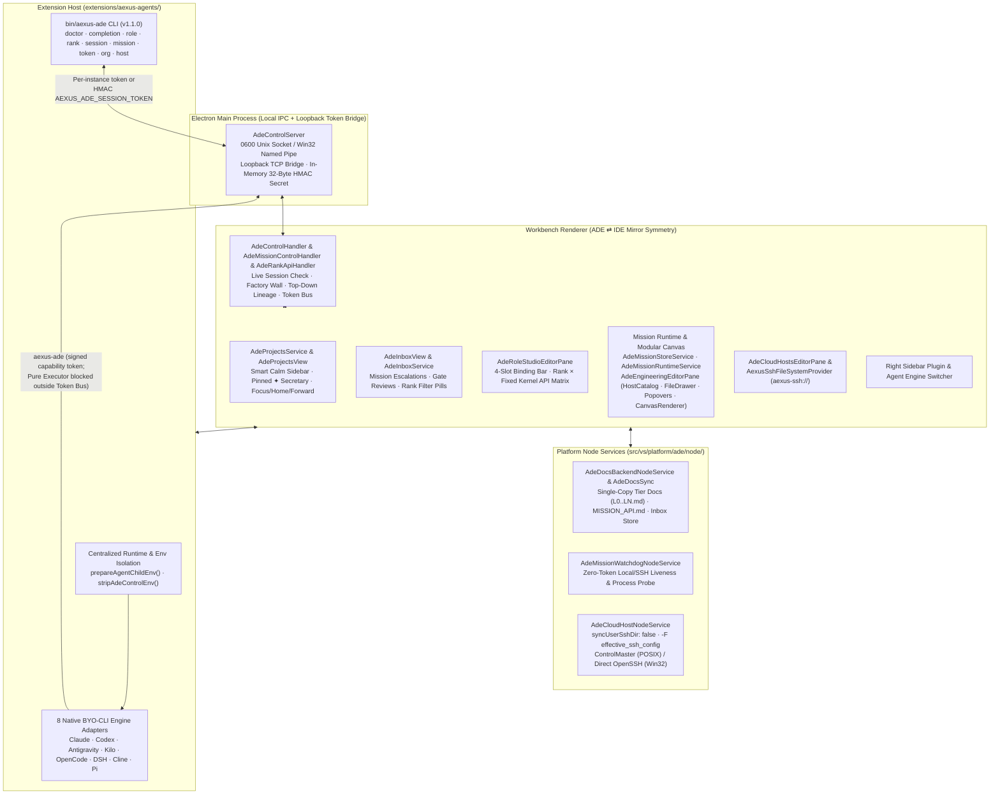
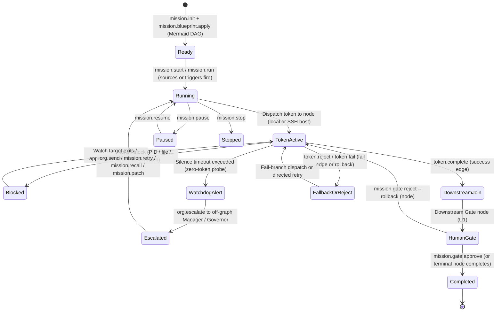

# Aexus Code Architecture

Aexus Code (`v1.1.0`) is an open-source, MIT-licensed desktop workbench built on `Code - OSS` (`1.146.0`) that unites a full-parity **IDE (`IDE`)** and a multi-agent **Agent Development Environment (`ADE`)** inside one cross-platform Electron application (`macOS`, `Windows`, `Linux`), using the open-source [Open VSX Registry](https://open-vsx.org/).

> [!NOTE]
> `docs/ARCHITECTURE.md` is the canonical architecture reference for Aexus Code (consolidating and superseding retired legacy notes, with Open VSX compliance and original Aexus branding).

---

## 1. High-Level System & Control-Plane Topology

---

## 2. Mission DAG Runtime & Token Bus State Machine

---

## 3. Module Map

| Layer | Path | Key Responsibilities |
| :--- | :--- | :--- |
| **Platform Contracts & Pure Logic** | [`src/vs/platform/ade/common/`](../src/vs/platform/ade/common/) | `adeControl.ts` (`stripAdeControlEnv()` airgap scrubber & IPC constants); `adeRoleSchema.ts` (extensible rank schema, 5 presets, 4 structural slots, fixed kernel primitive APIs including `mission.read/design/destroy/control` and `host.access/manage`, `canRankSupervise`, `{{variables}}` compiler); `adeMissionDag.ts` & `adeMissionEmployee.ts` (pure Mermaid DAG parser, `@Employee:` context-reuse grouping, flat layered auto-layout, smooth draw.io orthogonal router); `adeMissionEngine.ts` (Token Bus state machine, DAG scheduling, rollback/recall, atomic live `mission.patch`, source triggers); `adeMissionBoundary.ts` (Factory Wall off-graph/in-graph cutoff enforcement); `adeRankResize.ts`, `adeDocsCatalog.ts`, `adeApiRegistry.ts` (hot rank resizing, live aliases, single-copy API docs); `adeCloudHosts.ts` (SSH host contracts). |
| **Platform Node Services** | [`src/vs/platform/ade/node/`](../src/vs/platform/ade/node/) | `adeControlServer.ts` (local IPC server + loopback TCP bridge for remote/sandboxed agents, per-instance `0600` metadata, in-memory HMAC capability token minting & verification); `adeDocsBackendService.ts` & `adeDocsSync.ts` (single-copy `docs/ranks/L0..LN.md` + `docs/mission/MISSION_API.md` sync & Inbox persistence); `adeMissionWatchdogService.ts` (zero-token local/SSH liveness & PID/file watcher); `adeCloudHostService.ts` (`syncUserSshDir: false` default, `-F effective_ssh_config`, scrubbed OpenSSH transport); `vscodeConfigMigration.ts` (non-destructive VS Code SSH/proxy/non-secret state migration). |
| **Workbench ADE UI & Mission Orchestration** | [`src/vs/workbench/contrib/ade/browser/`](../src/vs/workbench/contrib/ade/browser/) | `adeControlHandler.ts`, `adeMissionControlHandler.ts`, `adeRankApiHandler.ts` (lineage-scoped RBAC, live session rank check, Factory Wall enforcement, Token Bus & Mission APIs); `adeMissionStore.ts` & `adeMissionRuntime.ts` (persistent Mission graphs, per-node pre-prompts, host bindings, Token Bus dispatch & watchdog integration); modular Mission Canvas (`adeEngineeringEditorPane.ts` lean coordinator + `adeMissionHostCatalog.ts` TTL-cached host/engine availability probing & persistent model recategorizer + `adeMissionFileDrawer.ts` diff-checked Run controls & Mermaid/Pre-Prompt split drawer + `adeMissionPopovers.ts` unified floating popovers + `adeMissionCanvasRenderer.ts` Armored Pods, in-place DOM telemetry patching & RAF-throttled SVG edge rerouting); `adeProjectsView.ts`, `adeInboxView.ts`, `adeRoleStudioEditorPane.ts`, `adeCloudHostsEditorPane.ts`, `adeCloudHostFileSystemProvider.ts`. |
| **Hybrid Terminal Routing** | [`src/vs/workbench/contrib/terminal/`](../src/vs/workbench/contrib/terminal/) | `ProjectTerminalService` routes integrated terminals automatically between local shells (`file://`) and interactive remote SSH PTYs (`aexus-ssh://`, using `-F effective_ssh_config`). |
| **8-Engine Runtime & CLI** | [`extensions/aexus-agents/`](../extensions/aexus-agents/) | Unified adapters (`claude.ts`, `codex.ts`, `acp.ts` with scrubbed PATH `sqlite3`, `kilo.ts`, `pi.ts`), public upstream default model catalogs (`capabilities.ts`), identity-keyed client pools `(cwd, sessionId, rank, pure)`, centralized `runtime.ts` child-env builder, zero-warmup Turn-1 prompt injection with prompt-hash invalidation & auto-compaction reset (`extension.ts`), opt-out third-party role bridge (`nativeRoleBridge.ts`), Secretary `/mission` command, and the `aexus-ade` CLI (`adeCli.ts`, `v1.1.0`, `schemaVersion: 1`, bash/zsh/fish/powershell completions). |

---

## 4. Core Architectural Principles

### 4.1 ADE ⇄ IDE Mirror Symmetry, Workspace Ordering & Right-Sidebar Switchers
- **Single Unified Project Universe**: `ADE` and `IDE` share the exact same project catalog (mixing local `file://` folders and `aexus-ssh://` remote folders), drag-to-reorder display order (without moving files on disk), open editor tabs, and `Focus → Home ⇄ Forward` navigation state. Toggling with `Alt+Cmd/Ctrl+A` flips only the workbench layout lens — never restarting language servers, closing terminals, or dropping agent sessions.
- **Decoupled Plugin & Agent Engine Switchers**: The top-right bar separates general installed VS Code extensions (left button) from the unified **Agent Engine** switcher (right button, compatible with both local and SSH cloud projects for creating or attaching native sessions).
- **Non-Destructive First-Run VS Code Migration & Proxy Passthrough**: On first launch, Aexus Code optionally imports network proxy settings (`http.*`), non-secret extension global state (strictly excluding `secret://` entries), and SSH host metadata from an existing VS Code profile without touching the original installation, and propagates `http.proxy` / `http.proxySupport` / `http.noProxy` / `http.systemCertificatesNode` and CLI `PATH` to `NativeLocalProcessExtensionHost` and all 8 agent child processes.

### 4.2 Extensible Organization Schema, Factory Wall & Lineage RBAC
Rather than hardcoding one fixed company hierarchy, Aexus Code defines a user-extensible organization schema (`aexus.ade.organization`, `application`-scoped and `restricted: true` so cloned repositories cannot tamper with it):

- **5 Built-In Presets + Dynamic Rank Resize (`1..N` Tiers)**:
  1. `default-4tier`: `Governor (L1) → Manager (L2) → Employee (L3) → Worker (L4 Pure)`
  2. `startup-3tier`: `Tech Lead (L1) → Reviewer (L2) → Builder (L3 Pure)`
  3. `research-lab`: `Principal Investigator (L1) → Research Lead (L2) → Peer Critic (L3) → Experimenter (L4 Pure)`
  4. `security-audit`: `Audit Director (L1) → Lead Auditor (L2) → Verifier (L3) → Scanner (L4 Pure)`
  5. `flat-swarm`: `Coordinator (L1) → Agent (L2 Pure)`
- **Factory Wall (`adeMissionBoundary.ts`)**: Every Mission defines an explicit `offGraphMaxTier` cutoff (default `L1` for User/Secretary-owned Missions, or owner tier for Governor/Manager-owned Missions). Tiers `≤ offGraphMaxTier` stay **off-graph** with strictly top-down supervision (`org.subordinates`, `org.send`, `org.context`, `org.escalate`) and topology patching (`mission.patch`, `mission.recall`, `mission.retry`). Tiers `> offGraphMaxTier` execute **in-graph** via the Token Bus (`token.*`).
- **Fixed Kernel Primitive APIs & Lineage Enforcement**:
  - High-privilege primitives **`project.manage`**, **`host.manage`**, **`mission.destroy`**, and **`mission.control`** are separated and flagged `dangerous: true`.
  - `AdeControlServer` authenticates HMAC-SHA256 `AEXUS_ADE_SESSION_TOKEN` tokens in constant time; `AdeControlHandler` verifies live session existence/rank, enforces `canRankSupervise` + subtree ownership across `session.*` mutations, and requires `mission.destroy` when deleting/archiving a Mission owner.
  - Pure execution ranks (`pureExecution: true`) outside a Mission receive stripped environments (`stripAdeControlEnv`, `aexus-ade` removed from `PATH`) and a `pure: true` deny token. Pure-rank **in-graph Mission nodes** receive a scoped `missionNode: true` capability token strictly limited at the server boundary to `token.*`, `whoami`, `docs.read`, and `api.update`.

### 4.3 Zero-Warmup Inline Turn-1 Injection, Single-Copy Docs & Prompt-Hash Invalidation
- **Single-Copy Tier Docs**: `AdeDocsBackendNodeService` writes alias-agnostic tier manuals under `~/.aexus-code/docs/ranks/L0..LN.md` alongside sibling `docs/mission/MISSION_API.md`, readable on demand via `aexus-ade docs read <L0..LN|common|mission>`.
- **Inline Turn-1 Injection**: Rank charters inject inline on Turn 1, commit only after `engine.send(...)` succeeds, re-inject automatically when Studio edits alter the SHA-256 `promptHash`, and recover cleanly after engine context compaction (`compact_boundary` / `context_compacted`).

### 4.4 High-Performance Modular Mission DAG Canvas & Runtime
- **Pure Mermaid + Synchronized Per-Node Pre-Prompts**: `parseMissionMermaidDag()` parses pure Mermaid flowcharts with `@Employee:` context reuse, `U1{{...}}` human gates, and `-->|fail|` fallback edges. Per-node pre-prompts live in `AdeMissionStoreService` and stay instantaneously synchronized between the per-node canvas prompt popover, the top-left File split drawer, and `aexus-ade mission prompt get|set|list`.
- **Host Availability Probing & Categorized Model Picker**: Opening any Mission pre-warms TTL-cached engine binary availability probes for local and bound SSH hosts (`adeMissionHostCatalog.ts`), disabling unavailable engines proactively. Clicking a node's big center icon opens the vendor-categorized Model & Thinking picker (with case-insensitive auto-classification and persistent user recategorization), while the bottom engine selector locks automatically once a Mission is running so runtime model switching works without corrupting live engine sessions.
- **Zero-Churn Long-Run Rendering**: `adeEngineeringEditorPane.ts` splits rendering into `adeMissionCanvasRenderer.ts` and `adeMissionFileDrawer.ts`, coalescing pan/zoom and node drag edge rerouting via `requestAnimationFrame` and patching live node status, token/context telemetry bars, and prompt previews **in place** without tearing down graph DOM on every runtime tick.

### 4.5 Zero-Server SSH Cloud Hosts (`aexus-ssh://`)
Remote filesystems, diffs, interactive ADE sessions, Mission remote nodes (`mission host bind`), and integrated terminals run over system OpenSSH with **zero remote daemon (`vscode-server`) installation**:
- **Two-Step Host Picker & Live Remote Path Browser**: Add local `file://` folders or remote `aexus-ssh://` folders across macOS, Linux, and Windows hosts with live directory browsing.
- **Non-Destructive SSH Config (`syncUserSshDir: false`)**: Aexus Code writes managed overrides solely to `<userDataDir>/ssh/effective_ssh_config` and passes `-F` exclusively to its own SSH processes — never modifying global `~/.ssh/config`.
- **Platform Multiplexing & Auth**: Uses OpenSSH `ControlMaster` multiplexing on macOS/Linux and direct OpenSSH on Windows, with `BatchMode=yes` and scrubbed ADE control env vars (private keys are never read or copied).

---

## 5. CI/CD, Packaging & Version Parity

- **Version Parity (`1.1.0`)**: `.github/workflows/aexus-ci.yml` verifies on every push/PR that `product.json` (`aexusVersion`), `extensions/aexus-agents/package.json` (`version`), and `extensions/aexus-agents/src/adeCli.ts` (`ADE_CLI_VERSION`) stay in strict lockstep.
- **Full-Coverage CI**: Runs `transpile-client`, `esbuild.mts`, `typecheck-client`, `tsc` on `extensions/aexus-agents`, `eslint --max-warnings=0` across `src/vs/platform/ade`, `src/vs/workbench/contrib/ade`, and `extensions/aexus-agents/src`, ADE platform Node unit tests, headless Linux (`xvfb-run`) Electron **browser workbench unit tests** (`adeControlAndViews`, `adeProjectsService`, `cloudHostsBrowser`), cross-platform `aexus-agents` & CLI matrix (`ubuntu`/`macos`/`windows`), and doc/Open VSX/desktop/blueprint integrity checks.
- **Clean Multi-Platform Releases**: `.github/workflows/release.yml` packages signed macOS (`arm64`/`x64`) `.dmg` & `.zip`, Linux (`x64`) `Aexus-Code-linux-x64` `.tar.gz`, Windows (`x64`) `.zip`, and `SHA256SUMS.txt`.

---

## 6. Data & Isolation Paths

| Artifact | Location | Notes |
| :--- | :--- | :--- |
| **User Settings** | macOS: `~/Library/Application Support/Aexus Code` Windows: `%APPDATA%\Aexus Code` Linux: `~/.config/Aexus Code` | Completely isolated from upstream VS Code settings. |
| **Installed Extensions** | `~/.aexus-code/extensions` | Sourced from [Open VSX](https://open-vsx.org/) or local `.vsix`. |
| **Control Plane IPC & Meta** | `~/.aexus-code/ade-control.<pid>.sock` & `.json` (POSIX `0600`) `\\.\pipe\aexus-ade-control-*` (Windows) | Per-instance metadata prevents cross-window misrouting. |
| **Single-Copy API Docs & Inbox** | `~/.aexus-code/docs/ranks/L0..LN.md` `~/.aexus-code/docs/mission/MISSION_API.md` | Alias-agnostic tier docs plus Mission Token Bus & Org API docs. |
| **Effective SSH Config** | `<userDataDir>/ssh/effective_ssh_config` | Passed via `-F` strictly to Aexus SSH commands (`syncUserSshDir: false` leaves global `~/.ssh/config` untouched). |
