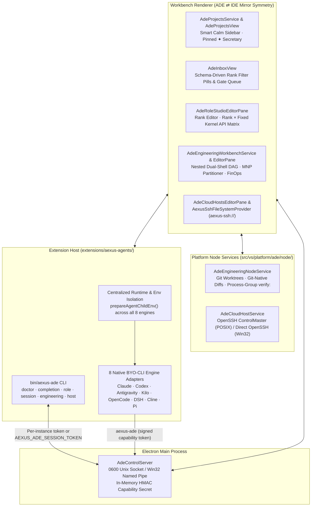

# Aexus Code Architecture

Aexus Code is an open-source, MIT-licensed desktop workbench built on `Code - OSS` (`1.146.0`) that unites a full-parity **IDE (`IDE`)** and a multi-agent **Agent Development Environment (`ADE`)** inside one cross-platform Electron application (`macOS`, `Windows`, `Linux`).

---

## 1. High-Level System Topology

---

## 2. Module Map

| Layer | Path | Key Responsibilities |
| :--- | :--- | :--- |
| **Platform Contracts & Pure Logic** | [`src/vs/platform/ade/common/`](../src/vs/platform/ade/common/) | `adeRoleSchema.ts` (extensible rank schema, 5 presets, structural work-tree slots, fixed kernel primitive APIs, `{{variables}}` compiler); `adeEngineeringBlueprint.ts` (Mermaid + Markdown parser/serializer, MNP auto-partitioner, critical-path & `files:` overlap checks); `adeBlueprintTemplates.ts` (6 curated recipes); `adePromptToDag.ts` (deterministic keyword-to-DAG scaffolding); `adePricing.ts` (configurable FinOps pricing + subscription mode); `adeRunReport.ts` (PR verification report generator); `adeCloudHosts.ts` (SSH config types). |
| **Platform Node Services** | [`src/vs/platform/ade/node/`](../src/vs/platform/ade/node/) | `adeControlServer.ts` (local IPC server, per-instance metadata files, in-memory HMAC capability token minting & verification); `adeEngineeringService.ts` (Git worktree lifecycle, Git-native change detection via `git status --porcelain=v2`, detached process-group `verify:` execution); `adeCloudHostService.ts` (OpenSSH transport); `vscodeConfigMigration.ts` (non-destructive VS Code SSH/proxy/settings migration). |
| **Workbench ADE UI & Orchestration** | [`src/vs/workbench/contrib/ade/browser/`](../src/vs/workbench/contrib/ade/browser/) | `adeProjectsView.ts` (Smart Calm sidebar, hover-bloom badges, pinned `✦ Secretary`); `adeInboxView.ts` (unified Inbox with dynamic schema-driven rank filter pills); `adeRoleStudioEditorPane.ts` (dirty-tracked editor with Rank Editor & Rank × API Permission Matrix); `adeEngineeringEditorPane.ts` & `adeEngineeringWorkbenchService.ts` (Armored Nested Dual-Shell DAG canvas, hash-pinned `verify:` trust gate, budget admission & pause, 2-stage watchdog, worktree merge workbench); `adeCloudHostsEditorPane.ts` & `adeCloudHostFileSystemProvider.ts`. |
| **Hybrid Terminal Routing** | [`src/vs/workbench/contrib/terminal/`](../src/vs/workbench/contrib/terminal/) | `ProjectTerminalService` routes integrated terminals automatically between local shells (`file://`) and interactive remote SSH PTYs (`aexus-ssh://`). |
| **8-Engine Runtime & CLI** | [`extensions/aexus-agents/`](../extensions/aexus-agents/) | Unified adapters (`claude.ts`, `codex.ts`, `acp.ts`, `kilo.ts`, `pi.ts`), centralized `runtime.ts` child-env builder, zero-warmup Turn-1 prompt injection with prompt-hash invalidation & auto-compaction reset (`extension.ts`), opt-out third-party role bridge (`nativeRoleBridge.ts`), and `aexus-ade` CLI (`adeCli.ts`). |

---

## 3. Core Architectural Principles

### 3.1 ADE ⇄ IDE Mirror Symmetry
`ADE` and `IDE` share a single unified project catalog (mixing local `file://` folders and `aexus-ssh://` remote folders), drag-to-sort display order, open editor tabs, and `Focus → Home ⇄ Forward` navigation state. Toggling with `Alt+Cmd/Ctrl+A` switches only the workbench layout lens — never restarting language servers, closing terminals, or dropping agent sessions.

### 3.2 Extensible Organization Schema & Structural Work-Tree Slots
Rather than hardcoding one company hierarchy, Aexus Code defines a user-extensible organization schema (`aexus.ade.organization`, `application`-scoped and `restricted: true` so cloned repositories cannot tamper with it):

- **5 Built-In Presets**:
  1. `default-4tier`: `Governor (L1) → Manager (L2) → Employee (L3) → Worker (L4)`
  2. `startup-3tier`: `Tech Lead (L1) → Reviewer (L2) → Builder (L3)`
  3. `research-lab`: `Principal Investigator (L1) → Research Lead (L2) → Peer Critic (L3) → Experimenter (L4)`
  4. `security-audit`: `Audit Director (L1) → Lead Auditor (L2) → Verifier (L3) → Scanner (L4)`
  5. `flat-swarm`: `Coordinator (L1) → Agent (L2)`
- **Structural Work-Tree Slots**: Engineering and Research DAGs map operational responsibilities onto 4 abstract slots — `orchestrator`, `segment_owner`, `reviewer`, and `executor` — resolved dynamically from the active organization config. This lets DAG pipelines run cleanly under 2-tier, 3-tier, 4-tier, or fully custom user-authored ranks.
- **Fixed Kernel Primitive APIs & Server-Signed Capability Tokens**: Ranks are granted coarse-grained fixed kernel APIs (`session.read_context`, `session.message`, `session.manage`, `project.read`, `project.manage`, `host.access`, `inbox.post`, `engineering.read`, `engineering.design`, `engineering.review`, `engineering.control`, plus high-privilege `engineering.integrate` and `engineering.destroy`). Enforcement happens server-side in `AdeControlServer` via HMAC-SHA256 per-session capability tokens (`AEXUS_ADE_SESSION_TOKEN`). Pure execution ranks (`pureExecution: true`) receive stripped environments and an explicit deny token.

### 3.3 Zero-Warmup Inline Turn-1 Injection & Prompt-Hash Cache Invalidation
Instead of locking the user input box for a separate warmup turn, Aexus Code injects the compiled rank charter inline on Turn 1 of an orchestrated session and computes a SHA-256 `promptHash` of the compiled prompt:
- `roleInit` is committed only **after** `engine.send(...)` succeeds, so a failed first turn never permanently drops role instructions.
- Editing a rank's prompt, switching presets, or updating API grants in the **Organization & Roles Studio** changes `promptHash` and cleanly re-injects updated instructions on the next turn.
- Detecting engine context compaction (`compact_boundary` / `context_compacted`) resets the injection state automatically so long sessions recover their charter.
- Subsequent turns carry only compact tree deltas, keeping LLM prompt-cache hit rates high.

### 3.4 Deterministic Engineering & Research DAG Runtime
- **Maximal Non-Branching Path (`MNP`) Partitioning**: Linear chains between forks, joins, and `user_gate` nodes are partitioned automatically into `segment_owner` (`Manager`) lanes.
- **Scheduling & Scope Safety**: Ready nodes are dispatched up to `max_concurrency`, prioritized by **critical-path depth**. In `shared` workspace mode, overlapping `files:` globs are serialized automatically.
- **Hash-Pinned Pre-Review `verify:` Gate**: Before waking the `reviewer` (`Employee`), Aexus Code runs the node's `verify:` shell command via `/bin/sh -c` in a detached process group (killing the entire process group on timeout). All `verify:` commands are pinned by SHA-256 hash per project and require explicit human trust confirmation before execution.
- **Git-Native Change Detection & Safe Worktrees**: Inside Git repositories, Worker diffs are computed via `git status --porcelain=v2 -z` / `git diff` (respecting `.gitignore` with no hardcoded file-count truncation). In `worktree` isolation mode, parallel lanes execute on dedicated `aexus-eng/*` branches with dirty-tree preflight, preserved user Git identity (`Co-authored-by` trailer), safe non-destructive branch creation, and explicit human merge/cleanup controls.
- **Branch-Isolated RED Circuit Breaker & 2-Stage Watchdog**: Repeated rejections escalate along the affected branch (`failure_1` amber → `failure_2` deep amber → `failure_3` crimson pause + `orchestrator` wake + `ADE Inbox` alert) without halting healthy sibling branches. Stalled nodes trigger a 2-stage watchdog: Stage 1 inspects session liveness and git activity locally at **zero token cost** before Stage 2 escalates to the user or orchestrator.
- **FinOps Admission & Budget Guardrails**: Token usage is tracked across all tiers using engine-reported costs when available or configurable model rate cards (`aexus.ade.pricing`), with an optional **Subscription (`$0` marginal)** mode. When `max_budget_usd` is configured, Aexus Code performs **pre-dispatch admission checks** and **post-turn ceiling pauses** that stop active agents and reset running nodes cleanly to `idle` so resuming never deadlocks.

### 3.5 Zero-Server SSH Cloud Hosts (`aexus-ssh://`)
Remote filesystems, diffs, and terminals run over system OpenSSH with **zero remote daemon (`vscode-server`) installation**:
- **POSIX (`macOS` / `Linux`)**: Uses OpenSSH `ControlMaster` connection multiplexing.
- **Windows**: Uses direct OpenSSH connections per operation (Windows OpenSSH does not support Unix-socket `ControlMaster`).
- **Authentication**: Non-interactive background file and Git transport uses `BatchMode=yes` and delegates strictly to key-based / `ssh-agent` authentication; private keys are never read or copied by Aexus Code.

---

## 4. Data & Isolation Paths

| Artifact | Location | Notes |
| :--- | :--- | :--- |
| **User Settings** | macOS: `~/Library/Application Support/Aexus Code` Windows: `%APPDATA%\Aexus Code` Linux: `~/.config/Aexus Code` | Completely isolated from upstream VS Code settings. |
| **Installed Extensions** | `~/.aexus-code/extensions` | Sourced from [Open VSX](https://open-vsx.org/) or local `.vsix`. |
| **Control Plane IPC & Meta** | `~/.aexus-code/ade-control.<pid>.sock` & `.json` (POSIX `0600`) `\\.\pipe\aexus-ade-control-*` (Windows) | Per-instance metadata prevents cross-window misrouting. |
| **DAG Blueprints & State** | `~/.aexus-code/engineering/<governor-id>/` `~/.aexus-code/research/<governor-id>/` | Stored outside your repository. In `worktree` mode, temporary branches live under `aexus-eng/*`. |
| **Effective SSH Config** | `<userDataDir>/ssh/effective_ssh_config` | Merges Cloud Host Studio overrides ahead of `~/.ssh/config`. |
