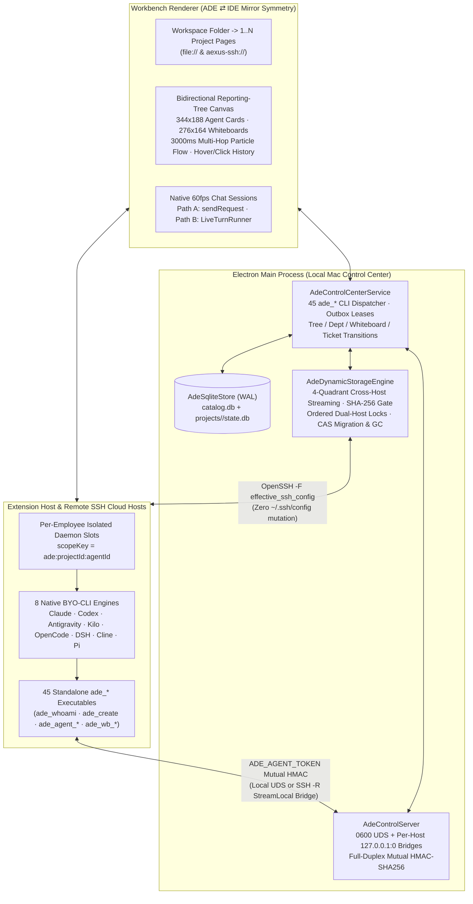

# Aexus Code Architecture

Aexus Code (`v1.1.0`) is an open-source, MIT-licensed desktop workbench built on `Code - OSS` (`1.146.0`) that unites a full-parity **IDE (`IDE`)** and a lightweight cross-host multi-agent **Agent Development Environment (`ADE`)** inside one cross-platform Electron application (`macOS`, `Linux`, `Windows`), connected to the [Open VSX Registry](https://open-vsx.org/).

## 1. System & Control-Plane Topology

## 2. Core Subsystems

### 2.1 Dual-Database SQLite WAL Control Center (`adeSqliteStore.ts` & `adeControlCenterService.ts`)
- **`catalog.db`**: Stores registered workspace folders (`file://` & `aexus-ssh://`), the `1..N` Project Page index per folder, and `remote_gc_tombstones` for crash-safe asynchronous physical blob cleanup.
- **`projects/<projectId>/state.db`**: Isolates each Project Page's `agents` (single-parent reporting tree `L1..LN`), `deleted_agents_archive`, `departments` (branch-pruned connected subtrees), `whiteboards`, `board_grants`, `whiteboard_items`, `whiteboard_notes`, `tickets`, `ticket_tasks` (including `archived_detail_gzip` on destroy), `edge_ticket_transfers`, `ticket_delivery_outbox`, and `storage_migration_items`.
- **Single-Writer `Sequencer` & Clean Shutdown**: Every `state.db` serializes write transactions in-process while allowing concurrent WAL reads, reclaiming `in_flight` outbox leases on window reload and executing `PRAGMA wal_checkpoint(TRUNCATE)` during `onWillShutdown`.

### 2.2 45 `ade_*` CLI Commands & Mutual HMAC-SHA256 Wire Protocol (`adeControlServer.ts` & `adeCliTransport.ts`)
- **4 Modules, 45 Executables, 28 Error Codes**:
  - **Base (3)**: `ade_whoami`, `ade_sysprompt_path`, `ade_sysprompt_update`.
  - **Ticket (7)**: `ade_create`, `ade_destroy`, `ade_edit`, `ade_list`, `ade_get`, `ade_detail`, `ade_history`.
  - **Orchestration (15)**: `ade_host_list`, `ade_engine_list`, `ade_model_list`, `ade_agent_list`, `ade_agent_create`, `ade_agent_edit`, `ade_agent_move`, `ade_agent_delete`, `ade_dept_create`, `ade_dept_edit`, `ade_dept_delete`, `ade_dept_member`, `ade_dept_members`, `ade_dept_info`, `ade_wb_grant`.
  - **Whiteboard (20)**: `ade_wb_list`, `ade_wb_my_perm`, `ade_wb_members`, `ade_wb_create`, `ade_wb_config`, `ade_wb_delete`, `ade_wb_tags`, `ade_wb_tag_manage`, `ade_wb_post_msg`, `ade_wb_upload_file`, `ade_wb_items`, `ade_wb_get_msg`, `ade_wb_download`, `ade_wb_edit_item`, `ade_wb_delete_item`, `ade_wb_manage_item`, `ade_wb_note_send`, `ade_wb_note_unread`, `ade_wb_note_detail`, `ade_wb_unread_all`.
- **Zero-Secret Disk Posture & >64KB Temp Bypass**: `ADE_AGENT_TOKEN` lives strictly in memory; remote SSH sessions read `$HOME/.ade_store/_run/bridge-<hash>.json` containing only `{ endpoint, updatedAt }`. Stdin payloads over 64KB bypass the 2MB control frame via `0700` local temp files, with a 3000ms empty-pipe timeout preventing CLI hangs.

### 2.3 Formal Organization, Connected Department Subtrees & Lossless Whiteboard Transfer (`adeJurisdictionPolicy.ts`)
- **Branch-Pruned Connected Subtrees**: An employee belongs to department `D` iff `D.root_agent_id` lies on `rootToSelfPath(agent)` and no node along the path from `D.root_agent_id` to `agent` excludes `D`, preserving strict tree reporting while cleanly scoping department privileges.
- **Lossless Upward Whiteboard Transfer**: Deleting an employee never destroys shared whiteboards or backup files — ownership transfers upward to the direct supervisor (or `dept.root_agent_id` when bound to a department outside the supervisor's scope).
- **Zero-Tension `ade_destroy`**: Compresses each task's detail (`zlib.gzip`) into `ticket_tasks.archived_detail_gzip` for human UI history inspection while clearing physical pointers and enqueuing `remote_gc_tombstones` so local/cloud storage directories leave zero orphan files.

### 2.4 4-Quadrant Dynamic Cross-Host Storage (`adeDynamicStorageEngine.ts`)
- Routes Ticket details and Whiteboard backups seamlessly across `local <-> local`, same-cloud `IP_A <-> IP_A` (single-SSH local copy with zero Mac round-trip), `local <-> IP_A`, and heterogeneous dual-cloud `IP_A <-> IP_B` (pure memory pipe through Mac with zero temp file accumulation).
- Separates data-stream semaphores (`maxDataStreams = 2` per cloud host) from control RPCs, acquires dual-host slots in strict lexicographical order (`acquireOrderedDualHostSlots`) to eliminate AB-BA deadlocks, pins blobs synchronously inside the SQLite `Sequencer` lock (`pinBlobForRead`), and supports resumable multi-hop CAS online storage migration.

### 2.5 8 BYO-CLI Engines, Context-Preserving `steer` & 60fps Dual-Path Streaming (`extensions/aexus-agents/`)
- Isolates persistent daemons per employee (`ade:<projectId>:<agentId>`), separates context-preserving `interruptTurn` (`killTree: false` on `claude`/`pi`) from `disposeAgentRuntime` (`killTree: true`), and streams background turns at 60fps via `IChatService.sendRequest` (Path A) and `LiveTurnRunner` + `activeResponseCallback` (Path B).

## 3. Data & Isolation Paths

| Artifact | Location | Notes |
| :--- | :--- | :--- |
| **User Settings** | macOS: `~/Library/Application Support/Aexus Code` Windows: `%APPDATA%\Aexus Code` Linux: `~/.config/Aexus Code` | Isolated from upstream VS Code settings. |
| **ADE SQLite Store & Local Blobs** | `~/.aexus-code/ade/catalog.db` `~/.aexus-code/ade/projects/<projectId>/state.db` `~/.aexus-code/ade-store/` | Dual-DB SQLite WAL + immutable `{uuid12}` content blobs. |
| **Read-Only Module Manuals** | Local: `~/.aexus-code/sysprompts/v1/{ticket,orchestration,whiteboard}.md` Cloud: `~/.ade_store/sysprompts/v1/*.md` | `0444` SHA-256 verified manuals read on demand via `ade_sysprompt_path`. |
| **Control Socket & SSH Bridge** | Local: `~/.aexus-code/run/ade-control-<uid>.sock` (`0600`) Cloud: `~/.ade_store/_run/bridge-<hash>.json` (`0600`) | Zero secrets stored on disk. |
| **Effective SSH Config** | `<userDataDir>/ssh/effective_ssh_config` | Passed via `-F` strictly to Aexus SSH commands (`syncUserSshDir: false`). |
