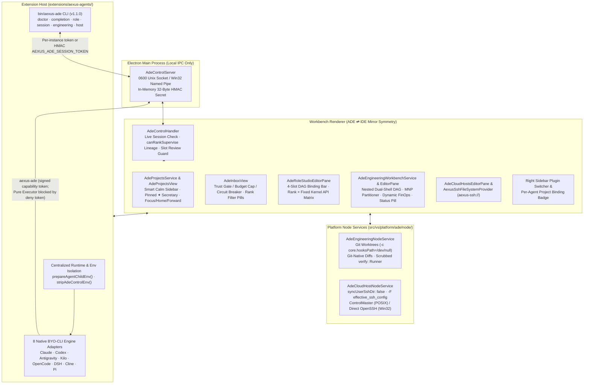
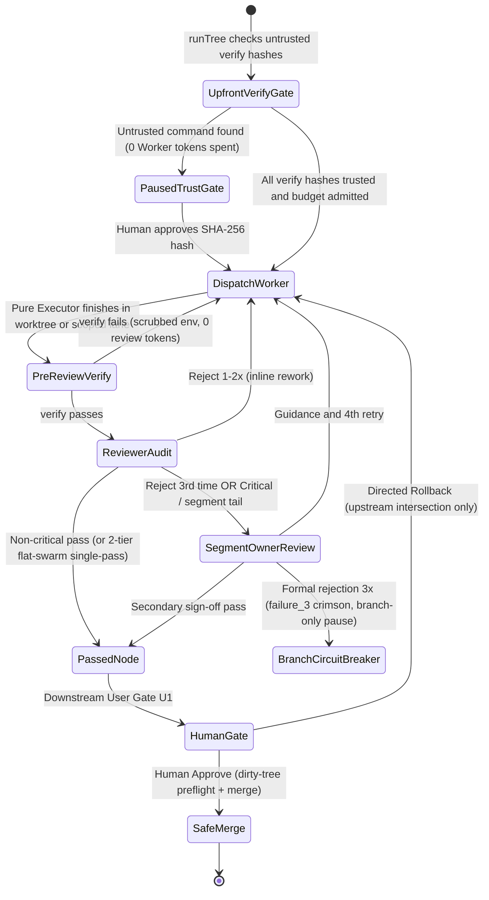

# Aexus Code Architecture

Aexus Code (`v1.1.0`) is an open-source, MIT-licensed desktop workbench built on `Code - OSS` (`1.146.0`) that unites a full-parity **IDE (`IDE`)** and a multi-agent **Agent Development Environment (`ADE`)** inside one cross-platform Electron application (`macOS`, `Windows`, `Linux`), using an original geometric A-prism / 3-node DAG identity and the open-source [Open VSX Registry](https://open-vsx.org/).

> [!NOTE]
> `docs/ARCHITECTURE.md` is the canonical architecture reference for Aexus Code (consolidating and superseding the retired legacy `AEXUS.md` notes, with Open VSX compliance and original Aexus branding).

---

## 1. High-Level System & Control-Plane Topology

---

## 2. 4-Slot Adversarial DAG Execution State Machine

---

## 3. Module Map

| Layer | Path | Key Responsibilities |
| :--- | :--- | :--- |
| **Platform Contracts & Pure Logic** | [`src/vs/platform/ade/common/`](../src/vs/platform/ade/common/) | `adeControl.ts` (`stripAdeControlEnv()` shared airgap scrubber & IPC constants); `adeRoleSchema.ts` (extensible rank schema, 5 presets, 4 structural work-tree slots, fixed kernel primitive APIs incl. high-privilege `host.manage`/`engineering.integrate`/`engineering.destroy`, `canRankSupervise`, `{{variables}}` compiler); `adeEngineeringBlueprint.ts` (Mermaid + Markdown parser/serializer, `org_preset` frontmatter, MNP auto-partitioner, critical-path & `files:` overlap checks); `adeBlueprintTemplates.ts` (6 curated recipes emitting `maxBudgetUsd`); `adePromptToDag.ts` (deterministic keyword-to-DAG scaffolding); `adePricing.ts` (configurable FinOps pricing + subscription mode); `adeRunReport.ts` (PR verification report generator); `adeCloudHosts.ts` (SSH config types). |
| **Platform Node Services** | [`src/vs/platform/ade/node/`](../src/vs/platform/ade/node/) | `adeControlServer.ts` (local IPC server, per-instance `0600` metadata, in-memory HMAC capability token minting & verification); `adeEngineeringService.ts` (Git worktree lifecycle with `-c core.hooksPath=/dev/null`, Git-native diffs via `git status --porcelain=v2`, scrubbed detached process-group `verify:` on POSIX & `cmd.exe /d /s /c` on Windows); `adeCloudHostService.ts` (`syncUserSshDir: false` default, `-F effective_ssh_config`, scrubbed OpenSSH transport); `vscodeConfigMigration.ts` (non-destructive VS Code SSH/proxy/non-secret state migration). |
| **Workbench ADE UI & Orchestration** | [`src/vs/workbench/contrib/ade/browser/`](../src/vs/workbench/contrib/ade/browser/) | `adeControlHandler.ts` (lineage-scoped RBAC, live session rank check, slot-verified `engineering.review`, `engineering.verifyTrust.*`); `adeProjectsView.ts` (Smart Calm sidebar, non-clipping badges, pinned `✦ Secretary`); `adeInboxView.ts` (accurate alert kind badges + schema-driven rank filter pills hiding empty pure ranks); `adeRoleStudioEditorPane.ts` (4-Slot DAG Binding bar + Rank Editor + Rank × API Permission Matrix); `adeEngineeringEditorPane.ts` & `adeEngineeringWorkbenchService.ts` (Armored Nested Dual-Shell DAG canvas, `Cmd/Ctrl+Shift+K` & `/` Prompt-to-DAG, upfront `verify:` gate + revocation, per-project autonomous DAG modal, `aexus-ssh://` DAG guard, dynamic-tier FinOps, 2-stage watchdog, worktree merge workbench); `ade.contribution.ts` (Status Bar `ADE: Safe Mode` / `ADE: Autonomous` pill, `Manage Trusted Verify Commands...`); `adeCloudHostsEditorPane.ts` & `adeCloudHostFileSystemProvider.ts`. |
| **Hybrid Terminal Routing** | [`src/vs/workbench/contrib/terminal/`](../src/vs/workbench/contrib/terminal/) | `ProjectTerminalService` routes integrated terminals automatically between local shells (`file://`) and interactive remote SSH PTYs (`aexus-ssh://`, using `-F effective_ssh_config`). |
| **8-Engine Runtime & CLI** | [`extensions/aexus-agents/`](../extensions/aexus-agents/) | Unified adapters (`claude.ts`, `codex.ts` with `workspace-write` on DAG worktrees, `acp.ts` with scrubbed PATH `sqlite3`, `kilo.ts`, `pi.ts`), public upstream default model catalogs (`capabilities.ts`), identity-keyed client pools `(cwd, sessionId, rank, pure)`, centralized `runtime.ts` child-env builder, zero-warmup Turn-1 prompt injection with prompt-hash invalidation & auto-compaction reset (`extension.ts`), opt-out third-party role bridge (`nativeRoleBridge.ts`), and the `aexus-ade` CLI (`adeCli.ts`, `v1.1.0`, `schemaVersion: 1`, full bash/zsh/fish completions). |

---

## 4. Core Architectural Principles

### 4.1 ADE ⇄ IDE Mirror Symmetry, Workspace Ordering & Right-Sidebar Plugins
- **Single Unified Project Universe**: `ADE` and `IDE` share the exact same project catalog (mixing local `file://` folders and `aexus-ssh://` remote folders), drag-to-reorder display order (without moving files on disk), open editor tabs, and `Focus → Home ⇄ Forward` navigation state. Toggling with `Alt+Cmd/Ctrl+A` flips only the workbench layout lens — never restarting language servers, closing terminals, or dropping agent sessions.
- **Installed Plugin Switcher & Project Binding**: The top-right plugin switcher surfaces installed user extensions cleanly (excluding built-in search/debug/SCM views), opening extensions with native views in the right auxiliary sidebar. Coding Agent panels display and update their own bound project independently of general plugins; multi-root workspaces avoid silently defaulting to the first root when unselected.
- **Non-Destructive First-Run VS Code Migration & Proxy Passthrough**: On first launch, Aexus Code optionally imports network proxy settings (`http.*`), non-secret extension global state (strictly excluding `secret://` entries), and SSH host metadata from an existing VS Code profile without touching the original installation, and propagates `http.proxy` / `http.proxySupport` / `http.noProxy` / `http.systemCertificatesNode` and CLI `PATH` to `NativeLocalProcessExtensionHost` and all 8 agent child processes.

### 4.2 Extensible Organization Schema, 4-Slot Bindings & Lineage RBAC
Rather than hardcoding one company hierarchy, Aexus Code defines a user-extensible organization schema (`aexus.ade.organization`, `application`-scoped and `restricted: true` so cloned repositories cannot tamper with it):

- **5 Built-In Presets**:
  1. `default-4tier`: `Governor (L1) → Manager (L2) → Employee (L3) → Worker (L4 Pure)`
  2. `startup-3tier`: `Tech Lead (L1) → Reviewer (L2) → Builder (L3 Pure)`
  3. `research-lab`: `Principal Investigator (L1) → Research Lead (L2) → Peer Critic (L3) → Experimenter (L4 Pure)`
  4. `security-audit`: `Audit Director (L1) → Lead Auditor (L2) → Verifier (L3) → Scanner (L4 Pure)`
  5. `flat-swarm`: `Coordinator (L1) → Agent (L2 Pure)`
- **Structural Work-Tree Slots & Studio Binding Bar**: Engineering and Research DAGs map operational responsibilities onto 4 abstract slots — `orchestrator`, `segment_owner`, `reviewer`, and `executor` — editable directly in the Role Studio **4-Slot DAG Binding bar**. DAG prompts and FinOps panels dynamically render the active preset's real rank names, and 2-tier presets where `segment_owner === reviewer` skip redundant duplicate self-review automatically.
- **Fixed Kernel Primitive APIs, Lineage Enforcement & Slot Verification**:
  - High-privilege primitives **`host.manage`**, **`engineering.integrate`**, and **`engineering.destroy`** are split out and flagged `dangerous: true`.
  - `AdeControlServer` authenticates HMAC-SHA256 `AEXUS_ADE_SESSION_TOKEN` tokens in constant time; `AdeControlHandler` verifies live session existence/rank, enforces `canRankSupervise` + subtree ownership across `session.*` mutations, requires `engineering.destroy` when deleting/archiving a tree owner, and verifies slot + bound session identity on `engineering.review`.
  - Pure execution ranks (`pureExecution: true`) receive stripped environments (`stripAdeControlEnv`, `aexus-ade` removed from `PATH`) and an explicit server-signed `pure: true` deny token.

### 4.3 Zero-Warmup Inline Turn-1 Injection & Prompt-Hash Cache Invalidation
Instead of locking the user input box for a separate warmup turn, Aexus Code injects the compiled rank charter inline on Turn 1 of an orchestrated session and computes a SHA-256 `promptHash` of the compiled prompt:
- `roleInit` is committed only **after** `engine.send(...)` succeeds, so a failed first turn never permanently drops role instructions.
- Editing a rank's prompt, switching presets, or updating API grants in the **Organization & Roles Studio** changes `promptHash` and cleanly re-injects updated instructions on the next turn.
- Detecting engine context compaction (`compact_boundary` / `context_compacted`) resets the injection state automatically so long sessions recover their charter.
- Subsequent turns carry only compact tree deltas, keeping LLM prompt-cache hit rates high.

### 4.4 Deterministic Engineering & Research DAG Runtime
- **Maximal Non-Branching Path (`MNP`) Partitioning**: Linear chains between forks, joins, and `user_gate` nodes are partitioned automatically into `segment_owner` lanes.
- **Scheduling & Scope Safety**: Ready nodes are dispatched up to `max_concurrency`, prioritized by **critical-path depth**. In `shared` workspace mode, overlapping `files:` globs are serialized automatically. Prompt-to-DAG uses non-colliding `Cmd/Ctrl+Shift+K` (or `/` on canvas), preserving all VS Code `Cmd/Ctrl+K` chords.
- **Upfront Hash-Pinned `verify:` Gate, Revocation & Scrubbed Subprocesses**: `runTree()` checks untrusted `verify:` commands **upfront before any Worker runs**. Approved commands run with `stripAdeControlEnv()` (POSIX detached process group via `/bin/sh -c`, or Windows `cmd.exe /d /s /c` with `windowsVerbatimArguments: true`). Trusted hashes can be listed and revoked via `Aexus ADE: Manage Trusted Verify Commands...` or `aexus-ade engineering verify-trust list|revoke`.
- **Autonomous Approval & Codex Worktree Sandbox**: Interactive sessions stay in safe mode, surfaced via the workbench Status Bar pill (`ADE: Safe Mode` / `ADE: Autonomous`). When `aexus.ade.autonomousMode` is `false`, launching an automated DAG prompts once per project for explicit approval and keeps headless Codex Workers bounded to `sandbox: 'workspace-write'` inside their isolated worktree.
- **Git-Native Change Detection & Safe Worktrees**: Inside Git repositories, Worker diffs are computed via `git status --porcelain=v2 -z` / `git diff`. In `worktree` isolation mode, parallel lanes execute on dedicated `aexus-eng/*` branches with scrubbed env, `-c core.hooksPath=/dev/null`, dirty-tree preflight, preserved user Git identity (`Co-authored-by` trailer), non-destructive branch creation, and explicit human merge/cleanup controls.
- **Branch-Isolated RED Circuit Breaker & 2-Stage Watchdog**: Repeated rejections escalate along the affected branch (`failure_1` amber → `failure_2` deep amber → `failure_3` crimson pause + `orchestrator` wake + `ADE Inbox` alert) without halting healthy sibling branches. Stalled nodes trigger a 2-stage watchdog that inspects liveness and Git activity locally at **zero token cost** before escalating.
- **FinOps Admission & Recipe Budget Guardrails**: Token usage is tracked across active schema tiers using engine-reported costs when available or `aexus.ade.pricing` overrides (plus **Subscription `$0`** mode). Applying built-in templates automatically populates `max_budget_usd`, enforced via pre-dispatch admission and clean `pauseTree` ceiling pauses.

### 4.5 Zero-Server SSH Cloud Hosts (`aexus-ssh://`)
Remote filesystems, diffs, interactive ADE sessions, and integrated terminals run over system OpenSSH with **zero remote daemon (`vscode-server`) installation**:
- **Two-Step Host Picker & Live Remote Path Browser**: Adding a project lets users pick `Local (This Computer)` or any saved/migrated SSH host, then browse remote directories live (including POSIX paths and Windows drive roots like `C:/`, `D:/`).
- **Non-Destructive SSH Config (`syncUserSshDir: false`)**: By default, Aexus Code never modifies `~/.ssh/config`. It generates `<userDataDir>/ssh/effective_ssh_config` and passes `-F <effective_ssh_config>` exclusively to its own SSH commands and remote terminals.
- **Platform Multiplexing & Auth**: Uses OpenSSH `ControlMaster` multiplexing on macOS/Linux and direct OpenSSH on Windows. Background filesystem/Git calls run with `BatchMode=yes` (requiring key-based / `ssh-agent` auth; private keys are never read or copied) and scrubbed ADE control env vars.
- **Local Workspace Scope for DAGs**: Engineering and Research DAG Git worktrees currently require a local Git repository; `initTree` explicitly guards `aexus-ssh://` URIs with a clear notice while keeping interactive ADE sessions, remote editing, Git diffs, and SSH terminals available over `aexus-ssh://`.

---

## 5. CI/CD, Packaging & Version Parity

- **Version Parity (`1.1.0`)**: `.github/workflows/aexus-ci.yml` verifies on every push/PR that `product.json` (`aexusVersion`), `extensions/aexus-agents/package.json` (`version`), and `extensions/aexus-agents/src/adeCli.ts` (`ADE_CLI_VERSION`) stay in strict lockstep.
- **Full-Coverage CI**: Runs `transpile-client`, `esbuild.mts`, `typecheck-client`, `tsc` on `extensions/aexus-agents`, `eslint --max-warnings=0` across `src/vs/platform/ade`, `src/vs/workbench/contrib/ade`, and `extensions/aexus-agents/src`, ADE platform Node unit tests, headless Linux (`xvfb-run`) Electron **browser workbench unit tests** (`adeControlAndViews`, `adeEngineering`, `adeProjectsService`, `cloudHostsBrowser`), cross-platform `aexus-agents` & CLI matrix (`ubuntu`/`macos`/`windows`), and doc/Open VSX/desktop/blueprint integrity checks.
- **Clean Multi-Platform Releases**: `.github/workflows/release.yml` packages signed macOS (`arm64`/`x64`) `.dmg` & `.zip`, Linux (`x64`) `Aexus-Code-linux-x64` `.tar.gz`, Windows (`x64`) `.zip`, and `SHA256SUMS.txt`.

---

## 6. Data & Isolation Paths

| Artifact | Location | Notes |
| :--- | :--- | :--- |
| **User Settings** | macOS: `~/Library/Application Support/Aexus Code` Windows: `%APPDATA%\Aexus Code` Linux: `~/.config/Aexus Code` | Completely isolated from upstream VS Code settings. |
| **Installed Extensions** | `~/.aexus-code/extensions` | Sourced from [Open VSX](https://open-vsx.org/) or local `.vsix`. |
| **Control Plane IPC & Meta** | `~/.aexus-code/ade-control.<pid>.sock` & `.json` (POSIX `0600`) `\\.\pipe\aexus-ade-control-*` (Windows) | Per-instance metadata prevents cross-window misrouting. |
| **DAG Blueprints & State** | `~/.aexus-code/engineering/<governor-id>/` `~/.aexus-code/research/<governor-id>/` | Stored outside your repository. In `worktree` mode, temporary branches live under `aexus-eng/*`. |
| **Effective SSH Config** | `<userDataDir>/ssh/effective_ssh_config` | Passed via `-F` strictly to Aexus SSH commands (`syncUserSshDir: false` leaves global `~/.ssh/config` untouched). |
