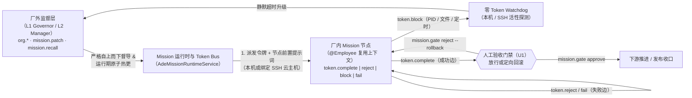
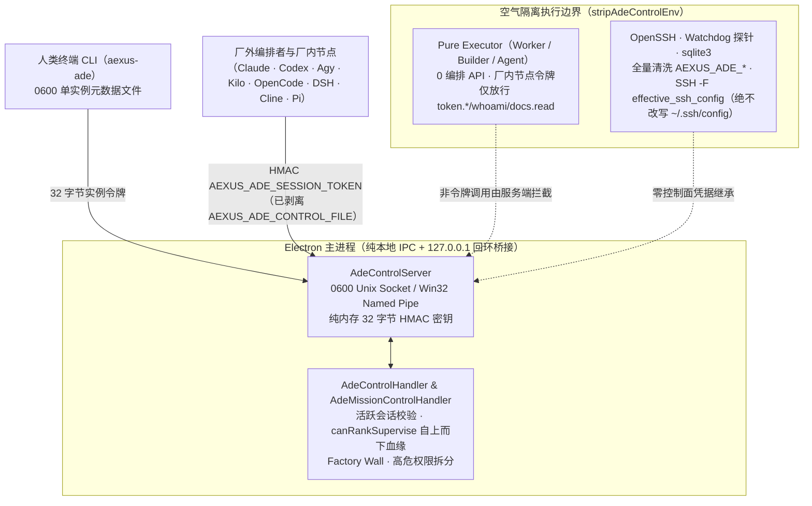
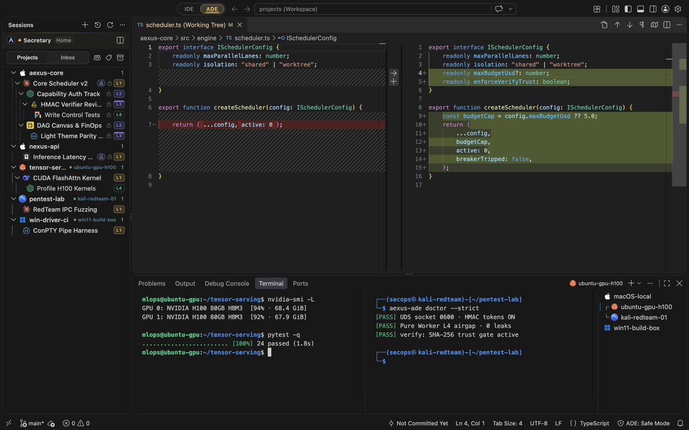
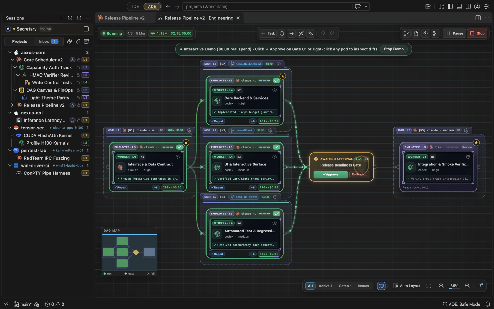
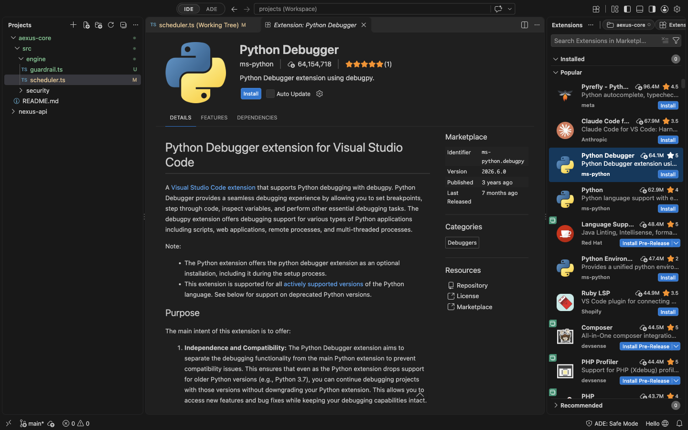

<p align="center">
  
</p>

<h1 align="center">Aexus Code</h1>

<p align="center">
  <strong>开源组织化智能体开发环境（ADE）与可视化多智能体控制面 IDE</strong><br/>
  可扩展多级组织架构 · 8 大本机 BYO-CLI 编码引擎 · Mission Mermaid DAG 与 Token Bus 运行时 · 服务端签名能力令牌 · 免装机原生 SSH 云主机
</p>

<p align="center">
  <a href="https://github.com/Daijunfan/Aexus-Code/actions/workflows/aexus-ci.yml"></a>
  <a href="https://github.com/Daijunfan/Aexus-Code/releases"></a>
  <a href="../LICENSE.txt"></a>
  <a href="https://open-vsx.org/"></a>
  
  
</p>

<p align="center">
  <a href="../README.md">English</a> · <strong>简体中文</strong> · <a href="ARCHITECTURE.md">架构总览</a> · <a href="gallery.md">完整图库与视频</a> · <a href="../examples/blueprints/README.md">蓝图模板库</a> · <a href="../SECURITY.md">安全模型</a> · <a href="../CHANGELOG.md">更新日志</a> · <a href="../CONTRIBUTING.md">贡献指南</a> · <a href="../CODE_OF_CONDUCT.md">行为准则</a>
</p>

---

> [!TIP]
> **通过 `aexus-ade` 控制面快速体验 Mission DAG 与瞬切 `ADE ⇄ IDE`：**
> - **一键本机体检**：运行 `aexus-ade doctor --project .`（无需启动窗口即可独立执行），快速检查 8 大编码 CLI、Git 与 OpenSSH 状态。
> - **启动可视化 Mission DAG**：执行 `aexus-ade mission init --title "Feature Ship" --open`，通过 `aexus-ade mission blueprint apply --mission <id> --file ./examples/blueprints/feature-ship.md` 导入示例蓝图，在画布或左上角分栏抽屉编辑各节点前置提示词后点击 **Start**（或执行 `aexus-ade mission start --mission <id>`）。
> - **瞬切 `ADE ⇄ IDE`**：随时按 `Alt+Cmd+A`（`Alt+Ctrl+A`）在组织化智能体视图与全功能 `Code - OSS` IDE 之间切换，不重启语言服务与终端。

<p align="center">
  
  <br/>
  <sub><strong>可视化多级 Mission DAG 编排：</strong>并行扇出 ➔ Token Bus 流转 ➔ 人工发布门禁 <code>U1</code> 审批 · <a href="assets/demos/02-live-dag-choreography.mp4">▶ 观看高清 MP4</a> · <a href="gallery.md">浏览完整图库与 5 段视频 →</a></sub>
</p>

---

## 为什么构建 Aexus Code？

现有 AI 研发工具通常不得不在「闭源单线程 IDE」、「脱离编辑器的外部终端壳」与「脱离真实代码库与本地 CLI 的云端节点画布」之间妥协。

**Aexus Code**（`v1.1.0`）基于开源 `Code - OSS`（`1.146.0`）深度魔改打造，采用 **MIT 开源协议**，默认接入开源 **[Open VSX](https://open-vsx.org/)** 市场并兼容绝大多数 VS Code 插件，同时彻底移除微软闭源 Copilot 遥测，在一个本地优先的桌面窗口中融合全功能 **IDE** 与可扩展的 **组织化智能体开发环境（ADE）**：

1. **一个面板管理多个项目，无视路径与系统差异（`macOS` · `Ubuntu` · `Kali` · `Windows`）**——在同一侧栏无缝混排本地 `file://` 仓库与免装机 `aexus-ssh://` 云端项目，自动呈现多平台图标、Smart Calm 悬停绽放徽章、一键全徽章切换与顶部常驻的视口感知 **`✦ Secretary`**。
2. **一个面板同时掌控多个本地与云主机集成终端**——在同一个窗口内分屏直控本机 macOS/Linux/Windows 终端与多台 Ubuntu GPU、Kali 渗透、Windows 编译云主机终端，右侧标签自带彩色系统图标，零 `vscode-server` 侵入且绝不修改 `~/.ssh/config`。
3. **8 大本机 BYO-CLI 编码引擎同台协作**——使用你自己的本机或 SSH 云端 CLI 与订阅直连 **Claude Code**、**Codex**、**Google Antigravity**、**Kilo Code**、**OpenCode**、**DeepSeek Harness**、**Cline** 与 **Pi**，打开 Mission 时自动探测可用引擎并置灰不可用项，底部状态栏实时显示 **`ADE: Safe Mode` / `ADE: Autonomous`**，并配按职级过滤的 **`ADE Inbox`**。
4. **多职级角色分工 + 组织与职级工作室（"Everything is Extensible"）**——内置 **5 套组织预设**并支持 `1..N` 级动态扩缩容，支持像做填空题一样自定义职级、编写 `{{variables}}` 提示词、配置**职级 × 固定内核 API 权限矩阵**，全链路服务端 HMAC 能力令牌鉴权与单副本职级手册（`docs/ranks/L0..LN.md`）。
5. **可视化 Mission DAG 运行时、Token Bus 与 Factory Wall**——纯 Mermaid 流程图与 **`@Employee:` 跨阶段上下文复用**、画布卡片与左上角分栏抽屉双端实时同步的**节点前置提示词**、**按厂商分组且支持自定义归类的模型与思考深度选择器**（运行中锁定引擎切换、支持实时切换模型）、**Factory Wall** 厂内外职级边界、**零 Token Watchdog 活性探测**、**运行期原子热更 `mission.patch`** 与 **定时/文件触发器**。
6. **深度魔改版 VS Code，保留全套原生 IDE 功能并兼容市场插件**——随时按 `Alt+Cmd+A`（`Alt+Ctrl+A`）瞬切 **`ADE ⇄ IDE`**，顶栏插件按钮与通用 **Agent 引擎**按钮完全解耦，100% 保留原生资源管理器、分屏 Diff、调试器、多端终端与 **Open VSX** 主流插件生态。

---

## Factory Wall 厂内外边界、Token Bus 与能力令牌隔离架构

### Factory Wall 与 Token Bus 协同闭环

每个 Mission 均执行清晰的 **Factory Wall**（`offGraphMaxTier`），将厂外高层监督（`L1` Governor / `L2` Manager）与厂内节点执行（`token.*`）解耦：



### 本地控制面与纯净执行器空气隔离架构

Aexus Code 绝不对外暴露公网端口。所有控制面请求仅走本地 IPC 与 `127.0.0.1` 回环桥接，并由主进程强制执行服务端 HMAC 身份推导、严格自上而下血缘校验（`canRankSupervise`）与子进程环境变量清洗：



---

## 核心旗舰能力

### 1. 一个面板掌控多端多系统项目、8 大引擎 ADE 会话与多云主机集成终端

在同一左侧栏统一管理 **macOS**、**Ubuntu**、**Kali Linux** 与 **Windows** 上的本地及云端项目，并在同一窗口内分屏直控多台本机 + 云主机集成终端：

<table>
  <tr>
    <td width="50%">
      
      <p align="center"><sub><strong>一个面板管理多端项目 &amp; 8 大引擎 ADE 指挥中枢：</strong>本机 Apple + 云端 Ubuntu/Kali/Windows 项目同屏管理、官方彩色引擎图标、L1–L4 全徽章与实时 Governor 会话。</sub></p>
    </td>
    <td width="50%">
      
      <p align="center"><sub><strong>ADE 实时 Agent 会话 + 分屏 Git Diff 联动：</strong>多职级编排对话与代码改动左右同屏对照，搭配 Smart Calm 极简侧栏。</sub></p>
    </td>
  </tr>
  <tr>
    <td colspan="2">
      <p align="center">
        <br/>
        <sub><strong>一个面板同控多个本地与云主机终端：</strong>Ubuntu H100 GPU 与 Kali 安全终端分屏齐发，右侧列表自带 Apple / Ubuntu / Kali / Windows 专属彩色系统图标。</sub>
      </p>
    </td>
  </tr>
</table>

- **彻底无视路径与系统差异**：在同一侧栏混排本地 `file://` 与免装机 `aexus-ssh://` 云端项目，自动识别平台图标（Apple / Ubuntu / Kali / Windows），顶部常驻 **`✦ Secretary`**，支持 Smart Calm 极简模式与**一键完整徽章展开**。
- **8 大本机原生编码引擎同台协作**：**Claude Code**、**Codex**、**Antigravity**、**Kilo Code**、**OpenCode**、**DeepSeek Harness**、**Cline**、**Pi** 官方辨识度彩色图标一眼区分，覆盖全职级与多端主机。

---

### 2. 组织与职级工作室（"Everything is Extensible"）

不再被绑死在单一固定组织结构里，按团队需要自由定制多级组织与权限：

<p align="center">
  
  <br/>
  <sub><strong>组织与职级工作室（"Everything is Extensible"）：</strong>5 套内置预设、动态 <code>1..N</code> 职级调整、实时 <code>职级 × 固定内核 API</code> 权限矩阵（含 <code>High Privilege</code> 高危标记）、叶子执行器永久 <code>Pure · 0</code> 锁定与 Smart Calm 侧栏。</sub>
</p>

| 内置组织预设 | 职级梯队（顶层 → 叶子纯净执行器） | 结构槽位映射（`orch / seg / rev / exec`） |
| :--- | :--- | :--- |
| **`default-4tier`** *（默认）* | `Governor (L1)` → `Manager (L2)` → `Employee (L3)` → `Worker (L4 Pure)` | `governor / manager / employee / worker` |
| **`startup-3tier`** | `Tech Lead (L1)` → `Reviewer (L2)` → `Builder (L3 Pure)` | `tech-lead / tech-lead / reviewer / builder` |
| **`research-lab`** | `Principal Investigator (L1)` → `Research Lead (L2)` → `Peer Critic (L3)` → `Experimenter (L4 Pure)` | `governor / manager / employee / worker` |
| **`security-audit`** | `Audit Director (L1)` → `Lead Auditor (L2)` → `Verifier (L3)` → `Scanner (L4 Pure)` | `governor / manager / employee / worker` |
| **`flat-swarm`** | `Coordinator (L1)` → `Agent (L2 Pure)` | `coordinator / coordinator / coordinator / agent` |

- **填空式自定义职级与热调整**：在原生脏状态追踪编辑器中自由定制职级名称、颜色、图标与 `{{variables}}` 提示词（支持保存、回滚、ID 重命名自动迁移活跃会话），亦可通过 `aexus-ade rank set-count` 与 `rank rename` 热扩缩容与热改别名。
- **职级 × 固定内核 API 权限矩阵**：可视化配置每个职级可调用的内核原语（`session.*`、`project.read`、只读 `host.access`、`inbox.post`、`mission.read`、`mission.design`，以及独立拆分的高危权限 **`project.manage`**、**`host.manage`**、**`mission.control`** 与 **`mission.destroy`**）。
- **血缘校验的服务端签名能力令牌**：每个编排会话均持有主进程内存签发的 HMAC-SHA256 `AEXUS_ADE_SESSION_TOKEN`；服务端校验会话活跃状态并强制执行严格自上而下 `canRankSupervise` + 子树归属校验。
- **零预热首轮内联注入 + 单副本职级手册**：首轮内联注入职级契约并在提示词变更或上下文压缩后自动同步，按需引用 `~/.aexus-code/docs/ranks/L0..LN.md` 与 `docs/mission/MISSION_API.md`。
- **防恶意仓库提示词注入**：`aexus.ade.organization` 为 `application` 级受限配置（`restricted: true`），忽略克隆仓库中 `.vscode/settings.json` 的覆盖。

---

### 3. 可视化 Mission 并行 DAG、同步前置提示词与 6 套蓝图模板

通过可视化画布或 `aexus-ade mission` CLI 编写纯 Mermaid 流程图，为每个节点配置主机、可用引擎、模型/思考深度与前置提示词，全自动协同推进本机与 SSH 云端节点：

<table>
  <tr>
    <td width="50%">
      
      <p align="center"><sub><strong>Mission 并行 DAG 画布：</strong>装甲任务舱、draw.io 平滑正交路由、上下文遥测条与人工发布门禁 <code>U1</code>。</sub></p>
    </td>
    <td width="50%">
      
      <p align="center"><sub><strong>科研工作流 DAG：</strong>多轨假设探索、定量基准验证与同行方法论门禁 <code>U1</code>。</sub></p>
    </td>
  </tr>
</table>

- **同员工跨位置上下文复用（`@Employee:`）**：多个 DAG 节点绑定同一员工（如 `@Architect:`）时共享同一持续会话上下文，悬停时高亮正交上下文复用连线。
- **双端实时同步的节点前置提示词**：点击任意节点卡片上的提示词图标，或展开左上角文件按钮中的分栏抽屉，均可直接查看与编辑节点前置提示词，并与 `aexus-ade mission prompt get|set` 共享同一 Mission 存储。
- **自动可用引擎探测 & 分组模型选择器**：点开 Mission 视图即自动探测本机与绑定 SSH 主机上可用/不可用的 Agent 引擎，不可用项直接置灰不可点击；点击卡片中央大图标弹出按厂商分组的模型与思考深度面板（大小写无关自动归类，并支持用户自定义把任意模型归入指定图标分组），运行期支持随时换模型同时锁定引擎切换。
- **零 Token Watchdog、运行期热更新与源节点触发器**：支持每任务静默超时（`mission timeout`）、无 Token 消耗的本机/SSH 活性巡检、定向召回/重试（`mission recall` / `mission retry`）、运行期原子拓扑热补丁（`mission patch`）及定时/事件源触发器（`mission trigger set`）。

<p align="center">
  <picture>
    <source media="(prefers-color-scheme: dark)" srcset="assets/08-finops-budget-guardrails.png" />
    <source media="(prefers-color-scheme: light)" srcset="assets/12-light-theme-finops.png" />
    
  </picture>
  <br/>
  <sub><strong>深浅双主题与高对比度适配：</strong>完整兼容 Dark Modern、Light Modern 与 High Contrast 工作台主题。</sub>
</p>

| 内置示例蓝图 | 拓扑结构 | 员工上下文复用 | 适用场景 |
| :--- | :--- | :--- | :--- |
| **[`feature-ship`](../examples/blueprints/feature-ship.md)** | `N1 → (N2 ∥ N3 ∥ N4) → U1 → N5` | `@Architect`, `@Backend`, `@Frontend`, `@QA` | 契约先行的全栈功能交付：后端/前端/测试并行 + 发布门禁 |
| **[`bug-hunt-fix`](../examples/blueprints/bug-hunt-fix.md)** | `N1 → (N2 ∥ N3) → N4 → U1` | `@Debugger`, `@QA`, `@Auditor` | 最小复现驱动的精准排障 + 分作用域修复与回归测试 |
| **[`security-audit-swarm`](../examples/blueprints/security-audit-swarm.md)** | `(N1 ∥ N2 ∥ N3) → N4 → U1 → N5` | `@AuthAudit`, `@IpcAudit`, `@SupplyAudit`, `@Hardening` | 鉴权、IPC 与供应链三轨并行安全审计与补丁收敛 |
| **[`safe-migration`](../examples/blueprints/safe-migration.md)** | `N1 → (N2 ∥ N3) → U1 → N4` | `@Architect`, `@CoreDev`, `@CallerDev` | 行为基线锁定、并行重构、回滚门禁与旧代码清理 |
| **[`deep-research-lab`](../examples/blueprints/deep-research-lab.md)** | `R1 → (R2 ∥ R3 ∥ R4) → U1 → R5` | `@PI`, `@TrackA`, `@TrackB`, `@Bench` | 多轨假设探索、反证基线、定量基准与同行评审报告 |
| **[`arch-teardown`](../examples/blueprints/arch-teardown.md)** | `R1 → (R2 ∥ R3) → R4 → U1` | `@Systems`, `@UX`, `@Architect` | 系统并发与开发体验双轨架构拆解，产出可执行 RFC |

---

### 4. Smart Calm 侧栏与按职级过滤的 `ADE Inbox`

<table>
  <tr>
    <td width="50%">
      
      <p align="center"><sub><strong>按职级过滤 <code>ADE Inbox</code> &amp; 职级提示词编辑器</strong></sub></p>
    </td>
    <td width="50%">
      
      <p align="center"><sub><strong>多路改动与 Diff 审阅视图</strong></sub></p>
    </td>
  </tr>
</table>

- **Smart Calm 极简侧栏**：会话行默认展示紧凑悬停绽放徽章且防止徽章裁切，顶部提供**一键切换完整徽章视图**按钮，并在最上方常驻具备视口感知能力的 **`✦ Secretary`**（支持 `/mission`、`/status`、`/sessions`、`/projects`）。
- **按职级过滤的 `ADE Inbox`**：统一收信箱汇总 Mission 升级告警与人工门禁，并根据当前组织预设动态渲染职级过滤胶囊（如 `All | Governor | Manager | Employee`——当 `0`-API 纯执行职级为空时自动隐藏，减少噪音）。

---

### 5. 魔改版全功能 VS Code IDE（`ADE ⇄ IDE`）、主流插件兼容与免装机 SSH 云主机

Aexus Code 完整保留原生 `Code - OSS` IDE 的全部生产力——资源管理器、分屏编辑器、实时 Git Diff、多端集成终端、顶栏完全解耦的**插件**与**Agent 引擎**按钮以及 **[Open VSX](https://open-vsx.org/)** 主流 VS Code 扩展兼容，同时提供免远端装机的多系统 SSH 云主机工作室：

<table>
  <tr>
    <td width="50%">
      
      <p align="center"><sub><strong>瞬切 <code>ADE ⇄ IDE</code> 镜像对称（<code>Alt+Cmd+A</code>）：</strong>完整原生 VS Code 资源管理器、分屏 Diff 与多端云主机终端。</sub></p>
    </td>
    <td width="50%">
      
      <p align="center"><sub><strong>兼容 VS Code 主流市场插件（Open VSX）：</strong>开箱安装 <code>Python Debugger</code>、<code>Claude Code</code>、<code>Python</code>、<code>Java</code>、<code>Ruby LSP</code> 等海量插件。</sub></p>
    </td>
  </tr>
</table>

<p align="center">
  
  <br/>
  <sub><strong>免远端装机多系统 SSH 云主机中心：</strong>统一管理 Kali（含 ProxyJump 跳板机）、macOS、Ubuntu GPU 与 Windows 云主机，无需安装 <code>vscode-server</code>，绝不改写 <code>~/.ssh/config</code>。</sub>
</p>

- **零远端后台**：在同一窗口直接编辑远端文件、查看 `HEAD` Diff、自动发现并导入云端主机项目级会话（如 Claude Code / Codex / OpenCode）、将 Mission 节点绑定到云主机（`mission host bind`）并打开远端 SSH 集成终端，**无需在目标服务器安装或升级 `vscode-server`**。
- **非破坏性 `~/.ssh/config` 保证**：`syncUserSshDir` 默认为 **`false`**——Aexus Code 仅向自身的 SSH 会话与终端传入 `-F <userDataDir>/ssh/effective_ssh_config`，**绝不修改或向用户全局 `~/.ssh/config` 头部插入 `Include`**。
- **OpenSSH 传输行为**：macOS / Linux 使用 OpenSSH `ControlMaster` 连接复用，Windows 使用直连 OpenSSH；后台文件、Git 与探针操作使用 `BatchMode=yes`（需密钥或 `ssh-agent` 免交互鉴权，Aexus Code 从不读取或复制私钥内容）。
- **无损迁移 VS Code 配置**：通过 `aexus-ade host import-vscode` 只读解析 `~/.ssh/config`（含递归 `Include`）及 VS Code 远端目录历史。
- **更多界面截图与高清短视频**：请前往 [`docs/gallery.md`](gallery.md) 查看全部界面展示与 5 段 HD MP4 演示。

---

## 8 大本机原生 Coding Agent 引擎

所有引擎均在本机或绑定 SSH 云主机运行（`requiresCopilotSignIn: false`），共用统一的隔离环境构造器（`runtime.ts`）、公开上游默认模型列表（同时动态发现本机 CLI 自定义配置）与首轮内联角色同步机制（`extension.ts`）：

| 引擎名称 | 会话标识 | 默认 CLI | 协议与默认安全模式 |
| :--- | :--- | :--- | :--- |
| **Claude Code** | `aexus-claude` | `claude` | 双向 `stream-json` · 默认 `acceptEdits` · 实时 Token 捕获与压缩重置 |
| **Codex** | `aexus-codex` | `codex` | `app-server` JSON-RPC（`thread/inject_items`）· 默认 `workspace-write` + `on-request` |
| **Google Antigravity** | `aexus-antigravity` | `agy` | 本机 `--hub` ConnectRPC 桥接 · 默认 `ask` |
| **Kilo Code** | `aexus-kilo` | `kilo` | ACP 运行时桥接 · 默认 `ask` |
| **OpenCode** | `aexus-opencode` | `opencode` | 原生面板 + ACP 生命周期 · 默认 `ask` |
| **DeepSeek Harness** | `aexus-dsh` | `dsh` | 原生适配器 + 可关闭角色桥接 · 默认 `ask` |
| **Cline** | `aexus-cline` | `cline` | `--acp` 流式协议 · 默认 `ask` |
| **Pi** | `aexus-pi` | `pi` | `--mode rpc` 结构化事件流与思考进度 · 默认安全模式 |

> [!NOTE]
> - **安全模式与自动执行开关**：底部状态栏实时显示 **`ADE: Safe Mode`** / **`ADE: Autonomous`** 胶囊（点击或运行 **`Aexus ADE: Toggle Safe / Autonomous Permission Mode`** 一键切换）。
> - **第三方扩展角色桥接可随时关闭**：详见 [`SECURITY.md`](../SECURITY.md)，可通过设置 `aexus.ade.nativeExtensionRoleBridge.enabled: false` 或环境变量 `AEXUS_ADE_DISABLE_NATIVE_ROLE_BRIDGE=1` 全局关闭。

---

## `aexus-ade` 本地控制面 CLI

Aexus Code 监听按实例隔离的本地 `0600` Unix Socket（macOS/Linux：`~/.aexus-code/ade-control.<pid>.sock`）或本机 Windows Named Pipe（`\\.\pipe\aexus-ade-control-*`）及 `127.0.0.1` 回环桥接，由**单实例 32 字节令牌**（人类 CLI）与**服务端签名会话级 HMAC 能力令牌**（`AEXUS_ADE_SESSION_TOKEN`，编排智能体专用）双重鉴权：

```bash
# 0. 一键体检 8 大引擎、Git 与 OpenSSH（v1.1.0，输出 schemaVersion: 1 JSON，失败/严格警告退出码 1/2）
aexus-ade --version
aexus-ade doctor --project . --json
eval "$(aexus-ade completion zsh)"   # 同时支持 bash | fish | powershell

# 1. 查看/切换组织预设、动态调整职级并阅读单副本 API 手册
aexus-ade role list --json
aexus-ade role apply-preset startup-3tier
aexus-ade rank names --json
aexus-ade docs read mission

# 2. 创建 Mission、导入示例 Mermaid 蓝图、写入节点前置提示词并启动
GOV_ID=$(aexus-ade session create --project . --engine claude --role governor --title "Release Lead" --no-open --json | jq -r .id)
MISSION_ID=$(aexus-ade mission init --governor "$GOV_ID" --title "Feature Ship" --open --json | jq -r .id)
aexus-ade mission blueprint validate --file ./examples/blueprints/feature-ship.md
aexus-ade mission blueprint apply --mission "$MISSION_ID" --file ./examples/blueprints/feature-ship.md
aexus-ade mission prompt set --mission "$MISSION_ID" --node N1 --text "定义共享 TypeScript 契约与文件边界。"
aexus-ade mission start --mission "$MISSION_ID" --timeout 15

# 3. 实时查看运行态、处理 Inbox 告警并审批人工发布门禁
aexus-ade mission status --mission "$MISSION_ID" --json
aexus-ade inbox list --unread-only
aexus-ade mission gate approve --mission "$MISSION_ID" --node U1 --note "全链路验收通过"
```

| 命令组 | 核心子命令 |
| :--- | :--- |
| `doctor` / `completion` | `doctor [--project <path>] [--strict] [--json]` *（含 `schemaVersion: 1` 与 `aexusVersion`）* · `completion <bash\|zsh\|fish\|powershell>` · `--version` *（无需启动窗口即可独立运行）* |
| `whoami` / `docs` / `api` | `whoami [--json]` · `docs read <L0..LN\|common\|mission>` · `api update [--since <v>] [--scope <s\|all>]` |
| `role` *（别名 `roles`）* | `list [--json]` / `schema` · `apis` / `primitives` · `presets [--json]` · `preset <id>` / `apply-preset <id>` · `set-tier <sessionId> <rankId>` · `reset` · `studio [rankId]` |
| `rank` *（别名 `ranks`）* | `list` · `names` · `get <tier\|alias>` · `docs [tier]` · `rename <tier\|alias> <newName>` · `set-count <n>` · `mission-name <name>` |
| `status` / `mode` / `view` | `status [--json]` · `mode [get \| set <ade\|ide>]` · `view [--archived] [--inspector <changes\|files\|hide>] [--refresh]` |
| `project` | `list` · `add <path\|host:/path>` · `select` · `remove` · `delete` · `focus` · `home` · `forward` · `move` · `changes` · `files` · `open-file` · `open-diff` |
| `host` *（别名 `cloud-host`）* | `list` · `info` · `add` · `update` · `remove` · `test` · `browse` · `import-vscode` · `open` |
| `engine` | `list` · `sessions <engine> [--project <p>] [--limit <n>]` |
| `session` | `list` · `info` · `subordinates` · `tree` · `create` · `attach` · `connect` · `open` · `select` · `close` · `send [--wait]` · `history` · `mark-read` · `draft` · `reorder` · `rename` · `role` · `configure` · `move` · `stop` · `archive` · `unarchive` · `detach` · `delete` |
| `secretary` | `status` · `open` · `engine` · `reset` · `send [--wait]` · `history` · `stop` · `draft` · `mark-read` |
| `mission` | `list` · `init` · `open` · `docs` · `rename` · `blueprint <get\|apply\|validate>` · `prompt <list\|get\|set\|clear>` · `start` / `run` · `pause` · `resume` · `stop` · `status` · `timeout` · `boundary <get\|set>` · `recall` · `retry` · `patch` · `gate <approve\|reject>` · `trigger <list\|set\|remove>` · `host bind` · `remove` |
| `token` | `current` · `trace <ptr>` · `complete <id>` · `reject <id>` · `block <id>` · `fail <id>` |
| `org` | `subordinates` · `send <target> <msg>` · `context <target>` · `escalate` |
| `inbox` | `list [--unread-only]` · `post` · `resolve` · `mark-read` |

---

## 生态定位与架构取舍对比

不同工具针对不同工作流做了取舍，以下聚焦于公开可验证的架构设计差异：

| 架构维度 | **Aexus Code** | 闭源商业 AI IDE *（如 Cursor、Windsurf）* | 外部看板启动器 *（如 Vibe Kanban、Conductor）* | IDE 内部智能体插件 *（如 Cline、Roo Code）* | 独立图编排工作室 *（如 LangGraph Studio、Dify）* |
| :--- | :---: | :---: | :---: | :---: | :---: |
| **开源协议与扩展源** | MIT · [Open VSX](https://open-vsx.org/) | 闭源商业 | 混合开源 / 商业 | 开源插件 | 混合开源 / 托管服务 |
| **原生桌面 IDE 内核** | 完整 `Code - OSS`（`ADE ⇄ IDE`） | 闭源 VS Code 分叉 | 编辑器/终端外部启动壳 | 依赖宿主 IDE | 独立 Web / 服务端界面 |
| **多引擎 BYO-CLI 编排** | 8 大本机/云端原生 CLI 同屏混搭 | 以自有运行时为主 | 外部 CLI 窗格启动 | 单一插件运行时（多模型 API） | API / SDK 图节点 |
| **可扩展组织架构与内核权限** | 自定义 `1..N` 职级 + Factory Wall + 血缘 HMAC 令牌 | 固定代理 / 子代理模式 | 人工任务分配 | 自定义模式提示词 | 代码编写图角色 |
| **可视化 Mission DAG + Token Bus** | 内置 Mermaid DAG、`@Employee:` 上下文复用、同步前置提示词、Watchdog | 后台代理（无可视化 DAG） | 看板（脱离原生 LSP/Diff） | 顺序 / 模式循环 | 通用图（脱离本地 CLI） |
| **免装机多根 SSH（`aexus-ssh://`）** | 原生 OpenSSH（零远端进程、不改 `~/.ssh/config`） | 需远端服务插件 | 偏本机 | 依赖宿主 IDE | 服务端托管 |

---

## 快速开始：下载预编译发行版或从源码构建

### 方式 A — 下载预编译发行版（`v1.1.0`，约 60 秒上手）

前往 **[GitHub Releases](https://github.com/Daijunfan/Aexus-Code/releases)** 直接下载由 [`.github/workflows/release.yml`](../.github/workflows/release.yml) 构建的平台产物与 `SHA256SUMS.txt`：

- **macOS（`arm64` Apple Silicon / `x64` Intel）**：`Aexus-Code-v1.1.0-darwin-*.dmg` 与 `.zip`
  - *签名说明*：未配置 Apple Developer ID 密钥的构建采用 ad-hoc 签名，首次启动请执行 `xattr -dr com.apple.quarantine "/Applications/Aexus Code.app"` 或通过访达右键 → 打开。
- **Linux（`x64`）**：`Aexus-Code-v1.1.0-linux-x64.tar.gz` *（解压即为干净的 `Aexus-Code-linux-x64/` 目录）*
- **Windows（`x64`）**：`Aexus-Code-v1.1.0-win32-x64.zip`

打开应用后按 `Alt+Cmd+A`（`Alt+Ctrl+A`）即可体验 `ADE ⇄ IDE` 镜像对称，并打开或初始化你的第一个 Mission DAG。

> **扩展市场说明**：Aexus Code 默认接入开源 **[Open VSX Registry](https://open-vsx.org/)**（`open-vsx.org/vscode/gallery`，遵循与 VSCodium 一致的开源合规策略），同时支持本地 `.vsix` 安装；微软限制仅限官方闭源构建运行的专有扩展不包含在内。

### 方式 B — 从源码构建（首次完整编译约 15 分钟）

作为完整的 `Code - OSS` Electron 桌面端，首次从源码安装依赖并构建约需 15 分钟与 8–12 GB 磁盘空间。*（若仅需开发/调试引擎适配器或 `aexus-ade` CLI，请直接使用 **[30 秒引擎适配器贡献快车道](../CONTRIBUTING.md#30-second-engine-adapter-contributor-fast-path)**，无需编译完整 IDE！）*

#### 前置要求
- **Node.js `24.22.1`**（与 [`.nvmrc`](../.nvmrc) 保持一致）及 **`pnpm@12.16.0`**（可通过 `nvm`/`fnm`/`mise` + `corepack enable && corepack prepare pnpm@12.16.0 --activate` 准备）。
  - `./scripts/aexus-env.sh`（macOS/Linux）与 `.\scripts\aexus-env.ps1`（Windows）会自动检测可选的 `.build/toolchain` 目录、对照 `.nvmrc` 校验当前 Node 版本并清理代理/Electron 环境变量——但**不会**自动为你下载 Node。
- **本机编译工具链**：Xcode Command Line Tools（macOS）、`build-essential` 与 X11/libsecret 头文件（Linux）或 Visual Studio 2022 C++ Build Tools + Windows 11 SDK（Windows），以及 Python 3、Git、OpenSSH。

#### 源码构建（macOS / Linux）

```bash
# 1. 安装依赖并快速转译核心与 extensions/aexus-agents
./scripts/aexus-env.sh pnpm install
./scripts/aexus-env.sh pnpm run build-fast

# 2. 体检本机 8 大编码 CLI、Git 与 OpenSSH
#    （提示：在 build-fast 之前也可直接运行：node --experimental-strip-types extensions/aexus-agents/src/adeCli.ts doctor）
./extensions/aexus-agents/bin/aexus-ade doctor

# 3. 从源码启动开发版
./scripts/aexus-env.sh ./scripts/code.sh

# 4a. macOS 打包并安装至 /Applications/Aexus Code.app（自动识别 arm64/x64，可用 AEXUS_ARCH=x64 覆盖）
ARCH=$(uname -m | sed 's/x86_64/x64/')
./scripts/aexus-env.sh pnpm run gulp "vscode-darwin-${ARCH}"
./scripts/aexus-install.sh   # 本地签名与钥匙串助手均为可选，缺失时自动降级 ad-hoc 签名

# 4b. Linux 打包（gulp 产出 ../VSCode-linux-x64，release.yml 归档时自动重命名为 Aexus-Code-linux-x64）
./scripts/aexus-env.sh pnpm run gulp vscode-linux-x64
```

#### 源码构建（Windows PowerShell）

```powershell
# 1. 安装依赖并快速转译
.\scripts\aexus-env.ps1 pnpm install
.\scripts\aexus-env.ps1 pnpm run build-fast

# 2. 体检本机编码 CLI、Git 与 OpenSSH
.\extensions\aexus-agents\bin\aexus-ade.ps1 doctor

# 3. 从源码启动开发版
.\scripts\aexus-env.ps1 .\scripts\code.bat

# 4. 打包并安装至 %LOCALAPPDATA%\Programs\Aexus Code
.\scripts\aexus-env.ps1 pnpm run gulp vscode-win32-x64
.\scripts\aexus-install.ps1
```

---

## 坦诚的局限性与非目标（Honest Limitations & Non-Goals）

我们希望在第一屏就把真实边界说清楚：

- **从源码构建体量较大**：作为完整的 `Code - OSS` Electron 桌面端，源码依赖与构建产物约占用 8–12 GB 磁盘空间，首次构建约需 15 分钟。只想快速试用请优先下载 GitHub Releases 预编译包，仅改引擎适配器请使用 [`CONTRIBUTING.md`](../CONTRIBUTING.md) 中的 30 秒测试快车道。
- **macOS 发行版签名**：在尚未接入 Apple Developer ID 签名与公证前，macOS 构建包使用 ad-hoc 签名，首次打开需手动放行 Gatekeeper 隔离属性。
- **SSH 传输约束**：`aexus-ssh://` 后台文件、Git 与引擎探测使用 `BatchMode=yes`（需密钥或 `ssh-agent` 免交互鉴权），且 Windows 客户端无法使用 Unix Socket `ControlMaster`，远端文件操作延迟高于 macOS/Linux。
- **非目标**：不提供托管云端 SaaS IDE、不中转或加价转售模型 API Token，也不捆绑微软闭源 Copilot 或 Visual Studio Marketplace。

---

## 社区、安全与开源许可

- **架构与贡献**：请参阅英文架构文档 [`docs/ARCHITECTURE.md`](ARCHITECTURE.md)、[`CONTRIBUTING.md`](../CONTRIBUTING.md) 与 [`CHANGELOG.md`](../CHANGELOG.md)。
- **安全模型与威胁边界**：请参阅 [`SECURITY.md`](../SECURITY.md)，完整了解安全/全自动模式、Factory Wall 与血缘校验 HMAC 能力令牌、子进程环境清洗、非破坏性 SSH 配置（`syncUserSshDir: false`）及第三方扩展角色桥接的关闭方式。
- **开源许可与合规声明**：基于 Microsoft [`Code - OSS`](https://github.com/microsoft/vscode) 衍生开发并遵循 **[MIT License](../LICENSE.txt)**，完整保留上游版权声明，并接入开源 [Open VSX Registry](https://open-vsx.org/)。Microsoft 与 Visual Studio Code 为 Microsoft Corporation 的注册商标。
