<p align="center">
  
</p>

<h1 align="center">Aexus Code</h1>

<p align="center">
  <strong>开源组织化智能体开发环境（ADE）与可视化多智能体控制面 IDE</strong><br/>
  双视图有环 Orchestration 与雕琢级 Mission Task DAG · 8 大本机 BYO-CLI 与 FinOps 熔断 · 免装机原生 SSH 云主机 · 主进程无头后台与指针接力令牌总线
</p>

<p align="center">
  <a href="https://github.com/Daijunfan/Aexus-Code/actions/workflows/aexus-ci.yml"></a>
  <a href="https://github.com/Daijunfan/Aexus-Code/releases"></a>
  <a href="../LICENSE.txt"></a>
  <a href="https://open-vsx.org/"></a>
  
  
</p>

<p align="center">
  <a href="../README.md">English</a> · <strong>简体中文</strong> · <a href="ARCHITECTURE.md">架构总览</a> · <a href="gallery.md">完整图库与视频</a> · <a href="../examples/blueprints/README.md">蓝图模板库</a> · <a href="../SECURITY.md">安全模型</a> · <a href="../CHANGELOG.md">更新日志</a> · <a href="../CONTRIBUTING.md">贡献指南</a> · <a href="../CODE_OF_CONDUCT.md">行为准则</a>
</p>

---

> [!TIP]
> **几分钟内上手双视图多智能体编排：**
> 1. **双视图 Engineering 画布（宽屏有环 Orchestration + 雕琢级 Mission Task DAG）**：在一张画布上编排全职级常驻 **Orchestration** 团队（部门翼、`<-->` 双向评审回路、折角部门共享白板、放射/横向/纵向/网格布局），并与严格无环的 **Mission Task DAG** 实时联动，内置 **50 步撤销重做（`Cmd/Ctrl+Z`）**、框选多选、磁吸对齐参考线与 `Cmd/Ctrl+F` 大图搜索。
> 2. **直连 8 大本机 BYO-CLI 与免装机 SSH 云主机**：为员工节点指派 **Claude Code**、**Codex**、**Google Antigravity**、**Kilo Code**、**OpenCode**、**DeepSeek Harness**、**Cline** 或 **Pi**（本机或远端 SSH）。直接向顶层 `L1` 对话（自动签发根 `otok-*` 令牌）或调用 `aexus-ade orchestration dispatch`，驱动并行 `token split --wait-join`、零成本 Check 校验、评审打回与上游依赖门禁的任务结单。
> 3. **原位检视接力令牌、共享白板与 FinOps，瞬切 `ADE ⇄ IDE`**：点击任意卡片、胶囊或在途彗星即可原位展开指针接力轨迹、部门白板章节目录、结单契约与多轮 FinOps 预算账本；随时按 `Alt+Cmd+A`（`Alt+Ctrl+A`）瞬切 **`ADE ⇄ IDE`**。

<p align="center">
  
  <br/>
  <sub><strong>一个面板掌控多云端与多引擎旗舰 Agent 协同作业：</strong>4 大系统侧栏（<code>macOS</code> · <code>Ubuntu</code> · <code>Kali</code> · <code>Windows</code>）➔ 跨云高亮协作拓扑（<code>Claude Fable 5.2</code> · <code>GPT-6.2 Astra</code> · <code>Gemini 4 Argon</code> · <code>DeepSeek V4 Pro</code>）⇄ 实时联动任务 DAG ➔ 4 台跨系统并发 SSH 终端 · <a href="gallery.md">浏览完整 25 张 2x Retina 旗舰图集 →</a></sub>
</p>

---

## 为什么构建 Aexus Code？

现有 AI 研发工具通常不得不在「闭源单线程 IDE」、「脱离编辑器的外部终端壳」与「脱离真实代码库与本地 CLI 的云端节点画布」之间妥协。

**Aexus Code**（`v1.1.0`）基于开源 `Code - OSS`（`1.146.0`）深度魔改打造，采用 **MIT 开源协议**，默认接入开源 **[Open VSX](https://open-vsx.org/)** 市场并兼容绝大多数 VS Code 插件，同时彻底移除微软闭源 Copilot 遥测，在一个本地优先的桌面窗口中融合全功能 **IDE** 与可扩展的 **组织化智能体开发环境（ADE）**：

1. **双视图有环 Orchestration 拓扑 + 雕琢级 Mission Task DAG**——所有职级（`L1..LN`）同台进入宽屏有环 **Orchestration** 画布（`344×188` 员工节点、1:1 唯一常驻员工、`<-->` 双向评审回路、`276×164` 折角部门共享白板、多种布局），与严格无环的 **Mission Task DAG**（`280×154` 契约守卫任务卡、人工主权门禁、上游依赖强门禁、50 步撤销重做、框选多选与原位渐进式详情浮层）实时联动。
2. **统一轻量指针 `otok-*` 接力令牌总线与主进程 0 窗口无头后台**——完整支持带 `scopePaths` 并发文件冲突治理与 `all|any|quorum` + `--deadline` 超时屏障的异构拆分汇聚（`token mint|split --wait-join`）、确定性任务结单契约（`completionContract`）、TOC/按章节切片白板读写、溯源交回（`token return`）、同级/环路流转与分类打回（`token handoff|reject --category`）、幂等键去重（`--idempotency-key`）、持久化状态检查点（`mission checkpoint`）、关键路径健康诊断（`mission diagnostics`）、`maxHops` 死循环熔断、429/502 瞬态重试以及关窗重载不中断的主进程无头持久运行。
3. **8 大本机 BYO-CLI 编码引擎 + 全引擎统一 FinOps 预算熔断**——直连 **Claude Code**、**Codex**、**Google Antigravity**、**Kilo Code**、**OpenCode**、**DeepSeek Harness**、**Cline** 与 **Pi**，内置全引擎模型单价目录（支持输入/输出/缓存费率、用户自定义覆写与本地模型 `$0` 识别），在所有 8 大引擎上激活真实与预估（`~$`）硬预算熔断。
4. **一个面板掌控多端多系统项目（`macOS` · `Ubuntu` · `Kali` · `Windows`）与多云主机集成终端**——无缝混排本地仓库与免装机 `aexus-ssh://` 云端项目，同窗分屏直控本地与远程终端，零 `vscode-server` 侵入且绝不修改 `~/.ssh/config`。
5. **多职级角色分工（"Everything is Extensible"）与清晰的原生/工程 API 边界**——内置 **5 套组织预设**与 `1..N` 级动态扩缩容、服务端 HMAC 能力令牌与血缘校验；常规 ADE 员工管理走原生核心 `session.*` API，而在 Engineering 编排画布中增删配置员工节点须使用 Engineering 专属 `orchestration staff create|config|remove` API。
6. **深度魔改版 VS Code，保留全套原生 IDE 功能并兼容市场插件**——随时按 `Alt+Cmd+A`（`Alt+Ctrl+A`）瞬切 **`ADE ⇄ IDE`**，100% 保留原生资源管理器、分屏 Diff、调试器、多端终端与 **Open VSX** 主流插件生态。

---

## 双视图编排、统一 `otok-*` 接力令牌与能力隔离架构

### 双视图有环编排与统一 `otok-*` 接力总线

每个 Engineering 工作区将**全员有环 Orchestration 画布**（零厂内外隔离墙、唯一常驻员工、部门共享白板）与**严格无环圆形 Mission Task DAG**（状态/执行人自动同步 + 上游依赖强校验的高阶验收结单）深度联动：

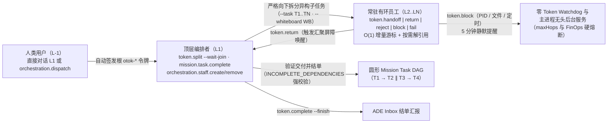

### 本地控制面与纯净执行器空气隔离架构

Aexus Code 绝不对外暴露公网端口。所有控制面请求仅走本地 IPC、主进程无头后台与 `127.0.0.1` 回环桥接，并强制执行服务端 HMAC 身份推导、严格自上而下血缘/部门校验（`canRankSupervise`）与子进程环境变量清洗：

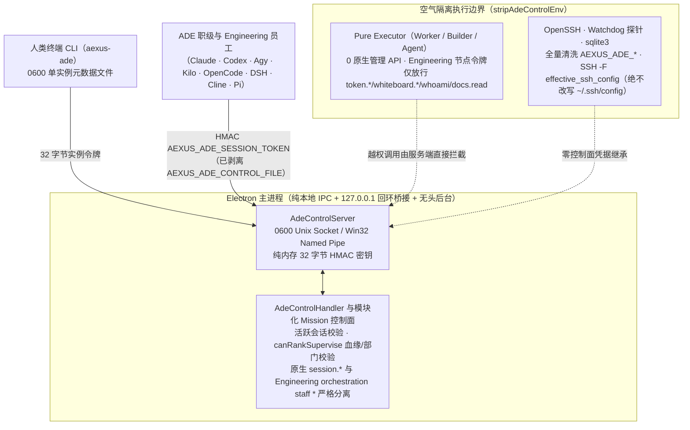

---

## 核心旗舰能力

### 1. 一个面板掌控多端多系统项目、8 大引擎 ADE 会话与多云主机集成终端

在同一左侧栏统一管理 **macOS**、**Ubuntu**、**Kali Linux** 与 **Windows** 上的本地及云端项目，并在同一窗口内分屏直控多台本机 + 云主机集成终端：

<p align="center">
  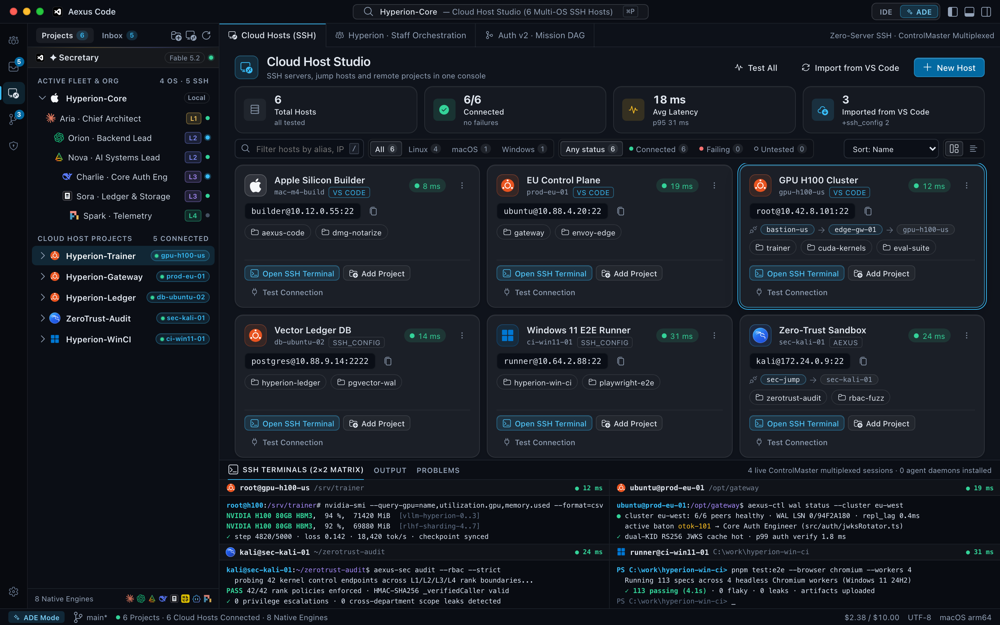
  <br/>
  <sub><strong>一个面板掌控多系统云主机舰队与 2×2 四云主机并发 SSH 终端：</strong>同时直连 macOS、Ubuntu H100 GPU 与控制面、Kali 零信任审计及 Windows CI 终端，免远端装机、绝不改写 <code>~/.ssh/config</code>。</sub>
</p>

- **彻底无视路径与系统差异**：在同一侧栏混排本地 `file://` 与免装机 `aexus-ssh://` 云端项目，自动识别平台图标（Apple / Ubuntu / Kali / Windows），顶部常驻 **`✦ Secretary`**，支持 Smart Calm 极简模式与**一键完整徽章展开**。
- **8 大本机原生编码引擎同台协作**：**Claude Code**、**Codex**、**Antigravity**、**Kilo Code**、**OpenCode**、**DeepSeek Harness**、**Cline**、**Pi** 官方辨识度彩色图标一眼区分，覆盖全职级与多端主机。

---

### 2. 组织与职级工作室（"Everything is Extensible"）

不再被绑死在单一固定组织结构里，按团队需要自由定制多级组织与权限：

<p align="center">
  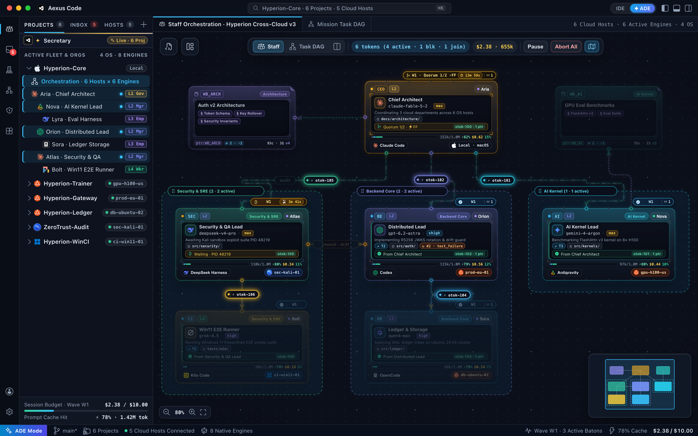
  <br/>
  <sub><strong>跨云多引擎多职级 Agent 编排全景拓扑：</strong>L1 主权架构师统筹 3 大云端部门翼与折角共享白板，跨 6 台多系统主机、6 大原生 Agent 引擎实时流转接力令牌与汇聚屏障。</sub>
</p>

| 内置组织预设 | 职级梯队（顶层 → 叶子纯净执行器） | 结构槽位映射（`orch / seg / rev / exec`） |
| :--- | :--- | :--- |
| **`default-4tier`** *（默认）* | `Governor (L1)` → `Manager (L2)` → `Employee (L3)` → `Worker (L4 Pure)` | `governor / manager / employee / worker` |
| **`startup-3tier`** | `Tech Lead (L1)` → `Reviewer (L2)` → `Builder (L3 Pure)` | `tech-lead / tech-lead / reviewer / builder` |
| **`research-lab`** | `Principal Investigator (L1)` → `Research Lead (L2)` → `Peer Critic (L3)` → `Experimenter (L4 Pure)` | `governor / manager / employee / worker` |
| **`security-audit`** | `Audit Director (L1)` → `Lead Auditor (L2)` → `Verifier (L3)` → `Scanner (L4 Pure)` | `governor / manager / employee / worker` |
| **`flat-swarm`** | `Coordinator (L1)` → `Agent (L2 Pure)` | `coordinator / coordinator / coordinator / agent` |

- **填空式自定义职级与热调整**：在原生脏状态追踪编辑器中自由定制职级名称、颜色、图标与 `{{variables}}` 提示词（支持保存、回滚、ID 重命名自动迁移活跃会话），亦可通过 `aexus-ade rank set-count` 与 `rank rename` 热扩缩容与热改别名。
- **职级 × 固定内核 API 权限矩阵**：可视化配置每个职级可调用的内核原语（`session.*`、`project.read`、只读 `host.access`、`inbox.post`、`mission.read`、`mission.design`，以及独立拆分的高危权限 **`project.manage`**、**`host.manage`**、**`mission.control`** 与 **`mission.destroy`**）。
- **血缘校验的服务端签名能力令牌**：每个编排会话均持有主进程内存签发的 HMAC-SHA256 `AEXUS_ADE_SESSION_TOKEN`；服务端校验会话活跃状态并强制执行严格自上而下 `canRankSupervise` + 子树归属校验。
- **零预热 KV-Cache 稳定首轮注入 + 单副本职级手册**：首轮注入将 100% 静态核心宪章前缀置顶，动态上下级与子树绑定收尾至 `### Live Role Bindings`（会话自动改名或增删下属绝不破坏前缀缓存与提示词哈希），仅在真实宪章变更或上下文压缩后同步，并按需引用 `~/.aexus-code/docs/ranks/L0..LN.md` 与 `docs/mission/MISSION_API.md`。
- **防恶意仓库提示词注入**：`aexus.ade.organization` 为 `application` 级受限配置（`restricted: true`），忽略克隆仓库中 `.vscode/settings.json` 的覆盖。

---

### 3. 双视图 Engineering 画布（雕琢级 Mission Task DAG + 有环 Orchestration）与 6 套蓝图模板

通过可视化双视图画布或 CLI（`aexus-ade orchestration ...` / `aexus-ade mission task ...`）将严格无环的 **Mission Task DAG** 与常驻有环 **Orchestration** 团队实时联动，按需配置本机或 SSH 云主机、引擎、模型/思考深度与部门共享白板：

<table>
  <tr>
    <td width="50%">
      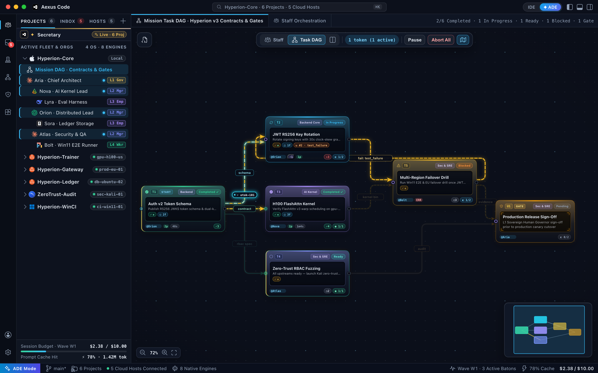
      <p align="center"><sub><strong>雕琢级 Mission Task DAG：</strong><code>280×154</code> 契约守卫任务节点、确定性校验回执、就绪前沿光晕与鎏金主权门禁。</sub></p>
    </td>
    <td width="50%">
      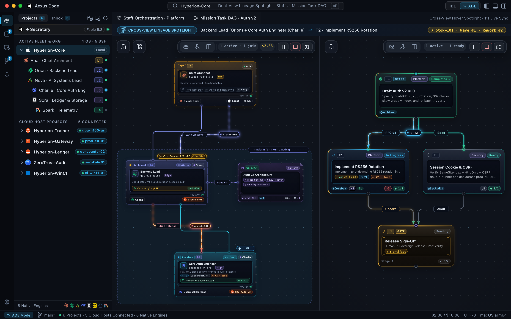
      <p align="center"><sub><strong>双视图实时联动：</strong>左侧宽屏 Orchestration 实时接力令牌流与右侧 Mission Task DAG 交付物 1:1 跨视图聚光联动。</sub></p>
    </td>
  </tr>
</table>

- **全职级有环常驻协作与零静态前置提示词**：所有职级（`L1..LN`）同台进入 Orchestration 画布，严格 1:1 员工唯一且支持 `<-->` 评审回路；任务说明与交付物全部经由轻量指针 `otok-*` 令牌流转（`--summary`、`--detail`、`--artifact`、`--decision`、`--whiteboard`），环路重入仅注入 O(1) 增量指针。
- **实时 Task DAG 联动与上游强依赖结单门禁**：令牌绑定 `--task <taskId>` 后自动实时同步任务状态、执行人、耗时与产物指针，但绝不自动结单；必须由有权限的上级调用 `mission task complete` 且所有上游前置任务均已完成才允许结单。
- **自动可用引擎探测 & 分组模型选择器**：打开 Engineering 视图即自动探测本机与绑定 SSH 主机上可用引擎，不可用项直接置灰；点击节点中央大图标可按厂商分组切换模型与思考深度（运行期支持热换模型同时锁定引擎切换）。
- **零 Token Watchdog、主进程 0 窗口无头后台与容错护栏**：支持 5 分钟静默提醒、零 Token PID/文件 `token block` 唤醒、`maxHops` 死循环熔断、FinOps 硬预算熔断（`orchestration limits`）、确定性 `%% check` 校验门禁与 429/502 指数退避重试。

<p align="center">
  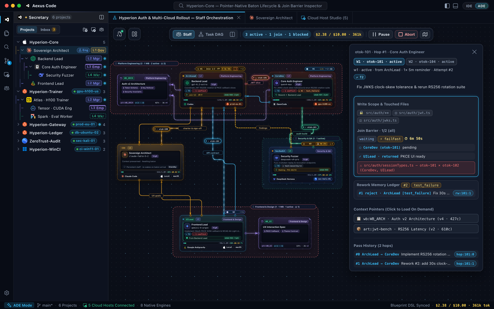
  <br/>
  <sub><strong>轻量指针接力令牌审查器、汇聚屏障与共享白板：</strong>原位检视写作用域规则、并发文件冲突告警、Quorum 倒计时、返工记忆账本与按需解引用指针。</sub>
</p>

| 内置双视图示例蓝图 | Mission 任务 DAG | Orchestration 团队角色 | 适用场景 |
| :--- | :--- | :--- | :--- |
| **[`feature-ship`](../examples/blueprints/feature-ship.md)** | `T1 → (T2 ∥ T3 ∥ T4) → U1 → T5` | `Architect (L1)`, `Backend (L2)`, `Frontend (L2)`, `QA (L3)` | 契约先行的全栈功能交付：后端/前端/测试并行 + 发布门禁 |
| **[`bug-hunt-fix`](../examples/blueprints/bug-hunt-fix.md)** | `T1 → (T2 ∥ T3) → T4 → U1` | `LeadDebugger (L1)`, `FixDev (L2)`, `QA (L3)`, `Auditor (L2)` | 最小复现驱动的精准排障 + 分作用域修复与回归测试 |
| **[`security-audit-swarm`](../examples/blueprints/security-audit-swarm.md)** | `(T1 ∥ T2 ∥ T3) → T4 → U1 → T5` | `AuditLead (L1)`, `AuthAudit/IpcAudit/SupplyAudit (L2)`, `Hardening (L3)` | 鉴权、IPC 与供应链三轨并行安全审计与补丁收敛 |
| **[`safe-migration`](../examples/blueprints/safe-migration.md)** | `T1 → (T2 ∥ T3) → U1 → T4` | `Architect (L1)`, `CoreDev (L2)`, `CallerDev (L2)`, `Verifier (L3)` | 行为基线锁定、并行重构、回滚门禁与旧代码清理 |
| **[`deep-research-lab`](../examples/blueprints/deep-research-lab.md)** | `R1 → (R2 ∥ R3 ∥ R4) → U1 → R5` | `PI (L1)`, `TrackA (L2)`, `TrackB (L2)`, `Bench (L3)` | 多轨假设探索、反证基线、定量基准与同行评审报告 |
| **[`arch-teardown`](../examples/blueprints/arch-teardown.md)** | `R1 → (R2 ∥ R3) → R4 → U1` | `Architect (L1)`, `Systems (L2)`, `UX (L2)`, `Reviewer (L3)` | 系统并发与开发体验双轨架构拆解，产出可执行 RFC |

#### 多领域跨云多智能体实战场景一览

无论是红蓝对抗安全集群、多机多卡 AI 科研实验、三云端实时会话接力还是全引擎 FinOps 成本治理，均可在一个面板内统一调度：

<table>
  <tr>
    <td width="50%">
      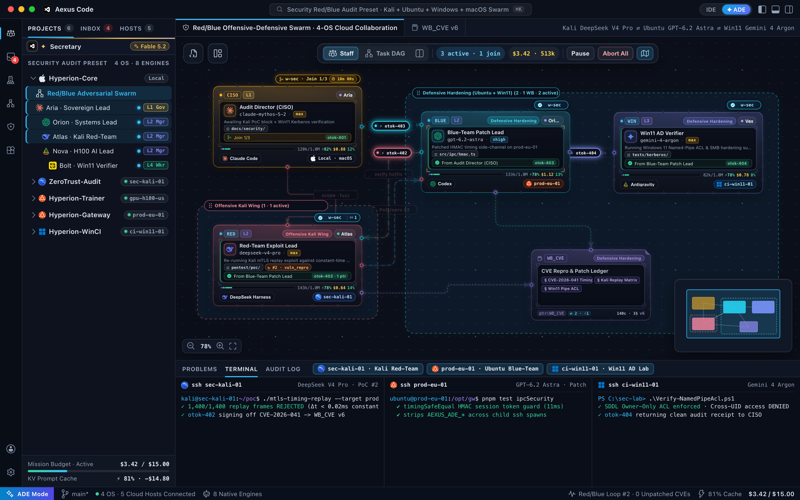
      <p align="center"><sub><strong>红蓝对抗跨云安全集群：</strong><code>Kali</code> DeepSeek V4 Pro 漏洞复现 ⇄ <code>Ubuntu</code> GPT-6.2 Astra 热修复 ⇄ <code>Win11</code> Gemini 4 Argon 域控回归校验。</sub></p>
    </td>
    <td width="50%">
      
      <p align="center"><sub><strong>多 GPU AI 科研实验室：</strong><code>8×H100</code> FP8 算子、<code>8×H200</code> 稀疏 MoE 与 <code>Win11</code> DirectML 消融实验跨云并行汇聚。</sub></p>
    </td>
  </tr>
  <tr>
    <td width="50%">
      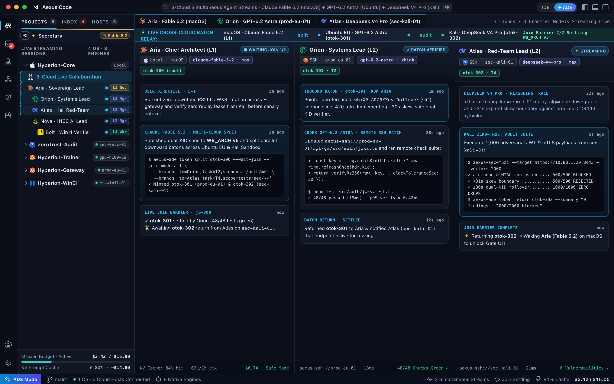
      <p align="center"><sub><strong>三云端多引擎同屏实时流：</strong>本机 <code>macOS</code> Claude Fable 5.2 拆分令牌，与远端 <code>Ubuntu</code> GPT-6.2 Astra 及 <code>Kali</code> DeepSeek V4 Pro 同屏实时流转。</sub></p>
    </td>
    <td width="50%">
      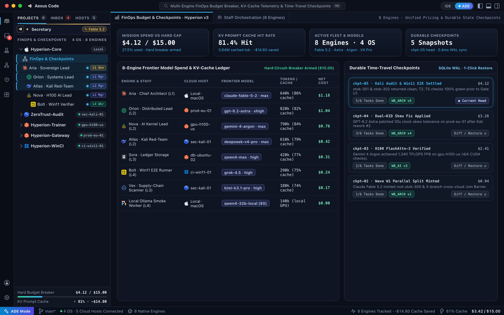
      <p align="center"><sub><strong>全引擎 FinOps 与状态检查点：</strong>8 大引擎旗舰模型统一计费、81% 缓存命中省费、硬预算熔断与一键回滚检查点。</sub></p>
    </td>
  </tr>
</table>

---

### 4. Smart Calm 侧栏与按职级过滤的 `ADE Inbox`

<p align="center">
  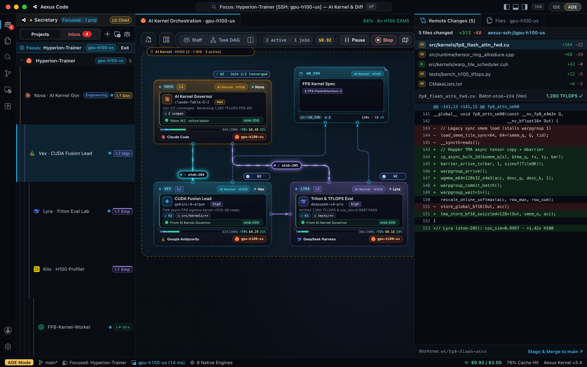
  <br/>
  <sub><strong>项目 Focus 聚焦模式、跨引擎协作与远端 Git Diff 审查：</strong>一键聚焦单个 H100 云端仓库，同时保持其余 5 个项目后台运行，配合实时统一 Diff 审查。</sub>
</p>

- **Smart Calm 极简侧栏**：会话行默认展示紧凑悬停绽放徽章且防止徽章裁切，顶部提供**一键切换完整徽章视图**按钮，并在最上方常驻具备视口感知能力的 **`✦ Secretary`**（支持 `/mission`、`/status`、`/sessions`、`/projects`）。
- **按职级过滤的 `ADE Inbox`**：统一收信箱汇总 Mission 升级告警与人工门禁，并根据当前组织预设动态渲染职级过滤胶囊（如 `All | Governor | Manager | Employee`——当 `0`-API 纯执行职级为空时自动隐藏，减少噪音）。

---

### 5. 魔改版全功能 VS Code IDE（`ADE ⇄ IDE`）、主流插件兼容与免装机 SSH 云主机

Aexus Code 完整保留原生 `Code - OSS` IDE 的全部生产力——资源管理器、分屏编辑器、实时 Git Diff、多端集成终端、顶栏完全解耦的**插件**与**Agent 引擎**按钮以及 **[Open VSX](https://open-vsx.org/)** 主流 VS Code 扩展兼容，同时提供免远端装机的多系统 SSH 云主机工作室：

<p align="center">
  
  <br/>
  <sub><strong>瞬切 <code>ADE ⇄ IDE</code> 镜像对称（<code>Alt+Cmd+A</code>）：</strong>在同一工作区无缝切回原生 IDE 模式，管理本地与多云 SSH 多根项目、编辑代码、右侧联动雕琢级 Task DAG 并直控多云主机终端。</sub>
</p>

- **零远端后台**：在同一窗口直接编辑远端文件、查看 `HEAD` Diff、自动发现并导入云端主机项目级会话（如 Claude Code / Codex / OpenCode）、将 Mission 节点绑定到云主机（`mission host bind`）并打开远端 SSH 集成终端，**无需在目标服务器安装或升级 `vscode-server`**。
- **非破坏性 `~/.ssh/config` 保证**：`syncUserSshDir` 默认为 **`false`**——Aexus Code 仅向自身的 SSH 会话与终端传入 `-F <userDataDir>/ssh/effective_ssh_config`，**绝不修改或向用户全局 `~/.ssh/config` 头部插入 `Include`**。
- **OpenSSH 传输行为**：macOS / Linux 使用 OpenSSH `ControlMaster` 连接复用，Windows 使用直连 OpenSSH；后台文件、Git 与探针操作使用 `BatchMode=yes`（需密钥或 `ssh-agent` 免交互鉴权，Aexus Code 从不读取或复制私钥内容）。
- **无损迁移 VS Code 配置**：通过 `aexus-ade host import-vscode` 只读解析 `~/.ssh/config`（含递归 `Include`）及 VS Code 远端目录历史。
- **完整 2x Retina 宣传图集**：请前往 [`docs/gallery.md`](gallery.md) 查看全部 25 张旗舰高清界面展示。

---

## 8 大本机原生 Coding Agent 引擎

所有引擎均在本机或绑定 SSH 云主机运行（`requiresCopilotSignIn: false`），共用统一的隔离环境构造器（`runtime.ts`）、公开上游默认模型列表（同时动态发现本机 CLI 自定义配置）与首轮内联角色同步机制（`extension.ts`）：

| 引擎名称 | 会话标识 | 默认 CLI | 协议与默认安全模式 |
| :--- | :--- | :--- | :--- |
| **Claude Code** | `aexus-claude` | `claude` | 双向 `stream-json` · 默认 `acceptEdits` · 实时 Token 捕获与压缩重置 |
| **Codex** | `aexus-codex` | `codex` | `app-server` JSON-RPC（`thread/inject_items`）· 默认 `workspace-write` + `on-request` |
| **Google Antigravity** | `aexus-antigravity` | `agy` | 本机 `--hub` ConnectRPC 桥接 · 默认 `ask` |
| **Kilo Code** | `aexus-kilo` | `kilo` | ACP 运行时桥接 · 默认 `ask` |
| **OpenCode** | `aexus-opencode` | `opencode` | 原生面板 + ACP 生命周期 · 默认 `ask` |
| **DeepSeek Harness** | `aexus-dsh` | `dsh` | 原生适配器 + 可关闭角色桥接 · 默认 `ask` |
| **Cline** | `aexus-cline` | `cline` | `--acp` 流式协议 · 默认 `ask` |
| **Pi** | `aexus-pi` | `pi` | `--mode rpc` 结构化事件流与思考进度 · 默认安全模式 |

> [!NOTE]
> - **安全模式与自动执行开关**：底部状态栏实时显示 **`ADE: Safe Mode`** / **`ADE: Autonomous`** 胶囊（点击或运行 **`Aexus ADE: Toggle Safe / Autonomous Permission Mode`** 一键切换）。
> - **第三方扩展角色桥接可随时关闭**：详见 [`SECURITY.md`](../SECURITY.md)，可通过设置 `aexus.ade.nativeExtensionRoleBridge.enabled: false` 或环境变量 `AEXUS_ADE_DISABLE_NATIVE_ROLE_BRIDGE=1` 全局关闭。

---

## `aexus-ade` 本地控制面 CLI

Aexus Code 监听按实例隔离的本地 `0600` Unix Socket（macOS/Linux：`~/.aexus-code/ade-control.<pid>.sock`）或本机 Windows Named Pipe（`\\.\pipe\aexus-ade-control-*`）及 `127.0.0.1` 回环桥接，由**单实例 32 字节令牌**（人类 CLI）与**服务端签名会话级 HMAC 能力令牌**（`AEXUS_ADE_SESSION_TOKEN`，编排智能体专用）双重鉴权：

```bash
# 0. 一键体检 8 大引擎、Git 与 OpenSSH（v1.1.0，输出 schemaVersion: 1 JSON，失败/严格警告退出码 1/2）
aexus-ade --version
aexus-ade doctor --project . --json
eval "$(aexus-ade completion zsh)"   # 同时支持 bash | fish | powershell

# 1. 查看/切换组织预设、动态调整职级并阅读单副本 API 手册
aexus-ade role list --json
aexus-ade role apply-preset startup-3tier
aexus-ade rank names --json
aexus-ade docs read engineering       # 双视图协作范式与令牌规则
aexus-ade docs read engineering-api   # Engineering CLI 命令速查手册

# 2. 原生 ADE 创建常规员工会话（基础原生能力，并非 Engineering 专属）
aexus-ade session create --project . --engine claude --role governor --title "Release Lead" --no-open --json

# 3. 初始化双视图 Engineering 工作区，一键导入任务 DAG + Orchestration 团队 + 任务说明并配置安全护栏
MISSION_ID=$(aexus-ade mission init --title "Feature Ship" --open --json | jq -r .id)
aexus-ade mission blueprint validate --file ./examples/blueprints/feature-ship.md --json
aexus-ade mission blueprint apply --mission "$MISSION_ID" --file ./examples/blueprints/feature-ship.md
aexus-ade orchestration limits --mission "$MISSION_ID" --max-hops 48 --budget 15 --json

# 4. 在 Engineering 编排画布中新建员工节点（必须使用 Engineering 专属 API！）
aexus-ade orchestration staff create --mission "$MISSION_ID" --name "Perf Engineer" --rank L3 --department Backend --engine codex --json

# 5. 下发需求波次（或直接对话 L1）、查看紧凑双视图运行态并审批人工门禁节点 U1
aexus-ade orchestration dispatch --mission "$MISSION_ID" --prompt "按 T1..T5 交付 Feature X" --task T1 --json
aexus-ade orchestration status --mission "$MISSION_ID" --json
aexus-ade inbox list --unread-only
aexus-ade mission task complete --mission "$MISSION_ID" --node U1 --note "人工发布门禁已通过"
```

| 命令组 | 核心子命令 |
| :--- | :--- |
| `doctor` / `completion` | `doctor [--project <path>] [--strict] [--json]` *（含 `schemaVersion: 1` 与 `aexusVersion`）* · `completion <bash\|zsh\|fish\|powershell>` · `--version` *（无需启动窗口即可独立运行）* |
| `whoami` / `docs` / `api` | `whoami [--json]` · `docs read <common\|L0..LN\|engineering\|engineering-api\|mission\|manifest>` · `api update [--since <v>] [--scope <s\|all>]` |
| `role` *（别名 `roles`）* | `list [--json]` / `schema` · `apis` / `primitives` · `presets [--json]` · `preset <id>` / `apply-preset <id>` · `set-tier <sessionId> <rankId>` · `reset` · `studio [rankId]` |
| `rank` *（别名 `ranks`）* | `list` · `names` · `get <tier\|alias>` · `docs [tier]` · `rename <tier\|alias> <newName>` · `set-count <n>` · `mission-name <name>` |
| `status` / `mode` / `view` | `status [--json]` · `mode [get \| set <ade\|ide>]` · `view [--archived] [--inspector <changes\|files\|hide>] [--refresh]` |
| `project` | `list` · `add <path\|host:/path>` · `select` · `remove` · `delete` · `focus` · `home` · `forward` · `move` · `changes` · `files` · `open-file` · `open-diff` |
| `host` *（别名 `cloud-host`）* | `list` · `info` · `add` · `update` · `remove` · `test` · `browse` · `import-vscode` · `open` |
| `engine` | `list` · `sessions <engine> [--project <p>] [--limit <n>]` |
| `session` *（原生核心 ADE）* | `list` · `info` · `subordinates` · `tree` · `create` · `attach` · `connect` · `open` · `select` · `close` · `send [--wait]` · `history` · `mark-read` · `draft` · `reorder` · `rename` · `role` · `configure` · `move` · `stop` · `archive` · `unarchive` · `detach` · `delete [--force]` |
| `secretary` | `status` · `open` · `engine` · `reset` · `send [--wait]` · `history` · `stop` · `draft` · `mark-read` |
| `orchestration` *（Engineering 画布）* | `get` · `status [--full]` · `validate` · `load` · `apply` · `export` · `import` · `layout set` · `group <list\|create\|rename\|assign\|remove>` · **`staff <create\|rename\|config\|remove>`** *（Engineering 画布员工节点专属）* · `edge <connect\|label\|remove>` · `dispatch [--ref]` · `pause` · `resume` · `abort` · `limits [--max-hops] [--budget] [--silence]` |
| `mission` *（Task DAG 与生命周期）* | `list [--project <p>]` · `init` · `open [--view <orchestration\|mission\|both>]` · `docs` · `rename <id> <title>` · `blueprint <get\|apply\|validate>` · `task <list\|get\|set\|create\|update\|remove\|edge\|complete\|status>` · `check <list\|get\|set\|remove\|run>` · `diagnostics` · `checkpoint <list\|create\|diff\|restore>` · `export [--format json\|markdown]` · `import` · `host bind` · `trigger <list\|set\|remove>` · `remove` |
| `token` *（统一 `otok-*` 总线）* | `current [--full]` · `read <ptrs> [--toc\|--section <h>\|--tail <n>]` · `history <id> [--delta\|--all]` · `mint` · `split [--wait-join] [--scope-paths] [--join-mode all\|any\|quorum] [--branches-json -]` · `return <id> [--complete-task]` · `handoff <id>` · `reject <id> [--category]` · `fail <id> [--category]` · `retry <id>` · `block <id>` · `complete <id> [--finish] [--complete-task]` |
| `whiteboard` | `list` · `create` · `read <wbId> [--toc\|--section <h>\|--max-chars <n>\|--tail <n>]` · `write <wbId> [--section <h>] [--expected-version <n>]` · `rename` · `remove` |
| `org` | `subordinates` · `send <target> <msg>` · `context <target> [--limit <n>] [--full]` · `escalate` |
| `inbox` | `list [--unread-only]` · `post` · `resolve` · `mark-read` |

---

## 生态定位与架构取舍对比

不同工具针对不同工作流做了取舍，以下聚焦于公开可验证的架构设计差异：

| 架构维度 | **Aexus Code** | 闭源商业 AI IDE *（如 Cursor、Windsurf）* | 外部看板启动器 *（如 Vibe Kanban、Conductor）* | IDE 内部智能体插件 *（如 Cline、Roo Code）* | 独立图编排工作室 *（如 LangGraph Studio、Dify）* |
| :--- | :---: | :---: | :---: | :---: | :---: |
| **开源协议与扩展源** | MIT · [Open VSX](https://open-vsx.org/) | 闭源商业 | 混合开源 / 商业 | 开源插件 | 混合开源 / 托管服务 |
| **原生桌面 IDE 内核** | 完整 `Code - OSS`（`ADE ⇄ IDE`） | 闭源 VS Code 分叉 | 编辑器/终端外部启动壳 | 依赖宿主 IDE | 独立 Web / 服务端界面 |
| **多引擎 BYO-CLI 编排** | 8 大本机/云端原生 CLI 同屏混搭 | 以自有运行时为主 | 外部 CLI 窗格启动 | 单一插件运行时（多模型 API） | API / SDK 图节点 |
| **可扩展组织架构与内核权限** | 自定义 `1..N` 职级 + 原生 `session.*` 与 Engineering `orchestration staff *` 严格分层 + 血缘 HMAC 令牌 | 固定代理 / 子代理模式 | 人工任务分配 | 自定义模式提示词 | 代码编写图角色 |
| **双视图编排 + 圆形任务 DAG** | 全员有环画布、圆形任务 DAG、指针 `otok-*` 拆分汇聚与打回、白板与无头后台 | 后台代理（无可视化 DAG） | 看板（脱离原生 LSP/Diff） | 顺序 / 模式循环 | 通用图（脱离本地 CLI） |
| **免装机多根 SSH（`aexus-ssh://`）** | 原生 OpenSSH（零远端进程、不改 `~/.ssh/config`） | 需远端服务插件 | 偏本机 | 依赖宿主 IDE | 服务端托管 |

---

## 快速开始：下载预编译发行版或从源码构建

### 方式 A — 下载预编译发行版（`v1.1.0`，约 60 秒上手）

前往 **[GitHub Releases](https://github.com/Daijunfan/Aexus-Code/releases)** 直接下载由 [`.github/workflows/release.yml`](../.github/workflows/release.yml) 构建的平台产物与 `SHA256SUMS.txt`：

- **macOS（`arm64` Apple Silicon / `x64` Intel）**：`Aexus-Code-v1.1.0-darwin-*.dmg` 与 `.zip`
  - *签名说明*：未配置 Apple Developer ID 密钥的构建采用 ad-hoc 签名，首次启动请执行 `xattr -dr com.apple.quarantine "/Applications/Aexus Code.app"` 或通过访达右键 → 打开。
- **Linux（`x64`）**：`Aexus-Code-v1.1.0-linux-x64.tar.gz` *（解压即为干净的 `Aexus-Code-linux-x64/` 目录）*
- **Windows（`x64`）**：`Aexus-Code-v1.1.0-win32-x64.zip`

打开应用后按 `Alt+Cmd+A`（`Alt+Ctrl+A`）即可体验 `ADE ⇄ IDE` 镜像对称，并打开或初始化你的第一个 Mission DAG。

> **扩展市场说明**：Aexus Code 默认接入开源 **[Open VSX Registry](https://open-vsx.org/)**（`open-vsx.org/vscode/gallery`，遵循与 VSCodium 一致的开源合规策略），同时支持本地 `.vsix` 安装；微软限制仅限官方闭源构建运行的专有扩展不包含在内。

### 方式 B — 从源码构建（首次完整编译约 15 分钟）

作为完整的 `Code - OSS` Electron 桌面端，首次从源码安装依赖并构建约需 15 分钟与 8–12 GB 磁盘空间。*（若仅需开发/调试引擎适配器或 `aexus-ade` CLI，请直接使用 **[30 秒引擎适配器贡献快车道](../CONTRIBUTING.md#30-second-engine-adapter-contributor-fast-path)**，无需编译完整 IDE！）*

#### 前置要求
- **Node.js `24.22.1`**（与 [`.nvmrc`](../.nvmrc) 保持一致）及 **`pnpm@12.16.0`**（可通过 `nvm`/`fnm`/`mise` + `corepack enable && corepack prepare pnpm@12.16.0 --activate` 准备）。
  - `./scripts/aexus-env.sh`（macOS/Linux）与 `.\scripts\aexus-env.ps1`（Windows）会自动检测可选的 `.build/toolchain` 目录、对照 `.nvmrc` 校验当前 Node 版本并清理代理/Electron 环境变量——但**不会**自动为你下载 Node。
- **本机编译工具链**：Xcode Command Line Tools（macOS）、`build-essential` 与 X11/libsecret 头文件（Linux）或 Visual Studio 2022 C++ Build Tools + Windows 11 SDK（Windows），以及 Python 3、Git、OpenSSH。

#### 源码构建（macOS / Linux）

```bash
# 1. 安装依赖并快速转译核心与 extensions/aexus-agents
./scripts/aexus-env.sh pnpm install
./scripts/aexus-env.sh pnpm run build-fast

# 2. 体检本机 8 大编码 CLI、Git 与 OpenSSH
#    （提示：在 build-fast 之前也可直接运行：node --experimental-strip-types extensions/aexus-agents/src/adeCli.ts doctor）
./extensions/aexus-agents/bin/aexus-ade doctor

# 3. 从源码启动开发版
./scripts/aexus-env.sh ./scripts/code.sh

# 4a. macOS 打包并安装至 /Applications/Aexus Code.app（自动识别 arm64/x64，可用 AEXUS_ARCH=x64 覆盖）
ARCH=$(uname -m | sed 's/x86_64/x64/')
./scripts/aexus-env.sh pnpm run gulp "vscode-darwin-${ARCH}"
./scripts/aexus-install.sh   # 本地签名与钥匙串助手均为可选，缺失时自动降级 ad-hoc 签名

# 4b. Linux 打包（gulp 产出 ../VSCode-linux-x64，release.yml 归档时自动重命名为 Aexus-Code-linux-x64）
./scripts/aexus-env.sh pnpm run gulp vscode-linux-x64
```

#### 源码构建（Windows PowerShell）

```powershell
# 1. 安装依赖并快速转译
.\scripts\aexus-env.ps1 pnpm install
.\scripts\aexus-env.ps1 pnpm run build-fast

# 2. 体检本机编码 CLI、Git 与 OpenSSH
.\extensions\aexus-agents\bin\aexus-ade.ps1 doctor

# 3. 从源码启动开发版
.\scripts\aexus-env.ps1 .\scripts\code.bat

# 4. 打包并安装至 %LOCALAPPDATA%\Programs\Aexus Code
.\scripts\aexus-env.ps1 pnpm run gulp vscode-win32-x64
.\scripts\aexus-install.ps1
```

---

## 坦诚的局限性与非目标（Honest Limitations & Non-Goals）

我们希望在第一屏就把真实边界说清楚：

- **从源码构建体量较大**：作为完整的 `Code - OSS` Electron 桌面端，源码依赖与构建产物约占用 8–12 GB 磁盘空间，首次构建约需 15 分钟。只想快速试用请优先下载 GitHub Releases 预编译包，仅改引擎适配器请使用 [`CONTRIBUTING.md`](../CONTRIBUTING.md) 中的 30 秒测试快车道。
- **macOS 发行版签名**：在尚未接入 Apple Developer ID 签名与公证前，macOS 构建包使用 ad-hoc 签名，首次打开需手动放行 Gatekeeper 隔离属性。
- **SSH 传输约束**：`aexus-ssh://` 后台文件、Git 与引擎探测使用 `BatchMode=yes`（需密钥或 `ssh-agent` 免交互鉴权），且 Windows 客户端无法使用 Unix Socket `ControlMaster`，远端文件操作延迟高于 macOS/Linux。
- **非目标**：不提供托管云端 SaaS IDE、不中转或加价转售模型 API Token，也不捆绑微软闭源 Copilot 或 Visual Studio Marketplace。

---

## 社区、安全与开源许可

- **架构与贡献**：请参阅英文架构文档 [`docs/ARCHITECTURE.md`](ARCHITECTURE.md)、[`CONTRIBUTING.md`](../CONTRIBUTING.md) 与 [`CHANGELOG.md`](../CHANGELOG.md)。
- **安全模型与威胁边界**：请参阅 [`SECURITY.md`](../SECURITY.md)，完整了解安全/全自动模式、双视图边界与血缘校验 HMAC 能力令牌、子进程环境清洗、非破坏性 SSH 配置（`syncUserSshDir: false`）及第三方扩展角色桥接的关闭方式。
- **开源许可与合规声明**：基于 Microsoft [`Code - OSS`](https://github.com/microsoft/vscode) 衍生开发并遵循 **[MIT License](../LICENSE.txt)**，完整保留上游版权声明，并接入开源 [Open VSX Registry](https://open-vsx.org/)。Microsoft 与 Visual Studio Code 为 Microsoft Corporation 的注册商标。
