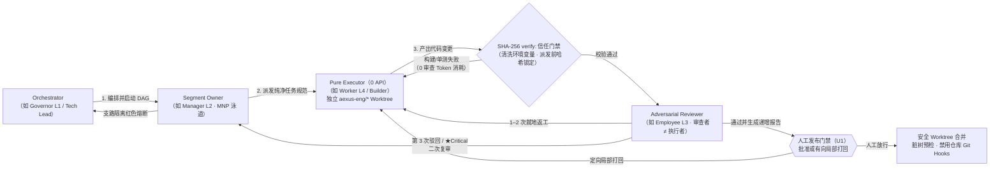
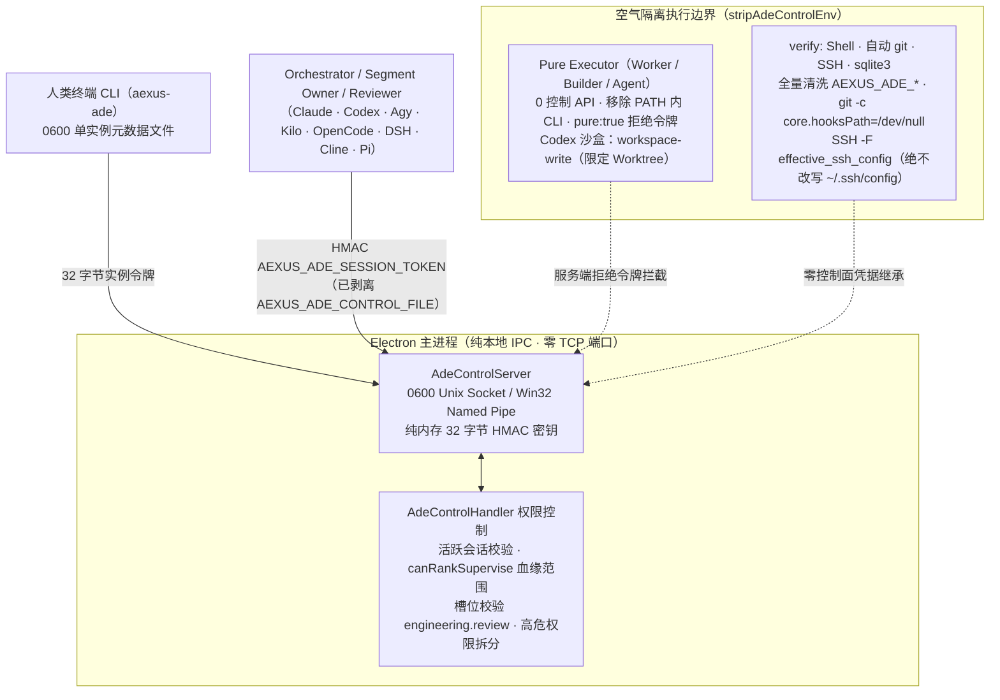

<p align="center">
  
</p>

<h1 align="center">Aexus Code</h1>

<p align="center">
  <strong>开源组织化智能体开发环境（ADE）与可视化多智能体控制面 IDE</strong><br/>
  可扩展多级组织架构 · 8 大本机 BYO-CLI 编码引擎 · 确定性 Engineering &amp; Research DAG · 服务端签名能力令牌 · Git Worktree 沙盒 · 免装机原生 SSH 云主机
</p>

<p align="center">
  <a href="https://github.com/Daijunfan/Aexus-Code/actions/workflows/aexus-ci.yml"></a>
  <a href="https://github.com/Daijunfan/Aexus-Code/releases"></a>
  <a href="../LICENSE.txt"></a>
  <a href="https://open-vsx.org/"></a>
  
  
</p>

<p align="center">
  <a href="../README.md">English</a> · <strong>简体中文</strong> · <a href="ARCHITECTURE.md">架构总览</a> · <a href="gallery.md">完整图库与视频</a> · <a href="../examples/blueprints/README.md">蓝图模板库</a> · <a href="../SECURITY.md">安全模型</a> · <a href="../CHANGELOG.md">更新日志</a> · <a href="../CONTRIBUTING.md">贡献指南</a> · <a href="../CODE_OF_CONDUCT.md">行为准则</a>
</p>

---

> [!TIP]
> **10 秒零花费预览（`$0.00` 模拟演练），或 `<50ms` 生成可编辑 DAG 脚手架：**
> - **零 Token 模拟互动演练（`$0.00` 花费、零源码改动）**：点击画布工具栏的 **`▶ Simulated Demo (0 tok)`**、按 `Cmd/Ctrl+Shift+P` 执行 **`Aexus ADE: Try Interactive Engineering DAG Demo (0 Tokens)`**，或运行 `aexus-ade engineering demo`，预览完整多级编排、点击放行门禁 `U1`，并导出**矢量 SVG** 与 **GitHub PR 验收报告**。
> - **Prompt-to-DAG（`Cmd/Ctrl+Shift+K` 或 `/`）**：按 **`Cmd/Ctrl+Shift+K`**（或在画布聚焦时按 **`/`**——完整保留 VS Code 原生 `Cmd/Ctrl+K` 组合快捷键不冲突）即可在 **`<50ms`** 内完成确定性关键词到 DAG 脚手架合成，可直接可视化编辑或交由 `Orchestrator` LLM 深化。
> - **瞬切 `ADE ⇄ IDE`**：随时按 `Alt+Cmd+A`（`Alt+Ctrl+A`）在组织化智能体视图与全功能 `Code - OSS` IDE 之间切换，不重启语言服务与终端。

<p align="center">
  
  <br/>
  <sub><strong>零 Token 模拟互动演示（<code>$0.00</code> 真实花费，确定性编排预览）：</strong>三路并行 Worktree ➔ 返工自愈 ➔ 门禁 <code>U1</code> 审批 ➔ FinOps 遥测 · <a href="assets/demos/02-live-dag-choreography.mp4">▶ 观看高清 MP4</a> · <a href="gallery.md">浏览完整图库与 5 段视频 →</a></sub>
</p>

---

## 为什么构建 Aexus Code？

现有 AI 研发工具通常不得不在「闭源单线程 IDE」、「脱离编辑器的外部 Worktree 终端壳」与「脱离真实代码库与 Git 的云端节点画布」之间妥协。

**Aexus Code**（`v1.1.0`）基于开源 `Code - OSS`（`1.146.0`）打造，采用 **MIT 开源协议**，默认接入开源 **[Open VSX](https://open-vsx.org/)** 扩展市场并彻底移除微软闭源 Copilot 遥测，在一个本地优先的桌面窗口中融合全功能 **IDE** 与可扩展的 **组织化智能体开发环境（ADE）**：

1. **组织与职级工作室（"Everything is Extensible"）**——内置 **5 套组织预设**（`企业四级`、`敏捷三级创业团队`、`AI 科研实验室`、`红蓝安全审计`、`双层扁平蜂群`），支持填空式自定义职级、**四槽位 DAG 绑定栏**（`Orchestrator` / `Segment Owner` / `Adversarial Reviewer` / `Pure Executor`）、`{{variables}}` 提示词模板、**职级 × 固定内核 API 权限矩阵**，以及全 8 大引擎统一的血缘校验 HMAC 能力令牌。
2. **8 大本机 BYO-CLI 编码引擎（可见的安全 / 全自动开关）**——使用你自己的本机 CLI 与订阅直连 **Claude Code**、**Codex**、**Google Antigravity**、**Kilo Code**、**OpenCode**、**DeepSeek Harness**、**Cline** 与 **Pi**。交互式会话默认运行安全审批模式；底部**状态栏胶囊**（`ADE: Safe Mode` / `ADE: Autonomous`）随时展示并切换权限策略；自动 DAG 流水线需按项目显式确认，且 Codex 执行器默认限定在 Worktree 级 `workspace-write` 沙盒内。
3. **确定性 Engineering & Research DAG 护栏**——支持 **派发前前置校验的 SHA-256 哈希锁定 `verify:`**（配可视化撤销面板与 CLI）、**`files:` 作用域串行化**、**`max_concurrency` + 关键路径调度**、**支路隔离的红色熔断器**、**Git 原生累计 Diff** 与 **零 Token 优先的两阶段 Watchdog**。
4. **动态职级 FinOps、可配置定价与预算护栏**——按当前生效的组织职级实时统计 `$USD` 消耗（优先采用引擎上报费用）、缓存节省、自定义费率表（`aexus.ade.pricing`）与 **订阅制（`$0` 边际费用）模式**；内置模板自动应用 `max_budget_usd` 上限，并配合**派发前准入 + 回合后停机暂停**杜绝失控消耗。
5. **Smart Calm 极简侧栏、精准分类 Inbox 与非破坏性 SSH 云主机**——侧栏采用紧凑悬停绽放徽章，统一 `ADE Inbox` 展示精准告警分类（`Trust Gate`、`Budget Cap`、`Circuit Breaker`）与动态职级筛选胶囊；同一窗口混排本地 `file://` 与免装机 `aexus-ssh://` 云主机，且默认绝不修改用户全局 `~/.ssh/config`。

---

## 对抗式执行闭环与纯执行器隔离架构

### 四槽位对抗式执行与信任门禁闭环

每个 Engineering / Research DAG 均从当前生效的组织配置动态解析 4 个结构化槽位，将**零 API 纯净编码执行**、**确定性 `verify:` 校验**与**独立对抗审查**物理隔离：



### 本地控制面与纯净执行器空气隔离架构

Aexus Code 绝不监听任何 TCP 网络端口。所有控制面请求仅走本地 IPC，并由主进程强制执行服务端 HMAC 身份推导、血缘层级校验（`canRankSupervise`）与子进程环境变量清洗：



---

## 核心旗舰能力

### 1. 组织与职级工作室（"Everything is Extensible"）

不再被绑死在单一固定组织结构里。Engineering 与 Research DAG 通过 4 个**结构化工作树槽位**（`orchestrator`、`segment_owner`、`reviewer`、`executor`）动态映射至当前生效的组织配置，并可在工作室内一键绑定与校验：

<p align="center">
  
  <br/>
  <sub><strong>组织与职级工作室（"Everything is Extensible"）：</strong>5 套内置预设、可视化<strong>四槽位 DAG 绑定栏</strong>、实时 <code>职级 × 固定内核 API</code> 权限矩阵（含 <code>High Privilege</code> 高危标记）、叶子执行器永久 <code>Pure · 0</code> 锁定与 Smart Calm 侧栏。</sub>
</p>

| 内置组织预设 | 职级梯队（顶层 → 叶子纯净执行器） | 工作树槽位映射（`orch / seg / rev / exec`） |
| :--- | :--- | :--- |
| **`default-4tier`** *（默认）* | `Governor (L1)` → `Manager (L2)` → `Employee (L3)` → `Worker (L4 Pure)` | `governor / manager / employee / worker` |
| **`startup-3tier`** | `Tech Lead (L1)` → `Reviewer (L2)` → `Builder (L3 Pure)` | `tech-lead / tech-lead / reviewer / builder` |
| **`research-lab`** | `Principal Investigator (L1)` → `Research Lead (L2)` → `Peer Critic (L3)` → `Experimenter (L4 Pure)` | `governor / manager / employee / worker` |
| **`security-audit`** | `Audit Director (L1)` → `Lead Auditor (L2)` → `Verifier (L3)` → `Scanner (L4 Pure)` | `governor / manager / employee / worker` |
| **`flat-swarm`** | `Coordinator (L1)` → `Agent (L2 Pure)` | `coordinator / coordinator / coordinator / agent` *（自动跳过同角色重复二次自审）* |

- **四槽位 DAG 绑定栏与预设动态提示词**：在工作室顶部直接将任意职级绑定到 `Orchestrator`、`Segment Owner`、`Adversarial Reviewer` 与 `Pure Executor`（并在 `reviewer === executor` 或执行器非纯净时给出实时告警）。DAG 提示词与 FinOps 遥测标签自动适配当前预设的真实职级名称。
- **填空式自定义职级与 `{{variables}}` 模板**：在具备原生脏状态追踪（`isDirty` / `Cmd/Ctrl+S` 保存与回滚、职级 ID 重命名自动迁移活跃会话）的编辑器中自由定制名称、颜色、图标与提示词变量。
- **职级 × 固定内核 API 权限矩阵**：可视化配置每个职级可调用的内核原语（`session.*`、`project.*`、只读 `host.access`、`inbox.post`、`engineering.read/design/review/control`，以及独立拆分的高危权限 **`host.manage`**、**`engineering.integrate`** 与 **`engineering.destroy`**）。
- **血缘校验的服务端签名能力令牌**：每个编排会话均持有主进程内存签发的 HMAC-SHA256 `AEXUS_ADE_SESSION_TOKEN`；服务端校验会话活跃状态、强制执行 `canRankSupervise` + 子树归属校验，并验证 `engineering.review` 调用方的槽位身份，杜绝越权与自我审批。
- **零预热首轮内联注入 + 提示词哈希失效 + 自动压缩恢复**：首轮内联注入职级契约，发送成功后才提交状态；提示词哈希变更时下一轮自动重注；检测到上下文压缩后自动恢复契约。
- **防恶意仓库提示词注入**：`aexus.ade.organization` 为 `application` 级受限配置（`restricted: true`），忽略克隆仓库中 `.vscode/settings.json` 的覆盖。

---

### 2. 确定性 DAG 护栏、装甲嵌套双壳舱与 6 套 1:1 同步蓝图模板

在本地 Git 工作区中右键任意顶层编排者（`Governor` / `Tech Lead` / `Coordinator`）开启 **`Engineering`** 或 **`Research`**，即可启动与 Mermaid + Markdown 双向同步的可视化流水线：

<p align="center">
  
  <br/>
  <sub><em>零 Token 模拟演练预览：</em>外层 <code>EMPLOYEE · L3</code> 验收壳四边包裹内层 <code>WORKER · L4</code> 纯净执行核，整体嵌于自动切分的 <code>MGR · L2</code> 泳道中。</sub>
</p>

- **派发前前置 SHA-256 哈希锁定 `verify:` 与撤销机制**：`runTree` 启动时在**派发任何 Worker 之前**即前置扫描未信任的 `verify:` 命令，避免在等待人工同意前浪费 Token。通过审核的命令在清洗后的环境（剥离 `AEXUS_ADE_*`；POSIX 独立进程组 / Windows `cmd.exe /d /s /c`）中执行，且随时可通过 **`Aexus ADE: Manage Trusted Verify Commands...`** 或 `aexus-ade engineering verify-trust list|revoke` 查看或撤销信任。
- **`files:` 作用域串行化与 `max_concurrency` 关键路径调度**：为节点声明文件所有权 glob（如 `files: src/services/**`），`shared` 模式下存在交集的节点自动串行避免写冲突；`max_concurrency` 控制最大并行数并沿关键路径优先调度。
- **支路隔离红色熔断器 & 零 Token 优先的两阶段 Watchdog**：连续正式失败演进为 `failure_1` 浅琥珀 → `failure_2` 深琥珀 → `failure_3` 红色熔断，**仅暂停故障支路**并唤醒顶层编排者与 `ADE Inbox`，健康兄弟支路继续推进。节点卡顿时 Watchdog 第一阶段在**零 Token 消耗**下本地巡检进程与 Git 活跃度，必要时再升级。
- **Git 原生累计 Diff 与安全 Git Hooks**：Git 仓库内直接基于 `git status --porcelain=v2 -z` 与 `git diff` 追踪改动（无文件数截断盲区），自动 Worktree Git 操作统一注入 `-c core.hooksPath=/dev/null` 并剥离控制面环境变量。
- **动态职级 FinOps、自适应明暗双主题与模板预算强制生效**：应用内置蓝图模板时自动写入并执行其 `max_budget_usd` 预算上限（并支持在蓝图元数据中声明可选 `org_preset` 便于分享复用），配合派发前预算准入、超限停机暂停（`pauseTree`）、自定义 `aexus.ade.pricing` 费率与 **订阅制 `$0` 模式**。

<p align="center">
  <picture>
    <source media="(prefers-color-scheme: dark)" srcset="assets/08-finops-budget-guardrails.png" />
    <source media="(prefers-color-scheme: light)" srcset="assets/12-light-theme-finops.png" />
    
  </picture>
  <br/>
  <sub><strong>FinOps 成本遥测与预算护栏（自动适配 GitHub 深色 / 浅色主题）：</strong>按当前组织职级拆解 Token 与估算成本、缓存节省与派发前预算上限。</sub>
</p>

| 内置蓝图模板（与 `ADE_BLUEPRINT_TEMPLATES` 100% 同步） | 模式 | 并行泳道 | 默认隔离 | 预算上限 | 内置护栏字段 | 适用场景 |
| :--- | :---: | :---: | :---: | :---: | :---: | :--- |
| **[`feature-ship`](../examples/blueprints/feature-ship.md)** | Engineering | `3×` 并行 | `worktree` | `$8.00` | `max_budget_usd` / `max_concurrency` / `files:` / `verify:` | 契约先行的全栈功能交付：后端/前端/测试并行 + 发布门禁 |
| **[`bug-hunt-fix`](../examples/blueprints/bug-hunt-fix.md)** | Engineering | `2×` 并行 | `shared` | `$4.00` | `max_budget_usd` / `max_concurrency` / `files:` / `verify:` | 最小复现驱动的精准排障 + 分作用域修复与回归测试 |
| **[`security-audit-swarm`](../examples/blueprints/security-audit-swarm.md)** | Engineering | `3×` 并行 | `worktree` | `$6.00` | `max_budget_usd` / `max_concurrency` / `files:` / `verify:` | 鉴权、IPC 与供应链三轨并行安全审计与补丁收敛 |
| **[`safe-migration`](../examples/blueprints/safe-migration.md)** | Engineering | `2×` 并行 | `worktree` | `$7.00` | `max_budget_usd` / `max_concurrency` / `files:` / `verify:` | 行为基线锁定、并行重构、回滚门禁与旧代码清理 |
| **[`deep-research-lab`](../examples/blueprints/deep-research-lab.md)** | Research | `3×` 并行 | `shared` | `$6.00` | `max_budget_usd` / `max_concurrency` / `files:` / `verify:` | 多轨假设探索、反证基线、定量基准与同行评审报告 |
| **[`arch-teardown`](../examples/blueprints/arch-teardown.md)** | Research | `2×` 并行 | `shared` | `$5.00` | `max_budget_usd` / `max_concurrency` / `files:` / `verify:` | 系统并发与开发体验双轨架构拆解，产出可执行 RFC |

---

### 3. 安全 Git Worktree 沙盒、Smart Calm 侧栏与精准分类 Inbox

<table>
  <tr>
    <td width="50%">
      
      <p align="center"><sub><strong>按职级过滤 <code>ADE Inbox</code>（<code>Trust Gate</code> · <code>Budget Cap</code> · <code>Circuit Breaker</code>）&amp; 职级提示词编辑器</strong></sub></p>
    </td>
    <td width="50%">
      
      <p align="center"><sub><strong>独立 <code>aexus-eng/*</code> Git Worktree 沙盒与合并/清理工作台</strong></sub></p>
    </td>
  </tr>
</table>

- **安全的 Git Worktree 生命周期**：DAG 蓝图与运行态保存在仓库外部的 `~/.aexus-code/engineering/` 与 `~/.aexus-code/research/`。开启 `worktree` 模式时，并行泳道使用独立的 **`aexus-eng/*` Git 分支**，合并前执行脏工作树预检、避免破坏性 `-B` 强行重置或默认 `-D` 删分支、保留用户自身的 `git config user.name/email`（附带 `Co-authored-by` 尾注）、禁用自动操作期间的仓库 Git Hooks（`-c core.hooksPath=/dev/null`），且 Worktree 创建失败时显式暂停并告警。
- **Smart Calm 极简侧栏**：会话行默认展示紧凑悬停绽放徽章且防止徽章裁切，顶部提供**一键切换完整徽章视图**按钮，并在最上方常驻具备视口感知能力的 **`✦ Secretary`**。
- **精准分类与按职级过滤的 `ADE Inbox`**：统一收信箱精准区分 **`Trust Gate`**、**`Budget Cap`**、**`Circuit Breaker`**、**`Worktree Alert`** 与 **`User Gate`** 告警类型，并根据当前组织预设动态渲染职级过滤胶囊（如 `All | Governor | Manager | Employee`——当 `0`-API 纯执行职级为空时自动隐藏，减少噪音）。

---

### 4. 免远端装机 SSH 云主机（`aexus-ssh://`）与 `ADE ⇄ IDE` 镜像对称

<table>
  <tr>
    <td width="50%">
      
      <p align="center"><sub><strong>免装机多系统 SSH 云主机中心（Linux / macOS / Windows）</strong></sub></p>
    </td>
    <td width="50%">
      
      <p align="center"><sub><strong>瞬切 <code>ADE ⇄ IDE</code> 镜像对称与本地/远端混合终端</strong></sub></p>
    </td>
  </tr>
</table>

- **零远端后台**：在同一窗口直接编辑远端文件、查看 `HEAD` Diff、运行交互式 ADE 会话并打开远端 SSH 集成终端，**无需在目标服务器安装或升级 `vscode-server`**。
- **非破坏性 `~/.ssh/config` 保证**：`syncUserSshDir` 默认为 **`false`**——Aexus Code 仅向自身的 SSH 会话与终端传入 `-F <userDataDir>/ssh/effective_ssh_config`，**绝不修改或向用户全局 `~/.ssh/config` 头部插入 `Include`**。
- **坦诚的 SSH 边界与传输说明**：
  - **交互式会话与远端开发完全支持 `aexus-ssh://`**：交互式 ADE 会话、远端文件读写、Git Diff 与 SSH 集成终端均可直接在 `aexus-ssh://` 项目上使用。
  - **DAG Git Worktree 当前需要本地 Git 工作区**：Engineering 与 Research DAG 的 Git Worktree 编排目前要求本地 Git 仓库（在 `aexus-ssh://` 项目上执行 `engineering init` 会给出清晰说明提示）。
  - **OpenSSH 传输行为**：macOS / Linux 使用 OpenSSH `ControlMaster` 连接复用，Windows 使用直连 OpenSSH；后台文件与 Git 操作使用 `BatchMode=yes`（需密钥或 `ssh-agent` 免交互鉴权，Aexus Code 从不读取或复制私钥内容）。
- **无损迁移 VS Code 配置**：通过 `aexus-ade host import-vscode` 只读解析 `~/.ssh/config`（含递归 `Include`）及 VS Code 远端目录历史。
- **更多界面截图与高清短视频**：请前往 [`docs/gallery.md`](gallery.md) 查看执行甘特图、浅色主题、节点审查卡、Prompt-to-DAG 浮条及全部 5 段 HD MP4 演示。

---

## 8 大本机原生 Coding Agent 引擎

所有引擎均在本机运行（`requiresCopilotSignIn: false`），共用统一的隔离环境构造器（`runtime.ts`）、公开上游默认模型列表（同时动态发现本机 CLI 自定义配置）与首轮内联角色同步机制（`extension.ts`）：

| 引擎名称 | 会话标识 | 默认 CLI | 协议与默认安全模式 |
| :--- | :--- | :--- | :--- |
| **Claude Code** | `aexus-claude` | `claude` | 双向 `stream-json` · 默认 `acceptEdits` · 实时 Token 捕获与压缩重置 |
| **Codex** | `aexus-codex` | `codex` | `app-server` JSON-RPC（`thread/inject_items`）· 默认 `workspace-write` + `on-request` *（自动 DAG 泳道下亦保持 `workspace-write` 沙盒，除非显式开启 `autonomousMode: true`）* |
| **Google Antigravity** | `aexus-antigravity` | `agy` | 本机 `--hub` ConnectRPC 桥接 · 默认 `ask` |
| **Kilo Code** | `aexus-kilo` | `kilo` | ACP 运行时桥接 · 默认 `ask` |
| **OpenCode** | `aexus-opencode` | `opencode` | 原生面板 + ACP 生命周期 · 默认 `ask` |
| **DeepSeek Harness** | `aexus-dsh` | `dsh` | 原生适配器 + 可关闭角色桥接 · 默认 `ask` |
| **Cline** | `aexus-cline` | `cline` | `--acp` 流式协议 · 默认 `ask` |
| **Pi** | `aexus-pi` | `pi` | `--mode rpc` 结构化事件流与思考进度 · 默认安全模式 |

> [!NOTE]
> - **安全模式与自动 DAG 确认**：底部状态栏实时显示 **`ADE: Safe Mode`** / **`ADE: Autonomous`** 胶囊（点击或运行 **`Aexus ADE: Toggle Safe / Autonomous Permission Mode`** 一键切换）。当 `aexus.ade.autonomousMode` 为 `false` 时，首次在项目上启动自动 DAG 会弹出显式确认框，且 Codex 执行器限定在独立 Worktree 的 `workspace-write` 沙盒内。
> - **第三方扩展角色桥接可随时关闭**：详见 [`SECURITY.md`](../SECURITY.md)，可通过设置 `aexus.ade.nativeExtensionRoleBridge.enabled: false` 或环境变量 `AEXUS_ADE_DISABLE_NATIVE_ROLE_BRIDGE=1` 全局关闭。

---

## `aexus-ade` 本地控制面 CLI

Aexus Code 仅监听按实例隔离的本地 `0600` Unix Socket（macOS/Linux：`~/.aexus-code/ade-control.<pid>.sock`）或本机 Windows Named Pipe（`\\.\pipe\aexus-ade-control-*`），由**单实例 32 字节令牌**（人类 CLI）与**服务端签名会话级 HMAC 能力令牌**（`AEXUS_ADE_SESSION_TOKEN`，编排智能体专用）双重鉴权：

```bash
# 0. 一键体检 8 大引擎、Git Worktree 与 OpenSSH（v1.1.0，输出 schemaVersion: 1 JSON，失败/严格警告退出码 1/2）
aexus-ade --version
aexus-ade doctor --project . --json
eval "$(aexus-ade completion zsh)"   # 同时支持 bash | fish（覆盖 role、engineering generate 与 verify-trust）

# 1. 查看/切换组织预设或打开「组织与职级工作室」
aexus-ade role list --json
aexus-ade role presets --json
aexus-ade role preset startup-3tier
aexus-ade role studio

# 2. 启动 0 Token 模拟演示，或发起真实 Worktree 并行 DAG + $5 预算上限
aexus-ade engineering demo
GOV_ID=$(aexus-ade session create --project my-app --engine claude --role governor --title "Release Lead" --no-open --json | jq -r .id)
aexus-ade engineering init --governor "$GOV_ID" --open
aexus-ade engineering template apply --governor "$GOV_ID" --template feature-ship --preset balanced --isolation worktree --max-budget-usd 5
aexus-ade engineering verify-trust list
aexus-ade engineering run --governor "$GOV_ID"

# 3. 审批人工门禁、合并隔离 Worktree 分支并导出 GitHub PR 验收报告
aexus-ade inbox list --unread-only
aexus-ade engineering gate --governor "$GOV_ID" --node U1 --verdict pass
aexus-ade engineering worktrees merge --governor "$GOV_ID"
aexus-ade engineering report --governor "$GOV_ID" --out ./pr-verification-report.md
```

| 命令组 | 核心子命令 |
| :--- | :--- |
| `doctor` / `completion` | `doctor [--project <path>] [--strict] [--json]` *（含 `schemaVersion: 1` 与 `aexusVersion`）* · `completion <bash\|zsh\|fish>` · `--version` *（无需启动窗口即可独立运行）* |
| `role` *（别名 `roles`、`org`）* | `list [--json]` / `schema` · `apis` / `primitives` · `presets [--json]` · `preset <id>` · `reset` · `studio [rankId]` |
| `status` / `mode` / `view` | `status [--json]` · `mode [get \| set <ade\|ide>]` · `view [--archived] [--inspector <changes\|files\|hide>] [--refresh]` |
| `project` | `list` · `add <path\|host:/path>` · `select` · `remove` · `delete` · `focus` · `home` · `forward` · `move` · `changes` · `files` · `open-file` · `open-diff` |
| `host` *（别名 `cloud-host`）* | `list` · `info` · `add` · `update` · `remove` · `test` · `browse` · `import-vscode` · `open` |
| `engine` | `list` · `sessions <engine> [--project <p>] [--limit <n>]` |
| `session` | `list` · `info` · `subordinates` · `tree` · `create` · `attach` · `connect` · `open` · `select` · `close` · `send [--wait]` · `history` · `mark-read` · `draft` · `reorder` · `rename` · `role` · `move` · `stop` · `archive` · `unarchive` · `detach` · `delete` |
| `secretary` | `status` · `open` · `engine` · `reset` · `send [--wait]` · `history` · `stop` · `draft` · `mark-read` |
| `engineering` | `list` · `init` · `open` · `demo` · `generate --prompt "<goal>"` · `template <list\|apply>` · `blueprint <get\|apply\|validate>` · `verify-trust <list\|revoke>` · `run` · `pause` · `resume` · `stop` · `reset` · `configure` · `worktrees <merge\|cleanup>` · `report [--out <file>]` · `diff` · `reports` · `status` · `review` · `gate` · `watchdog-action` · `remove` |
| `inbox` | `list [--unread-only]` · `post` · `resolve` · `mark-read` |

---

## 生态定位与架构取舍对比

不同工具针对不同工作流做了取舍，以下聚焦于公开可验证的架构设计差异：

| 架构维度 | **Aexus Code** | 闭源商业 AI IDE *（如 Cursor、Windsurf）* | 外部 Worktree / 看板启动器 *（如 Vibe Kanban、Conductor）* | IDE 内部智能体插件 *（如 Cline、Roo Code）* | 独立图编排工作室 *（如 LangGraph Studio、Dify）* |
| :--- | :---: | :---: | :---: | :---: | :---: |
| **开源协议与扩展源** | MIT · [Open VSX](https://open-vsx.org/) | 闭源商业 | 混合开源 / 商业 | 开源插件 | 混合开源 / 托管服务 |
| **原生桌面 IDE 内核** | 完整 `Code - OSS`（`ADE ⇄ IDE`） | 闭源 VS Code 分叉 | 编辑器/终端外部启动壳 | 依赖宿主 IDE | 独立 Web / 服务端界面 |
| **多引擎 BYO-CLI 编排** | 8 大本机原生 CLI 同屏混搭 | 以自有运行时为主 | 外部 CLI 窗格启动 | 单一插件运行时（多模型 API） | API / SDK 图节点 |
| **可扩展组织架构与内核权限** | 自定义职级 + 四槽位绑定 + 血缘 HMAC 令牌 | 固定代理 / 子代理模式 | 人工任务分配 | 自定义模式提示词 | 代码编写图角色 |
| **可视化 DAG + `verify:` + Worktree** | 内置双壳 DAG、`files:`、`verify:` 与 Worktree | 后台代理（无可视化 DAG） | 看板 + Worktree（脱离原生 LSP/Diff） | 顺序 / 模式循环 | 通用图（脱离 Git Worktree） |
| **免装机多根 SSH（`aexus-ssh://`）** | 原生 OpenSSH（零远端进程、不改 `~/.ssh/config`） | 需远端服务插件 | 偏本机 | 依赖宿主 IDE | 服务端托管 |

---

## 快速开始：下载预编译发行版或从源码构建

### 方式 A — 下载预编译发行版（`v1.1.0`，约 60 秒上手）

前往 **[GitHub Releases](https://github.com/Daijunfan/Aexus-Code/releases)** 直接下载由 [`.github/workflows/release.yml`](../.github/workflows/release.yml) 构建的平台产物与 `SHA256SUMS.txt`：

- **macOS（`arm64` Apple Silicon / `x64` Intel）**：`Aexus-Code-v1.1.0-darwin-*.dmg` 与 `.zip`
  - *签名说明*：未配置 Apple Developer ID 密钥的构建采用 ad-hoc 签名，首次启动请执行 `xattr -dr com.apple.quarantine "/Applications/Aexus Code.app"` 或通过访达右键 → 打开。
- **Linux（`x64`）**：`Aexus-Code-v1.1.0-linux-x64.tar.gz` *（解压即为干净的 `Aexus-Code-linux-x64/` 目录）*
- **Windows（`x64`）**：`Aexus-Code-v1.1.0-win32-x64.zip`

打开应用后按 `Cmd/Ctrl+Shift+P` → **`Aexus ADE: Try Interactive Engineering DAG Demo (0 Tokens)`**，1 分钟内即可零成本完整体验 DAG 与 FinOps。

> **扩展市场说明**：Aexus Code 默认接入开源 **[Open VSX Registry](https://open-vsx.org/)**（`open-vsx.org/vscode/gallery`，遵循与 VSCodium 一致的开源合规策略），同时支持本地 `.vsix` 安装；微软限制仅限官方闭源构建运行的专有扩展不包含在内。

### 方式 B — 从源码构建（首次完整编译约 15 分钟）

作为完整的 `Code - OSS` Electron 桌面端，首次从源码安装依赖并构建约需 15 分钟与 8–12 GB 磁盘空间。*（若仅需开发/调试引擎适配器或 `aexus-ade` CLI，请直接使用 **[30 秒引擎适配器贡献快车道](../CONTRIBUTING.md#30-second-engine-adapter-contributor-fast-path)**，无需编译完整 IDE！）*

#### 前置要求
- **Node.js `24.22.1`**（与 [`.nvmrc`](../.nvmrc) 保持一致）及 **`pnpm@12.16.0`**（可通过 `nvm`/`fnm`/`mise` + `corepack enable && corepack prepare pnpm@12.16.0 --activate` 准备）。
  - `./scripts/aexus-env.sh`（macOS/Linux）与 `.\scripts\aexus-env.ps1`（Windows）会自动检测可选的 `.build/toolchain` 目录、对照 `.nvmrc` 校验当前 Node 版本并清理代理/Electron 环境变量——但**不会**自动为你下载 Node。
- **本机编译工具链**：Xcode Command Line Tools（macOS）、`build-essential` 与 X11/libsecret 头文件（Linux）或 Visual Studio 2022 C++ Build Tools + Windows 11 SDK（Windows），以及 Python 3、Git、OpenSSH。

#### 源码构建（macOS / Linux）

```bash
# 1. 安装依赖并快速转译核心与 extensions/aexus-agents
./scripts/aexus-env.sh pnpm install
./scripts/aexus-env.sh pnpm run build-fast

# 2. 体检本机 8 大编码 CLI、Git Worktree 与 OpenSSH
#    （提示：在 build-fast 之前也可直接运行：node --experimental-strip-types extensions/aexus-agents/src/adeCli.ts doctor）
./extensions/aexus-agents/bin/aexus-ade doctor

# 3. 从源码启动开发版
./scripts/aexus-env.sh ./scripts/code.sh

# 4a. macOS 打包并安装至 /Applications/Aexus Code.app（自动识别 arm64/x64，可用 AEXUS_ARCH=x64 覆盖）
ARCH=$(uname -m | sed 's/x86_64/x64/')
./scripts/aexus-env.sh pnpm run gulp "vscode-darwin-${ARCH}"
./scripts/aexus-install.sh   # 本地签名与钥匙串助手均为可选，缺失时自动降级 ad-hoc 签名

# 4b. Linux 打包（gulp 产出 ../VSCode-linux-x64，release.yml 归档时自动重命名为 Aexus-Code-linux-x64）
./scripts/aexus-env.sh pnpm run gulp vscode-linux-x64
```

#### 源码构建（Windows PowerShell）

```powershell
# 1. 安装依赖并快速转译
.\scripts\aexus-env.ps1 pnpm install
.\scripts\aexus-env.ps1 pnpm run build-fast

# 2. 体检本机编码 CLI、Git 与 OpenSSH
.\extensions\aexus-agents\bin\aexus-ade.ps1 doctor

# 3. 从源码启动开发版
.\scripts\aexus-env.ps1 .\scripts\code.bat

# 4. 打包并安装至 %LOCALAPPDATA%\Programs\Aexus Code
.\scripts\aexus-env.ps1 pnpm run gulp vscode-win32-x64
.\scripts\aexus-install.ps1
```

---

## 坦诚的局限性与非目标（Honest Limitations & Non-Goals）

我们希望在第一屏就把真实边界说清楚：

- **从源码构建体量较大**：作为完整的 `Code - OSS` Electron 桌面端，源码依赖与构建产物约占用 8–12 GB 磁盘空间，首次构建约需 15 分钟。只想快速试用请优先下载 GitHub Releases 预编译包，仅改引擎适配器请使用 [`CONTRIBUTING.md`](../CONTRIBUTING.md) 中的 30 秒测试快车道。
- **macOS 发行版签名**：在尚未接入 Apple Developer ID 签名与公证前，macOS 构建包使用 ad-hoc 签名，首次打开需手动放行 Gatekeeper 隔离属性。
- **SSH 云主机与 DAG Worktree 边界**：交互式 ADE 会话、远端文件编辑、Git Diff 与 SSH 集成终端均支持 `aexus-ssh://`，但 **Engineering / Research DAG 的 Git Worktree 编排目前要求本地 Git 仓库**。此外，`aexus-ssh://` 后台文件与 Git 传输使用 `BatchMode=yes`（需密钥或 `ssh-agent` 免交互鉴权），且 Windows 客户端无法使用 Unix Socket `ControlMaster`，远端文件操作延迟高于 macOS/Linux。
- **Prompt-to-DAG 是确定性脚手架，不是黑盒魔法**：`Cmd/Ctrl+Shift+K`（或画布按 `/`）通过关键词规则在 `<50ms` 内零 Token 搭好并行泳道与门禁框架，更深度的任务拆解仍建议可视化调整或交由 `Orchestrator` LLM 细化。
- **FinOps 费用在引擎未上报时为估算值**：CLI 未返回 `total_cost_usd` 时，系统依据 Token 数与 `aexus.ade.pricing` 费率表估算并标注 `estimated`（包月订阅用户可开启 `aexus.ade.pricing.subscriptionMode` 切换为 `$0` 边际模式）。预算护栏在派发新回合前准入拦截，并在回合结束超限时立即停机暂停，因此已在运行中的单回合仍可能轻微超出阈值。
- **非目标**：不提供托管云端 SaaS IDE、不中转或加价转售模型 API Token，也不捆绑微软闭源 Copilot 或 Visual Studio Marketplace。

---

## 社区、安全与开源许可

- **架构与贡献**：请参阅英文架构文档 [`docs/ARCHITECTURE.md`](ARCHITECTURE.md)*（已整合替代旧版 `AEXUS.md`）*、[`CONTRIBUTING.md`](../CONTRIBUTING.md) 与 [`CHANGELOG.md`](../CHANGELOG.md)。
- **安全模型与威胁边界**：请参阅 [`SECURITY.md`](../SECURITY.md)，完整了解安全/全自动模式、血缘校验 HMAC 能力令牌、子进程环境清洗、`verify:` 前置锁定与撤销、非破坏性 SSH 配置（`syncUserSshDir: false`）及第三方扩展角色桥接的关闭方式。
- **开源许可与合规声明**：基于 Microsoft [`Code - OSS`](https://github.com/microsoft/vscode) 衍生开发并遵循 **[MIT License](../LICENSE.txt)**，完整保留上游版权声明。Aexus Code 使用原创几何标识（`docs/assets/aexus-logo.svg`）并接入开源 [Open VSX Registry](https://open-vsx.org/)。Microsoft 与 Visual Studio Code 为 Microsoft Corporation 的注册商标。
