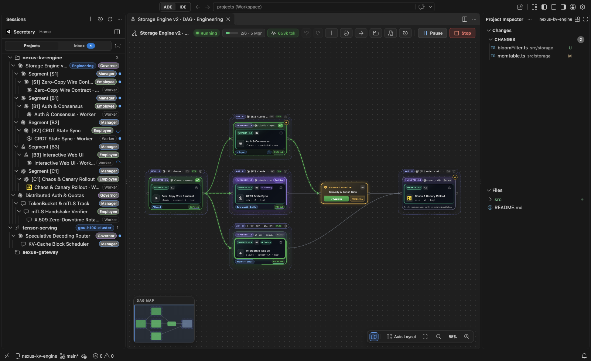
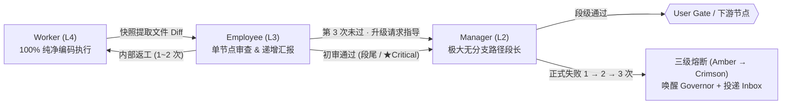
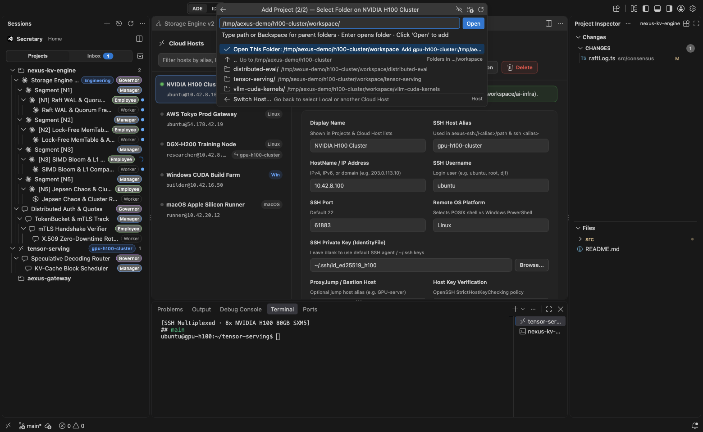

<p align="center">
  
</p>

<h1 align="center">Aexus Code</h1>

<p align="center">
  <strong>开源组织化智能体开发环境（ADE）与可视化多智能体控制面 IDE</strong><br/>
  8 大本机原生 Coding Agent 引擎 · 四级对抗式质量验收 · Engineering &amp; Research 可视化 DAG · 四层 FinOps 成本与预算熔断 · Git Worktree 沙盒工作台 · 免装机原生 SSH 云主机
</p>

<p align="center">
  <a href="https://github.com/Daijunfan/Aexus-Code/blob/main/LICENSE.txt"></a>
  
  
  
  
  
</p>

<p align="center">
  <a href="../README.md">English</a> · <strong>简体中文</strong> · <a href="../examples/blueprints/README.md">蓝图模板库</a> · <a href="../AEXUS.md">架构文档 (AEXUS.md)</a> · <a href="../CHANGELOG.md">更新日志</a> · <a href="../CONTRIBUTING.md">贡献指南</a>
</p>

---

<p align="center">
  
</p>

## 为什么构建 Aexus Code？

市面上的 AI 研发工具往往陷入三类割裂：
- **闭源 AI IDE**（Cursor、Windsurf）把单线程对话侧栏套在闭源编辑器上——不仅厂商强绑定、费用黑盒，一旦研发任务扩展到多模块并行协作，就缺乏真正的组织化验收与治理机制。
- **外部多 Worktree 启动器**（Vibe Kanban、Conductor、Superset）在编辑器之外开一堆终端窗口——丢失了完整的 LSP/AST 跳转、并排 Git Diff、断点调试与结构化对抗审查。
- **独立图编排平台**（LangGraph Studio、Dify、n8n）与真实代码库、Git Worktree 以及本机 Coding Agent CLI 完全脱节。

**Aexus Code** 基于开源 `Code - OSS` 从底层重构，开辟了一个全新品类——**在同一个 MIT 开源原生桌面窗口内，将全功能对标 VS Code 的 `IDE` 与组织化多智能体研发环境 `ADE` 融为一体**：

1. **8 大本机 Coding Agent 原生直连（自带 CLI，零厂商绑定）**——原生聚合 **Claude Code**、**Codex**、**Google Antigravity**、**Kilo Code**、**OpenCode**、**DeepSeek Harness**、**Cline** 与 **Pi**，无需强制登录云端订阅，彻底剔除微软闭源 Copilot 遥测与捆绑组件。
2. **严格的四级组织化梯队与对抗式验收（`Employee [L3] ≠ Worker [L4]`）**——将顶层编排与代码审查（**`Governor L1 ➔ Manager L2 ➔ Employee L3`**）与 **100% 纯净无污染的 `Worker L4`** 编码上下文物理隔离，确保每一颗模型 Token 都聚焦于高质量代码交付。
3. **装甲嵌套双壳任务舱 + 6 套内置蓝图模板（Blueprint Recipes）**——一键套用经过实战检验的 Engineering & Research 多路并行流水线（`Full-Stack Feature Ship`、`Surgical Bug Hunt`、`Multi-Engine Security Audit Swarm`、`Zero-Downtime Refactor`、`Deep Research Lab`、`Architecture Teardown`），支持 `.aexus-blueprint.md` 导出分享，并内置可视化 **Execution Gantt 甘特图** 与 **DAG MAP 小地图**。
4. **四层 Agent FinOps、缓存省钱统计与硬预算熔断护栏**——跨全部 8 大引擎实时核算 **`$USD` 预估花费**、**Prompt Cache 节省金额（`Cache Saved $`）** 以及四级 / 段 / 节点维度的成本分布；支持设置 **`max_budget_usd` 硬预算上限**，一旦触发自动暂停 DAG 并在 `ADE Inbox` 发出严重告警，彻底杜绝失控烧钱。
5. **Git Worktree 沙盒一键合并工作台 + 一键生成 GitHub PR 验收报告**——并行 `MGR · L2` 泳道自动运行在独立 Git Worktree 分支上，直接在画布侧栏一键 **`Merge All into Project`** 或 **`Clean Up Worktrees`**；一键复制或 CLI 导出包含实时状态 Mermaid DAG、四层成本表与交付清单的 **GitHub PR 验收报告**（`Copy PR Report` / `aexus-ade engineering report`）。
6. **免远端装机 SSH 云主机（`aexus-ssh://`）与全量控制面 CLI（含 `aexus-ade doctor`）**——本地项目与多台 Linux / macOS / Windows 云主机在**同一窗口**无缝共存，无需远端安装 `vscode-server`；一条 `aexus-ade doctor` 即可体检 8 大引擎、Git Worktree、OpenSSH 与仓库规则文件。

---

## 核心生态位与主流竞品全景对比

| 核心能力维度 | **Aexus Code** | Cursor / Windsurf | Vibe Kanban / Paradev / Conductor | Cline / Roo Code | LangGraph Studio / Dify |
| :--- | :---: | :---: | :---: | :---: | :---: |
| **100% MIT 开源 & 零云端厂商绑定** | **支持** | 闭源商业软件 | 部分开源 / 外壳包装 | 开源插件 | 部分开源 |
| **与 VS Code 全功能对标的原生 IDE（LSP / Diff / 调试 / 终端）** | **完整原生（`ADE ⇄ IDE` 镜像）** | 支持 | 无（外部启动器） | 依赖宿主 IDE | 无 |
| **8 大本机 BYO-CLI 编码引擎同屏混搭编排** | **支持（8 大原生引擎）** | 仅自有运行时 | 仅终端窗格包装 | 单一插件循环 | 仅 API 节点 |
| **严格四级对抗式验收（`Employee L3 ≠ Worker L4` 纯净编码）** | **支持（Worker 零污染）** | 单代理 / 子代理 | 依赖人工手审 | 同上下文切模式 | 需全手工编排 |
| **可视化嵌套双壳 DAG + 自动 MNP 切分 + 有向精准打回门禁** | **支持（Eng + Research）** | 无 | 仅看板列表 | 无 | 通用节点图 |
| **内置可分享蓝图模板库（Markdown + Mermaid 双向同步）** | **支持（6 套模板 + 模板库）** | 仅规则文本 | 无 | 模式 JSON | 私有 JSON/YAML |
| **四层美元 FinOps + 缓存省钱核算 + 硬预算自动熔断** | **支持（自动暂停 + Inbox）** | 订阅额度 | 无 | 仅单聊估算 | 商业云附加功能 |
| **IDE 内置 Git Worktree 并行隔离 + 一键合并/清理工作台** | **支持（按 MGR 泳道隔离）** | 基础后台代理 | 支持（脱离 IDE） | 无 | 无 |
| **可视化执行甘特图 + 一键导出 GitHub PR 验收审计报告** | **支持（界面 + CLI）** | 无 | 无 | 无 | 仅 Trace 日志 |
| **免远端装机 SSH 云主机（`aexus-ssh://`）与实时路径弹窗** | **支持（零远端守护进程）** | 需装远端服务 | 仅本机 | 依赖宿主插件 | 无 |
| **100% 等价本地控制面 CLI + 独立 `doctor` 环境体检** | **支持（`aexus-ade`）** | 无 | 有限接口 | 无 | 服务端 API |
| **跨平台原生桌面端（`macOS · Windows · Linux`）** | **全平台支持** | 支持 | 偏 macOS / Web | 依赖宿主 IDE | Web / Docker |

---

## 商业级旗舰特性亮点

### 1. 四层 FinOps 成本护栏、6 套内置蓝图模板、执行甘特图与 Worktree 合并工作台

通过画布内置的 **DAG Blueprint Recipes** 模板库一键拉起多路并行流水线（或在 [`examples/blueprints/`](../examples/blueprints/README.md) 中直接导入分享 `.md` 蓝图）；实时洞察四级组织架构的美元支出与 Prompt Cache 节省金额，一键设定 `$2 / $5 / $10 / $25` 或自定义硬预算熔断线，并可在深色与浅色主题下享受同等高质感体验：

<table>
  <tr>
    <td width="50%">
      
      <p align="center"><sub><strong>6 套内置 DAG 蓝图模板库 · 实时 SVG 拓扑预览与引擎预设</strong></sub></p>
    </td>
    <td width="50%">
      
      <p align="center"><sub><strong>Dark Modern / Light Modern / High Contrast 三主题同等商业级打磨</strong></sub></p>
    </td>
  </tr>
  <tr>
    <td width="50%">
      
      <p align="center"><sub><strong>可视化执行甘特图、按角色过滤日志与一键复制 PR 验收报告</strong></sub></p>
    </td>
    <td width="50%">
      
      <p align="center"><sub><strong>按 MGR · L2 泳道自动隔离 Git Worktree · 一键合并与清理</strong></sub></p>
    </td>
  </tr>
</table>

| 内置蓝图模板 | 模式 | 并行泳道 | 默认隔离模式 | 适用场景 |
| :--- | :---: | :---: | :---: | :--- |
| **[`feature-ship`](../examples/blueprints/feature-ship.md)** | Engineering | `3×` 并行 | `worktree` | 契约先行的全栈功能交付：后端/前端/测试三路独立 Worktree 并行 + 人工发布门禁 |
| **`bug-hunt-fix`** | Engineering | `2×` 并行 | `shared` | 最小复现驱动的精准排障 + 并行修复与回归测试护栏 |
| **[`security-audit-swarm`](../examples/blueprints/security-audit-swarm.md)** | Engineering | `3×` 并行 | `worktree` | 多引擎交叉安全审计军团（鉴权/注入/依赖三轨并行）收敛至加固补丁 |
| **[`safe-migration`](../examples/blueprints/safe-migration.md)** | Engineering | `2×` 并行 | `worktree` | 先固化行为基线测试、再并行重构核心与调用点的零停机架构迁移 |
| **[`deep-research-lab`](../examples/blueprints/deep-research-lab.md)** | Research | `3×` 并行 | `shared` | 多轨文献综述、基线复现验证与同行评审综合报告 |
| **`arch-teardown`** | Research | `2×` 并行 | `shared` | 竞品与大型代码库深度架构拆解并沉淀可执行 RFC |

---

### 2. 四级智能体组织架构与多模态协同（`Employee [L3] ≠ Worker [L4]`）

在 ADE 左栏（`Sessions` 调度中心）顶部常驻具备全视口与全会话树感知能力的 **`✦ Secretary`**，下方按项目清晰展开多层级智能体会话树；中间工作区支持智能体会话流与项目实时源码并排 Diff 同屏审阅，右栏 `Project Inspector` 实时同步工作区 `Changes` 与 `Files`：

<p align="center">
  
</p>

> [!IMPORTANT]
> **核心架构原则：`Employee（L3）` 绝不等于 `Worker（L4）`**
> - **`Governor [L1]` / `Manager [L2]` / `Employee [L3]`** 属于正式编排与质量门禁职级：创建时即自动锁定输入框完成短暂的组织架构与 `aexus-ade` 控制面预热阅读，后续对话无需重复拼接说明文档。在 Engineering 模式中，`Employee` 专职单节点代码审查、测试核验与递增式交付汇报撰写，**绝不亲自下场改业务代码**。
> - **`Worker [L4]`** 位于最底层，是唯一**不注入任何编排提示词、不挂载下属 API、不可继续向下派发子会话**的 **100% 原生纯净编码执行器**，确保每一颗模型 Token 都聚焦于代码实现本身。

| 职级 | 层级 | 核心职责 | 控制面权限 | 上下文纯净度 |
| :--- | :---: | :--- | :--- | :--- |
| **`✦ Secretary`** | 全局顶置 | 感知活跃项目/视口/全树状态，代用户完成全局调度 | 全量 ADE 操作权限（严禁切入 IDE） | 视口感知 + 控制面 |
| **`Governor`** | `L1` | 顶层架构拆解、跨模块 `Manager` 统筹、熔断升级决策 | 创建/管理下级树、写入 `ADE Inbox` | 顶层编排预热 |
| **`Manager`** | `L2` | 管辖单条无分支任务链，处理 `Employee` 升级与关键二次验收 | 调度段内节点、提交段级正式裁决 | 段级编排预热 |
| **`Employee`** | `L3` | 派发并审查直属 `Worker` 产出、核对快照 Diff、撰写递增汇报 | 调度直属 `Worker`、提交节点验收结果 | 审查门禁预热 |
| **`Worker`** | `L4` | 纯粹编码、测试与单点问题攻坚 | **无任何编排 API（叶子节点）** | **100% 原生纯净** |

---

### 3. 嵌套双壳任务舱、双层对抗验收与精准局部打回门禁

对任意顶层 `Governor` 右键开启 **`Engineering`**，或执行 **`Open ADE Research...`**，即可将口头对话升级为**拓扑锁定的可视化工程/研究流水线**（蓝图与运行态完全独立保存在 `~/.aexus-code/engineering/<governor-id>/` 与 `~/.aexus-code/research/<governor-id>/`，零污染业务 Git 仓库）：

<p align="center">
  
</p>

<table>
  <tr>
    <td width="50%">
      
      <p align="center"><sub><strong>节点验收汇报与改动文件级 Diff + 分角色 Token 消耗明细</strong></sub></p>
    </td>
    <td width="50%">
      
      <p align="center"><sub><strong>单角色自由混搭 8 大原生引擎、模型与五档思考强度</strong></sub></p>
    </td>
  </tr>
  <tr>
    <td width="50%">
      
      <p align="center"><sub><strong>User Gate 门禁审批：聚合上游递增汇报与精准局部打回</strong></sub></p>
    </td>
    <td width="50%">
      
      <p align="center"><sub><strong>ADE Inbox 收信箱实时门禁提醒与动态 DAG 同屏联动</strong></sub></p>
    </td>
  </tr>
</table>

<p align="center">
  
</p>

- **极大无分支路径（Maximal Non-Branching Path）自动切分**：只需套用模板、拖拽节点或编辑 Markdown + Mermaid，系统 100% 自动在分叉前、合流后与 `user_gate` 边界切分 `MGR · L2` 管辖段框（Worktree 模式下段顶实时呈现隔离分支徽章），并同步生成锁定的左栏四级会话树。
- **装甲嵌套双壳任务舱（`268×172`）**：每个任务节点都是一枚完整实体舱——外层 **`EMPLOYEE · L3`** 验收壳在四边物理包裹内层凹陷的 **`WORKER · L4`** 执行核，实时呈现阶段计时徽章（`Worker · Ns` / `Emp Audit · Ns` / `Mgr Review · Ns`）、改动文件计数与节点级 Token + `$USD` 消耗。
- **画布聚光灯过滤、小地图、吸附对齐与完整撤销/重做**：底部 HUD 支持一键按状态聚光聚焦（`All | Active | Gates | Issues`），悬浮 **DAG MAP** 支持点击/拖拽飞镜，悬停输出端口 `+` 键 1 键派生下游任务（`Alt+单击` 派生 `User Gate`），全部操作支持 `Cmd/Ctrl+Z` 撤销重做。
- **双层验收闭环与三级失败熔断（Circuit Breaker）**：
  - `Employee` 内部打回 1–2 次在原会话增量返工；第 3 次自动唤醒段 `Manager` 评估并授予第 4 次指导机会；
  - 段尾节点或 `★Critical` 关键节点通过 `Employee` 初审后，自动触发 `Manager` 二次正式验收；
  - `Manager` 正式判定失败呈现三级色阶演进：**浅琥珀（`failure_1`）➔ 深琥珀（`failure_2`）➔ 深红熔断（`failure_3`）**，暂停支路、唤醒 `Governor` 并投递 **`ADE Inbox`** 决策告警。
- **独立 `User Gate` 验收盾牌与精准局部打回**：等待验收时门禁卡片内联呈现 **`✓ Approve`** 与 **`Rollback…`**，可按有向路径交集精准打回指定上游节点（绝不误伤无关并行支路）。



---

### 4. 免远端装机的原生 SSH 云主机与实时路径弹窗（`aexus-ssh://`）

无需在云端服务器预装或升级专有远端后台，直接复用本机 OpenSSH 多路复用通道、跳板机（`ProxyJump`）与密钥体系，让多台 Linux / macOS / Windows 云主机项目与本地项目在同一窗口内丝滑并存：

<p align="center">
  
</p>

<p align="center">
  
</p>

- **一键无损搬移原版 VS Code 云主机**：自动递归解析 `~/.ssh/config` 及全部 `Include` 子配置，并从 VS Code 的 `settings.json`、`state.vscdb`、`storage.json` 与 `Project Manager` 完整迁移云主机、平台类型与历史远端文件夹（严禁读取或复制私钥内容）。
- **统一 `+` 两步式体验（选主机 ➔ 实时路径联动弹窗）**：自动弹出当前远端路径下全部子文件夹，支持 `Backspace` 跨 `/` 0ms 退回上级目录（Windows 主机退至 `/` 可直接选择 `C:/`、`D:/` 等全部盘符）。
- **原生远端编辑、Git Diff 与专属 SSH 集成终端**：Monaco 编辑器 `Cmd/Ctrl+S` 直接写回远端磁盘，云主机项目终端与本地 Shell 标签页并排运行。

---

### 5. IDE 镜像对称模式：全功能 VS Code 对标、顶栏纯净插件栏与项目 `Focus`

点击顶栏模式开关切回 **`IDE`**，立即获得清爽、纯粹的高性能代码编辑环境：

<p align="center">
  
</p>

- **本地 + 云主机混合多根 Explorer & 拖拽自由排序**：同一文件树内直接展开编辑本地 `file://` 与远端 `aexus-ssh://` 项目，自由调整同级文件、文件夹与项目根目录顺序（不移动磁盘文件）。
- **项目级 `Focus ➔ Home ⇄ Forward` 沉浸聚焦**：IDE 与 ADE 实时共享项目聚焦与前进/返回状态。
- **纯净单图标顶栏与精准项目绑定**：右上角仅展示已安装的用户级插件与 8 大 Coding Agent（严格不重复），右侧栏标题区清晰展示并切换绑定的目标项目。

---

## 8 大原生 Coding Agent 引擎矩阵

所有引擎均声明 `requiresCopilotSignIn: false`，通过本地 CLI / RPC 协议直连，并由 `extensions/aexus-agents` 统一提供会话发现、历史挂载、流式对话、中断、物理删除、实时 Token/USD 遥测及动态职级提示词同步：

| 引擎名称 | 会话标识 | 默认 CLI 命令 | 职级与控制面注入机制 |
| :--- | :--- | :--- | :--- |
| **Claude Code** | `aexus-claude` | `claude` | 双向 `stream-json` 协议 + 动态职级上下文 + 实时流式 Token 捕获 |
| **Codex** | `aexus-codex` | `codex` | `app-server` JSON-RPC `thread/inject_items` 实时注入 |
| **Google Antigravity** | `aexus-antigravity` | `agy` | 本地 `--hub` ConnectRPC 代理拦截 `StartCascade` / `SendUserCascadeMessage` |
| **Kilo Code** | `aexus-kilo` | `kilo` | ACP 协议适配 + 请求体职级同步 |
| **OpenCode** | `aexus-opencode` | `opencode` | 原生侧栏与 ACP 双通道协同 |
| **DeepSeek Harness** | `aexus-dsh` | `dsh` | `dshRolePreload` 扩展宿主零延迟角色同步 |
| **Cline** | `aexus-cline` | `cline` | `--acp` 协议直连与权限流协同 |
| **Pi** | `aexus-pi` | `pi` | `--mode rpc` 结构化交互与思考进度流 |

---

## `aexus-ade` 全量控制面 CLI 与 `doctor` 体检工具

Aexus Code 启动后自动监听本地鉴权 Socket（macOS/Linux: `~/.aexus-code/ade-control.sock`，权限 `0600`）或本机鉴权 Windows Named Pipe（`\\.\pipe\aexus-ade-control-*`），并将 `aexus-ade` 自动注入集成终端与编排智能体 `PATH`：

```bash
# 0. 一键体检 8 大本机 Coding CLI、Git Worktree 就绪度、OpenSSH、控制面与仓库规则文件
aexus-ade doctor --project .

# 1. 模式切换、工作区状态与云主机迁移
aexus-ade status --json
aexus-ade mode set ade
aexus-ade host import-vscode
aexus-ade project add gpu-h100-cluster:/workspace/tensor-serving

# 2. 创建 Governor、套用内置蓝图模板并设置 $5 硬预算上限
GOV_ID=$(aexus-ade session create --project nexus-kv-engine --engine claude --role governor --title "Storage Lead" --no-open --json | jq -r .id)
aexus-ade engineering init --governor "$GOV_ID" --open
aexus-ade engineering template list
aexus-ade engineering template apply --governor "$GOV_ID" --template feature-ship --preset balanced --isolation worktree --max-budget-usd 5
aexus-ade engineering run --governor "$GOV_ID"

# 3. 审批 User Gate、合并隔离 Worktree 分支并导出 GitHub PR 验收审计报告
aexus-ade inbox list --unread-only
aexus-ade engineering gate --governor "$GOV_ID" --node U1 --verdict pass
aexus-ade engineering worktrees merge --governor "$GOV_ID"
aexus-ade engineering report --governor "$GOV_ID" --out ./pr-verification-report.md
```

| 命令组 | 核心子命令 |
| :--- | :--- |
| `doctor` | `doctor [--project <path>] [--json]` *（无需启动界面即可独立体检）* |
| `status` / `mode` / `view` | `status` · `mode [get \| set <ade\|ide>]` · `view [--archived] [--inspector <changes\|files\|hide>] [--refresh]` |
| `project` | `list` · `add <path\|host:/path>` · `select` · `remove` · `delete` · `focus` · `home` · `forward` · `move` · `changes` · `files` · `open-file` · `open-diff` |
| `host` | `list` · `info` · `add` · `update` · `remove` · `test` · `browse` · `import-vscode` · `open` |
| `engine` | `list` · `sessions <engine> [--project <p>] [--limit <n>]` |
| `session` | `list` · `info` · `subordinates` · `tree` · `create` · `attach` · `connect` · `open` · `select` · `close` · `send [--wait]` · `history` · `mark-read` · `draft` · `reorder` · `rename` · `role` · `move` · `stop` · `archive` · `unarchive` · `detach` · `delete` |
| `secretary` | `status` · `open` · `engine` · `reset` · `send [--wait]` · `history` · `stop` · `draft` · `mark-read` |
| `engineering` | `list` · `init` · `open` · `template <list\|apply>` · `blueprint <get\|apply\|validate>` · `run` · `pause` · `resume` · `stop` · `reset` · `configure [--max-budget-usd <n> \| --clear-budget]` · `worktrees <merge\|cleanup>` · `report [--out <file>]` · `diff` · `reports` · `status` · `review` · `gate` · `watchdog-action` · `remove` |
| `inbox` | `list [--unread-only]` · `post` · `resolve` · `mark-read` |

---

## 从源码构建与运行

### 环境要求

- **操作系统**：**全平台跨系统支持** —— **macOS（`arm64` / `x64`）**、**Windows 10/11（`x64` / `arm64`）** 与 **Linux（`x64` / `arm64`）**
- **工具链**：
  - **macOS / Linux**：仓库内置 `./scripts/aexus-env.sh` 自动固定兼容的 Node.js（`24.22.1`，与 `.nvmrc` 保持一致）与 `pnpm@12.16.0` 环境，配合 Xcode Command Line Tools / `build-essential`、Python 3、Rust `1.88` 与系统 OpenSSH。
  - **Windows**：仓库内置 `.\scripts\aexus-env.ps1`（及 `.\scripts\aexus-env.cmd`）固定 Node.js（`24.22.1`）与 `pnpm@12.16.0`，配合 Visual Studio 2022 C++ Build Tools（含 Spectre 库与 Windows 11 SDK）、Python 3（`setuptools`）、Rust `1.88`、Git（`core.longpaths=true`）与系统 OpenSSH。

### 开发运行与独立应用打包（macOS / Linux）

```bash
# 1. 安装依赖并体检本机多引擎环境
./scripts/aexus-env.sh pnpm install
./extensions/aexus-agents/bin/aexus-ade doctor

# 2. 快速转译构建并启动开发版（macOS 与 Linux 通用）
./scripts/aexus-env.sh pnpm run build-fast
./scripts/aexus-env.sh ./scripts/code.sh

# 3a. 构建 macOS arm64 独立应用包并覆盖安装至 /Applications/Aexus Code.app
./scripts/aexus-env.sh pnpm run gulp vscode-darwin-arm64
./scripts/aexus-install.sh

# 3b. 构建 Linux 独立应用包（输出至 ../VSCode-linux-x64 或 ../VSCode-linux-arm64）
./scripts/aexus-env.sh pnpm run gulp vscode-linux-x64
```

### 开发运行与独立应用打包（Windows PowerShell）

```powershell
# 1. 安装依赖并编译原生 Win32 C++ 扩展模块
.\scripts\aexus-env.ps1 pnpm install
.\extensions\aexus-agents\bin\aexus-ade.ps1 doctor

# 2. 快速转译构建并启动开发版
.\scripts\aexus-env.ps1 pnpm run build-fast
.\scripts\aexus-env.ps1 .\scripts\code.bat

# 3. 构建 Windows x64 独立应用包并安装至 %LOCALAPPDATA%\Programs\Aexus Code
.\scripts\aexus-env.ps1 pnpm run gulp vscode-win32-x64
.\scripts\aexus-install.ps1
```

`.\scripts\aexus-install.ps1` 支持跨盘符原子暂存同步并后台无弹窗安装至 `%LOCALAPPDATA%\Programs\Aexus Code`，同时自动校验内置全套命令行启动器：`bin\aexus-ade.cmd`、`bin\aexus-ade.ps1`、`bin\aexus-ade`（Git Bash / WSL）与 `bin\aexus-code.cmd`。

**与官方 VS Code 全功能对标**：在 Windows、macOS 与 Linux 三大平台上，Aexus Code 完整保留上游 VS Code 的全部核心能力——Monaco 编辑器内核、IntelliSense / LSP、多根资源管理器、ripgrep 全局搜索、Git 源码管理与并排 Diff、断点调试器、Tasks 任务系统、原生集成终端（Windows ConPTY / macOS & Linux PTY）、Extension Host 与完整扩展 API；用户配置保存在 `~/Library/Application Support/Aexus Code`（macOS）、`%APPDATA%\Aexus Code`（Windows）或 `~/.config/Aexus Code`（Linux），已安装扩展目录为 `~/.aexus-code/extensions`，与原版 VS Code 完全隔离且互不覆盖，仅排除微软限制仅允许在官方闭源构建中运行的专有插件。

---

## 源码架构导览

- [`src/vs/platform/ade/`](../src/vs/platform/ade/)：跨进程核心协议与 Node 服务（`adeControlServer` 本地鉴权控制面、`adeEngineeringService` 与蓝图解析器、`adePricing` 四层 FinOps 计费引擎、`adeBlueprintTemplates` 蓝图模板库、`adeRunReport` PR 验收报告生成器、`adeCloudHostService` 多路复用 SSH 传输层与 `vscodeConfigMigration`）。
- [`src/vs/workbench/contrib/ade/`](../src/vs/workbench/contrib/ade/)：ADE 工作台核心视图与编辑器（`adeProjectsView` 四级会话树与 `Inbox`、`adeEngineeringEditorPane` 嵌套双壳 DAG 画布与 FinOps / 模板库 / 执行甘特图 / Worktree 合并台 / 聚光灯 HUD、`adeCloudHostsEditorPane`、`adeCloudHostFileSystemProvider` 与 `adeInspectorViews`）。
- [`src/vs/workbench/contrib/terminal/`](../src/vs/workbench/contrib/terminal/)：按项目自动路由本地 Shell 与远端 SSH PTY 的 `ProjectTerminalService`。
- [`extensions/aexus-agents/`](../extensions/aexus-agents/)：8 大原生 Coding Agent 运行时适配器、动态角色桥接与 `bin/aexus-ade` CLI（含独立 `doctor` 体检工具）。
- [`examples/blueprints/`](../examples/blueprints/)：开箱即用、经由解析器往返校验的 Engineering 与 Research 蓝图示例。

---

## 社区贡献、安全隐私与开源许可

- **社区贡献与更新日志**：请参阅 [`CONTRIBUTING.md`](../CONTRIBUTING.md)（含核心架构不变量与开发测试流程）与 [`CHANGELOG.md`](../CHANGELOG.md)。
- **本地优先与安全策略**：请参阅 [`SECURITY.md`](../SECURITY.md)。控制面仅监听本地 `0600` Unix Socket（macOS/Linux）或本机鉴权 Windows Named Pipe（`\\.\pipe\aexus-ade-control-*`）；SSH 云主机迁移仅解析别名与公开连接参数，绝不读取、拷贝或存储任何私钥文件内容与口令；本构建已剔除上游内置 Copilot 扩展、CLI shim、订阅/令牌端点与微软专有 Agent 后台。
- **本地 ad-hoc macOS 签名**：构建产物使用本机 ad-hoc 开发签名，适用于开发与自行安装；面向第三方分发 macOS 应用前，仍需另行完成 Apple Developer ID 签名与公证。
- **开源许可**：本项目基于 Microsoft [`Code - OSS`](https://github.com/microsoft/vscode) 衍生开发，遵循 **[MIT License](../LICENSE.txt)** 开源许可，完整保留上游版权与许可声明。有关品牌图标与公开扩展市场访问的合规说明，详见 [AEXUS.md](../AEXUS.md)。
