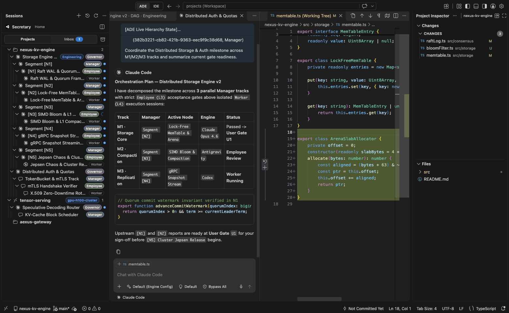
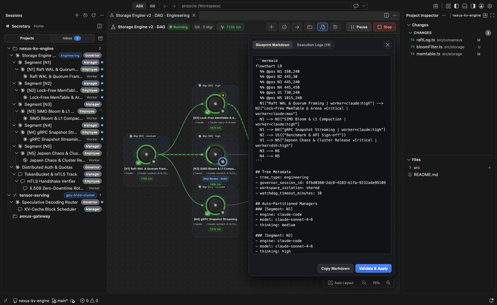
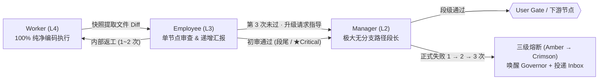

<p align="center">
  
</p>

<h1 align="center">Aexus Code</h1>

<p align="center">
  <strong>新一代组织化智能体开发环境（ADE）与镜像对称 IDE 一体化工作台</strong><br/>
  8 大原生 Coding Agent 引擎 · 四级职责层级编排 · 可视化 Engineering 动态协作 DAG · 免服务端装机的原生 SSH 云主机
</p>

<p align="center">
  <a href="https://github.com/Daijunfan/Aexus-Code/blob/main/LICENSE.txt"></a>
  
  
  
  
</p>

<p align="center">
  <a href="../README.md">English</a> · <strong>简体中文</strong> · <a href="../AEXUS.md">架构与演进说明 (AEXUS.md)</a>
</p>

---

<p align="center">
  
</p>

## 为什么构建 Aexus Code？

传统 AI 编辑器往往将智能体当作孤立的单聊侧栏：一旦任务扩大到多模块并行研发，上下文迅速膨胀、角色职责混淆、验收标准缺失，而切换远程服务器又需要在每台主机额外部署沉重的私有服务端。

**Aexus Code** 基于开源 `Code - OSS` 深度重构，在**同一个原生窗口**内构建了完全对称的 **ADE（Agent Development Environment）** 与 **IDE** 双模态架构——让开发者既能以软件工程组织的方式调度多引擎智能体军团，又能随时一键切回熟悉的专业代码编辑器：

1. **ADE ⇄ IDE 镜像对称，零割裂切换**：共享同一套本地与云端项目目录、自定义文件树排序、已打开编辑器与 `Focus ➔ Home ⇄ Forward` 聚焦状态，无需拆窗或复制仓库。
2. **严格的四级组织化智能体梯队 + 常驻 `✦ Secretary`**：建立 **`Governor（L1 总督）➔ Manager（L2 经理）➔ Employee（L3 正式员工/验收官）➔ Worker（L4 纯净执行层）`** 清晰职级，彻底隔离“编排验收上下文”与“纯净编码上下文”。
3. **Engineering 可视化动态协作 DAG 画布**：算法自动切分极大无分支路径（Maximal Non-Branching Path）`Manager` 管辖段，双核同心圆任务节点实时呈现 `Worker` 编码与 `Employee` 审查呼吸态、三级失败熔断色阶、`User Gate` 里程碑门禁与分角色实时流式 Token 计量。
4. **8 大本机 Coding Agent 原生直连（自带 CLI，零厂商绑定）**：原生聚合 **Claude Code**、**Codex**、**Google Antigravity**、**Kilo Code**、**OpenCode**、**DeepSeek Harness**、**Cline** 与 **Pi**，剔除一切内置商业订阅强绑组件。
5. **免远端装机的原生 SSH 云主机（`aexus-ssh://`）**：自动迁移原版 VS Code 云主机与常用远端目录，内置可视化 **Cloud Host Studio**、统一的 `+` 两步式 **选主机 ➔ 实时路径输入与父子目录自动弹窗**，以及本地/云主机并存的原生 SSH 集成终端。
6. **100% 等价可编程控制面（`aexus-ade` CLI）**：所有界面操作均通过 `0600` 本地鉴权 Unix Socket 暴露给智能体与脚本。

---

## 核心特性全景展示

### 1. 四级智能体组织架构与多模态协同（`Employee [L3] ≠ Worker [L4]`）

在 ADE 左栏（`Sessions` 调度中心）顶部常驻具备全视口与全会话树感知能力的 **`✦ Secretary`**，下方按项目清晰展开多层级智能体会话树；中间工作区支持智能体会话流与项目实时源码并排 Diff 同屏审阅，右栏 `Project Inspector` 实时同步工作区 `Changes` 与 `Files`：

<p align="center">
  
</p>

> [!IMPORTANT]
> **核心架构原则：`Employee（L3）` 绝不等于 `Worker（L4）`**
> - **`Governor [L1]` / `Manager [L2]` / `Employee [L3]`** 属于正式编排与质量门禁职级：创建时即自动锁定输入框完成短暂的组织架构与 `aexus-ade` 控制面预热阅读，后续对话无需重复拼接说明文档。在 Engineering 模式中，`Employee` 专职单节点代码审查、测试核验与递增式交付汇报撰写，**绝不亲自下场改业务代码**。
> - **`Worker [L4]`** 位于最底层，是唯一**不注入任何编排提示词、不挂载下属 API、不可继续向下派发子会话**的 **100% 原生纯净编码执行器**，确保每一颗模型 Token 都聚焦于代码实现本身。

| 职级 | 层级 | 核心职责 | 控制面权限 | 上下文纯净度 |
| :--- | :---: | :--- | :--- | :--- |
| **`✦ Secretary`** | 全局顶置 | 感知活跃项目/视口/全树状态，代用户完成全局调度 | 全量 ADE 操作权限（严禁切入 IDE） | 视口感知 + 控制面 |
| **`Governor`** | `L1` | 顶层架构拆解、跨模块 `Manager` 统筹、熔断升级决策 | 创建/管理下级树、写入 `ADE Inbox` | 顶层编排预热 |
| **`Manager`** | `L2` | 管辖单条无分支任务链，处理 `Employee` 升级与关键二次验收 | 调度段内节点、提交段级正式裁决 | 段级编排预热 |
| **`Employee`** | `L3` | 派发并审查直属 `Worker` 产出、核对快照 Diff、撰写递增汇报 | 调度直属 `Worker`、提交节点验收结果 | 审查门禁预热 |
| **`Worker`** | `L4` | 纯粹编码、测试与单点问题攻坚 | **无任何编排 API（叶子节点）** | **100% 原生纯净** |

---

### 2. ADE Engineering：动态协作 DAG、双层验收状态机与实时 Token 遥测

对任意顶层 `Governor` 右键开启 **`Engineering`**，即可将口头对话升级为**拓扑锁定的可视化工程流水线**（蓝图与运行态完全独立保存在 `~/.aexus-code/engineering/<governor-id>/`，零污染业务 Git 仓库）：

<table>
  <tr>
    <td width="50%">
      
      <p align="center"><sub><strong>节点验收汇报与改动文件级 Diff + 分角色 Token 消耗明细</strong></sub></p>
    </td>
    <td width="50%">
      
      <p align="center"><sub><strong>单角色自由混搭 8 大原生引擎、模型与五档思考强度</strong></sub></p>
    </td>
  </tr>
  <tr>
    <td width="50%">
      
      <p align="center"><sub><strong>User Gate 门禁审批：聚合上游递增汇报与精准局部打回</strong></sub></p>
    </td>
    <td width="50%">
      
      <p align="center"><sub><strong>ADE Inbox 收信箱实时门禁提醒与动态 DAG 同屏联动</strong></sub></p>
    </td>
  </tr>
</table>

<p align="center">
  
</p>

- **极大无分支路径（Maximal Non-Branching Path）自动切分**：只需编写或拖拽任务节点与连线，系统 100% 自动在分叉前、合流后与 `user_gate` 边界切分 `Manager` 段框，并同步在左栏生成锁定的四级会话树。
- **双核同心圆动态节点与流动边**：内核代表 `Worker`，外环卫星代表 `Employee`；运行中自动点亮对应子角色呼吸光效与实时阶段计时徽章（`Worker · Ns` / `Emp Review · Ns`），激活边呈现绿色流动虚线。
- **双层验收闭环与三级失败熔断（Circuit Breaker）**：
  - `Employee` 内部打回 1–2 次在原会话增量返工；第 3 次自动唤醒段 `Manager` 评估并可授予第 4 次指导机会；
  - 段尾节点或 `★Critical` 关键节点通过 `Employee` 初审后，自动触发 `Manager` 二次正式验收；
  - `Manager` 正式判定失败呈现三级色阶演进：**浅琥珀（`failure_1`）➔ 深琥珀（`failure_2`）➔ 深红熔断（`failure_3`）**，第 3 次失败立即暂停支路、唤醒 `Governor` 评估并向 **`ADE Inbox`** 投递决策通知。
- **独立 `User Gate` 用户验收盾牌**：上游完成后亮起醒目琥珀盾牌与顶栏 `Review Gate` 一键定位按钮；支持一键放行下游，或勾选任意上游节点执行**按有向路径交集的精准局部打回**（绝不误伤无关并行支路）。
- **右键紧邻卡片与流式 Token 计数**：鼠标悬停零干扰，**右键点击**任意节点即在旁弹出 `Worker | Employee | Mgr | Spec | Report` 五栏卡片（支持为不同角色混搭 8 大引擎与思考强度、一键批量同步未锁定角色、直接展开 Worker 改动的源码 Diff）；顶栏与节点内置回合中流式刷新的分角色 Token 统计。



---

### 3. 免远端装机的原生 SSH 云主机与实时路径弹窗（`aexus-ssh://`）

无需在云端服务器预装或升级专有远端后台，直接复用本机 OpenSSH 多路复用通道、跳板机（`ProxyJump`）与密钥体系，让多台 Linux / macOS / Windows 云主机项目与本地项目在同一窗口内丝滑并存：

<p align="center">
  
</p>

<p align="center">
  
</p>

- **一键无损搬移原版 VS Code 云主机**：自动递归解析 `~/.ssh/config` 及全部 `Include` 子配置，并从 VS Code 的 `settings.json`、`state.vscdb`、`storage.json` 与 `Project Manager` 完整迁移全部云主机、系统平台类型及历史常用远端文件夹（严禁读取或复制私钥内容）。
- **点击 `+` 直达两步式体验（选主机 ➔ 实时路径联动弹窗）**：
  - **第 1 步（`Select Host`）**：同屏平铺 `Local (This Computer)` 与每一台云主机；
  - **第 2 步（`Select Folder on <Host>`）**：自动填入当前远端路径并**即刻弹出当前路径下的子文件夹**；继续输入字符实时高亮匹配、回车直入下级目录；**按 `Backspace` 删除字符跨过 `/` 退回上级时，依托内存缓存与父目录后台预读 0ms 弹出上一级文件夹**（Windows 云主机退至 `/` 更可直接切换 `C:/`、`D:/` 等全部盘符）。
- **原生远端编辑、Git Diff 与专属 SSH 集成终端**：在云主机项目上新建终端（`` Ctrl+Shift+` `` 或终端 `+`）自动直连远端项目目录，与本地项目 Shell 标签页并排切换；Monaco 编辑器 `Cmd+S` 直接写回远端磁盘。

---

### 4. IDE 镜像对称模式：混合多根资源管理器、顶栏纯净插件栏与项目 `Focus`

点击顶栏模式开关切回 **`IDE`**，立即获得清爽、纯粹的高性能代码编辑环境：

<p align="center">
  
</p>

- **本地 + 云主机混合多根 Explorer & 拖拽自由排序**：同一文件树内直接展开编辑本地 `file://` 与远端 `aexus-ssh://` 项目；支持在同一父目录下拖拽调整文件、文件夹及项目根目录显示顺序（不移动磁盘物理路径）。
- **项目级 `Focus ➔ Home ⇄ Forward` 沉浸聚焦**：右键任意项目选择 **Focus** 即可进入单项目沉浸视图，左上角出现 **Home** 返回键与前进导航，IDE 与 ADE 实时共享聚焦状态。
- **纯净单图标顶栏与精准项目绑定**：右上角仅展示已安装的用户级插件与 8 大 Coding Agent（每个插件严格只出现一次），右侧栏标题区清晰展示并可一键切换当前智能体绑定的目标项目。

---

## 8 大原生 Coding Agent 引擎矩阵

所有引擎均声明 `requiresCopilotSignIn: false`，通过本地 CLI / RPC 协议直连，并由 `extensions/aexus-agents` 统一提供会话发现、历史挂载、流式对话、中断、物理删除及动态职级提示词同步：

| 引擎名称 | 会话标识 | 默认 CLI 命令 | 职级与控制面注入机制 |
| :--- | :--- | :--- | :--- |
| **Claude Code** | `aexus-claude` | `claude` |双向 `stream-json` 协议 + 动态职级上下文 + 实时流式 Token 捕获 |
| **Codex** | `aexus-codex` | `codex` | `app-server` JSON-RPC `thread/inject_items` 实时注入 |
| **Google Antigravity** | `aexus-antigravity` | `agy` | 本地 `--hub` ConnectRPC 代理拦截 `StartCascade` / `SendUserCascadeMessage` |
| **Kilo Code** | `aexus-kilo` | `kilo` | ACP 协议适配 + 请求体职级同步 |
| **OpenCode** | `aexus-opencode` | `opencode` | 原生侧栏与 ACP 双通道协同 |
| **DeepSeek Harness** | `aexus-dsh` | `dsh` | `dshRolePreload` 扩展宿主零延迟角色同步 |
| **Cline** | `aexus-cline` | `cline` | `--acp` 协议直连与权限流协同 |
| **Pi** | `aexus-pi` | `pi` | `--mode rpc` 结构化交互与思考进度流 |

---

## `aexus-ade` 全量控制面 CLI 速查

Aexus Code 启动后自动监听 `~/.aexus-code/ade-control.sock`（权限 `0600` + 随机鉴权令牌），并将 `aexus-ade` 自动注入集成终端与编排智能体 `PATH`：

```bash
# 1. 模式切换、工作区状态与云主机迁移
aexus-ade status --json
aexus-ade mode set ade
aexus-ade host import-vscode
aexus-ade project add gpu-h100-cluster:/workspace/tensor-serving

# 2. 创建四级组织化智能体会话并同步等待回复
GOV_ID=$(aexus-ade session create --project nexus-kv-engine --engine claude --role governor --title "Storage Lead" --no-open --json | jq -r .id)
MGR_ID=$(aexus-ade session create --project nexus-kv-engine --parent "$GOV_ID" --engine codex --title "WAL Track" --no-open --json | jq -r .id)
aexus-ade session send "$GOV_ID" "拆解 Raft WAL 与无锁 MemTable 并行研发计划" --wait

# 3. 初始化、校验并运行 Engineering 可视化 DAG 工作流
aexus-ade engineering init --governor "$GOV_ID" --open
aexus-ade engineering blueprint apply --governor "$GOV_ID" --file ./blueprint.md
aexus-ade engineering run --governor "$GOV_ID"
aexus-ade engineering status --governor "$GOV_ID" --json

# 4. 查看收信箱门禁通知并审批放行 User Gate
aexus-ade inbox list --unread-only
aexus-ade engineering gate --governor "$GOV_ID" --node U1 --verdict pass
```

| 命令组 | 核心子命令 |
| :--- | :--- |
| `status` / `mode` / `view` | `status` · `mode [get \| set <ade\|ide>]` · `view [--archived] [--inspector <changes\|files\|hide>] [--refresh]` |
| `project` | `list` · `add <path\|host:/path>` · `select` · `remove` · `delete` · `focus` · `home` · `forward` · `move` · `changes` · `files` · `open-file` · `open-diff` |
| `host` | `list` · `info` · `add` · `update` · `remove` · `test` · `browse` · `import-vscode` · `open` |
| `engine` | `list` · `sessions <engine> [--project <p>] [--limit <n>]` |
| `session` | `list` · `info` · `subordinates` · `tree` · `create` · `attach` · `open` · `send [--wait]` · `history` · `stop` · `rename` · `role` · `move` · `reorder` · `archive` · `unarchive` · `delete` |
| `secretary` | `status` · `open` · `engine` · `reset` · `send [--wait]` · `history` · `stop` · `draft` · `mark-read` |
| `engineering` | `list` · `init` · `open` · `blueprint <get\|apply\|validate>` · `run` · `pause` · `resume` · `stop` · `reset` · `configure` · `diff` · `reports` · `status` · `review` · `gate` · `watchdog-action` · `remove` |
| `inbox` | `list [--unread-only]` · `post` · `resolve` · `mark-read` |

---

## 从源码构建与运行

### 环境要求

- **操作系统**：macOS（Apple Silicon `arm64` 已完成完整打包、签名与端到端验证）
- **工具链**：仓库内置 `./scripts/aexus-env.sh` 自动固定兼容的 Node.js（`22.x`）与 `pnpm` 环境，加上 Xcode Command Line Tools、Python 3 与系统 OpenSSH

### 开发运行与独立应用打包

```bash
# 1. 安装依赖
./scripts/aexus-env.sh pnpm install

# 2. 快速转译构建并启动开发版
./scripts/aexus-env.sh pnpm run build-fast
./scripts/aexus-env.sh ./scripts/code.sh

# 3. 构建 macOS arm64 独立应用包并安装至 /Applications/Aexus Code.app
./scripts/aexus-env.sh pnpm run gulp vscode-darwin-arm64
./scripts/aexus-install.sh
```

用户配置保存在 `~/Library/Application Support/Aexus Code`，已安装扩展目录为 `~/.aexus-code/extensions`，与原版 VS Code 完全隔离且互不覆盖。

---

## 源码架构导览

- [`src/vs/platform/ade/`](../src/vs/platform/ade/)：跨进程核心协议与 Node 服务（`adeControlServer` 本地鉴权控制面、`adeEngineeringService` 与蓝图解析器、`adeCloudHostService` 多路复用 SSH 传输层与 `vscodeConfigMigration`）。
- [`src/vs/workbench/contrib/ade/`](../src/vs/workbench/contrib/ade/)：ADE 工作台核心视图与编辑器（`adeProjectsView` 四级会话树与 `Inbox`、`adeEngineeringEditorPane` 可视化 DAG 画布、`adeCloudHostsEditorPane` 云主机面板、`adeCloudHostFileSystemProvider` 远端文件系统与实时路径联动弹窗、`adeInspectorViews`）。
- [`src/vs/workbench/contrib/terminal/`](../src/vs/workbench/contrib/terminal/)：按项目自动路由本地 Shell 与远端 SSH PTY 的 `ProjectTerminalService`。
- [`extensions/aexus-agents/`](../extensions/aexus-agents/)：8 大原生 Coding Agent 运行时适配器、动态角色桥接与 `bin/aexus-ade` CLI。

---

## 隐私安全与开源许可

- **本地优先与零密钥泄露**：控制面仅监听本地 `0600` Unix Socket；SSH 云主机迁移仅解析别名与公开连接参数，绝不读取、拷贝或存储任何私钥文件内容与口令；已彻底移除上游内置 Copilot 专有遥测、令牌与后台组件。
- **开源许可**：本项目基于 Microsoft [`Code - OSS`](https://github.com/microsoft/vscode) 衍生开发，遵循 **[MIT License](../LICENSE.txt)** 开源许可，完整保留上游版权与许可声明。有关品牌图标与公开扩展市场访问的合规说明，详见 [AEXUS.md](../AEXUS.md)。
