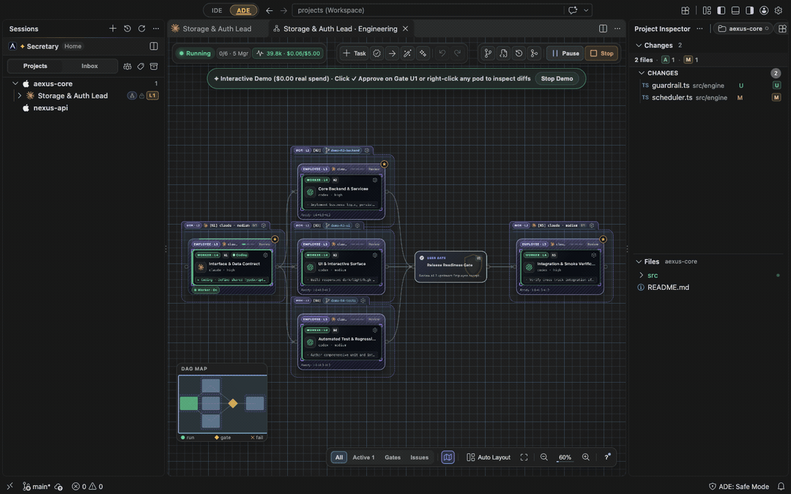
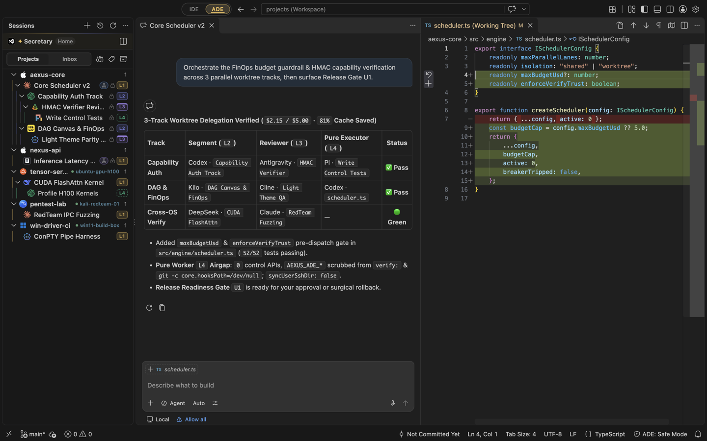

# Aexus Code Visual Gallery & Motion Clips

A curated visual tour of Aexus Code's surfaces across Dark Modern, Light Modern, High Contrast, Organization & Roles Studio, Mission DAG orchestration, Zero-Server SSH Cloud Hosts, multi-host terminals, and `ADE ⇄ IDE` Mirror Symmetry.

> [!NOTE]
> Some historical showcase captures below depict earlier DAG Studio themes and telemetry mockups; live Mission workflows are driven by the unified `aexus-ade mission`, `token`, and `org` runtime documented in [`docs/ARCHITECTURE.md`](ARCHITECTURE.md).

---

## Organization & Roles Studio, 4-Slot Bindings, Permission Matrix & Rank-Filtered Inbox

<table>
  <tr>
    <td width="50%">
      
      
<strong>Organization &amp; Roles Studio — 4-Slot Binding Bar, <code>Rank × Fixed Kernel API</code> Matrix &amp; Smart Calm Sidebar</strong>

    </td>
    <td width="50%">
      
      
<strong>Rank-Filtered <code>ADE Inbox</code> (<code>All | Governor | Manager | Employee</code>) &amp; Rank Prompt Editor</strong>

    </td>
  </tr>
</table>

---

## Motion Clips *(6–10s Auto-Playing GIFs + HD 1440×900 MP4s)*

<table>
  <tr>
    <td width="50%">
      
      
<strong>1. Multi-Tier DAG Choreography:</strong> Parallel Fan-Out ➔ Rework ➔ Gate <code>U1</code> · <a href="assets/demos/02-live-dag-choreography.mp4">▶ HD MP4</a>

    </td>
    <td width="50%">
      
      
<strong>2. Mission DAG Authoring &amp; Curated Blueprint Recipes</strong> · <a href="assets/demos/01-prompt-to-dag.mp4">▶ HD MP4</a>

    </td>
  </tr>
  <tr>
    <td width="50%">
      
      
<strong>3. DAG Inspection, Timeline &amp; Dark ⇄ Light Theme Parity</strong> · <a href="assets/demos/03-gantt-worktrees-themes.mp4">▶ HD MP4</a>

    </td>
    <td width="50%">
      
      
<strong>4. Instant <code>ADE ⇄ IDE</code> Mirror Symmetry · Multi-Project + <code>✦ Secretary</code></strong> · <a href="assets/demos/04-ade-ide-mirror-symmetry.mp4">▶ HD MP4</a>

    </td>
  </tr>
  <tr>
    <td colspan="2">
      

         
        <strong>5. Zero-Server Multi-OS SSH Cloud Host Studio (Linux, macOS &amp; Windows)</strong> · <a href="assets/demos/05-cloud-hosts-studio.mp4">▶ HD MP4</a>
      

    </td>
  </tr>
</table>

---

## Mission DAG Canvas, Multi-Engine Configuration, Gates & Synchronized Blueprints

<table>
  <tr>
    <td width="50%">
      
      
<strong>Parallel Mission DAG — Armored Task Pods &amp; Release Gate <code>U1</code></strong>

    </td>
    <td width="50%">
      
      
<strong>Research Workflow DAG — Multi-Track Hypothesis Probing &amp; Peer Gate</strong>

    </td>
  </tr>
  <tr>
    <td width="50%">
      
      
<strong>Visual DAG Authoring Surface</strong>

    </td>
    <td width="50%">
      
      
<strong>6 Curated Mission Blueprint Recipes</strong>

    </td>
  </tr>
  <tr>
    <td width="50%">
      
      
<strong>Node Details, Artifacts &amp; Per-Role Telemetry</strong>

    </td>
    <td width="50%">
      
      
<strong>Mix All 8 Native Engines, Vendor Models &amp; Thinking Effort per Node</strong>

    </td>
  </tr>
  <tr>
    <td width="50%">
      
      
<strong>Human Gate Sign-Off Card — Approve or Directed Rollback</strong>

    </td>
    <td width="50%">
      
      
<strong>Mermaid DAG &amp; Synchronized Pre-Prompts Split Drawer</strong>

    </td>
  </tr>
</table>

---

## Telemetry, Themes & Multi-Track Visualization

<table>
  <tr>
    <td width="50%">
      
      
<strong>Per-Tier Token &amp; Context Telemetry (Dark Modern)</strong>

    </td>
    <td width="50%">
      
      
<strong>Light Modern Theme Parity (Dark / Light / High Contrast)</strong>

    </td>
  </tr>
  <tr>
    <td width="50%">
      
      
<strong>Execution Timeline &amp; Role-Filtered Logs</strong>

    </td>
    <td width="50%">
      
      
<strong>Multi-Branch Isolation &amp; Diff Review Surface</strong>

    </td>
  </tr>
</table>

---

## Multi-OS Projects, Live Agent Chat, Multi-Host Terminals, VS Code Extensions & Cloud Hosts

<table>
  <tr>
    <td width="50%">
      
      
<strong>Unified Multi-OS Projects &amp; 8-Engine ADE Command Center (Full Badges + Governor Chat)</strong>

    </td>
    <td width="50%">
      
      
<strong>Live ADE Agent Chat Session + Side-by-Side Git Working Tree Diff</strong>

    </td>
  </tr>
  <tr>
    <td width="50%">
      
      
<strong>Simultaneous Local &amp; Multi-Cloud OS Terminals (macOS · Ubuntu · Kali · Windows)</strong>

    </td>
    <td width="50%">
      
      
<strong>Zero-Server SSH Cloud Host Studio — Colorful Multi-OS Cards (Kali · macOS · Ubuntu · Windows)</strong>

    </td>
  </tr>
  <tr>
    <td width="50%">
      
      
<strong>Instant <code>ADE ⇄ IDE</code> Mirror Symmetry — All 5 Mirrored Projects, Split Diff &amp; Multi-OS Terminals</strong>

    </td>
    <td width="50%">
      
      
<strong>Full VS Code Extensions Ecosystem via Live Open VSX Marketplace</strong>

    </td>
  </tr>
</table>
