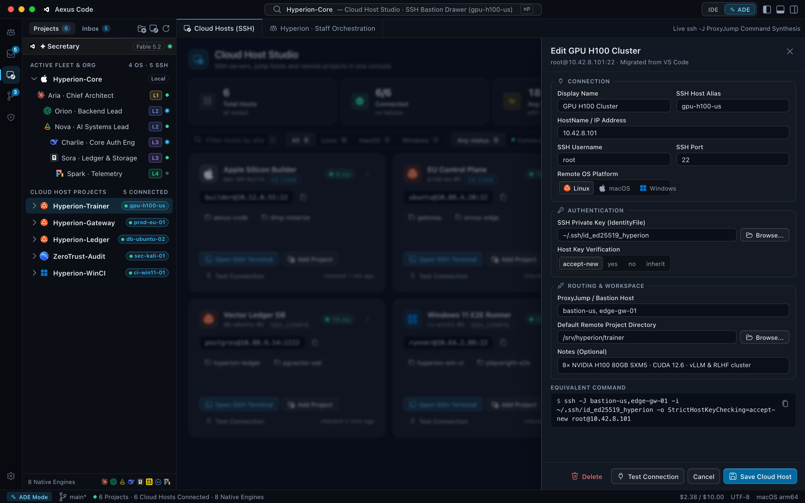
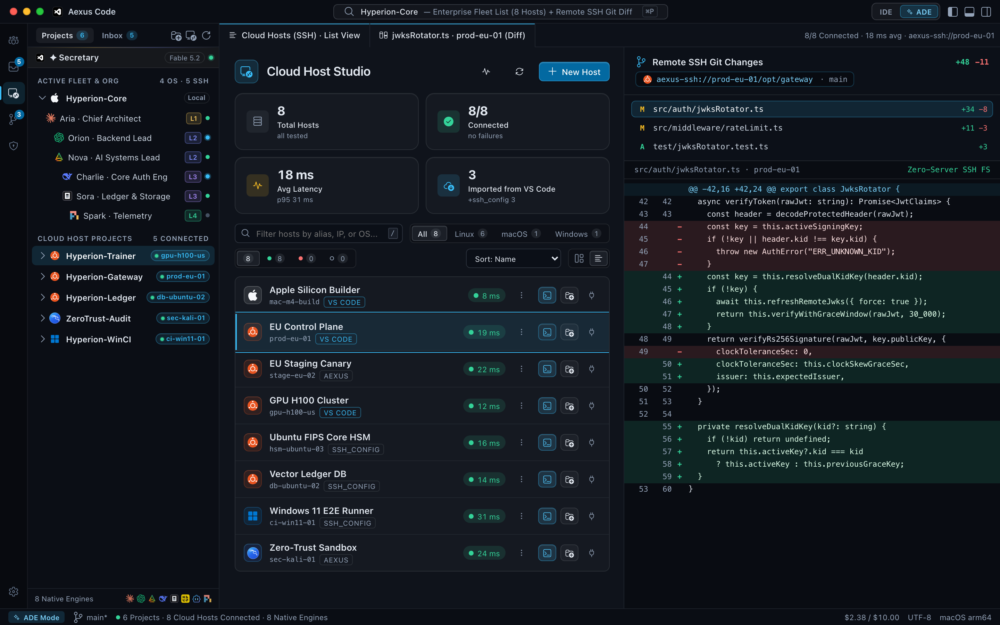
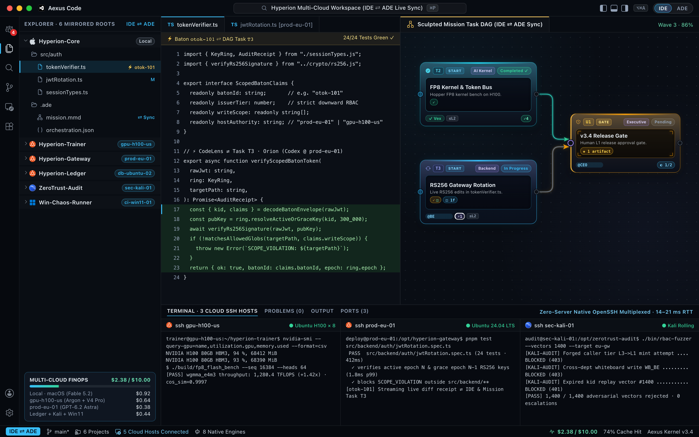
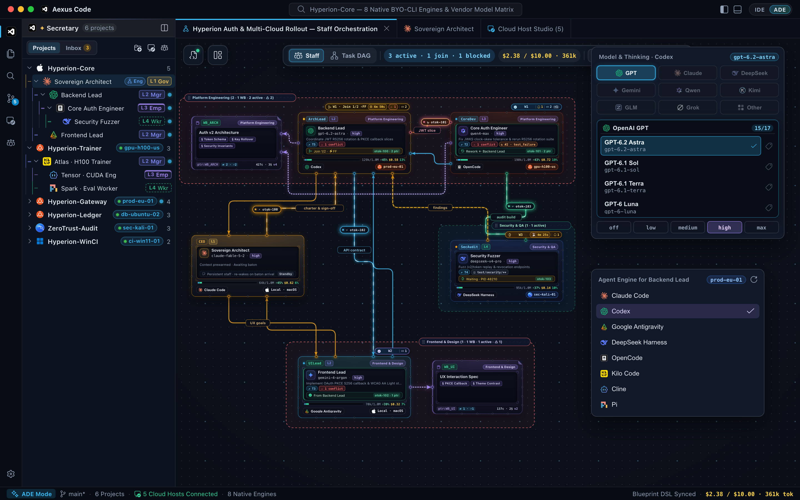
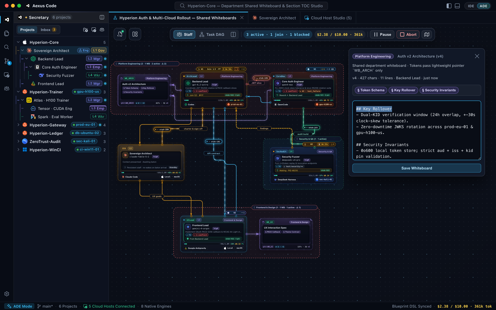
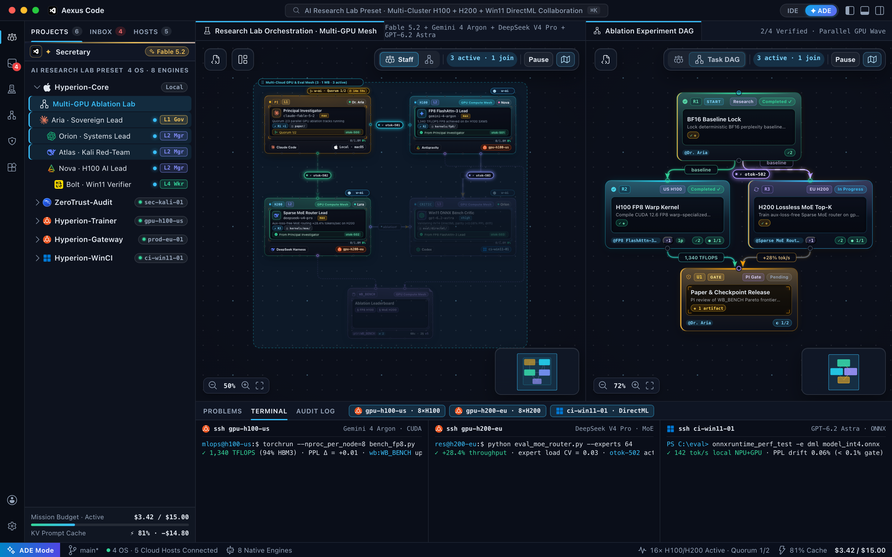

# Aexus Code Visual Gallery (2× Retina Dark Obsidian Showcase)

A curated 2× Retina (`2880×1800`) Dark Obsidian visual showcase of **Aexus Code**: one unified desktop workbench managing **local & SSH cloud repositories (`macOS` · `Ubuntu` · `Kali` · `Windows`)**, **`1..N` ADE Project Pages per folder**, **8 native BYO-CLI coding engines**, **bidirectional reporting-tree orchestration (`344×188` cards + `276×164` shared whiteboards)**, **Zero-Server Multi-OS Cloud Host Studio**, **simultaneous cross-cloud agent streams**, and **instant `ADE ⇄ IDE` mirror symmetry**.

## 1. Command Center & Cross-Cloud Orchestration (`01`–`02`)

  
   
  <strong>01. Multi-OS ADE Command Center:</strong> Local &amp; SSH workspace folders (<code>macOS</code> · <code>Ubuntu</code> · <code>Kali</code> · <code>Windows</code>), cross-engine staff orchestration, and simultaneous multi-host SSH terminals.

  
   
  <strong>02. Cross-Cloud 6-Host × 6-Engine Panorama:</strong> <code>L1</code> lead coordinating department subtrees across macOS, Ubuntu, Kali &amp; Windows 11 with shared whiteboards and 3000ms live Ticket flow particles.

## 2. Cloud Host Studio, SSH Bastion & Remote Git Diff (`04`–`06`, `16`, `19`)

<table>
  <tr>
    <td width="50%">
      
      
<strong>03. Multi-OS Cloud Host Studio &amp; 2×2 Live SSH Terminal Matrix:</strong> macOS, Ubuntu, Kali &amp; Windows 11 host cards above 4 simultaneous SSH terminals.

    </td>
    <td width="50%">
      
      
<strong>04. Zero-Server SSH Bastion Drawer:</strong> Configure ProxyJump chains, SSH keys, and OS targets with live <code>ssh -J</code> preview and zero <code>~/.ssh/config</code> mutation.

    </td>
  </tr>
  <tr>
    <td width="50%">
      
      
<strong>05. Fleet List &amp; Remote SSH Git Diff:</strong> Multi-host fleet overview paired with zero-server remote Git Changes &amp; unified diff.

    </td>
    <td width="50%">
      
      
<strong>06. Instant <code>ADE ⇄ IDE</code> Mirror Symmetry:</strong> Flip between ADE Project Pages and native IDE editing across the same local + SSH workspace roots.

    </td>
  </tr>
</table>

## 3. 8 Native Engines, Shared Whiteboards & Live Cross-Cloud Streams (`09`, `13`, `14`, `20`–`23`)

<table>
  <tr>
    <td width="50%">
      
      
<strong>07. 8 Native Engines &amp; Model Selector:</strong> Per-employee host, engine, model, and thinking effort configuration with engine lock once a session starts.

    </td>
    <td width="50%">
      
      
<strong>08. Shared Whiteboards:</strong> Department one-board binding, controlled tags, cross-host file backups, and directed role notes.

    </td>
  </tr>
  <tr>
    <td width="50%">
      
      
<strong>09. Simultaneous 60fps Live Sessions:</strong> Local macOS <code>L1</code> lead delegating Tickets to remote Ubuntu <code>L2</code> engineers with zero-flicker streaming.

    </td>
    <td width="50%">
      
      
<strong>10. 3-Cloud Simultaneous Agent Streams:</strong> Parallel cross-host collaboration across macOS, Ubuntu, and Kali Linux.

    </td>
  </tr>
  <tr>
    <td width="50%">
      
      
<strong>11. Cross-OS Security Audit Topology:</strong> Isolated department subtrees collaborating across Kali, Ubuntu, Windows 11 &amp; macOS.

    </td>
    <td width="50%">
      
      
<strong>12. Multi-GPU Research Lab:</strong> Cross-host experiment coordination with 4-quadrant dynamic artifact storage.

    </td>
  </tr>
</table>
