# Aexus Code Visual Gallery (30-Shot 2× Retina Showcase)

A curated 2× Retina (`2880×1800`) showcase of **Aexus Code** across Dark and Daylight themes: one unified desktop command center managing **multiple local & SSH cloud repositories (`macOS` · `Ubuntu` · `Kali` · `Windows`)**, **8 native BYO-CLI coding engines**, **frontier models (`Claude Opus 4.6`, `GPT-5.4`, `Gemini 3.1 Pro`, `DeepSeek R1`, `Qwen3-Max`, `Kimi K2.5`, `Grok 4`)**, **highlighted cross-cloud Staff Orchestration (`344×188`)**, **sculpted Mission Task DAGs (`280×154`)**, **folded Department Shared Whiteboards (`276×164`)**, **Zero-Server Multi-OS Cloud Host Studio**, **simultaneous multi-cloud agent streams**, **FinOps & Checkpoints**, and **instant `ADE ⇄ IDE` mirror symmetry**.

---

## 1. Flagship Unified Command Center & Cross-Cloud Orchestration (`01`–`04`)

  
   
  <strong>01. Flagship ADE Command Center (Dark):</strong> Multi-OS multi-project sidebar (<code>macOS</code> · <code>Ubuntu</code> · <code>Kali</code> · <code>Windows</code>), split dual-view widescreen Staff Orchestration &amp; sculpted Mission Task DAG, and 3-host simultaneous SSH + local terminal dock.

  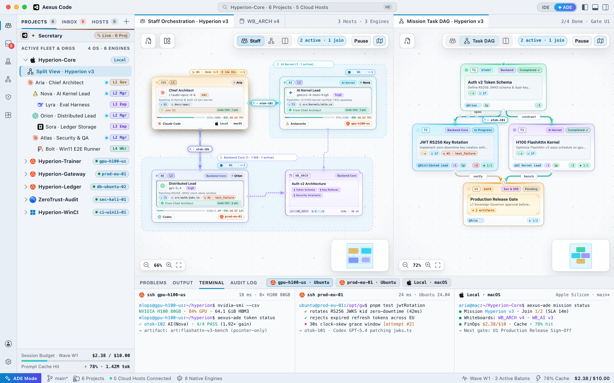
   
  <strong>02. Flagship ADE Command Center (Daylight Light):</strong> Full WCAG AA daylight clarity across multi-OS projects, <code>1px</code> hairline cards, and live terminals.

<table>
  <tr>
    <td width="50%">
      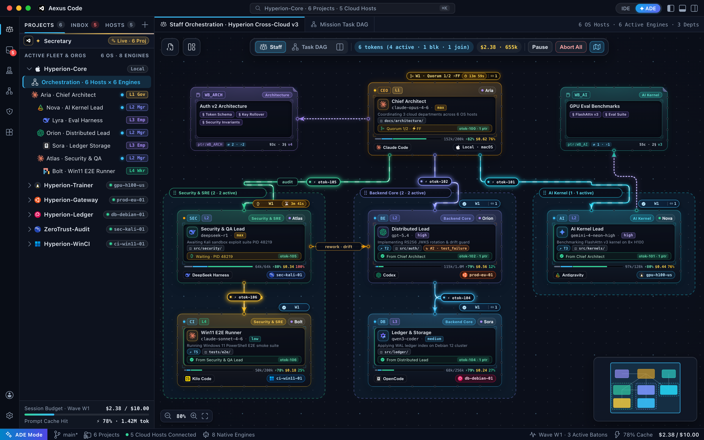
      
<strong>03. Cross-Cloud 6-Host × 6-Engine Panorama (Dark):</strong> <code>L1</code> Sovereign Architect coordinating 3 cloud department wings across macOS, Ubuntu (H100 GPU, EU Gateway &amp; Ledger), Kali &amp; Windows 11.

    </td>
    <td width="50%">
      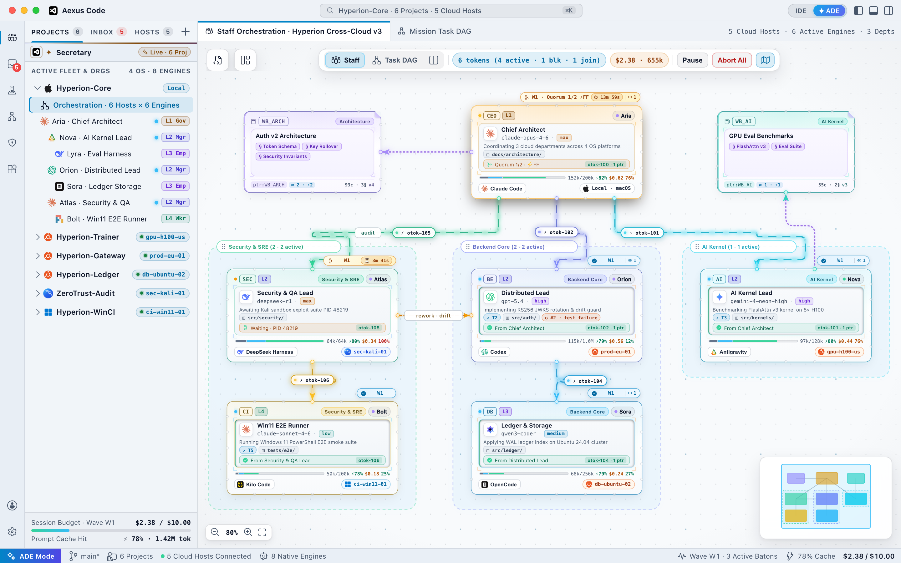
      
<strong>04. Cross-Cloud 6-Host × 6-Engine Panorama (Light):</strong> Crisp daylight orchestration with folded whiteboards, live <code>otok-*</code> comets, and semantic minimap.

    </td>
  </tr>
</table>

---

## 2. Sculpted Mission Task DAG, Completion Contracts & Guardrails (`05`–`06`)

<table>
  <tr>
    <td width="50%">
      
      
<strong>05. Sculpted Mission Task DAG (Dark):</strong> <code>280×154</code> task pods with Completion Contract guardrails, deterministic Check Receipts, Ready Frontier, Critical Path, and Gold Sovereign Gate.

    </td>
    <td width="50%">
      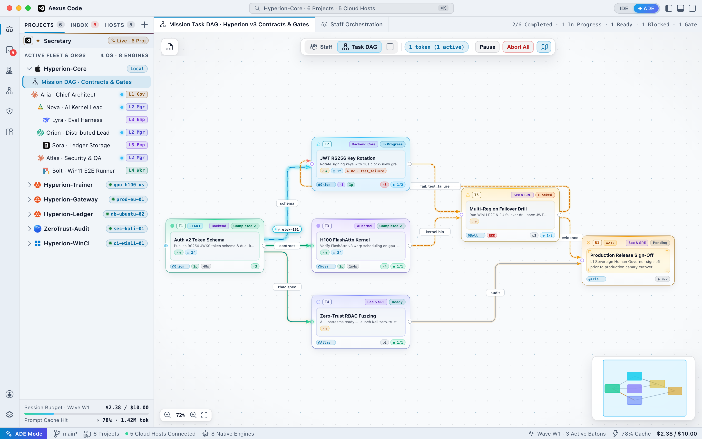
      
<strong>06. Sculpted Mission Task DAG (Light):</strong> High-contrast daylight DAG cards, rework loop attribution, and semantic status minimap.

    </td>
  </tr>
</table>

---

## 3. Zero-Server Multi-OS Cloud Host Studio, Dual-View Spotlight & Mermaid DSL (`07`–`12`)

  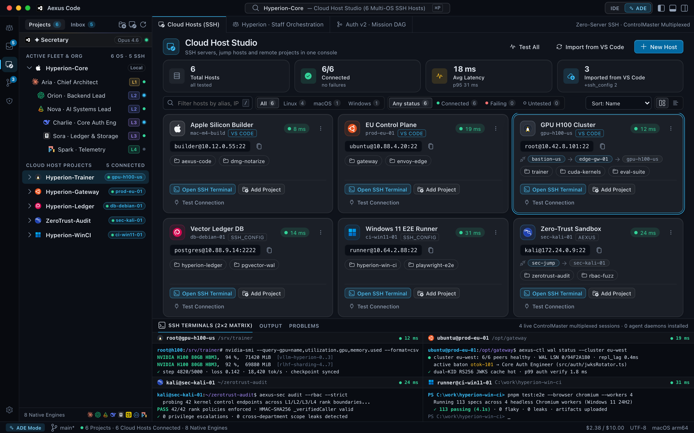
   
  <strong>07. Multi-OS Cloud Host Studio &amp; 2×2 Live SSH Terminal Matrix (Dark):</strong> Authentic macOS, Ubuntu, Kali &amp; Windows 11 vectors on sleek <code>1px</code> hairline host cards above 4 simultaneous SSH terminals.

<table>
  <tr>
    <td width="50%">
      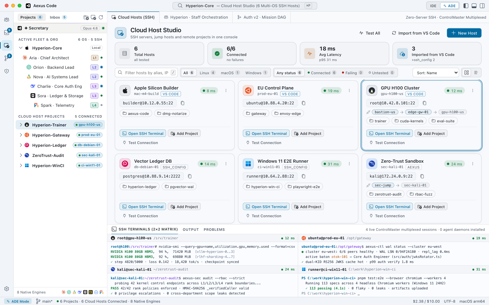
      
<strong>08. Cloud Host Studio &amp; 2×2 SSH Matrix (Light):</strong> Crisp snow-white host cards, ProxyJump chains, KPI telemetry, and daylight terminals.

    </td>
    <td width="50%">
      
      
<strong>09. Zero-Server SSH Bastion Drawer:</strong> Configure ProxyJump chains, SSH keys, and OS targets with live <code>ssh -J</code> preview and zero <code>~/.ssh/config</code> mutation.

    </td>
  </tr>
  <tr>
    <td width="50%">
      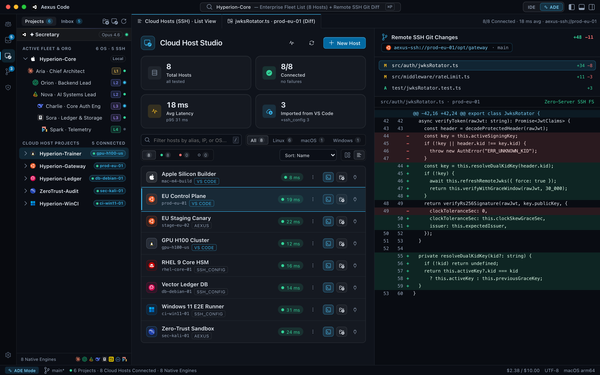
      
<strong>10. Compact 8-Host Fleet List &amp; Remote SSH Git Diff:</strong> Dense multi-region host list across macOS, Ubuntu, Kali &amp; Windows paired with zero-server remote Git Changes &amp; unified diff.

    </td>
    <td width="50%">
      
      
<strong>11. Dual-View Lineage Spotlight:</strong> Side-by-side Staff Orchestration &amp; Mission Task DAG with live 1:1 hover/click cross-highlighting.

    </td>
  </tr>
</table>

  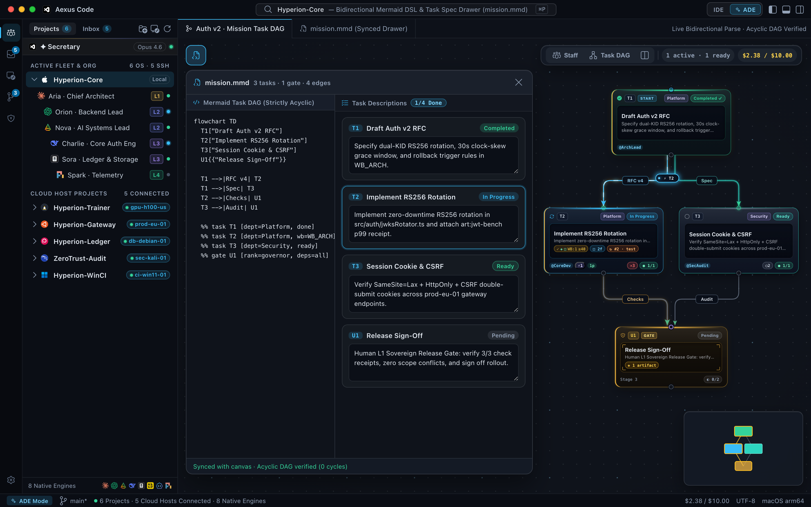
   
  <strong>12. Bidirectional Mermaid DSL &amp; Task Spec Drawer:</strong> Edit strictly acyclic Mermaid DAG code and task descriptions synced live with the visual canvas and 50-step Undo/Redo.

---

## 4. 8-Engine Model Picker, Pointer-Native Batons, Gates & Shared Whiteboards (`13`–`18`)

<table>
  <tr>
    <td width="50%">
      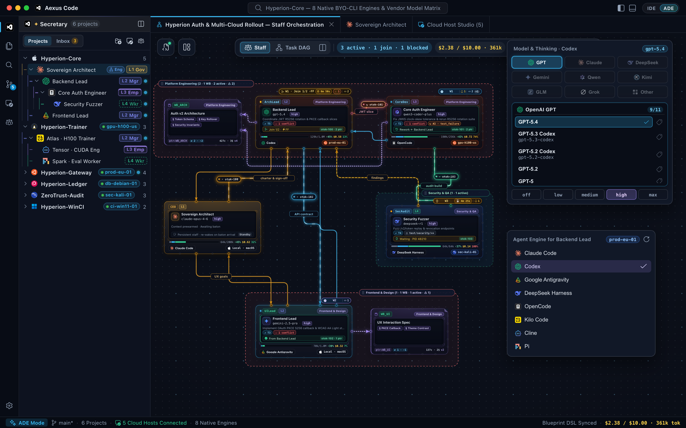
      
<strong>13. 8 Native Engines &amp; Vendor Model Matrix:</strong> Switch per-node engines and vendor-grouped frontier models (GPT, Claude, Gemini, DeepSeek, Qwen, Kimi, GLM, Grok) + thinking effort.

    </td>
    <td width="50%">
      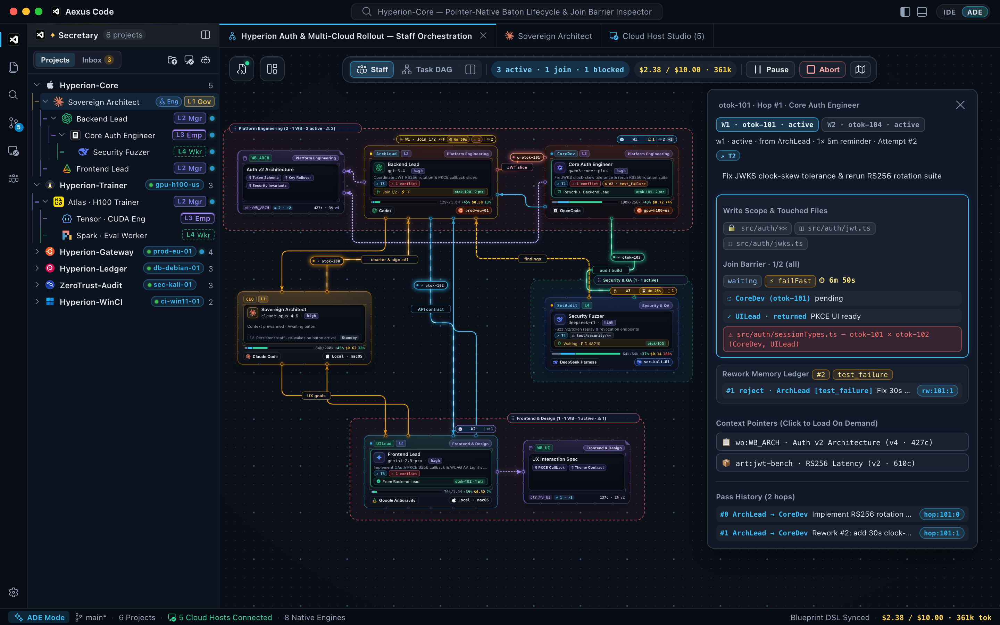
      
<strong>14. Baton Lifecycle, Join Barrier &amp; Conflict Inspector:</strong> Inspect multi-baton tabs, Write Scope globs, DP scope conflict alerts, quorum countdowns, rework ledger &amp; lazy pointers.

    </td>
  </tr>
  <tr>
    <td width="50%">
      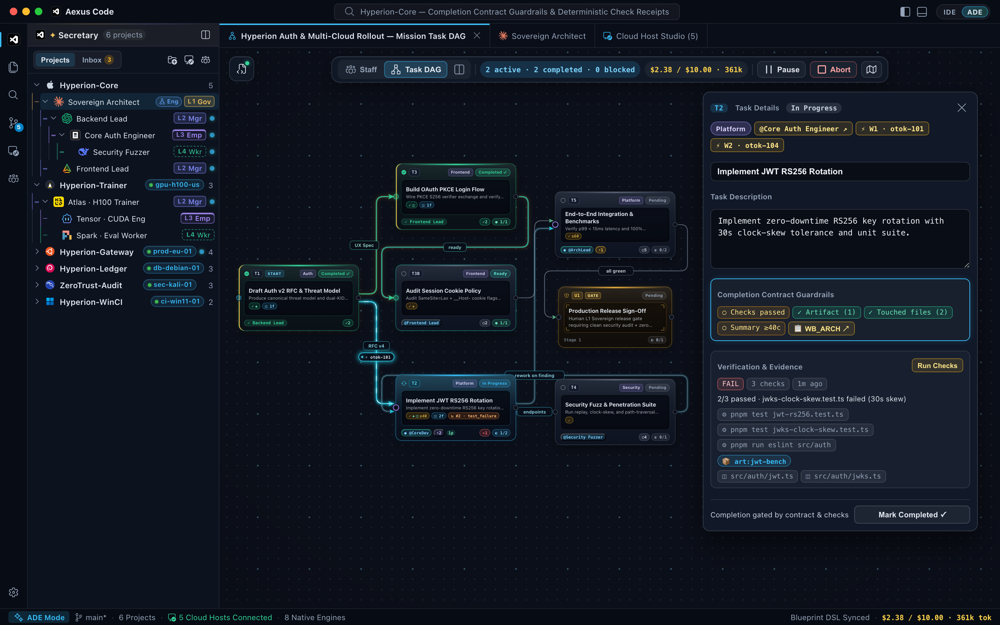
      
<strong>15. Completion Contract &amp; Check Receipt Popover:</strong> Guardrail checklist, deterministic check receipts, 1-click <code>Run Checks</code>, artifact preview, and <code>WB_ARCH ↗</code> jump.

    </td>
    <td width="50%">
      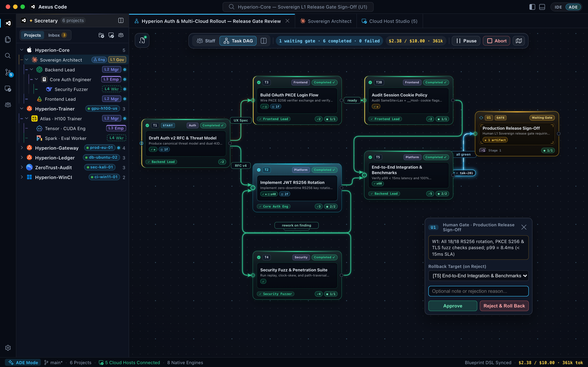
      
<strong>16. Sovereign Human Release Gate Popover:</strong> Approve or roll back to an exact upstream task with multi-wave context and audit notes.

    </td>
  </tr>
  <tr>
    <td width="50%">
      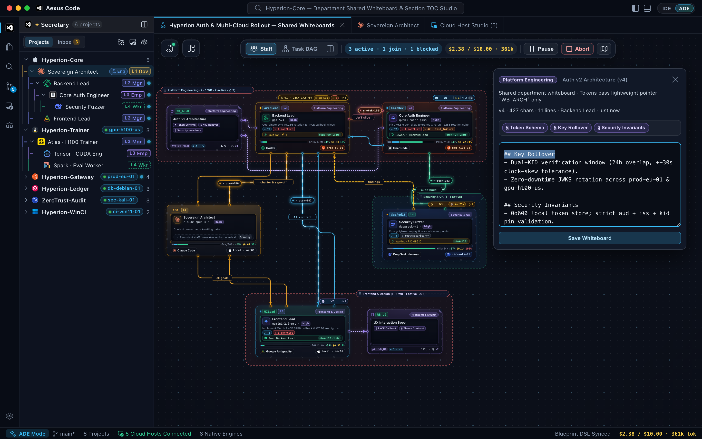
      
<strong>17. Shared Whiteboard Sheet &amp; Section TOC:</strong> Folded-corner department spec sheets with clickable <code>§ Section</code> TOC chips and optimistic version sync.

    </td>
    <td width="50%">
      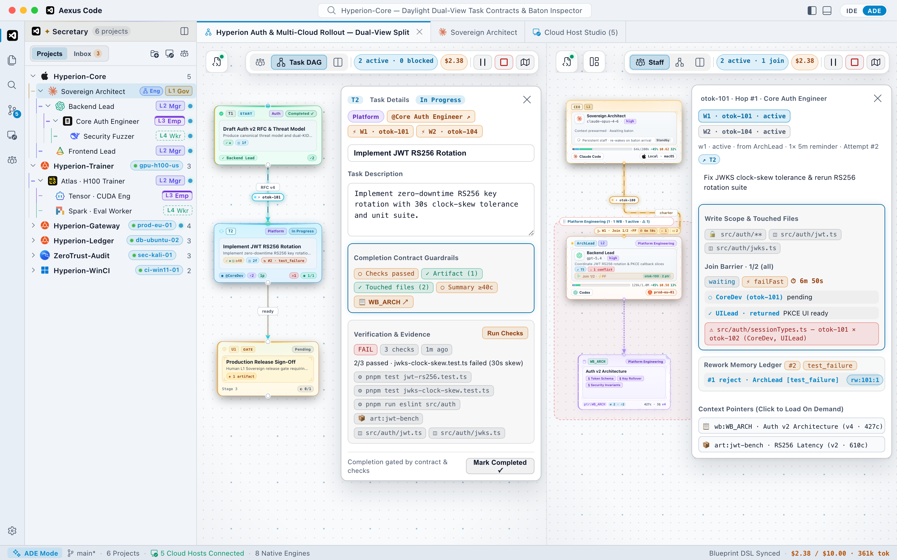
      
<strong>18. Daylight Dual-View Popovers (Light):</strong> Crisp WCAG AA+ Task Contract and Baton Inspector popovers in split daylight mode.

    </td>
  </tr>
</table>

---

## 5. Multi-Engine Live Sessions, `✦ Secretary`, Focus Mode, Inbox, Role Studio & `ADE ⇄ IDE` (`19`–`24`)

<table>
  <tr>
    <td width="50%">
      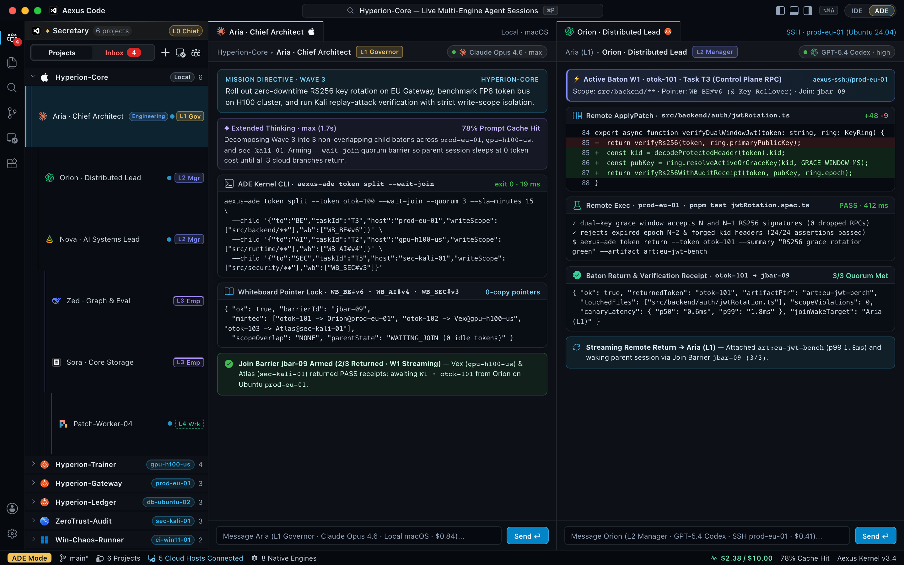
      
<strong>19. Simultaneous Cross-Engine Live Sessions:</strong> Local macOS <code>L1</code> Claude Opus 4.6 splitting batons beside remote Ubuntu <code>L2</code> GPT-5.4 Codex streaming patches &amp; test receipts.

    </td>
    <td width="50%">
      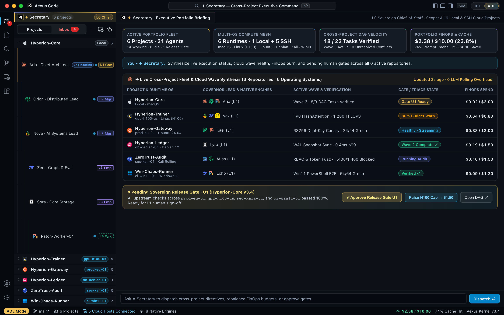
      
<strong>20. Pinned <code>✦ Secretary</code> Portfolio Command:</strong> Zero-polling synthesis across all 6 multi-OS projects, FinOps cache savings, and 1-click Release Gate sign-off.

    </td>
  </tr>
  <tr>
    <td width="50%">
      
      
<strong>21. Project Focus Mode &amp; Remote Git Diff:</strong> Scope the sidebar to a single H100 GPU repository while 5 sibling projects run in background, paired with live CUDA diff inspection.

    </td>
    <td width="50%">
      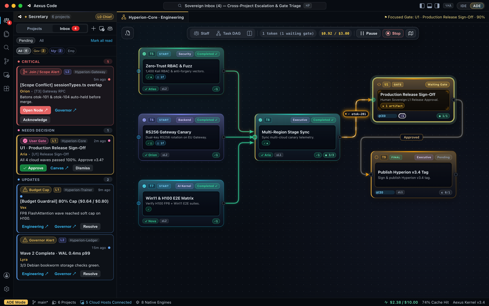
      
<strong>22. Sovereign Inbox &amp; Gate Triage:</strong> Rank-filtered cross-project alerts (Scope Conflict, User Gate, Budget Cap, Wave Complete) linked 1:1 to canvas nodes.

    </td>
  </tr>
  <tr>
    <td width="50%">
      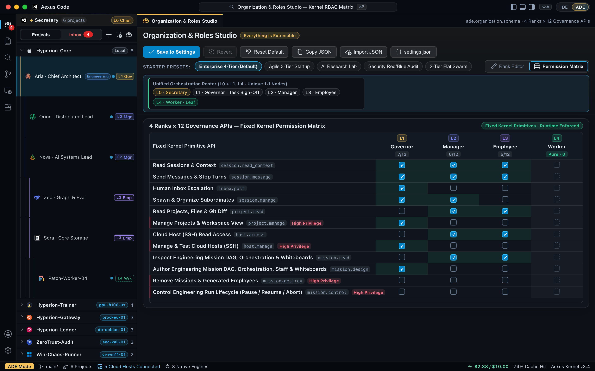
      
<strong>23. Organization &amp; Roles Studio:</strong> 5 starter presets, custom <code>1..N</code> rank ladder, <code>{{variables}}</code> prompt templates, and Rank × Kernel API Permission Matrix.

    </td>
    <td width="50%">
      
      
<strong>24. Instant <code>ADE ⇄ IDE</code> Mirror Symmetry:</strong> Flip to native IDE mode managing the same 6 mirrored local + SSH roots, TypeScript editor, live synced Task DAG, and 3-host SSH terminals.

    </td>
  </tr>
</table>

---

## 6. Multi-Domain Cross-Cloud Collaboration, Live Streams & FinOps (`25`–`30`)

<table>
  <tr>
    <td width="50%">
      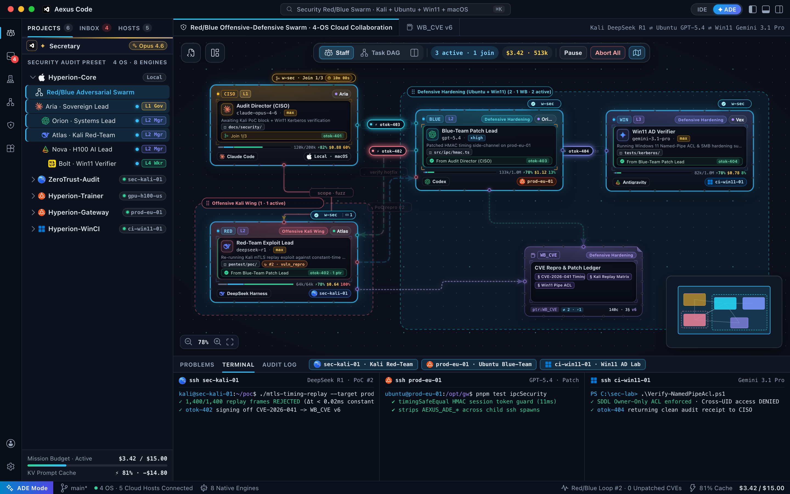
      
<strong>25. Red/Blue Offensive-Defensive Security Swarm:</strong> <code>Security Red/Blue Audit</code> preset coordinating <code>Kali</code> DeepSeek R1 exploit verification ⇄ <code>Ubuntu</code> GPT-5.4 hotfix ⇄ <code>Win11</code> Gemini 3.1 Pro AD checks under <code>macOS</code> Opus 4.6 CISO.

    </td>
    <td width="50%">
      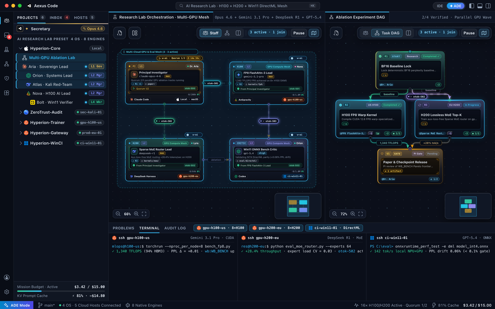
      
<strong>26. Distributed Multi-GPU AI Research Lab:</strong> <code>AI Research Lab</code> preset running parallel <code>8×H100</code> FP8 FlashAttn-3, <code>8×H200</code> Sparse MoE, and <code>Win11</code> DirectML ablation tracks with synced DAG &amp; GPU terminals.

    </td>
  </tr>
  <tr>
    <td width="50%">
      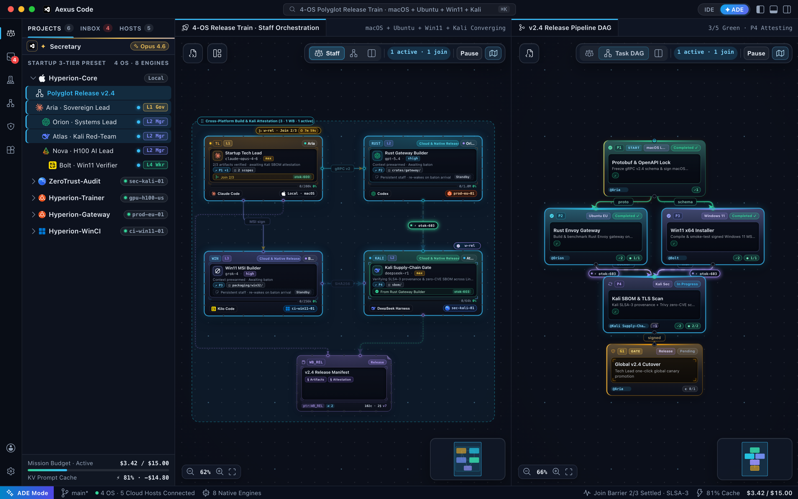
      
<strong>27. 4-OS Polyglot Full-Stack Release Train:</strong> <code>Agile 3-Tier Startup</code> preset converging macOS universal build, Ubuntu Rust gateway, Win11 MSI installer, and Kali SLSA-3 attestation into one release gate.

    </td>
    <td width="50%">
      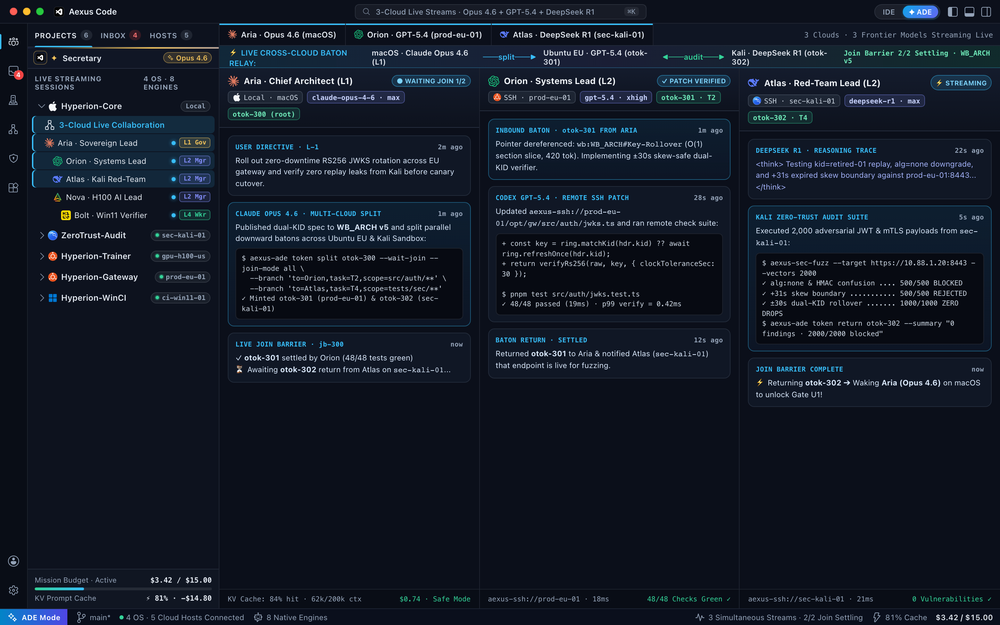
      
<strong>28. 3-Cloud Simultaneous Live Agent Streams:</strong> Watch <code>macOS</code> Claude Opus 4.6, <code>Ubuntu</code> Codex GPT-5.4, and <code>Kali</code> DeepSeek R1 stream patches, reasoning traces, and baton handoffs side by side.

    </td>
  </tr>
  <tr>
    <td width="50%">
      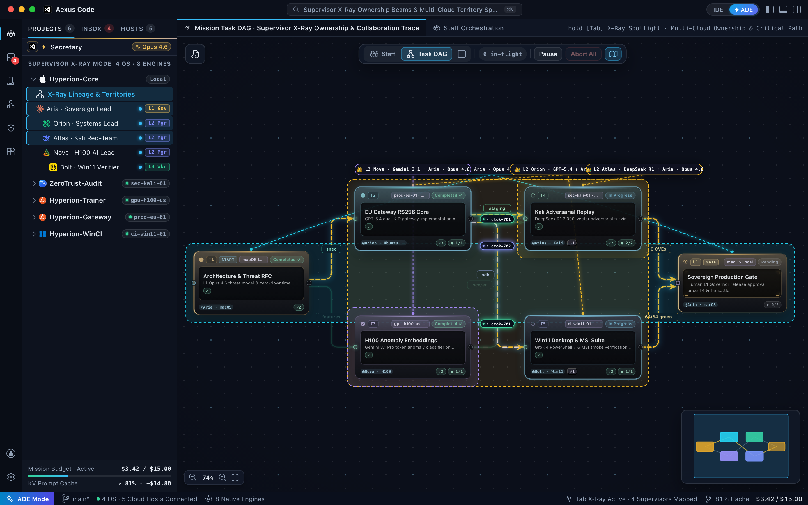
      
<strong>29. Supervisor X-Ray Beams &amp; Cloud Territories:</strong> Hold <code>Tab</code> to illuminate color-coded supervisor ownership enclosures, X-Ray lineage beams, and critical-path traces across multi-cloud DAG nodes.

    </td>
    <td width="50%">
      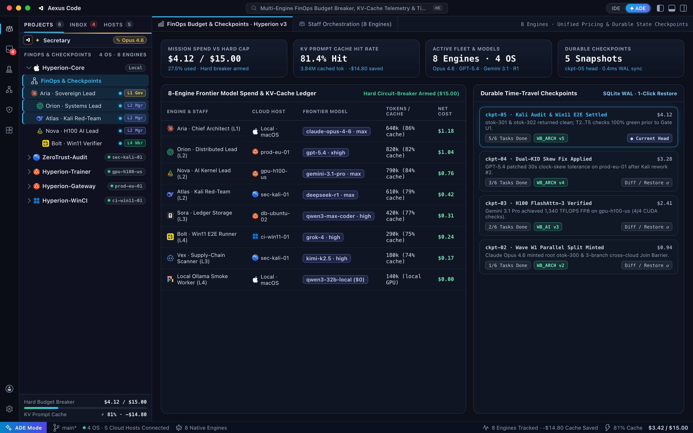
      
<strong>30. 8-Engine FinOps &amp; Time-Travel Checkpoints:</strong> Unified frontier model spend ledger, 81.4% KV-cache savings, hard budget circuit-breaker, and SQLite WAL checkpoint diff/restore.

    </td>
  </tr>
</table>
