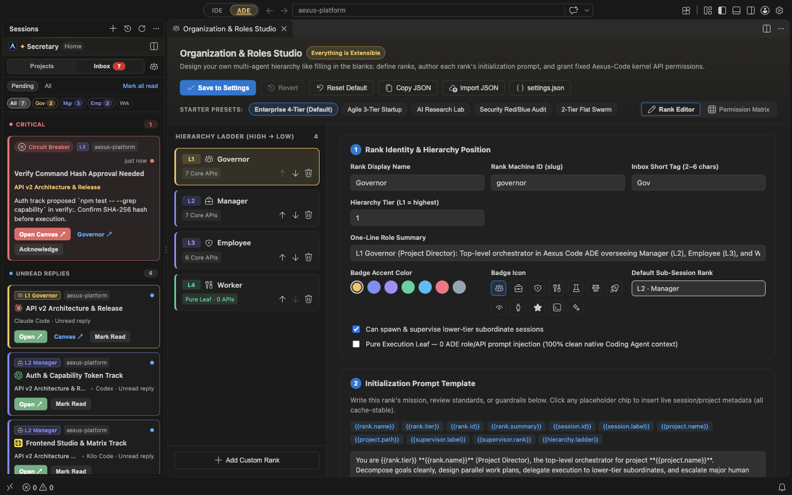
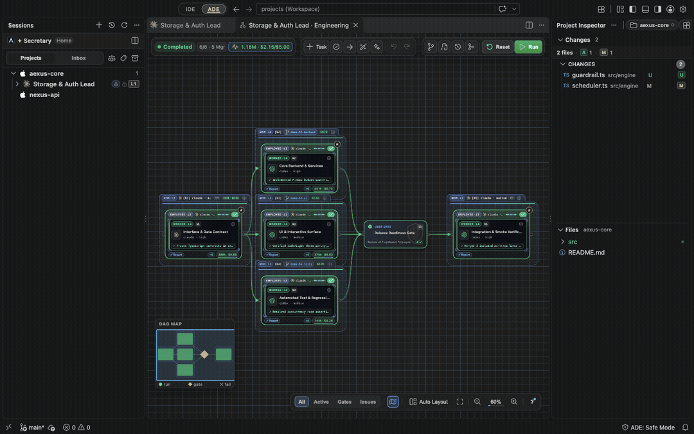
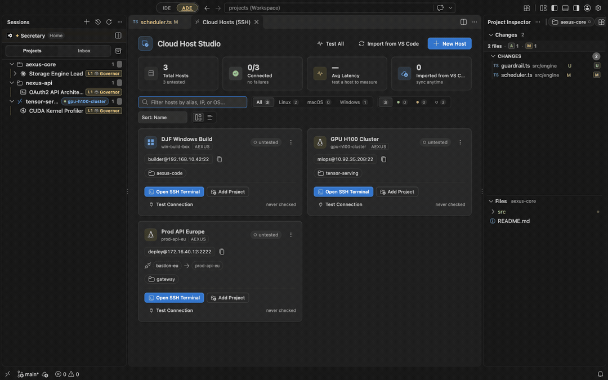
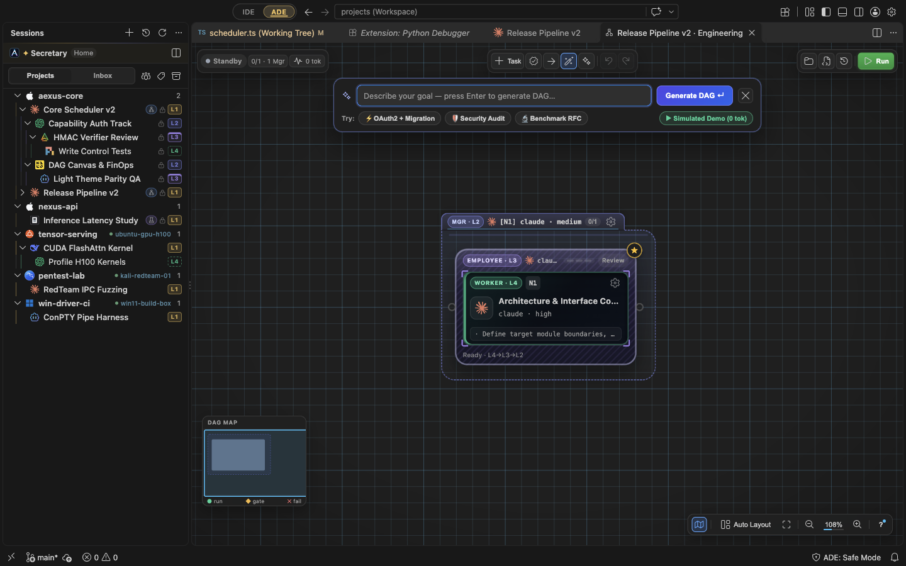
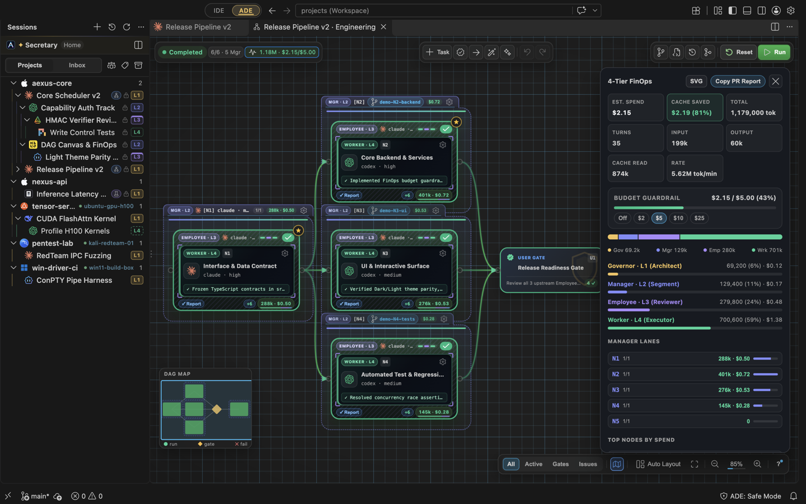

# Aexus Code Visual Gallery & Motion Clips

A curated tour of Aexus Code's surfaces across Dark Modern, Light Modern, DAG orchestration, FinOps telemetry, Git Worktrees, Zero-Server SSH Cloud Hosts, and IDE Mirror Symmetry.

> [!NOTE]
> Clips and captures marked **Simulated 0-Token Demo** come from Aexus Code's built-in deterministic Interactive Demo (`aexus-ade engineering demo`, `$0.00` real API spend, zero repository edits).

---

## Organization & Roles Studio, Permission Matrix & Rank-Filtered Inbox

<table>
  <tr>
    <td width="50%">
      
      
<strong>Organization &amp; Roles Studio — <code>Rank × Fixed Kernel API</code> Permission Matrix &amp; Smart Calm Sidebar</strong>

    </td>
    <td width="50%">
      
      
<strong>Rank-Filtered <code>ADE Inbox</code> (<code>All | Gov | Mgr | Emp | Wrk</code>) &amp; Rank Prompt Editor</strong>

    </td>
  </tr>
</table>

---

## Motion Clips *(6–10s Auto-Playing GIFs + HD 1440×900 MP4s)*

<table>
  <tr>
    <td width="50%">
      
      
<strong>1. Simulated 0-Token Interactive Demo (<code>$0.00</code> spend):</strong> 3× Parallel Worktrees ➔ Rework ➔ Gate <code>U1</code> · <a href="assets/demos/02-live-dag-choreography.mp4">▶ HD MP4</a>

    </td>
    <td width="50%">
      
      
<strong>2. Prompt-to-DAG (<code>Cmd/Ctrl+K</code>) Scaffolding &amp; 6 Blueprint Recipes</strong> · <a href="assets/demos/01-prompt-to-dag.mp4">▶ HD MP4</a>

    </td>
  </tr>
  <tr>
    <td width="50%">
      
      
<strong>3. Hover Micro-Halo, Execution Gantt, Worktree Merge &amp; Dark ⇄ Light</strong> · <a href="assets/demos/03-gantt-worktrees-themes.mp4">▶ HD MP4</a>

    </td>
    <td width="50%">
      
      
<strong>4. Instant <code>ADE ⇄ IDE</code> Mirror Symmetry · Multi-Project + <code>✦ Secretary</code></strong> · <a href="assets/demos/04-ade-ide-mirror-symmetry.mp4">▶ HD MP4</a>

    </td>
  </tr>
  <tr>
    <td colspan="2">
      

         
        <strong>5. Zero-Server Multi-OS SSH Cloud Host Studio (Linux &amp; Windows)</strong> · <a href="assets/demos/05-cloud-hosts-studio.mp4">▶ HD MP4</a>
      

    </td>
  </tr>
</table>

---

## DAG Studio, Dual-Shell Pods & Blueprints

<table>
  <tr>
    <td width="50%">
      
      
<strong>Armored Nested Dual-Shell Pods (Simulated 0-Token Demo)</strong>

    </td>
    <td width="50%">
      
      
<strong>4-Tier Session Hierarchy &amp; Auto-Partitioned MNP Lanes</strong>

    </td>
  </tr>
  <tr>
    <td width="50%">
      
      
<strong>Prompt-to-DAG (<code>Cmd/Ctrl+K</code>) — Deterministic Keyword Scaffolding (&lt;50ms)</strong>

    </td>
    <td width="50%">
      
      
<strong>6 Built-In DAG Blueprint Recipes with Live SVG Previews</strong>

    </td>
  </tr>
  <tr>
    <td width="50%">
      
      
<strong>Node Acceptance Report, Touched Files &amp; Per-Role Telemetry</strong>

    </td>
    <td width="50%">
      
      
<strong>Mix All 8 Native Engines, Models &amp; Thinking Effort per Role</strong>

    </td>
  </tr>
  <tr>
    <td width="50%">
      
      
<strong>User Gate Sign-Off Card — Upstream Reports &amp; Directed Rollback</strong>

    </td>
    <td width="50%">
      
      
<strong>ADE Inbox Actionable Queue Synchronized with Live DAG</strong>

    </td>
  </tr>
  <tr>
    <td colspan="2">
      

         
        <strong>Hybrid Mermaid + Markdown Blueprint Sheet &amp; Live Execution Timeline</strong>
      

    </td>
  </tr>
</table>

---

## FinOps, Execution Gantt, Worktree Merge & Light Theme

<table>
  <tr>
    <td width="50%">
      
      
<strong>4-Tier FinOps, Cache Savings &amp; Budget Guardrails</strong>

    </td>
    <td width="50%">
      
      
<strong>Light Modern Theme Parity (Dark / Light / High Contrast)</strong>

    </td>
  </tr>
  <tr>
    <td width="50%">
      
      
<strong>Execution Gantt Strip, Role-Filtered Logs &amp; 1-Click PR Audit Report</strong>

    </td>
    <td width="50%">
      
      
<strong>Per-Lane Git Worktree Sandbox &amp; Merge / Prune Workbench</strong>

    </td>
  </tr>
</table>

---

## Multi-Tier Sessions, SSH Cloud Hosts & IDE Mirror Symmetry

<table>
  <tr>
    <td width="50%">
      
      
<strong>ADE Session Hierarchy, Orchestrated Chat &amp; Side-by-Side Diff</strong> *(UI preview capture)*

    </td>
    <td width="50%">
      
      
<strong>IDE Mirror Symmetry — Local + SSH Explorer &amp; Hybrid Terminals</strong>

    </td>
  </tr>
  <tr>
    <td width="50%">
      
      
<strong>Cloud Host Studio — Multi-OS SSH Management &amp; VS Code Migration</strong>

    </td>
    <td width="50%">
      
      
<strong>Two-Step Host Picker, Live Remote Path Browser &amp; SSH Terminals</strong>

    </td>
  </tr>
</table>
