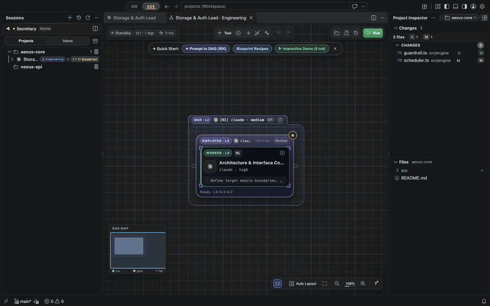
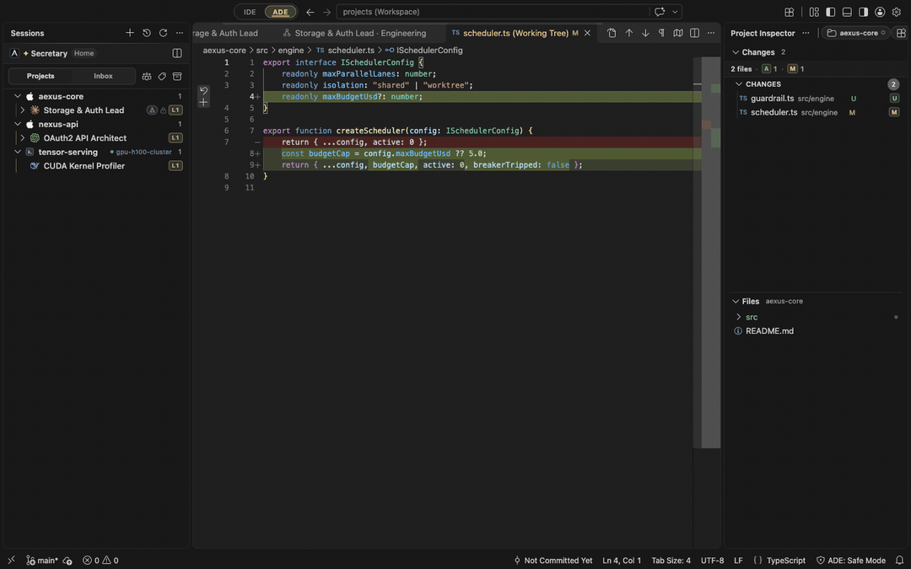
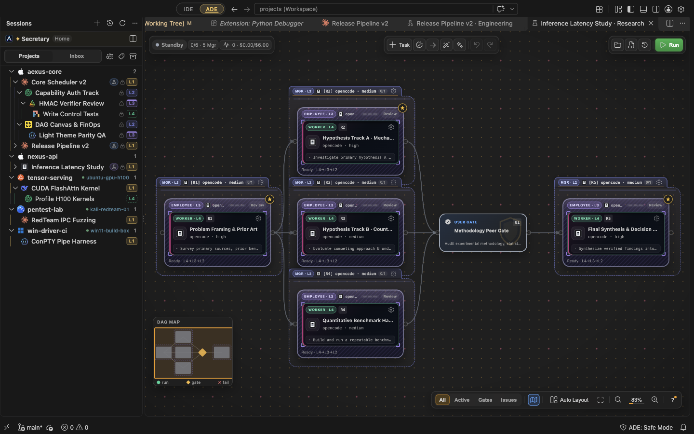
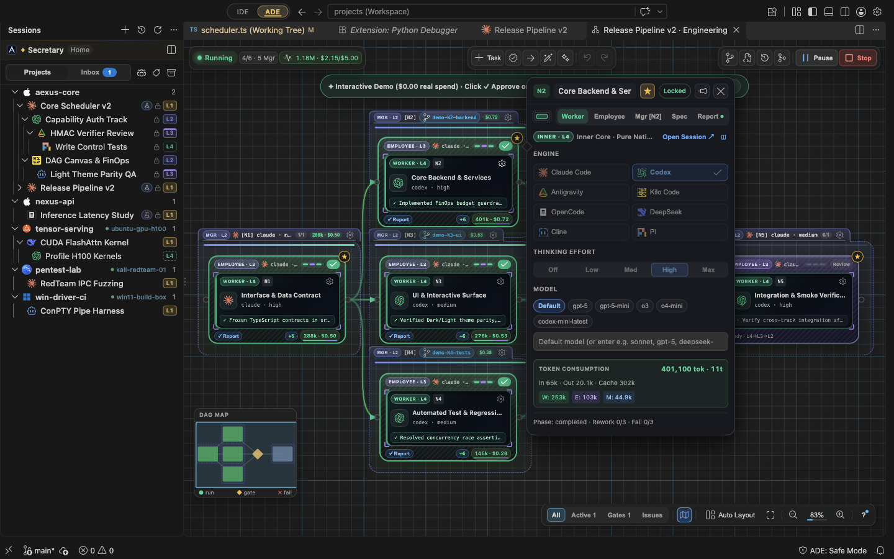
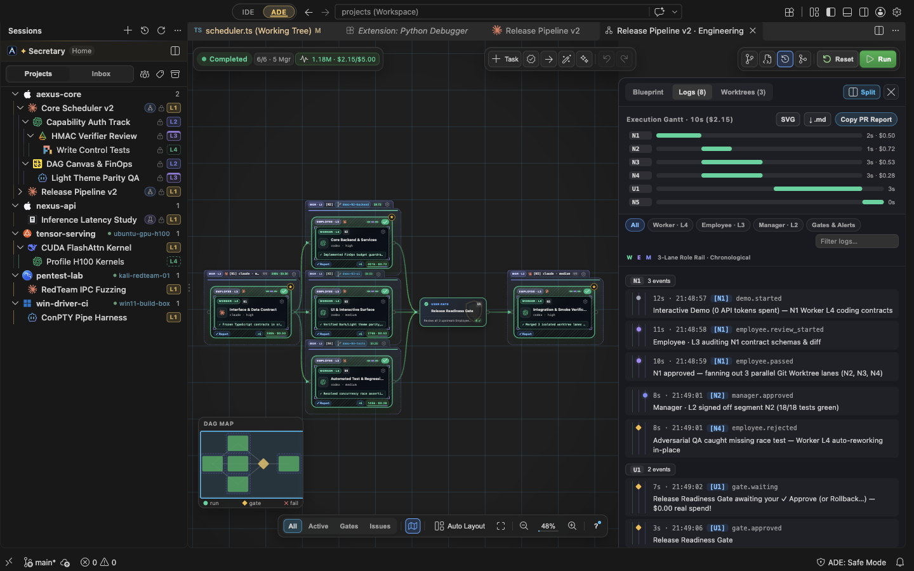
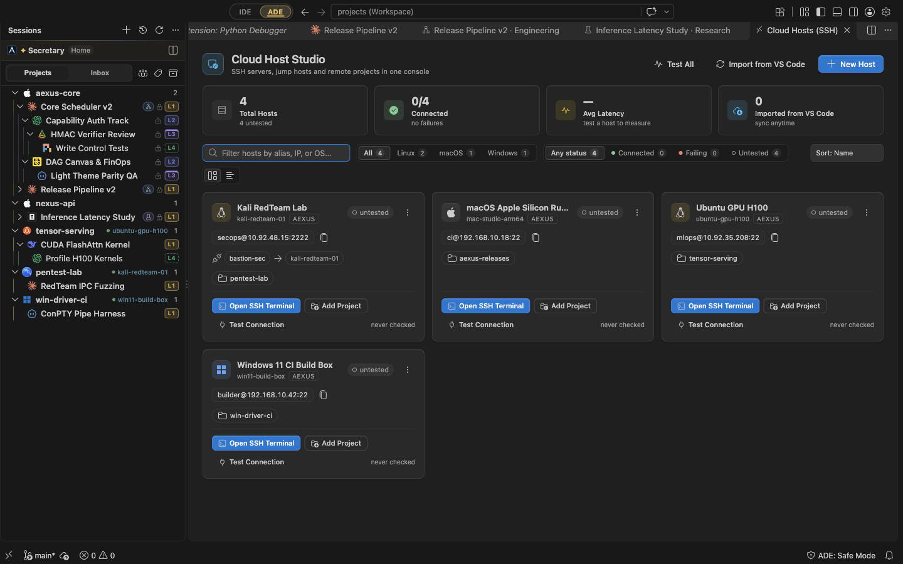

# Aexus Code Visual Gallery & Motion Clips

A curated tour of Aexus Code's surfaces across Dark Modern, Light Modern, High Contrast, Organization & Roles Studio, DAG orchestration, FinOps telemetry, Git Worktrees, Zero-Server SSH Cloud Hosts, and `ADE ⇄ IDE` Mirror Symmetry.

> [!NOTE]
> Clips and captures marked **Simulated 0-Token Demo** come from Aexus Code's built-in deterministic Interactive Demo (`▶ Simulated Demo (0 tok)` / `aexus-ade engineering demo`, `$0.00` real API spend, zero repository edits).

---

## Organization & Roles Studio, 4-Slot Bindings, Permission Matrix & Rank-Filtered Inbox

<table>
  <tr>
    <td width="50%">
      
      
<strong>Organization &amp; Roles Studio — 4-Slot DAG Binding Bar, <code>Rank × Fixed Kernel API</code> Matrix &amp; Smart Calm Sidebar</strong>

    </td>
    <td width="50%">
      
      
<strong>Rank-Filtered <code>ADE Inbox</code> (<code>All | Governor | Manager | Employee</code> · <code>Trust Gate</code> · <code>Budget Cap</code>) &amp; Rank Prompt Editor</strong>

    </td>
  </tr>
</table>

---

## Motion Clips *(6–10s Auto-Playing GIFs + HD 1440×900 MP4s)*

<table>
  <tr>
    <td width="50%">
      
      
<strong>1. Simulated 0-Token Interactive Demo (<code>$0.00</code> spend):</strong> 3× Parallel <code>aexus-eng/*</code> Worktrees ➔ Rework ➔ Gate <code>U1</code> · <a href="assets/demos/02-live-dag-choreography.mp4">▶ HD MP4</a>

    </td>
    <td width="50%">
      
      
<strong>2. Prompt-to-DAG (<code>Cmd/Ctrl+Shift+K</code> / <code>/</code>) Scaffolding &amp; 6 Blueprint Recipes</strong> · <a href="assets/demos/01-prompt-to-dag.mp4">▶ HD MP4</a>

    </td>
  </tr>
  <tr>
    <td width="50%">
      
      
<strong>3. Hover Micro-Halo, Execution Gantt, Worktree Merge &amp; Dark ⇄ Light</strong> · <a href="assets/demos/03-gantt-worktrees-themes.mp4">▶ HD MP4</a>

    </td>
    <td width="50%">
      
      
<strong>4. Instant <code>ADE ⇄ IDE</code> Mirror Symmetry · Multi-Project + <code>✦ Secretary</code></strong> · <a href="assets/demos/04-ade-ide-mirror-symmetry.mp4">▶ HD MP4</a>

    </td>
  </tr>
  <tr>
    <td colspan="2">
      

         
        <strong>5. Zero-Server Multi-OS SSH Cloud Host Studio (Linux, macOS &amp; Windows)</strong> · <a href="assets/demos/05-cloud-hosts-studio.mp4">▶ HD MP4</a>
      

    </td>
  </tr>
</table>

---

## DAG Studio, Dual-Shell Pods, Research Mode & Synchronized Blueprints

<table>
  <tr>
    <td width="50%">
      
      
<strong>Engineering Mode Parallel DAG — Nested Dual-Shell Pods (Simulated 0-Token Demo)</strong>

    </td>
    <td width="50%">
      
      
<strong>Research Mode Parallel DAG — Warm Amber/Magenta Hypothesis Canvas &amp; Peer Gate</strong>

    </td>
  </tr>
  <tr>
    <td width="50%">
      
      
<strong>Prompt-to-DAG (<code>Cmd/Ctrl+Shift+K</code> or <code>/</code>) — Deterministic Keyword Scaffolding (&lt;50ms)</strong>

    </td>
    <td width="50%">
      
      
<strong>6 Built-In DAG Blueprint Recipes with Live SVG Previews &amp; Budget Caps</strong>

    </td>
  </tr>
  <tr>
    <td width="50%">
      
      
<strong>Node Acceptance Report, Touched Files &amp; Per-Role Telemetry</strong>

    </td>
    <td width="50%">
      
      
<strong>Mix All 8 Native Engines, Public Models &amp; Thinking Effort per Role</strong>

    </td>
  </tr>
  <tr>
    <td width="50%">
      
      
<strong>User Gate Sign-Off Card — Upstream Reports &amp; Directed Rollback</strong>

    </td>
    <td width="50%">
      
      
<strong>Hybrid Mermaid + Markdown Blueprint Sheet &amp; Live Execution Timeline</strong>

    </td>
  </tr>
</table>

---

## Dynamic-Tier FinOps, Execution Gantt, Worktree Merge & Light Theme

<table>
  <tr>
    <td width="50%">
      
      
<strong>Dynamic-Tier FinOps, Cache Savings &amp; Budget Guardrails</strong>

    </td>
    <td width="50%">
      
      
<strong>Light Modern Theme Parity (Dark / Light / High Contrast)</strong>

    </td>
  </tr>
  <tr>
    <td width="50%">
      
      
<strong>Execution Gantt Strip, Role-Filtered Logs &amp; 1-Click PR Audit Report</strong>

    </td>
    <td width="50%">
      
      
<strong>Per-Lane <code>aexus-eng/*</code> Git Worktree Sandbox &amp; Merge / Prune Workbench</strong>

    </td>
  </tr>
</table>

---

## Multi-OS Projects, Multi-Host Terminals, VS Code Extensions & Zero-Server Cloud Hosts

<table>
  <tr>
    <td width="50%">
      
      
<strong>Unified Multi-OS Projects &amp; 8-Engine ADE Command Center (Full Badges + Diff)</strong>

    </td>
    <td width="50%">
      
      
<strong>Simultaneous Local &amp; Multi-Cloud OS Terminals (macOS · Ubuntu · Kali · Windows)</strong>

    </td>
  </tr>
  <tr>
    <td width="50%">
      
      
<strong>Instant <code>ADE ⇄ IDE</code> Mirror Symmetry — Native Explorer, Split Diff &amp; Multi-OS Terminals</strong>

    </td>
    <td width="50%">
      
      
<strong>Full VS Code Extensions Ecosystem via Live Open VSX Marketplace</strong>

    </td>
  </tr>
  <tr>
    <td colspan="2">
      

         
        <strong>Zero-Server SSH Cloud Host Studio — Multi-OS Cards (Kali · macOS · Ubuntu · Windows) &amp; Non-Destructive SSH Config</strong>
      

    </td>
  </tr>
</table>
