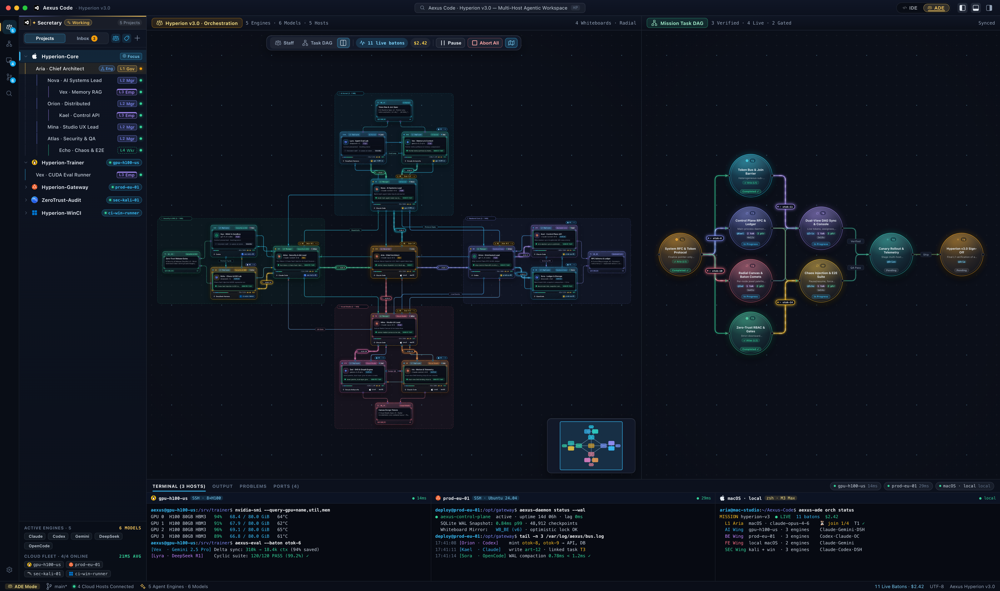
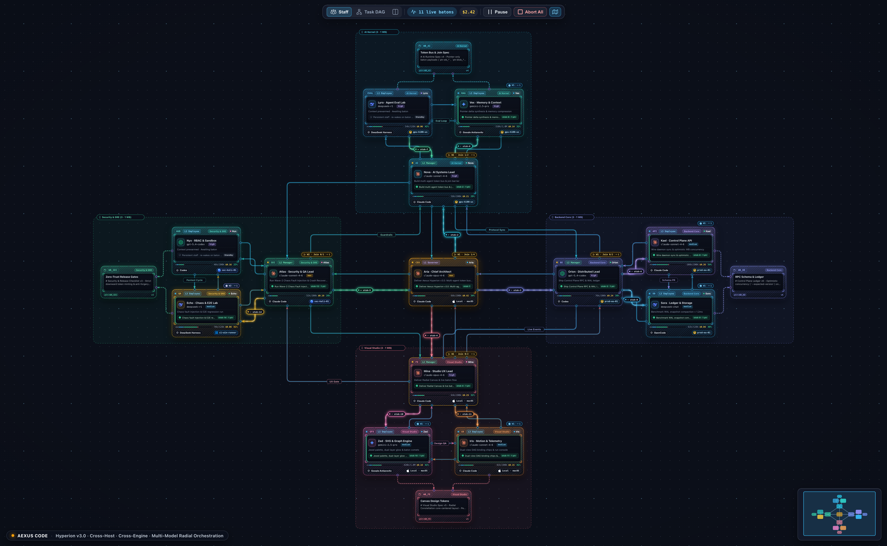
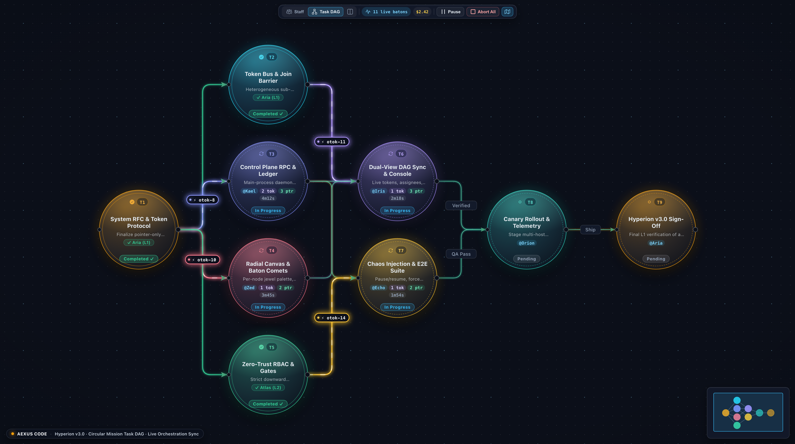
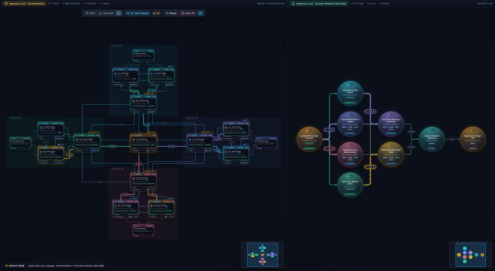
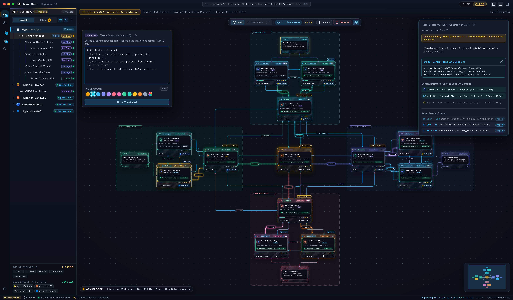
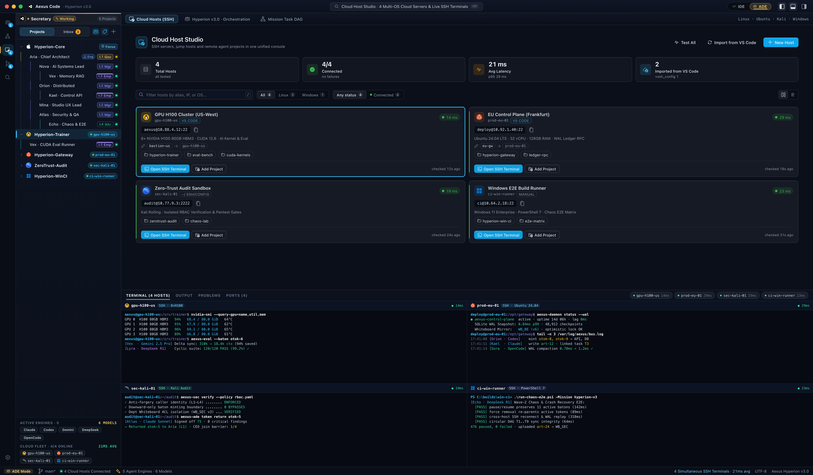
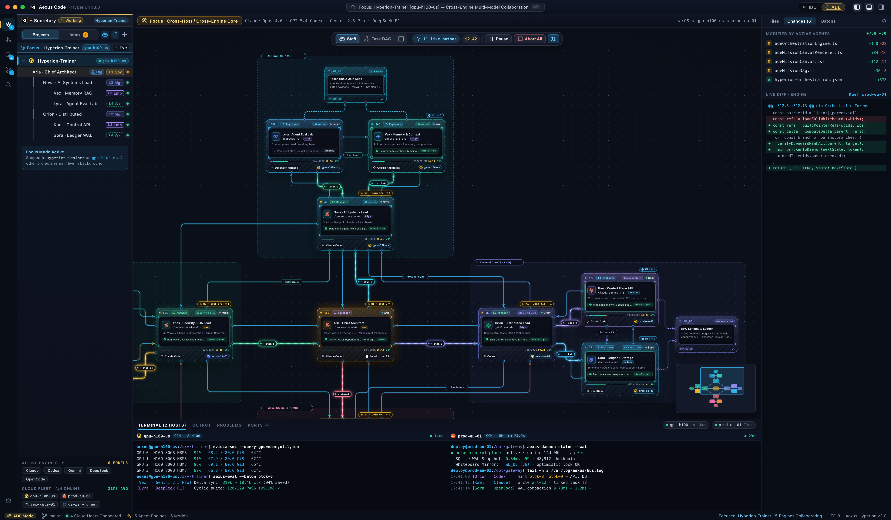
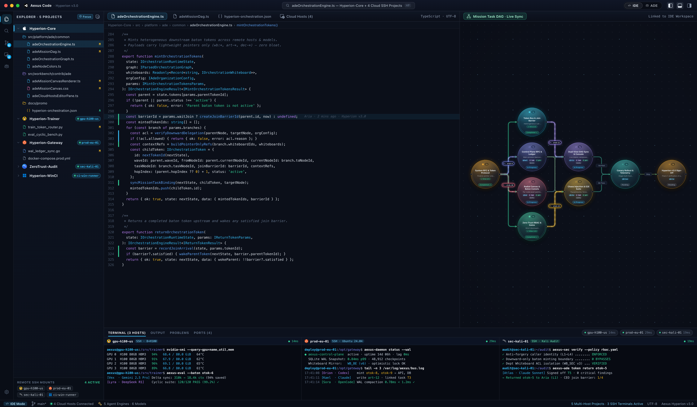

# Aexus Code Visual Gallery

A curated 2x Retina visual showcase of Aexus Code's flagship surfaces: Dual-View Radial Agent Orchestration, Circular Mission Task DAGs, Department Shared Whiteboards & Pointer-Only Baton Inspectors, Cross-Host / Cross-Engine / Multi-Model Collaboration, Zero-Server Multi-OS SSH Cloud Host Studio, Project Focus Mode, and Instant `ADE ⇄ IDE` Mirror Symmetry.

---

## 1. Full ADE Workbench & Radial Orchestration Constellation

  
   
  <strong>1. Full ADE Workbench Hero:</strong> Curated 5-project multi-OS/multi-cloud sidebar, dual-view Radial Orchestration &amp; Circular Mission Task DAG, and 3-host simultaneous SSH + local terminal dock.

  
   
  <strong>2. Radial Orchestration Constellation:</strong> L1 Gold Chief Architect centered with 4 jewel-colored department wings, 4 shared whiteboards, 13 staff across 5 hosts, 5 agent engines &amp; 6 models, live baton comets &amp; join barriers.

---

## 2. Circular Mission Task DAG, Dual-View Linkage & Interactive Whiteboards

<table>
  <tr>
    <td width="50%">
      
      
<strong>3. Circular Mission Task DAG:</strong> Luminous <code>176×176</code> radial task orbs, jewel palette, live baton packets, assignee/pointer badges &amp; circular minimap.

    </td>
    <td width="50%">
      
      
<strong>4. Dual-View Live Linkage:</strong> Orchestration staff tokens synchronized live with circular Mission Task DAG deliverables.

    </td>
  </tr>
</table>

  
   
  <strong>5. Interactive Whiteboards, Node Color Palette &amp; Baton Token Inspector:</strong> Live Markdown department whiteboard editor, 12-color swatch picker, cyclic re-entry delta bar, on-demand pointer diff preview &amp; 3-hop pass history.

---

## 3. Cross-Host Cloud Fleet, Project Focus Mode & Seamless `ADE ⇄ IDE` Mode

  
   
  <strong>6. Cloud Host Studio &amp; 2×2 Multi-Cloud SSH Terminal Matrix:</strong> Manage Linux H100 GPU, Ubuntu EU Prod, Kali Audit &amp; Windows CI servers alongside 4 live simultaneous SSH terminals.

<table>
  <tr>
    <td width="50%">
      
      
<strong>7. Project Focus Mode &amp; Cross-Engine Collaboration:</strong> Scoped cloud project focus banner, zoomed multi-engine/multi-model coordination &amp; live Git diff inspector.

    </td>
    <td width="50%">
      
      
<strong>8. Instant <code>ADE ⇄ IDE</code> Mirror Symmetry:</strong> Manage the same 5 local + cloud SSH projects in native IDE mode with TypeScript editing, live circular Task DAG preview &amp; multi-cloud terminals.

    </td>
  </tr>
</table>
