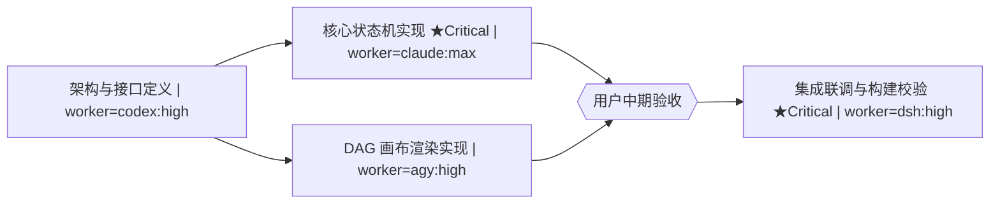

AEXUS CODE — ADE ENGINEERING 核心功能开发蓝图（纯文本规范版）
========================================================================

1. 功能定位与架构红线
------------------------------------------------------------------------
1.1 核心目标
在 Aexus Code 的 ADE（Agent Development Environment）模式下构建核心护城河功能：Engineering（跨 Agent 协作式可视化重型工程编排系统）。通过有向无环图（DAG）驱动多个本地 Coding Agent 按四级职级协同完成复杂工程项目，实现全链路状态可视化、双层验收、异常监控与人工卡点介入。
注：系统顶层抽象预留两类工作树——工程树（engineering）与科研树（research），当前阶段仅实现 engineering，但数据结构与服务接口需预留 treeType 字段以便后续扩展。

1.2 架构与合规底线（本地开发 Agent 必须严格遵守）
- 分层与依赖注入：严格遵循 VS Code 原有分层（base -> platform -> editor -> workbench）与构造函数服务注入，扩展宿主逻辑落在 extensions/aexus-agents 内。
- 桥接而非重写：复用本机 8 大 Coding Agent CLI（Codex、Claude Code、Kilo Code、OpenCode、DeepSeek Harness [dsh]、Google Antigravity [agy]、Cline、Pi）的原生认证、模型配置、权限与底层会话历史。通过现有 nativeRoleBridge、extHostRolePreload、dshRolePreload、thread/inject_items 等机制仅向 L1-L3（Governor / Manager / Employee）注入编排职责与 aexus-ade 控制指令。
- Worker(L4) 上下文 100% 原生纯净：实际编码主力为 Worker 角色，严禁向 Worker 注入任何 ADE 职级提示词、上下级树结构、aexus-ade 命令说明，甚至严禁向 Worker 追加“请撰写工作汇报”之类的编排要求。
- 业务仓库零污染：所有工程树蓝图文件与运行时状态统一持久化在 ~/.aexus-code/ 目录下，不在用户打开的项目代码仓库中生成任何隐藏配置文件。
- 零弹窗验收约束：遵循项目 AGENTS.md 规范，不得引入任何钥匙串访问、登录引导弹窗或破坏 secret:// 隔离的行为。

2. 组织架构、职级分工与左栏会话树映射
------------------------------------------------------------------------
2.1 项目、Governor 与工程树的对应关系
- 一个项目下允许存在多个 Governor(L1) 会话，因此一个项目可拥有多棵独立的工程树。
- 一个带有 Engineering 标签的 Governor 严格一对一绑定一棵工程树。
- 极简互斥原则：一个 Governor 要么带 Engineering 标签专职负责该工程树，要么不带标签处理日常自由会话，绝不允许混用。
- 初始化清理逻辑：用户在左栏 Projects 视图右键某个 Governor 点击“Engineering”按钮时：
  (a) 若该 Governor 已开启 Engineering，直接打开/聚焦对应的 Engineering 页面；
  (b) 若尚未开启且该 Governor 当前没有下级会话，直接打上 Engineering 标签并初始化工程树；
  (c) 若尚未开启但该 Governor 当前已有下级员工会话，必须弹窗拦截并提供两个选项供用户处理现有下级：“移出至其他位置/转为独立会话”或“删除/移除现有下级会话”。清理完毕后方可打上 Engineering 标签。

2.2 四级职级职责定义（默认休眠上级，事件驱动唤醒）
- Governor (L1，全局负责人)：
  负责根据项目情况设计任务拆分与并行拓扑、生成或修改工程树蓝图；默认休眠，仅在某条链路发生 3 次 Manager 级正式失败触发熔断时被系统唤醒兜底；若判断需要人类介入，负责向 ADE 收信箱（Inbox）发送留言提醒用户。
- Manager (L2，关键链路负责人)：
  负责 DAG 中某一段连续无分叉链路的统筹与链路级验收，管辖范围互不重叠；默认休眠，仅在以下三种事件时唤醒：
  (a) 本段链路的“收尾节点”或标记为“Critical（关键卡点）”的节点通过 Employee 初审后，唤醒 Manager 执行关键链路二次验收；
  (b) 某节点连续 3 次未通过 Employee 单点验收时，唤醒 Manager 清空重试状态并给出指导意见，赋予下级第 4 次机会；
  (c) Watchdog 监测到下属活跃 Worker 超时无流式输出时，唤醒 Manager 接收异常告警并唤醒/处置 Worker。
- Employee (L3，单节点验收负责人)：
  对应 DAG 画布上的每一个任务节点。严禁亲自编写业务代码！在节点启动派发阶段保持休眠（由系统直接把静态提示词与上游汇报推给 Worker，避免无意义的派发 Token 消耗）。仅在所属 Worker 执行回合结束（turn-complete）后被唤醒，执行两项专属职责：
  (a) 依据节点验收标准与 Git Diff 检查 Worker 实现是否正确；
  (b) 若实现正确，由 Employee 负责总结当前 Worker 的代码改动，撰写本节点的简短工作汇报并提交给系统续接到递增汇报链中（以此保证 Worker 100% 纯净）。
- Worker (L4，纯净执行主力)：
  一对一挂载在每个 Employee 节点内部，负责全部真实编码、调试与构建工作，上下文 100% 保持对应 Coding Agent 引擎原生状态。

2.3 Manager 管辖链路 100% 全自动切分算法
- 系统根据 DAG 连线拓扑 100% 自动计算并生成 Manager 分段，不允许人工重叠指派。
- 极大无分支路径切分规则（Maximal Non-branching Path）：
  凡遇到分叉点（节点出度 > 1）或汇合点（节点入度 > 1），分叉与汇合前后必须切分为不同的 Manager 负责。
  示例：若拓扑为 A -> B, A -> C, B -> D, C -> D（A 出度为 2，D 入度为 2），系统必须自动切分为 4 段独立链路：[... -> A]、[B]、[C]、[D -> ...]，每段自动对应一个独立的 Manager 会话。
- 特殊人工卡点边界：独立的“用户验收节点”不包含 AI 执行体（不挂 Employee/Worker），在路径切分时同样作为链路断开边界，确保每个 Manager 管辖的都是纯粹且连续的 AI 执行链路。

2.4 左栏 Projects 会话树预创建与锁定机制
- 预创建树结构 + 底层进程懒加载：当工程树蓝图确认保存生效时，左栏 Projects 视图在该 Governor 下一次性生成完整的 Manager -> Employee -> Worker 会话层级树并显示 Engineering 标签；但底层 8 大 CLI 进程与原生会话文件采用懒加载策略，仅当某个角色真正首次被唤醒执行时才实例化底层引擎会话（防止大图保存时瞬间拉起大量空进程或污染原生历史）。
- 左栏拓扑强锁定：凡带有 Engineering 标签的会话树，左栏禁止拖拽改派（热拔插）、禁止手动修改上级、禁止在左栏单独删除或新增子会话。拓扑结构唯一修改途径是编辑 Engineering 画布并点击确定，或通过蓝图文本接口提交更新。无 Engineering 标签的普通会话树保持原有自由操作不变。

3. DAG 状态机、双层验收流转、递增汇报与 Watchdog 监控
------------------------------------------------------------------------
3.1 启动权限门禁
- 工程树创建或修改生效后，默认处于未启动/待命状态。
- 只有两类主体有权真正启动工程运行：（1）用户在 Engineering 页面点击“运行”按钮；（2）全局 Secretary（✦ Secretary）调用启动控制接口。Governor 自身无权未经确认直接发车运行。

3.2 节点激活与递增工作汇报传递机制
- 激活条件：当某任务节点的所有前置入边均处于“已完成”状态时，该节点被激活，输入连线与节点进入“进行中”状态。
- 纯净派发载荷：系统不唤醒 Employee，直接启动该节点的 Worker 会话，拼装纯业务输入如下：
  [上游递增简短工作汇报链] + [本节点预设静态提示词（含完成目标与具体实现要求）]
- 递增汇报链规则：
  (a) 每个节点完成后传递的汇报，必须包含之前上游节点的汇报信息以及本节点新增的汇报信息，形成随链路递增的速成上下文；
  (b) 当多条并行支路汇合（如 B -> D 且 C -> D）时，系统按拓扑顺序合并多路汇报，并对公共祖先（如 A）的历史汇报自动去重，避免重复叠加；
  (c) 若某节点被打回重做，重新编写代码并通过验收后，Employee 必须同步修改/覆盖该节点对应的那一段汇报内容，再往下游传递。

3.3 Employee 单点验收与内部返工循环
- 触发时机：系统监听到底层 CLI 引擎的 Worker 会话回合完成事件后，自动通过专用唤醒机制激活对应的 Employee。
- Employee 验收输入载荷：
  [本节点目标与验收标准] + [上游递增汇报信息] + [该 Worker 本轮输出摘要] + [该 Worker 本轮修改的文件列表与 Git Diff 变更详情]（Employee 亦可按需调用 Git 命令查阅上下文）。
- 分支一（Employee 验收通过）：
  Employee 撰写（或更新）本节点的简短工作汇报，调用 aexus-ade 专用验收通过指令提交汇报：
  (a) 若该节点既非当前 Manager 链路的收尾节点，也未标记为 Critical：该节点直接标记为“已完成（绿色）”，工作令牌自动流转至下游节点；
  (b) 若该节点是当前 Manager 链路的收尾节点，或带有 Critical 标记：系统随即唤醒所属链路的 Manager 进行二次链路验收。
- 分支二（Employee 验收未通过 —— 内部迭代，不计入正式失败）：
  (a) 状态定义：Employee 验收未通过不算节点失败，节点颜色不变成琥珀色，维持进行中状态；
  (b) 复用原 Worker：系统将 Employee 给出的具体打回修改意见直接发给同一个原 Worker 会话继续增量修改（严禁销毁重开新 Worker，避免丢失上下文和浪费额度）；
  (c) 连续 3 次内部驳回上报：若原 Worker 连续 3 次未通过 Employee 验收，系统自动上报并唤醒所属链路的 Manager。Manager 介入审视全局后，清空内部重试状态并下发指导意见，使 Employee 与原 Worker 获得第 4 次机会。

3.4 Manager 链路验收、三级失败色阶与熔断上报
- 正式失败的唯一判定标准：只有“Manager 检查未通过”（包括尾节点/Critical 二审未通过，或第 4 次机会后仍被 Manager 判定未通过）才计为正式失败（Failure）。
- 正式失败颜色递增阶梯与处置动作：
  - 第 1 次 Manager 判定失败：节点变为【浅琥珀色】，按 Manager 意见打回原链路/原 Worker 修正；
  - 第 2 次 Manager 判定失败：节点颜色加深为【深琥珀色】，继续做最后一次修正尝试；
  - 第 3 次 Manager 判定失败：节点变为【红色】，该链路立即熔断暂停，不再自动循环重试，同时自动唤醒顶层 Governor 介入。到此为止由 Governor 统筹评估；若确实需要人类拍板或外部协助，Governor 调用接口向 ADE 收信箱（Inbox）发送提醒留言给用户。

3.5 独立“用户验收节点”（User Acceptance Gate）与局部打回规则
- 节点性质：作为独立的特殊卡点节点存在于 DAG 中，不分配 Employee 与 Worker。
- 阻塞与通知：当上游节点完成并流转至用户验收节点时，流程在此挂起等待人工裁决，并同步在 ADE 收信箱（Inbox）生成一条待验收通知。
- 人工裁决流转：
  - 用户判定“通过”：该卡点标绿完成，立即开启下游关联节点；
  - 用户判定“不通过（打回）”并指定打回到上游某一步（例如拓扑为 A -> B -> C 且 A -> D 并行，用户在 C 后的卡点选择打回至 A）：系统仅将回退路径（A -> B -> C）上的节点状态重置并交由原 Worker 按用户反馈增量返工并重写对应汇报，绝不重置或干扰并行支路 D 的状态与产出。

3.6 连线与节点的完整视觉状态矩阵
- 连线（Edge）视觉规范：
  - 未开始的链路：实线灰色
  - 进行中的链路：流动式绿色虚线（带方向流动动画）
  - 已完成的链路：实线绿色
  - 失败/阻断的链路：实线灰色
- 节点（Node）视觉规范：
  - 未开始：灰色
  - 进行中（含 Employee 内部打回重做阶段）：绿色活跃态
  - 已完成：绿色完成态
  - 正式失败 1 次：浅琥珀色
  - 正式失败 2 次：深琥珀色
  - 正式失败 3 次（熔断）：红色

3.7 Watchdog 超时无响应监控机制
- 监控对象：所有处于“进行中”状态的活跃 Worker 会话。
- 判定阈值：连续 10 分钟（默认值，需在设置项中暴露为可配置参数，如 aexus.ade.engineering.watchdogTimeoutMinutes）没有任何流式输出（stream output），即判定为员工响应异常。
- 唤醒与处置：Watchdog 捕获超时后，自动发送异常报告唤醒负责该链路的 Manager。Manager 默认通过发送提醒消息的方式唤醒该 Worker；同时底层接口赋予 Manager 强制杀死（kill）并重启该 Worker 进程的权限（默认优先发消息提醒，不盲目强杀）。

4. 工作区并行策略与精准变更追踪
------------------------------------------------------------------------
4.1 默认策略：共享项目根目录原地协作
- 所有并行支路的 Worker 默认直接在当前项目根目录下工作，零额外配置，兼容非 Git 项目或包含大型本地未追踪依赖的重型工程（由 Governor 在设计 DAG 时合理划分各并行支路负责的代码模块）。
- 单 Worker 变更追踪：系统在 Worker 执行回合前后记录文件指纹快照并结合引擎工具调用日志，精准提取当前 Worker 实际触碰过的文件变更集与 Git Diff，供 Employee 单点验收时精确审阅。
- 非破坏性打回：节点或用户卡点触发打回时，不执行全局破坏性 git reset，保留磁盘代码现状，由原 Worker 在现有代码基础上增量修改，彻底杜绝误伤并行支路 D 的代码。

4.2 高级策略（可选配置开关）：Git Worktree 链路沙盒隔离
- 提供工程级高级开关（默认关闭）：开启后，系统以每段 Manager 链路为单位自动创建临时分支与隐藏 git worktree 沙盒目录，各并行链路物理隔离读写；到达多路汇合节点前由系统自动执行 Git 合并，若遇代码冲突则自动唤醒汇合链路的 Manager 处理冲突。

5. 工程树蓝图协议规范与存储结构
------------------------------------------------------------------------
5.1 存储目录规划
所有数据保存在 ~/.aexus-code/engineering/<governor-session-id>/ 下：
- blueprint.md：Markdown + Mermaid 混合工程蓝图文件（唯一拓扑与配置源）
- state.json：DAG 节点运行态、重试计数、递增工作汇报链、文件快照索引与历史事件日志

5.2 混合蓝图协议（Markdown + Mermaid 方案）
- 顶部为标准 mermaid 代码块（flowchart LR 或 TD），直观定义节点、有向无环边、Critical 标记、独立用户验收节点形状，并在一开始就标明 Worker 引擎等核心摘要；
- 下方为结构化 Markdown 配置段落，完整规定每个节点与每段链路的提示词（含完成目标与验收标准），以及 Worker、Employee、Manager 各自选用的 Coding Agent 引擎、具体模型名称（model）和推理思考程度（thinking level：统一抽象为 low / medium / high / max 等标准档位，由 aexus-agents 适配器映射为各引擎原生参数）。
- 说明：Mermaid 源码不直接展示在 Engineering 可视化画布页面中（源码的图形化查看入口后续单独规划），但底层必须完整实现 blueprint.md 的解析器与生成器，供 Governor、Secretary 通过文本方式直接生成或编辑整棵工程树。

5.3 blueprint.md 标准格式示例

## Tree Metadata
- tree_type: engineering
- governor_session_id: <session-uuid>
- workspace_isolation: shared
- watchdog_timeout_minutes: 10

## Auto-Partitioned Managers
### [Segment: N1]
- engine: claude-code
- model: claude-opus-4-6
- thinking: high

### [Segment: N2]
- engine: codex
- model: o3
- thinking: max

### [Segment: N3]
- engine: antigravity
- model: gemini-2.5-pro
- thinking: high

### [Segment: N4]
- engine: claude-code
- model: claude-opus-4-6
- thinking: high

## Nodes
### [N1] 架构与接口定义
- type: task
- critical: false
- employee: engine=claude-code, model=claude-sonnet-4-6, thinking=medium
- worker: engine=codex, model=gpt-5-codex, thinking=high
- goal: |
    在 src/vs/platform/ade 下定义 IAdeEngineeringService 与 IAdeInboxService 接口及 IPC 通道协议。
- acceptance: |
    1. 所有新增接口完整导出且符合 VS Code DI 装饰器规范；
    2. 通过类型检查，无循环依赖。

### [U1] 用户中期验收
- type: user_gate
- description: |
    请检查状态机服务与前端画布组件的初步联调效果，确认是否推进至最终集成测试。

6. Engineering 页面 UI、手势交互与 ADE 收信箱规范
------------------------------------------------------------------------
6.1 标准编辑器标签页（Editor Tab）形态
- Engineering 页面作为一个普通的工作台编辑器页面（EditorPane / EditorInput）存在，与 Coding Agent 会话页面、打开的代码文件页面处于完全相同的顶部标签栏体系中，支持多棵工程树同时打开为多个标签页或分屏并排查看。
- 页面内容专注呈现渲染后的交互式 DAG 图与顶部控制栏（含“运行/暂停”按钮、草稿修改后的“确定/取消”按钮等），不直接显示 Mermaid 代码。

6.2 双核同心圆节点渲染与丝滑动画
- 任务节点采用同心双层圆设计：
  - 外圈圆环代表 Employee(L3)：展示 Employee 所选 Coding Agent 引擎标识，以及当前节点状态色环（灰 / 绿 / 浅琥珀 / 深琥珀 / 红）与 Critical 标记；
  - 内部圆心代表 Worker(L4)：直接展示 Worker 所选 Coding Agent 的原生图标。
- 用户验收节点采用醒目的人工卡点专属图标与轮廓。
- 连线采用平滑贝塞尔曲线或正交圆角连线，进行中状态具备顺滑的绿色虚线流动动画；节点拖拽、新增、删除、自动布局及抽屉展开均需配备流畅过渡动效。

6.3 手枪悬停抽屉与单击直达会话交互
- 鼠标悬停（Hover）：当鼠标指针移动到节点上方时，指针图标变为“食指向上的手枪形手势”，直观提示已指向该节点；同时无需点击，右侧自动滑出该节点的选择与详情抽屉（支持查看状态与递增汇报、编辑节点配置与提示词、切换查看 Employee 或 Worker 信息等；需在节点与右抽屉间处理好悬停保持逻辑，确保鼠标移入右抽屉操作时抽屉不意外关闭）。
- 鼠标单击（Click）：在节点上直接点击左键时，立即打开/切换到该节点对应的 Coding Agent 会话页面。

6.4 草稿态编辑与“点击确定”生效保护机制
- 非自动保存：用户在画布上拖动节点、增删节点、修改连线或在抽屉中调整节点配置时，所有变更均处于前端草稿状态，绝不在每次拖动或点击时立即落盘或改动左栏树；必须由用户点击页面上的“确定”按钮后，变更才一次性原子生效。
- 运行中编辑限制与强停重排：
  - 已完成节点：严格锁定，不可修改或删除；
  - 未开始节点：可自由新增、编辑、删除与调整连线；
  - 进行中节点：若草稿改动涉及正在运行的节点，点击“确定”时必须先弹窗提醒用户“当前节点正在进行中”；若用户确认执意更改，系统自动强停（stop）受影响的当前 Worker，按新 DAG 拓扑自动重新切分重排 Manager，并同步刷新左栏锁定会话树与 blueprint.md。

6.5 ADE 收信箱（ADE Inbox）
- 在 ADE 视图左栏常驻收信箱入口（含未读数量角标）。
- 收信箱统一承载两类消息卡片：
  (a) Governor 留言：当某链路历经 3 次 Manager 失败触发红色熔断后，Governor 发给用户的态势说明与决策请求（支持一键跳转对应 Engineering 页面或 Governor 会话）；
  (b) 用户验收待办：工程流转至“用户验收节点”时的实时验收请求，支持用户在卡片或画布中直接判定“通过”或“不通过（选择打回到哪一步并附带反馈意见）”。

7. 控制面 CLI（aexus-ade）与 Secretary 全量接口对等
------------------------------------------------------------------------
7.1 设计原则
全局 Secretary（✦ Secretary）必须拥有完整的 API / CLI 接口，能够完成用户在图形界面上能做到的全部 Engineering 与 Inbox 操作（包括初始化工程树、编写与提交蓝图、启动工程运行、暂停/停止、处理人工验收卡点、读取收信箱等）。

7.2 Unix Socket（~/.aexus-code/ade-control.sock）扩展子命令清单
在现有 aexus-ade CLI 中新增 engineering 与 inbox 两大命令域：

- aexus-ade engineering init --governor <id> [--on-children <relocate|delete> --target <id>]
  将指定 Governor 切换为 Engineering 模式并初始化空工程树。
- aexus-ade engineering list [--project <path>]
  列出当前所有工程树及其所属 Governor、运行状态与进度摘要。
- aexus-ade engineering open --governor <id>
  在工作台中部编辑器区域打开或聚焦对应的 Engineering 页面。
- aexus-ade engineering blueprint get --governor <id>
  读取当前工程树的完整 Markdown + Mermaid 蓝图文本。
- aexus-ade engineering blueprint apply --governor <id> --file <path> [--force-stop-running]
  校验并提交新蓝图生效（自动触发 Manager 极大无分支路径切分、已完成节点锁校验、进行中 Worker 强停重排及左栏会话树同步）。
- aexus-ade engineering run --governor <id>
  正式启动工程树推进（供前端“运行”按钮及 Secretary 调用）。
- aexus-ade engineering pause --governor <id> / resume --governor <id> / stop --governor <id>
  暂停、恢复或终止整棵工程树当前活跃的执行链路。
- aexus-ade engineering status --governor <id> [--node <nodeId>]
  查询整棵 DAG 实时节点/边状态、重试次数、失败等级及当前递增工作汇报链。
- aexus-ade engineering review --governor <id> --node <nodeId> --role <employee|manager> --verdict <pass|reject> [--report <text>] [--feedback <text>]
  供 Employee 提交单点验收结果与本节点工作汇报，或供 Manager 提交关键链路二次验收结果及第 4 次机会指导意见。
- aexus-ade engineering gate --governor <id> --node <nodeId> --verdict <pass|rollback> [--target-node <upstreamNodeId>] [--feedback <text>]
  供用户界面或 Secretary 对“用户验收节点”执行通过或指定上游节点局部打回（严格遵守不重置无关并行支路规则）。
- aexus-ade engineering watchdog-action --governor <id> --node <nodeId> --action <remind|kill-restart> [--message <text>]
  供 Manager 在收到超时告警后唤醒或强杀重启异常 Worker。
- aexus-ade inbox list [--unread-only] / post --from <governorId> --message <text> / resolve --id <msgId>
  供 Governor 投递提醒留言，以及供前端收信箱和 Secretary 查询、标记处理收信箱消息。

8. 推荐源码模块落点与分步实施顺序
------------------------------------------------------------------------
8.1 模块划分建议
- src/vs/platform/ade/common/adeEngineering.ts
  定义 IAdeEngineeringService、IAdeInboxService、DAG 节点/边/状态枚举、递增汇报结构与 IPC 数据契约。
- src/vs/platform/ade/node/adeEngineeringBlueprintParser.ts
  实现 blueprint.md（Mermaid 拓扑块 + Markdown 角色参数块）双向解析、序列化、环路检测（DAG 校验）与极大无分支路径 Manager 自动切分算法。
- src/vs/platform/ade/node/adeEngineeringService.ts
  实现核心状态机、懒加载会话桥接、单 Worker 文件变更快照与 Diff 提取、三级失败升级、Watchdog 10 分钟无流式输出定时器及 ~/.aexus-code/engineering/ 持久化；可选挂载 Git Worktree 隔离器。
- src/vs/workbench/contrib/ade/browser/adeEngineeringEditorPane.ts（及配套 EditorInput / Canvas 渲染组件）
  实现标准 Editor Tab 页面、SVG/Canvas 丝滑 DAG 渲染、流动绿色虚线动画、双核同心圆节点、向上手枪悬停手势 + 自动右抽屉、单击跳会话、草稿态编辑与确定生效交互。
- src/vs/workbench/contrib/ade/browser/adeInboxView.ts（或集成于左栏 AdeProjectsView 顶部区域）
  实现收信箱列表、未读角标、Governor 留言展示与用户验收节点审批交互。
- src/vs/workbench/contrib/ade/browser/adeProjectsView.ts
  扩展右键 Governor 的“Engineering”菜单项、已有子会话迁出/删除确认框、Engineering 专属标签徽章渲染，以及带标签会话树的拖拽与增删锁定守卫。
- extensions/aexus-agents/
  对接 8 大 CLI 引擎的思考档位参数映射与模型选择；捕获 Worker 回合完成与流式输出心跳上报平台层；向 Governor / Manager / Employee 注入专属工程编排提示词与 aexus-ade engineering 命令规范，同时确保 Worker 角色 100% 跳过角色预加载注入。

8.2 推荐开发与验证推进顺序
阶段一：完成 blueprint.md 解析器、DAG 环检测与极大无分支路径 Manager 自动切分单元测试。
阶段二：打通平台层 IAdeEngineeringService、~/.aexus-code/ 持久化、aexus-ade Socket 新命令集与 Secretary 提示词接入。
阶段三：改造左栏 AdeProjectsView（Governor 右键入口、Engineering 标签互斥清理、预创建树与拓扑锁定）并落盘 ADE Inbox 收信箱组件。
阶段四：在 extensions/aexus-agents 打通 Worker 纯净派发、流式输出心跳（Watchdog 数据源）、turn-complete 事件捕获及 Employee/Manager 唤醒载荷拼装。
阶段五：实现中部 AdeEngineeringEditorPane 可视化 DAG 画布、双核节点、流动虚线、手枪手势悬停右抽屉、单击跳转及草稿态确认保护，最终执行 pnpm run build-fast 与类型检查全量验收。
