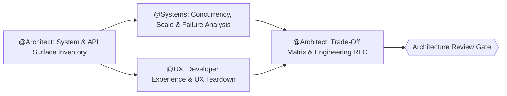

# Architecture Teardown & Engineering RFC

Parallel systems and UX teardown workflow: inventory module boundaries and APIs, analyze concurrency/scale failure modes in parallel with developer ergonomics, compile a trade-off matrix & Engineering RFC, and review at Gate `U1`.

## Node Pre-Prompts

Apply the Mermaid DAG with `aexus-ade mission blueprint apply --mission <id> --file ./examples/blueprints/arch-teardown.md`, then bind each node's pre-prompt via the Canvas / Split Drawer or `aexus-ade mission prompt set`:

### R1
Map module architecture, IPC/RPC boundaries, state ownership, and extension points with exact file references under `docs/rfc/inventory/`. Identify core invariants and primary bottlenecks.

### R2
Analyze scalability limits, failure domains, latency hot paths, and cross-platform edge cases under `docs/rfc/systems/`. Provide concrete complexity bounds and ranked mitigation options.

### R3
Evaluate onboarding friction, workflow ergonomics, visual clarity, and competitive trade-offs under `docs/rfc/ux/`. Prioritize friction points by user impact with concrete UX improvements.

### R4
Compile `R1`–`R3` into a concise Engineering RFC at `docs/rfc/RFC.md` containing a decision matrix, phased rollout plan, risk mitigations, and measurable success metrics.

### U1
Human Acceptance Gate: review the final RFC and either approve for execution or roll back a track for deeper analysis.
