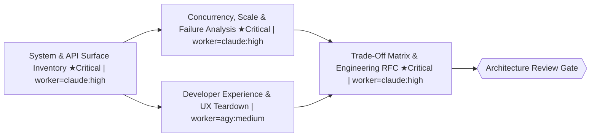

## Tree Metadata
- tree_type: research
- governor_session_id: <governor-session-id>
- workspace_isolation: shared
- max_concurrency: 2
- watchdog_timeout_minutes: 10
- max_budget_usd: 5

## Auto-Partitioned Managers
### [Segment: R1]
- engine: claude-code
- thinking: medium

### [Segment: R2]
- engine: claude-code
- thinking: medium

### [Segment: R3]
- engine: claude-code
- thinking: medium

### [Segment: R4]
- engine: claude-code
- thinking: medium

## Nodes
### [R1] System & API Surface Inventory
- type: task
- critical: true
- employee: engine=claude-code, thinking=medium
- worker: engine=claude-code, thinking=high
- files: docs/rfc/01-surface-inventory.md
- verify: test -s docs/rfc/01-surface-inventory.md
- goal: |
    Map module architecture, IPC/RPC boundaries, state ownership, and external extension points with concrete file references.
- acceptance: |
    1. Architecture diagram matches actual code;
    2. All major bottlenecks and invariants identified.

### [R2] Concurrency, Scale & Failure Analysis
- type: task
- critical: true
- employee: engine=claude-code, thinking=medium
- worker: engine=claude-code, thinking=high
- files: docs/rfc/02-scale-and-failure.md
- verify: test -s docs/rfc/02-scale-and-failure.md
- goal: |
    Analyze scalability limits, failure domains, latency hot paths, and cross-platform edge cases.
- acceptance: |
    1. Concrete failure modes and complexity bounds documented;
    2. Ranked mitigation options provided.

### [R3] Developer Experience & UX Teardown
- type: task
- critical: false
- employee: engine=claude-code, thinking=medium
- worker: engine=antigravity, thinking=medium
- files: docs/rfc/03-dx-ux-teardown.md
- verify: test -s docs/rfc/03-dx-ux-teardown.md
- goal: |
    Evaluate onboarding friction, workflow ergonomics, visual clarity, and competitive differentiation.
- acceptance: |
    1. Friction points prioritized by user impact;
    2. Concrete UX improvements specified.

### [R4] Trade-Off Matrix & Engineering RFC
- type: task
- critical: true
- employee: engine=claude-code, thinking=medium
- worker: engine=claude-code, thinking=high
- files: docs/rfc/RFC-architecture.md
- verify: test -s docs/rfc/RFC-architecture.md
- goal: |
    Compile R1–R3 into a concise Engineering RFC with decision matrix, rollout phases, and measurable success metrics.
- acceptance: |
    1. RFC addresses alternatives, risks, and migration strategy;
    2. Ready for team review and Engineering DAG execution.

### [U1] Architecture Review Gate
- type: user_gate
- description: |
    Approve the final RFC or roll back a track for deeper analysis.
