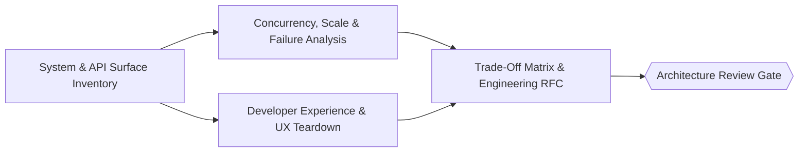

# Architecture Teardown & Engineering RFC (Dual-View Blueprint)

Parallel systems and UX teardown workflow combining an acyclic **Mission Task DAG** (`R1 → (R2 ∥ R3) → R4 → U1`) with a cyclic **Orchestration Team** (`Architect [L1]`, `Systems [L2]`, `UX [L2]`, `Reviewer [L3]`) sharing architecture inventory on whiteboard `WB_RFC`.

## Mission Task DAG



## Orchestration Team

```mermaid
flowchart LR
  Architect["Lead Architect @Architect (L1)"] <--> Systems
  Architect <--> UX
  subgraph Systems["Systems"]
    Systems["Systems Lead @Systems (L2)"] <--> Reviewer["Peer Reviewer @Reviewer (L3)"]
  end
  subgraph Experience["Experience"]
    UX["UX Lead @UX (L2)"]
  end
  UX <--> Reviewer
  WB_RFC[("Whiteboard: Module & Boundary Map")]
  Architect -.-> WB_RFC
  Systems -.-> WB_RFC
  UX -.-> WB_RFC
  Reviewer -.-> WB_RFC
  %% staff Architect [role=L1, dept=Executive, paths="docs/rfc/inventory/**|docs/rfc/RFC.md"]
  %% staff Systems [role=L2, dept=Systems, paths="docs/rfc/systems/**"]
  %% staff UX [role=L2, dept=Experience, paths="docs/rfc/ux/**"]
  %% staff Reviewer [role=L3, dept=Systems, paths="docs/rfc/**"]
  %% whiteboard WB_RFC [dept=General, title="Module & Boundary Map"]
```

## Task Specifications

Apply both views and task specs in one command via `aexus-ade mission blueprint apply --mission <id> --file ./examples/blueprints/arch-teardown.md`, then start via `aexus-ade orchestration dispatch` or direct chat to `Architect (L1)`:

### R1
Map module architecture, IPC/RPC boundaries, state ownership, and extension points under `docs/rfc/inventory/`. Publish core invariants onto `WB_RFC`, mark `R1` completed (`aexus-ade mission task complete --node R1`), and split `R2` (`scopePaths: ["docs/rfc/systems/**"]`) + `R3` (`scopePaths: ["docs/rfc/ux/**"]`) via `aexus-ade token split --wait-join --conflict-policy reject --branches-json - <<'EOF'`, stopping your turn immediately.

### R2
Inspect `WB_RFC` (`aexus-ade whiteboard read WB_RFC --toc` / `--section "Boundaries"`), analyze scalability limits, failure domains, latency hot paths, and cross-platform edge cases under `docs/rfc/systems/`, peer-review with `Reviewer (L3)` via `token handoff`/`token reject --category spec`, then return atomically via `aexus-ade token return <tokenId> --complete-task --files "docs/rfc/systems/analysis.md" --summary "Systems & concurrency teardown complete"`.

### R3
Evaluate onboarding friction, workflow ergonomics, visual clarity, and competitive trade-offs under `docs/rfc/ux/`. Return atomically via `aexus-ade token return <tokenId> --complete-task --files "docs/rfc/ux/teardown.md" --summary "Developer experience & UX teardown complete"`.

### R4
`Architect (L1)` compiles `R1`–`R3` into a decision-ready Engineering RFC at `docs/rfc/RFC.md` with trade-off matrix, phased rollout plan, risk mitigations, and success metrics, then marks `R4` completed (`aexus-ade mission task complete --node R4`).

### U1
Human Acceptance Gate (`kind=gate`): `Architect (L1)` notifies the Human User (`L-1`) via `inbox post` / chat so the User reviews `docs/rfc/RFC.md` and approves `U1` (`aexus-ade mission task complete --mission <id> --node U1`), after which `Architect` closes the wave with `aexus-ade token complete <rootTokenId> --finish --summary "Engineering RFC approved"`.
