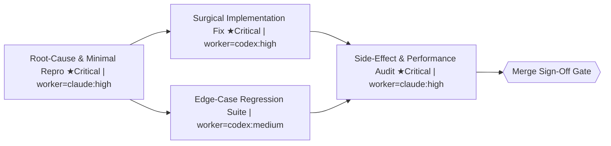

## Tree Metadata
- tree_type: engineering
- governor_session_id: <governor-session-id>
- workspace_isolation: shared
- max_concurrency: 2
- watchdog_timeout_minutes: 10
- max_budget_usd: 4

## Auto-Partitioned Managers
### [Segment: N1]
- engine: claude-code
- thinking: medium

### [Segment: N2]
- engine: claude-code
- thinking: medium

### [Segment: N3]
- engine: claude-code
- thinking: medium

### [Segment: N4]
- engine: claude-code
- thinking: medium

## Nodes
### [N1] Root-Cause & Minimal Repro
- type: task
- critical: true
- employee: engine=claude-code, thinking=medium
- worker: engine=claude-code, thinking=high
- files: test/repro/**, docs/triage/**
- verify: npm test -- --grep repro
- goal: |
    Isolate the exact failing code path, prove root cause with a minimal failing reproduction test, and document fix scope.
- acceptance: |
    1. Minimal repro deterministically demonstrates the failure;
    2. Root cause cites exact file paths and state transitions.

### [N2] Surgical Implementation Fix
- type: task
- critical: true
- employee: engine=claude-code, thinking=medium
- worker: engine=codex, thinking=high
- files: src/**
- verify: npm run typecheck && npm run lint
- goal: |
    Apply the cleanest minimal fix for the confirmed root cause without refactoring unrelated modules.
- acceptance: |
    1. The N1 reproduction passes cleanly;
    2. Diff is minimal, idiomatic, and free of lint/type regressions.

### [N3] Edge-Case Regression Suite
- type: task
- critical: false
- employee: engine=claude-code, thinking=medium
- worker: engine=codex, thinking=medium
- files: test/regression/**, tests/**
- verify: npm test
- goal: |
    Add targeted unit/integration tests covering boundary conditions and adjacent sibling paths to prevent regressions.
- acceptance: |
    1. Regression tests fail before N2 and pass after N2;
    2. Full module test suite runs cleanly.

### [N4] Side-Effect & Performance Audit
- type: task
- critical: true
- employee: engine=claude-code, thinking=medium
- worker: engine=claude-code, thinking=high
- files: src/**, test/**
- verify: npm run typecheck && npm run lint && npm test
- goal: |
    Audit the combined diff for memory leaks, race conditions, error handling, and performance impact.
- acceptance: |
    1. Zero unhandled rejections, leaks, or performance regressions;
    2. Build and test checks verified end-to-end.

### [U1] Merge Sign-Off Gate
- type: user_gate
- description: |
    Inspect root-cause evidence, surgical diff, and audit report before shipping.
