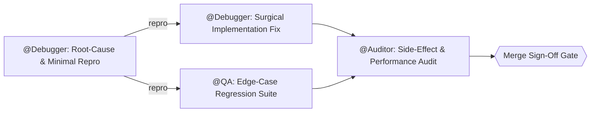

# Bug Hunt & Surgical Fix

Repro-first root-cause debugging pipeline: isolate a minimal deterministic reproduction, apply a surgical fix in parallel with a comprehensive edge-case regression suite, audit side effects, and sign off at Gate `U1`.

## Node Pre-Prompts

Apply the Mermaid DAG with `aexus-ade mission blueprint apply --mission <id> --file ./examples/blueprints/bug-hunt-fix.md`, then bind each node's pre-prompt via the Canvas / Split Drawer or `aexus-ade mission prompt set`:

### N1
Isolate the exact failing code path, prove the root cause with a minimal failing reproduction test (`test/repro/**`), and cite exact file paths and state transitions in your token summary.

### N2
Apply the cleanest minimal fix for the confirmed `N1` root cause without refactoring unrelated modules (`src/**`). Verify the `N1` reproduction passes cleanly with zero lint or type regressions before completing the token.

### N3
Add targeted unit and integration regression tests covering boundary conditions and adjacent sibling code paths (`test/regression/**`). Confirm full module tests run deterministically before completing the token.

### N4
Audit the combined diff from `N2` and `N3` for memory leaks, race conditions, error-handling gaps, and performance regressions. Run lint and full test checks end-to-end before completing the token.

### U1
Human Acceptance Gate: inspect root-cause evidence, surgical diff, and audit summary before merging or rolling back.
