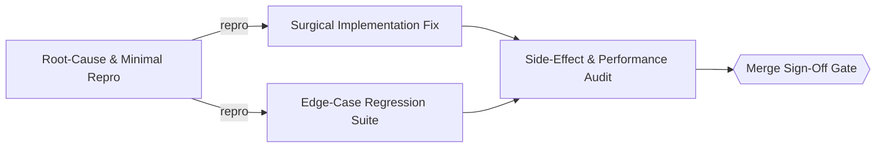
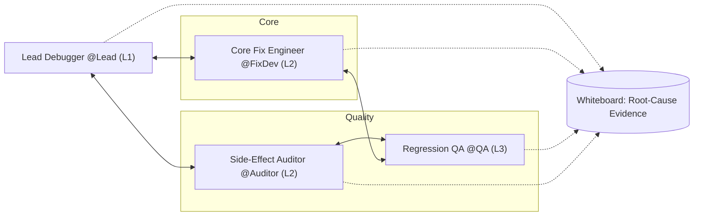

# Bug Hunt & Surgical Fix (Dual-View Blueprint)

Repro-first root-cause debugging pipeline combining an acyclic **Mission Task DAG** (`T1 → (T2 ∥ T3) → T4 → U1`) with a cyclic **Orchestration Team** (`LeadDebugger [L1]`, `FixDev [L2]`, `QA [L3]`, `Auditor [L2]`) sharing root-cause evidence on whiteboard `WB_REPRO`.

## Mission Task DAG

## Orchestration Team

## Task Specifications

Apply both views and task specs in one command via `aexus-ade mission blueprint apply --mission <id> --file ./examples/blueprints/bug-hunt-fix.md`, then start via `aexus-ade orchestration dispatch` or direct chat to `LeadDebugger (L1)`:

### T1
Isolate the exact failing code path, prove the root cause with a minimal failing reproduction test (`test/repro/**`), publish structured evidence to `WB_REPRO`, mark `T1` completed (`aexus-ade mission task complete --node T1`), and split `T2` (`FixDev`, `scopePaths: ["src/**"]`) + `T3` (`Auditor`, `scopePaths: ["test/regression/**"]`, who delegates/reviews edge cases with `QA`) via `aexus-ade token split --wait-join --conflict-policy reject --branches-json - <<'EOF'`, stopping your turn immediately.

### T2
Inspect `WB_REPRO` (`aexus-ade whiteboard read WB_REPRO --toc`) and apply the cleanest minimal fix for the confirmed `T1` root cause without refactoring unrelated modules (`src/**`). Verify the `T1` reproduction passes with zero lint/type regressions and return via `aexus-ade token return <tokenId> --complete-task --files "src/fix.ts" --summary "Minimal fix verified"`.

### T3
Add targeted unit and integration regression tests covering boundary conditions and adjacent sibling paths (`test/regression/**`). Confirm deterministic execution and return via `aexus-ade token return <tokenId> --files "test/regression/edge.test.ts" --summary "Edge-case regression suite green"` (signed off by `Auditor` / `LeadDebugger`).

### T4
`Auditor (L2)` audits the combined diff from `T2` and `T3` for leaks, races, and performance regressions — bouncing defects via `aexus-ade token reject --category defect` if found, or returning via `aexus-ade token return <tokenId> --complete-task --summary "Zero side-effects; full suite green"`.

### U1
Human Acceptance Gate (`kind=gate`): `LeadDebugger (L1)` posts the verified root-cause + fix summary to the User (`aexus-ade inbox post` / chat) so the Human User (`L-1`) approves `U1` (`aexus-ade mission task complete --mission <id> --node U1`), after which `LeadDebugger` closes the wave with `aexus-ade token complete <rootTokenId> --finish --summary "Bug fix signed off"`.
