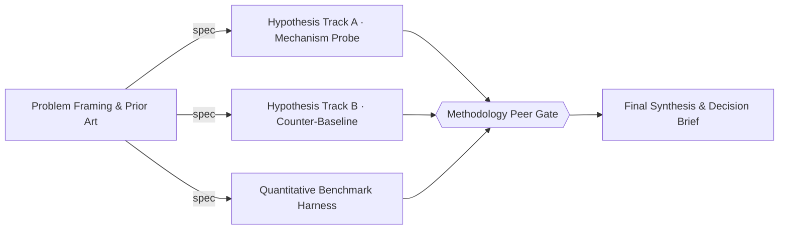
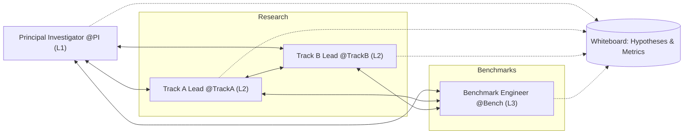

# Deep Research Lab (Dual-View Blueprint)

Multi-track scientific & systems research workflow combining an acyclic **Mission Task DAG** (`R1 → (R2 ∥ R3 ∥ R4) → U1 → R5`) with a cyclic **Orchestration Team** (`PI [L1]`, `TrackA [L2]`, `TrackB [L2]`, `Bench [L3]`) sharing experimental protocols on whiteboard `WB_LAB`.

## Mission Task DAG

## Orchestration Team

## Task Specifications

Apply both views and task specs in one command via `aexus-ade mission blueprint apply --mission <id> --file ./examples/blueprints/deep-research-lab.md`, then start via `aexus-ade orchestration dispatch` or direct chat to `PI (L1)`:

### R1
Survey primary sources, prior benchmarks, and open failure modes under `research/framing/`. Publish falsifiable hypotheses and quantitative metrics on `WB_LAB`, mark `R1` completed (`aexus-ade mission task complete --node R1`), and fan out `R2`, `R3`, and `R4` with disjoint `scopePaths` via `aexus-ade token split --wait-join --conflict-policy reject --branches-json - <<'EOF'`, stopping your turn immediately.

### R2
Read the protocol TOC (`aexus-ade whiteboard read WB_LAB --toc` / `--section "Hypotheses"`), investigate primary Hypothesis A via controlled prototype or analytical proof under `research/track-a/`, attach reproducible observations via `--artifact`, and return atomically via `aexus-ade token return <tokenId> --complete-task --files "research/track-a/results.md" --summary "Track A mechanism probe complete"`.

### R3
Evaluate competing Hypothesis B under identical constraints under `research/track-b/` to prevent confirmation bias. Document apples-to-apples comparisons and return atomically via `aexus-ade token return <tokenId> --complete-task --files "research/track-b/results.md" --summary "Track B counter-baseline complete"`.

### R4
Build and run a repeatable benchmark harness under `research/benchmarks/` measuring latency, throughput, accuracy, and cost variance (using `aexus-ade token block <tokenId> --duration 2h --reason "Running GPU benchmark" --watch-pid <pid>` for long runs). Return results via `aexus-ade token return <tokenId> --summary "Benchmark metrics recorded"` for `PI` sign-off on `R4`.

### U1
Human Acceptance Gate (`kind=gate`, requires Human `L-1` or Secretary `L0` approval): `PI (L1)` summarizes `R2`–`R4` metrics and awaits Human approval on `U1` (`aexus-ade mission task complete --mission <id> --node U1`) before final synthesis.

### R5
Once `U1` is approved, `PI (L1)` synthesizes verified findings from `R1`–`R4` under `research/report/` into an actionable decision brief and closes `R5` + the root wave via `aexus-ade token complete <rootTokenId> --finish --complete-task --task R5 --summary "Research synthesis published"`.
