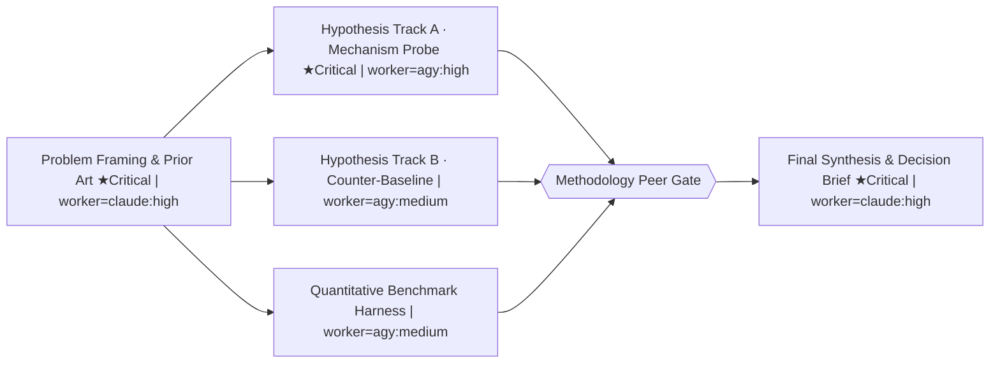

## Tree Metadata
- tree_type: research
- governor_session_id: <governor-session-id>
- workspace_isolation: shared
- watchdog_timeout_minutes: 10
- max_budget_usd: 6
- max_concurrency: 3
- verify: git status --short

## Auto-Partitioned Managers
### [Segment: R1]
- engine: claude-code
- thinking: medium

### [Segment: R2]
- engine: claude-code
- thinking: medium

### [Segment: R3]
- engine: claude-code
- thinking: medium

### [Segment: R4]
- engine: claude-code
- thinking: medium

### [Segment: R5]
- engine: claude-code
- thinking: medium

## Nodes
### [R1] Problem Framing & Prior Art
- type: task
- critical: true
- employee: engine=claude-code, thinking=medium
- worker: engine=claude-code, thinking=high
- files: research/framing/**
- verify: test -d research
- goal: |
    Survey primary sources, prior benchmarks, and open failure modes; establish explicit hypotheses and evaluation metrics.
- acceptance: |
    1. All claims cite primary sources or exact codebase evidence;
    2. Falsifiable hypotheses and quantitative metrics are defined.

### [R2] Hypothesis Track A · Mechanism Probe
- type: task
- critical: true
- employee: engine=claude-code, thinking=medium
- worker: engine=antigravity, thinking=high
- files: research/track-a/**
- verify: test -d research/track-a
- goal: |
    Investigate primary hypothesis A via controlled prototype or analytical proof and record quantitative observations.
- acceptance: |
    1. Controlled experiment / analysis is reproducible;
    2. Limitations and confounding variables are explicitly reported.

### [R3] Hypothesis Track B · Counter-Baseline
- type: task
- critical: false
- employee: engine=claude-code, thinking=medium
- worker: engine=antigravity, thinking=medium
- files: research/track-b/**
- verify: test -d research/track-b
- goal: |
    Evaluate competing approach B under identical constraints to prevent confirmation bias.
- acceptance: |
    1. Apples-to-apples comparison against identical baseline;
    2. Clear failure cases and trade-offs documented.

### [R4] Quantitative Benchmark Harness
- type: task
- critical: false
- employee: engine=claude-code, thinking=medium
- worker: engine=antigravity, thinking=medium
- files: research/benchmarks/**
- verify: test -d research/benchmarks
- goal: |
    Build and run a repeatable benchmark measuring latency, throughput, accuracy, and token/resource cost.
- acceptance: |
    1. Raw benchmark numbers & variance recorded;
    2. Script executes cleanly from a single command.

### [U1] Methodology Peer Gate
- type: user_gate
- description: |
    Audit experimental methodology, statistical rigor, and upstream peer reports before writing final conclusions.

### [R5] Final Synthesis & Decision Brief
- type: task
- critical: true
- employee: engine=claude-code, thinking=medium
- worker: engine=claude-code, thinking=high
- files: research/report/**
- verify: test -d research/report
- goal: |
    Synthesize verified findings into an actionable technical report with recommendation matrix, charts/tables, and next steps.
- acceptance: |
    1. Every conclusion traces directly to verified upstream evidence;
    2. Executive summary and concrete recommendations are crystal clear.
