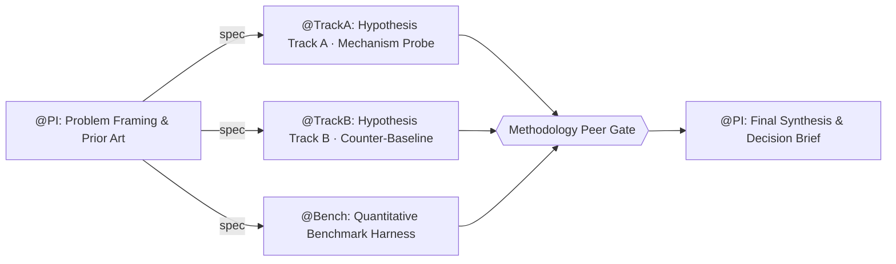

# Deep Research Lab

Multi-track scientific & systems research workflow: frame falsifiable hypotheses and evaluation metrics, run competing hypothesis ablations alongside a reproducible benchmark harness, pass Methodology Peer Gate (`U1`), and synthesize a decision brief reusing `@PI` context.

## Node Pre-Prompts

Apply the Mermaid DAG with `aexus-ade mission blueprint apply --mission <id> --file ./examples/blueprints/deep-research-lab.md`, then bind each node's pre-prompt via the Canvas / Split Drawer or `aexus-ade mission prompt set`:

### R1
Survey primary sources, prior benchmarks, and open failure modes under `research/framing/`. Define explicit falsifiable hypotheses and quantitative evaluation metrics before completing the token.

### R2
Investigate primary Hypothesis A via controlled prototype or analytical proof under `research/track-a/`. Record reproducible observations, limitations, and confounding variables.

### R3
Evaluate competing Hypothesis B under identical constraints under `research/track-b/` to prevent confirmation bias. Document apples-to-apples comparisons, failure cases, and trade-offs.

### R4
Build and run a repeatable single-command benchmark harness under `research/benchmarks/` measuring latency, throughput, accuracy, and resource cost with raw numbers and variance recorded.

### U1
Human Acceptance Gate: audit experimental methodology, statistical rigor, and upstream track reports before authoring final conclusions.

### R5
Synthesize verified findings from `R1`–`R4` under `research/report/` into an actionable decision brief with comparison tables, traced evidence links, and concrete next steps.
