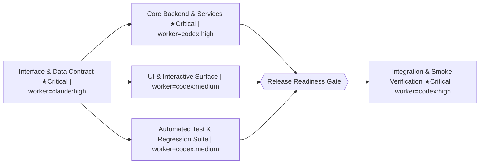

## Tree Metadata
- tree_type: engineering
- governor_session_id: <governor-session-id>
- workspace_isolation: worktree
- watchdog_timeout_minutes: 10
- max_budget_usd: 8
- max_concurrency: 3
- verify: npm test

## Auto-Partitioned Managers
### [Segment: N1]
- engine: claude-code
- thinking: medium

### [Segment: N2]
- engine: claude-code
- thinking: medium

### [Segment: N3]
- engine: claude-code
- thinking: medium

### [Segment: N4]
- engine: claude-code
- thinking: medium

### [Segment: N5]
- engine: claude-code
- thinking: medium

## Nodes
### [N1] Interface & Data Contract
- type: task
- critical: true
- employee: engine=claude-code, thinking=medium
- worker: engine=claude-code, thinking=high
- files: src/contracts/**, src/types/**
- verify: npm run typecheck
- goal: |
    Define shared TypeScript/API schemas, interface contracts, and file-ownership boundaries so parallel tracks execute with zero merge conflicts.
- acceptance: |
    1. Public types and contracts compile cleanly with zero warnings;
    2. Downstream file ownership boundaries are explicitly documented.

### [N2] Core Backend & Services
- type: task
- critical: true
- employee: engine=claude-code, thinking=medium
- worker: engine=codex, thinking=high
- files: src/services/**, src/server/**
- verify: npm test -- services
- goal: |
    Implement business logic, persistence, and error handling strictly adhering to the N1 contract.
- acceptance: |
    1. Core service unit tests pass with edge-case coverage;
    2. No unintended edits outside backend module boundaries.

### [N3] UI & Interactive Surface
- type: task
- critical: false
- employee: engine=claude-code, thinking=medium
- worker: engine=codex, thinking=medium
- files: src/ui/**, src/components/**
- verify: npm run build
- goal: |
    Build responsive dark/light/high-contrast UI components wired to the N1 interface contract with keyboard accessibility.
- acceptance: |
    1. UI renders cleanly without overflow or clipping;
    2. Keyboard navigation and focus states work end-to-end.

### [N4] Automated Test & Regression Suite
- type: task
- critical: false
- employee: engine=claude-code, thinking=medium
- worker: engine=codex, thinking=medium
- files: test/**, tests/**
- verify: npm test
- goal: |
    Author comprehensive unit and integration tests covering happy paths, concurrency, and failure recovery.
- acceptance: |
    1. New tests run deterministically with zero flakiness;
    2. Both positive and failure paths are asserted.

### [U1] Release Readiness Gate
- type: user_gate
- description: |
    Review all 3 upstream Employee acceptance reports & worktree diffs before final integration and merge.

### [N5] Integration & Smoke Verification
- type: task
- critical: true
- employee: engine=claude-code, thinking=medium
- worker: engine=codex, thinking=high
- files: src/**, test/**
- verify: npm run lint && npm test
- goal: |
    Verify cross-track integration after merge, run full typecheck, lint, and smoke tests, and summarize release readiness.
- acceptance: |
    1. Full build, lint, and test suite pass with zero errors;
    2. Release summary documents verified behavior and metrics.
