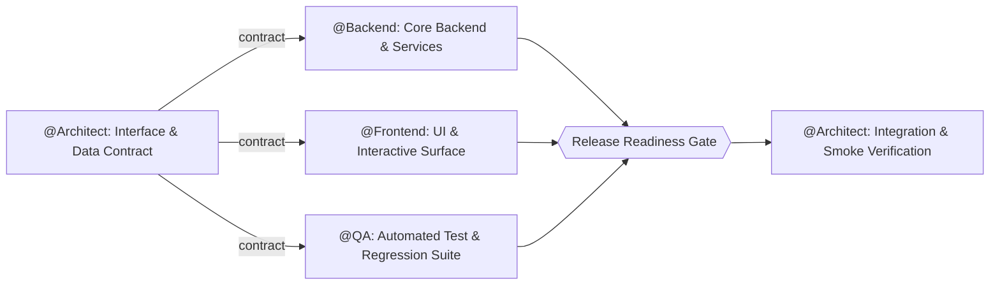

# Feature Ship · Full-Stack Parallel Delivery

Contract-first feature delivery with parallel Backend, UI, and QA tracks, an explicit Human Release Gate (`U1`), and final integration verification reusing the `@Architect` context.

## Node Pre-Prompts

Apply the Mermaid DAG with `aexus-ade mission blueprint apply --mission <id> --file ./examples/blueprints/feature-ship.md`, then bind each node's pre-prompt via the Canvas / Split Drawer or `aexus-ade mission prompt set`:

### N1
Define shared TypeScript/API schemas, interface contracts, and explicit file-ownership boundaries (`src/contracts/**`, `src/types/**`) so parallel tracks `N2`, `N3`, and `N4` execute with zero merge conflicts. Run typecheck before calling `aexus-ade token complete`.

### N2
Implement business logic, persistence, and error handling strictly adhering to the `N1` contract (`src/services/**`, `src/server/**`). Add unit tests covering edge cases and ensure no unintended edits outside backend module boundaries before completing the token.

### N3
Build responsive Dark / Light / High-Contrast UI components wired to the `N1` interface contract (`src/ui/**`, `src/components/**`) with keyboard accessibility. Verify clean build output and zero layout overflow before completing the token.

### N4
Author deterministic unit and integration tests covering happy paths, concurrency, and failure recovery (`test/**`, `tests/**`). Verify both positive and negative assertions pass cleanly before completing the token.

### U1
Human Acceptance Gate: review upstream summaries and diffs from `N2`, `N3`, and `N4`. Approve to trigger `N5`, or reject with `--rollback <nodeId>` and feedback to send targeted work back upstream.

### N5
Verify cross-track integration across `N2`–`N4`, run full typecheck, lint, and test suites end-to-end, and publish a concise release readiness summary before completing the final token.
