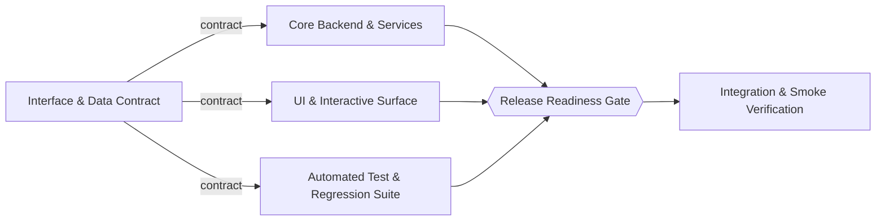

# Feature Ship · Full-Stack Parallel Delivery (Dual-View Blueprint)

Contract-first full-stack delivery combining a strictly acyclic **Mission Task DAG** (`T1 → (T2 ∥ T3 ∥ T4) → U1 → T5`) with a persistent cyclic **Orchestration Team** (`Architect [L1]`, `Backend [L2]`, `Frontend [L2]`, `QA [L3]`) sharing `WB_CONTRACT` via pointer-only `otok-*` baton tokens.

## Mission Task DAG



## Orchestration Team

```mermaid
flowchart LR
  Architect["Architect @Lead (L1)"] <--> Backend
  Architect <--> Frontend
  Architect <--> QA
  subgraph Backend["Backend"]
    Backend["Backend Lead @Backend (L2)"]
  end
  subgraph Frontend["Frontend"]
    Frontend["Frontend Lead @Frontend (L2)"]
  end
  subgraph Quality["Quality"]
    QA["QA Engineer @QA (L3)"]
  end
  Backend <--> QA
  Frontend <--> QA
  WB_CONTRACT[("Whiteboard: Shared API Contract")]
  Architect -.-> WB_CONTRACT
  Backend -.-> WB_CONTRACT
  Frontend -.-> WB_CONTRACT
  QA -.-> WB_CONTRACT
  %% staff Architect [role=L1, dept=Executive, paths="src/contracts/**|src/types/**"]
  %% staff Backend [role=L2, dept=Backend, paths="src/services/**|src/server/**"]
  %% staff Frontend [role=L2, dept=Frontend, paths="src/ui/**|src/components/**"]
  %% staff QA [role=L3, dept=Quality, paths="test/**|tests/**"]
  %% whiteboard WB_CONTRACT [dept=General, title="Shared API Contract"]
```

## Task Specifications

Apply both the Mission Task DAG, Orchestration Team, and task specs in one command via `aexus-ade mission blueprint apply --mission <id> --file ./examples/blueprints/feature-ship.md`, then start via `aexus-ade orchestration dispatch` or direct chat to `Architect (L1)`:

### T1
Define shared TypeScript/API schemas and explicit file-ownership boundaries (`src/contracts/**`, `src/types/**`), write structured sections to `WB_CONTRACT` (`aexus-ade whiteboard write WB_CONTRACT --content - <<'EOF'`), mark `T1` completed (`aexus-ade mission task complete --node T1`), and fan out `T2`, `T3`, and `T4` via shell-safe stdin `aexus-ade token split --wait-join --conflict-policy reject --branches-json - <<'EOF'` (binding `taskNodeId`, disjoint `scopePaths`, and `whiteboardIds: ["WB_CONTRACT"]`), then **stop your turn immediately**.

### T2
Read only the needed contract section (`aexus-ade whiteboard read WB_CONTRACT --toc` / `--section "Backend"`), implement business logic, persistence, and error handling strictly within `src/services/**` & `src/server/**`. Run unit tests and return atomically via `aexus-ade token return <tokenId> --complete-task --files "src/services/index.ts" --summary "Backend services & unit tests green"`.

### T3
Read the UI contract slice (`aexus-ade whiteboard read WB_CONTRACT --section "UI"`), build responsive Dark / Light / High-Contrast UI components (`src/ui/**`, `src/components/**`) with keyboard accessibility, verify clean build output, and return atomically via `aexus-ade token return <tokenId> --complete-task --files "src/ui/index.tsx" --summary "UI surface built & verified"`.

### T4
Author deterministic unit and integration tests covering happy paths, concurrency, and failure recovery (`test/**`, `tests/**`). Use `aexus-ade token handoff` or `aexus-ade token reject --category test` for `<-->` peer review loops with `Backend`/`Frontend`, then return via `aexus-ade token return <tokenId> --files "test/integration.test.ts" --summary "Regression suite passing"` for `L1`/`L2` sign-off on `T4`.

### U1
Human Acceptance Gate (`kind=gate`, requires Human `L-1` or delegated Secretary `L0` sign-off): once `T2`–`T4` are completed, `Architect (L1)` posts a concise readiness summary (`aexus-ade inbox post` or direct User reply) and pauses for the User to approve `U1` in the Mission Canvas or via `aexus-ade mission task complete --mission <id> --node U1 --note "Approved"`.

### T5
After `U1` is approved, `Architect (L1)` runs full end-to-end typecheck, lint, and smoke verification across `T2`–`T4` and closes both `T5` and the root wave via `aexus-ade token complete <rootTokenId> --finish --complete-task --task T5 --summary "Feature shipped & verified"`.
