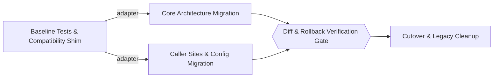
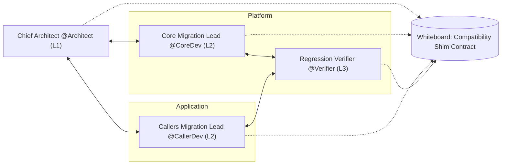

# Safe Architecture Migration (Dual-View Blueprint)

Zero-downtime refactoring workflow combining an acyclic **Mission Task DAG** (`T1 → (T2 ∥ T3) → U1 → T4`) with a cyclic **Orchestration Team** (`Architect [L1]`, `CoreDev [L2]`, `CallerDev [L2]`, `Verifier [L3]`) coordinated over whiteboard `WB_MIGRATION`.

## Mission Task DAG

## Orchestration Team

## Task Specifications

Apply both views and task specs in one command via `aexus-ade mission blueprint apply --mission <id> --file ./examples/blueprints/safe-migration.md`, then start via `aexus-ade orchestration dispatch` or direct chat to `Architect (L1)`:

### T1
Lock existing behavior with characterization tests (`test/baseline/**`), introduce clean compatibility adapter shims (`src/compat/**`), publish the adapter contract on `WB_MIGRATION`, snapshot a rollback point via `aexus-ade mission checkpoint create --mission <id> --label "pre-migration"`, mark `T1` completed (`aexus-ade mission task complete --node T1`), and split `T2` (`scopePaths: ["src/core/**"]`) + `T3` (`scopePaths: ["src/callers/**", "config/**"]`) via `aexus-ade token split --wait-join --conflict-policy reject --branches-json - <<'EOF'`, stopping your turn immediately.

### T2
Read the shim spec (`aexus-ade whiteboard read WB_MIGRATION --section "Adapter"`), implement the refactored core behind the `T1` adapter boundary (`src/core/**`), verify with `Verifier (L3)` via `token handoff`/`token reject --category defect` if needed, and return atomically via `aexus-ade token return <tokenId> --complete-task --files "src/core/index.ts" --summary "Refactored core verified with zero API breaks"`.

### T3
Migrate downstream call sites, configuration bindings, and docs (`src/callers/**`, `config/**`) to target the refactored interfaces. Confirm typecheck passes cleanly and return atomically via `aexus-ade token return <tokenId> --complete-task --files "src/callers/index.ts" --summary "All callers migrated & typechecked"`.

### U1
Human Acceptance Gate (`kind=gate`, requires Human `L-1` or Secretary `L0` approval): `Architect (L1)` posts migration diff & rollback verification notes to Inbox/chat and waits for Human approval on `U1` (`aexus-ade mission task complete --mission <id> --node U1`) before deleting legacy shims.

### T4
Once `U1` is approved, `Architect (L1)` removes obsolete compatibility shims and dead code, runs full lint, typecheck, build, and test suites with zero warnings, and closes `T4` + the root wave via `aexus-ade token complete <rootTokenId> --finish --complete-task --task T4 --summary "Cutover & legacy cleanup complete"`.
