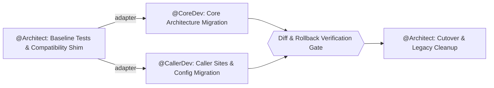

# Safe Architecture Migration

Zero-downtime refactoring workflow: lock baseline behavior with characterization tests and compatibility shims, migrate core internals and downstream call sites in parallel, verify rollback readiness at Gate `U1`, then clean up legacy code.

## Node Pre-Prompts

Apply the Mermaid DAG with `aexus-ade mission blueprint apply --mission <id> --file ./examples/blueprints/safe-migration.md`, then bind each node's pre-prompt via the Canvas / Split Drawer or `aexus-ade mission prompt set`:

### N1
Lock existing behavior with characterization tests (`test/baseline/**`) and introduce clean compatibility adapter shims (`src/compat/**`) enabling incremental cutover. Confirm baseline tests pass before completing the token.

### N2
Implement the target refactored core behind the `N1` adapter boundary (`src/core/**`) with strict typing and unit test coverage. Ensure zero breaking public API regressions before completing the token.

### N3
Update downstream call sites, configuration bindings, and documentation (`src/callers/**`, `config/**`) to target the refactored interfaces. Confirm zero deprecated references remain and typecheck passes cleanly.

### U1
Human Acceptance Gate: audit migration diffs and confirm the rollback path before deleting legacy compatibility shims.

### N4
Remove obsolete compatibility shims and dead code, run the full lint, typecheck, build, and test suite with zero warnings, and summarize the completed cutover.
