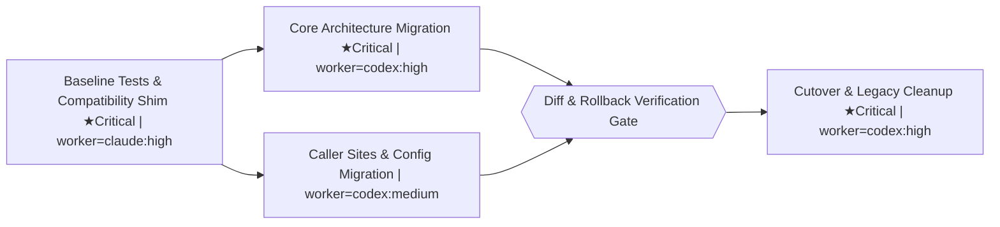

## Tree Metadata
- tree_type: engineering
- governor_session_id: <governor-session-id>
- workspace_isolation: worktree
- watchdog_timeout_minutes: 10
- max_budget_usd: 7

## Auto-Partitioned Managers
### [Segment: N1]
- engine: claude-code
- thinking: medium

### [Segment: N2]
- engine: claude-code
- thinking: medium

### [Segment: N3]
- engine: claude-code
- thinking: medium

### [Segment: N4]
- engine: claude-code
- thinking: medium

## Nodes
### [N1] Baseline Tests & Compatibility Shim
- type: task
- critical: true
- employee: engine=claude-code, thinking=medium
- worker: engine=claude-code, thinking=high
- goal: |
    Lock existing behavior with characterization tests and introduce clean adapter shims for incremental cutover.
- acceptance: |
    1. Baseline tests pass before any refactoring begins;
    2. Compatibility adapter compiles cleanly.

### [N2] Core Architecture Migration
- type: task
- critical: true
- employee: engine=claude-code, thinking=medium
- worker: engine=codex, thinking=high
- goal: |
    Implement the target refactored core behind the N1 adapter boundary with strict typing and unit tests.
- acceptance: |
    1. New implementation passes all baseline + new unit tests;
    2. Zero breaking public API changes.

### [N3] Caller Sites & Config Migration
- type: task
- critical: false
- employee: engine=claude-code, thinking=medium
- worker: engine=codex, thinking=medium
- goal: |
    Update downstream call sites, configuration bindings, and documentation to target the refactored interfaces.
- acceptance: |
    1. Zero deprecated references remaining in active modules;
    2. Static typecheck passes cleanly.

### [U1] Diff & Rollback Verification Gate
- type: user_gate
- description: |
    Audit migration diffs and confirm rollback path before removing legacy compatibility shims.

### [N4] Cutover & Legacy Cleanup
- type: task
- critical: true
- employee: engine=claude-code, thinking=medium
- worker: engine=codex, thinking=high
- goal: |
    Remove obsolete shims, run full regression/build suite, and confirm zero dead code or orphaned imports.
- acceptance: |
    1. Full build and test suite green with zero warnings;
    2. Legacy code cleanly removed.
