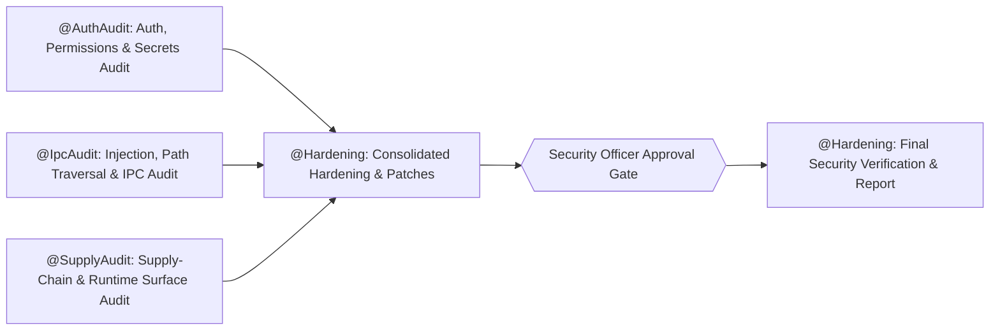

# Security Audit Swarm

Three-track parallel security review covering authentication/secrets, injection/IPC boundaries, and supply-chain/runtime posture — converging into consolidated hardening patches, Security Officer approval (`U1`), and final verification.

## Node Pre-Prompts

Apply the Mermaid DAG with `aexus-ade mission blueprint apply --mission <id> --file ./examples/blueprints/security-audit-swarm.md`, then bind each node's pre-prompt via the Canvas / Split Drawer or `aexus-ade mission prompt set`:

### N1
Audit authentication flows, token storage, file permissions (`0600`), privilege boundaries, and secret leakage vectors. Record every finding with exact `file:line`, severity, and exploit path under `docs/audit/auth/`.

### N2
Inspect shell spawning, command/SQL injection, path traversal, deserialization, and IPC/socket input sanitization. Trace untrusted inputs from boundary to sink and propose concrete remediation patches under `docs/audit/ipc/`.

### N3
Review third-party dependencies, sandbox flags, CSP/webview boundaries, and log/error redaction across platforms. Document prioritized risk findings under `docs/audit/supply-chain/`.

### N4
Synthesize findings from `N1`–`N3`, apply minimal security patches (`src/**`), and add automated security regression tests (`test/security/**`) for every High/Critical issue without regressing existing behavior.

### U1
Human Acceptance Gate: review consolidated vulnerability findings, patches, and residual risk notes before final verification.

### N5
Re-run security regression tests, static analysis, lint, and full test suite, then publish a clean PR-ready security sign-off report mapping every finding to its verified fix.
