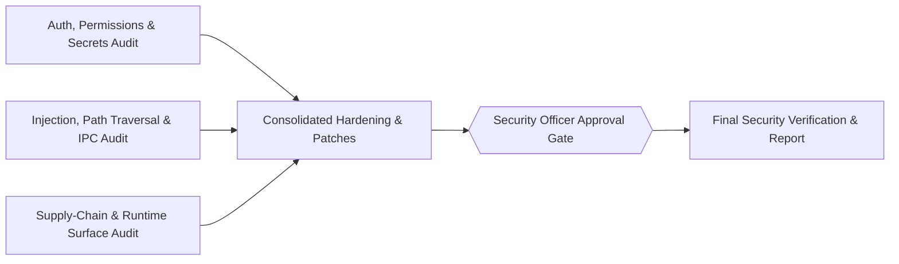
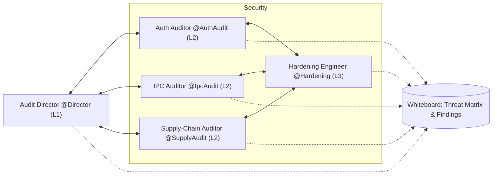

# Security Audit Swarm (Dual-View Blueprint)

Three-track parallel security review covering authentication/secrets, injection/IPC boundaries, and supply-chain/runtime posture — converging into consolidated hardening patches, Security Officer approval (`U1`), and final verification on a Dual-View Engineering workspace.

## Mission Task DAG

## Orchestration Team

## Task Specifications

Apply both views and task specs in one command via `aexus-ade mission blueprint apply --mission <id> --file ./examples/blueprints/security-audit-swarm.md`, then launch parallel audit tracks from `AuditLead (L1)` via `aexus-ade token split --wait-join --branches-json - <<'EOF'`:

### T1
Audit authentication flows, token storage, file permissions (`0600`), privilege boundaries, and secret leakage vectors. Record prioritized findings with exact `file:line` and exploit paths under `--section "Auth & Secrets"` on `WB_THREAT` (`aexus-ade whiteboard write WB_THREAT --section "Auth & Secrets" --content -`), then return atomically via `aexus-ade token return <tokenId> --complete-task --summary "Auth & secrets audit complete"`.

### T2
Inspect shell spawning, command/SQL injection, path traversal, deserialization, and IPC/socket input sanitization. Record findings under `--section "IPC & Injection"` on `WB_THREAT` and return atomically via `aexus-ade token return <tokenId> --complete-task --summary "IPC & injection audit complete"`.

### T3
Review third-party dependencies, sandbox flags, CSP/webview boundaries, and log/error redaction across platforms. Record findings under `--section "Supply Chain"` on `WB_THREAT` and return atomically via `aexus-ade token return <tokenId> --complete-task --summary "Supply-chain & runtime audit complete"`.

### T4
Synthesize findings from `T1`–`T3` (`aexus-ade whiteboard read WB_THREAT --toc` + targeted `--section` reads): `AuditLead (L1)` delegates `T4` via `AuthAudit (L2)` → `Hardening (L3)` to apply minimal hardening patches (`src/**`) and automated security regression tests (`test/security/**`) (using `token reject --category defect` for any incomplete fix), then marks `T4` completed once all High/Critical issues are closed.

### U1
Human Acceptance Gate (`kind=gate`, requires Human `L-1` or Secretary `L0` approval): `AuditLead (L1)` posts the consolidated threat & patch digest to Inbox/chat and awaits Human sign-off on `U1` (`aexus-ade mission task complete --mission <id> --node U1 --note "Security Officer approved"`).

### T5
After `U1` is approved, `AuditLead (L1)` re-runs full security regression tests, static analysis, and lint, then completes `T5` and closes the wave via `aexus-ade token complete <rootTokenId> --finish --complete-task --task T5 --summary "Security hardening verified & signed off"`.
