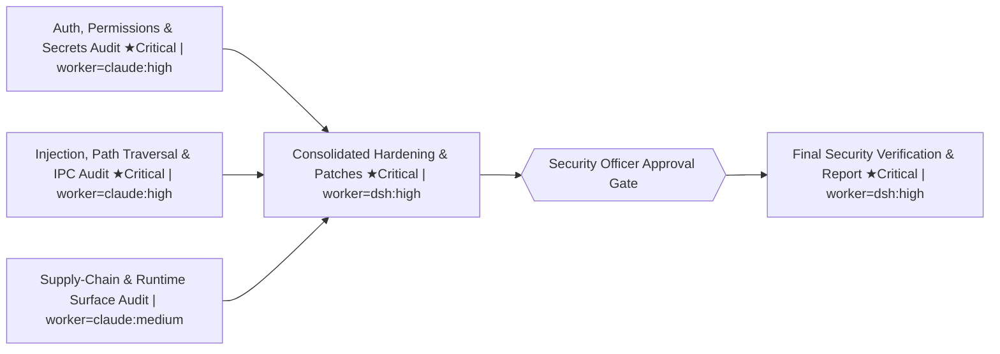

## Tree Metadata
- tree_type: engineering
- governor_session_id: <governor-session-id>
- workspace_isolation: worktree
- max_concurrency: 3
- watchdog_timeout_minutes: 10
- max_budget_usd: 6

## Auto-Partitioned Managers
### [Segment: N1]
- engine: claude-code
- thinking: medium

### [Segment: N2]
- engine: claude-code
- thinking: medium

### [Segment: N3]
- engine: claude-code
- thinking: medium

### [Segment: N4]
- engine: claude-code
- thinking: medium

### [Segment: N5]
- engine: claude-code
- thinking: medium

## Nodes
### [N1] Auth, Permissions & Secrets Audit
- type: task
- critical: true
- employee: engine=claude-code, thinking=medium
- worker: engine=claude-code, thinking=high
- files: docs/security/auth-audit.md, src/auth/**, src/permissions/**
- verify: test -s docs/security/auth-audit.md
- goal: |
    Audit authentication flows, token storage, file permissions (0600), privilege boundaries, and secret leakage vectors.
- acceptance: |
    1. Every finding includes exact file:line, severity, and exploit path;
    2. Zero hardcoded credentials or unguarded endpoints missed.

### [N2] Injection, Path Traversal & IPC Audit
- type: task
- critical: true
- employee: engine=claude-code, thinking=medium
- worker: engine=claude-code, thinking=high
- files: docs/security/ipc-audit.md, src/ipc/**, src/cli/**
- verify: test -s docs/security/ipc-audit.md
- goal: |
    Inspect shell spawning, SQL/command injection, path traversal, deserialization, and IPC/socket input sanitization.
- acceptance: |
    1. All untrusted inputs traced from boundary to sink;
    2. Concrete remediation patches proposed for every Medium+ issue.

### [N3] Supply-Chain & Runtime Surface Audit
- type: task
- critical: false
- employee: engine=claude-code, thinking=medium
- worker: engine=claude-code, thinking=medium
- files: docs/security/supply-chain-audit.md, package.json, .github/workflows/**
- verify: test -s docs/security/supply-chain-audit.md
- goal: |
    Review dependencies, sandbox flags, CSP/webview boundaries, and error/log redaction across platforms.
- acceptance: |
    1. Dependency and sandbox posture summarized clearly;
    2. Actionable hardening recommendations prioritized by risk.

### [N4] Consolidated Hardening & Patches
- type: task
- critical: true
- employee: engine=claude-code, thinking=medium
- worker: engine=dsh, thinking=high
- files: src/**, test/security/**
- verify: npm run typecheck && npm test
- goal: |
    Synthesize findings from N1–N3, apply minimal security patches, and add security regression tests for each resolved vulnerability.
- acceptance: |
    1. Every High/Critical finding patched and covered by automated tests;
    2. Zero regressions to existing functionality.

### [U1] Security Officer Approval Gate
- type: user_gate
- description: |
    Review consolidated vulnerability findings, patches, and residual risk notes before final verification.

### [N5] Final Security Verification & Report
- type: task
- critical: true
- employee: engine=claude-code, thinking=medium
- worker: engine=dsh, thinking=high
- files: docs/security/**, test/security/**
- verify: npm run typecheck && npm run lint && npm test
- goal: |
    Re-run security checks, static analysis, and full test suite, then publish a clean PR-ready security sign-off report.
- acceptance: |
    1. All security and regression checks pass;
    2. Final report cleanly maps findings to verified fixes.
